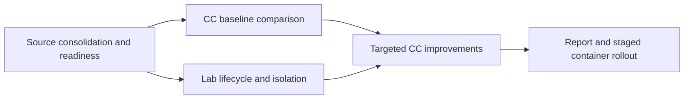

# CC effectiveness and a personal research lab

**Current sandbox design:** [[Designs/Sandbox Lab Design]] and [[Designs/Lab Capsule and Factory Design Plan]] replace the infrastructure-first proposal with persistent goals, revisable strategy and checked execution batches. Prove a useful change of experiment and measure its value first. This design work does not change the separate M1 live ML priority below.

[[Activities/2026-10-26 M1 Reliability and ML Readiness Checkpoint]] records published M1 `ab0d9c7fe8ceadf45c61d04e94e2dd9b44b867a7`, the 319-test stable-source checkpoint and separate pending live ML acceptance. ML is primary; π is optional.

## Current source and research route

[[Activities/2026-10-26 Reliability Fixes and Reproducible Checks]] is the latest reliability receipt, with exact Docker commands and the remaining live evaluation gap.

[[Activities/2026-10-26 M1 Docker Development and Test Preparation]] records the integrated source and current Docker-based M1 developer setup. Source integration and local process checks are complete within the recorded scope; authenticated scientific and whole-system acceptance remain pending. M2 lab sandboxing stays deferred by the user. Earlier source identities below are historical checkpoints.

## Earlier Builder upgrade candidate

[[Activities/2026-10-23 Agentic Builder and Pi Benchmark]] records the earlier separate native Builder and Pi benchmark branch, independent checking and blocked live acceptance. [[Activities/2026-10-23 Builder Upgrade]] preserves the earlier scripted implementation. Local shared branch `ai4r_M1` is the final merged checkpoint below; previously observed remote `809351f8` is later. That separation describes the earlier October 23 state. Builder was subsequently merged into M1; current verification is recorded in the October 26 activities.

## Recorded final integration checkpoint

[[Activities/2026-10-23 Final M1 Merge]] records the merge with the newly supplied AI4R, fresh-checkout verification, exact branch state and remaining connected-runtime work. Earlier delivery and pause statements below retain their historical scope.

## Earlier October 23 implementation checkpoint

[[Activities/2026-10-23 Delivery and Verification Status]]: no-sudo deployment tooling is pushed through `6a70305`; the required typed Planner is separately committed at `9d8f21b` and was not merged into M1 at that checkpoint; later source integration supersedes that separation. Local software checks pass within their stated scope. A live authenticated campaign and actual Spark validation remain outstanding; no CC effectiveness result is established.

**October 21 priority:** start with [[Project Overview]], [[Designs/CC Reference]], [[Experiments/CC Accuracy Study]], and [[Amendments/README]]. Accuracy is the first CC value claim. The semantic verifier remains declaration-and-output-only; input-dependent host checks are separate. [[Designs/Lab Progression]] tracks actual lab evidence independently. Earlier milestones below remain useful, but earlier two-arm pilot designs are superseded for the accuracy claim.

Your next stage moves from producing the M1 design package to understanding whether its capability capsules improve real work, while building the infrastructure needed to investigate that reliably. Design work remains part of your activities; the notebook also covers implementation, experiments, research, meetings, and presentations.

## Milestones

| Milestone | Deliverable | Exit evidence | State |
|---|---|---|---|
| Establish the starting point | Notebook, historical inventory, M1 readiness assessment | Reconciled migration manifest, linked authority, candidate/runtime status | Notebook and inventory validated; runtime reconciliation pending |
| Establish the CC comparison | Three-arm CC accuracy study | Pinned protocol, every attempt recorded, independent scores and paired report | Protocol prepared; runs pending |
| Build the minimal lab | Single-host manager and isolated AI4R sandboxes | Two real simultaneous experiments; export, interruption recovery, and cleanup checks | Synthetic Docker smoke verified; M1 and two-VM qualification pending |
| Improve and decide | Evidence-led CC changes and staged container rollout | Candidate-v-current and plain-agent comparisons; regressions reported | Awaiting baseline findings |

Milestones two and three proceed in parallel after their own prerequisites are available. A negative or inconclusive CC finding is a valid result. No improvement percentage is a success requirement.

## Immediate actions

**Near-term emphasis:** move the code assessment and test report forward as quickly as evidence permits, while continuing lab work. This retains the meeting's urgency without inventing a calendar deadline.

- [x] Locate and pin the supplied M1 code in a separate development checkout. See [[Experiments/First CC Demo]].
- [ ] Reconcile its contracts and validate configured runtime readiness. See [[Resources/M1 Readiness]].
- [ ] Freeze development task inputs, candidate pins, model route, and budgets using [[Experiments/CC Accuracy Study|the current three-arm accuracy study]].
- [ ] Use [[Designs/Lab Progression|the existing synthetic smoke evidence]] as bounded history; qualify actual M1 and Spark targets separately before assigning research work.
- [ ] Record every subsequent activity and preserve important prompt text through [[Sources/Prompt Register]].

## Working boundaries

At the high level, each lab sandbox contains its own AI4R fork and domain applications, integrated through shared and domain CCs; long-running research retains knowledge and results, while RSI develops capsule and harness candidates. The existing detailed M2 proposal uses VMs, a local factory and container carriers. These are proposed implementation choices, not demonstrated runtime behavior or requirements on the simulator author. See [[Designs/Lab Capsule and Factory Design Plan]]. Changes developed in a lab return as reviewed candidates, with evidence and provenance; central AI4Research adoption follows the existing project process.

Workload characterization is another research direction. Measuring a mixed workload on GB10 can describe that run. Mapping workload units to unknown CPUs, GPUs, NPUs, memory hierarchies, and storage remains an unresolved modeling problem, not an assumed consequence of profiling.

## Presentation readiness

Prepare a presentation when there is a concrete story: current code/test status, the first paired CC findings, and the lab lifecycle demonstration. Retain failures and limitations. The meeting's “this week” wording has no verified meeting date, so it does not establish a new deadline.

## Broader design direction

The earlier [[Sources/Prompts/2026-10-21-paper2agent-system-direction.txt|request]] adds Paper2Agent-style capability production and eventual whole-system self-improvement to the architecture agenda. [[Designs/AI4Research Capability Growth]] maps that direction against M1 limits; [[Designs/Agent Reading and Freshness]] supports efficient, current agent reading. This assessment adds a follow-on design track alongside the current accuracy and lab work.

## Current M1 and M2 routes

[[Resources/Coder Prompts/benchmark-runner]] is the current portable M1 tooling handoff. [[Designs/Lab Capsule and Factory Design Plan]] and [[Designs/Spark Shared Services and Storage]] own M2 sandbox/factory/resource planning. Working M1 code reported on another machine does not establish local runtime acceptance or a measured CC accuracy result.

The current [[Resources/Coder Prompts/benchmark-runner|benchmark handoff]] is human-judged tooling in our AI4Research branch of JiuwenSwarm. Implementation changes follow normal development; execution preserves user files/projects/live state and runs tasks sequentially through a separate control/data runner. Developers and delegated agents may run it. M2 sandbox/factory implementation is separate.
