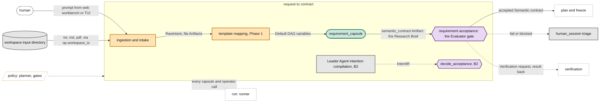

# Request to contract

> **Owner:** Xiaoyang · Muk · **Build steps:** B1 ingestion, template mapping, Research Brief; B2 Leader Agent

The PRD's first stages: **Ingestion**, **intention compilation** and **Requirement Compilation**. They run inside the Default DAG script, before freeze. Ingestion and intention compilation are control code. In Requirement Compilation the `requirement_capsule` writes the **Research Brief** (the M1 value of the semantic contract); **requirement acceptance**, the Evaluator gate on the Brief, accepts it. The accepted Brief is what the planner and freeze work to.

## Our understanding, to confirm

**For Xiaoyang (builds it), Ramika (the Research Brief's checks).**

- [ ] The stages keep the PRD's names: Ingestion, intention compilation, Requirement Compilation. The next part reads one thing from this one: the accepted Research Brief and requirement acceptance's result.
- [ ] Ingestion takes the prompt from the web workbench, the TUI or the CLI, and loads `.txt`, `.md` and `.pdf` files from the workspace input directory. It is control code calling `op.workspace_io`, which the Default DAG template allows it (policy `planner`, `control_operators`); each call goes through the runner and is observed with stage `intake`. Each file becomes a `file` Artifact; the prompt becomes a `raw_intent` Artifact.
- [ ] Phase 1 intention compilation is template mapping, in control code: the prompt fills the Default DAG's fixed variables (`topic`, `input_dir`, and the budget if given). It replaces the `compile_intent` and `review_fidelity` capsules and the `decide_acceptance` gate for M1. These return in B2, with the Leader Agent test.
- [ ] `requirement_capsule` (a skill) writes the Research Brief: research question, domain boundaries, compute constraints, target metrics, each metric also a `must` requirement with a check. Its call goes through the [runner](run.md#runner) with stage `requirement`.
- [ ] Requirement acceptance is the Evaluator gate on the Brief, before freeze: the same two tiers and the same `pass`, `fail` or `blocked` as after every step. Its fixed checks, including `check.brief_matches_dag.v1` (`want`, `given` and `scope` fit the Default DAG), come from the Default DAG template, not from the type.
- [ ] No automatic repair in M1: a `fail` or `blocked` Research Brief goes to a person through `human_session`; the person's `pass` also accepts it.
- [ ] The frontend is JiuwenSwarm's web workbench and TUI (PRD). We build no frontend.

## Inside

### Ingestion and intake

*Owner: Xiaoyang · Build steps: B1 · Code: the Default DAG script's intake*

Takes the prompt and the reference documents, and records them as Artifacts, as in the list above. Channels: the web workbench (`localhost:5173`), the TUI (`jiuwenswarm-tui`) or the CLI; the leader launches the Default DAG with the prompt as the script's `args`.

### Intention compilation

*Owner: Xiaoyang · Muk · Build steps: B1 template mapping; B2 Leader Agent · Code: the Default DAG script*

- **B1, template mapping** (control): fills the Default DAG's variables from the prompt and the configuration; no model, no capsule
- **B2, Leader Agent** (Phase 2 test): the Leader decomposes the prompt into an IntentIR; `decide_acceptance` (control) accepts, repairs, clarifies or rejects it. Compared against template mapping, never on the M1 path

### Requirement compilation

*Owner: Xiaoyang · Muk · Build steps: B1 · Code: `requirement_capsule`, its Declaration*

Turns the prompt and documents into the accepted Research Brief, as in the list above: `want` is the report, `given` the request and documents, `scope` the Default DAG's; requirement acceptance's budget comes from policy `routing`.

**Open:**

- The Research Brief's schema owner and exact fields: a question back to the PRD.
