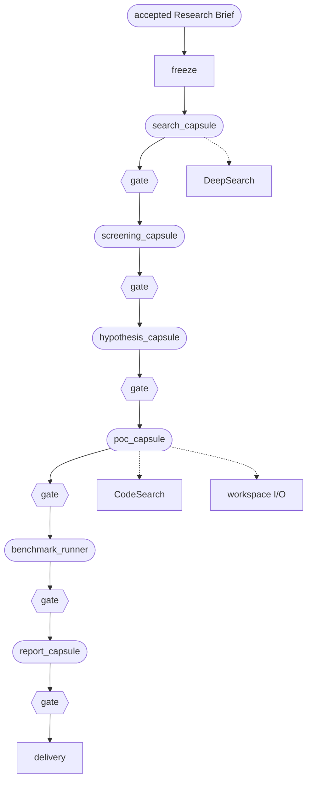

# The Default DAG

**Confirmed by:** PRD §2 (static defaults), §3 (Planner Phase 1; workflow features), §4.1 (stage capsules).

The M1 workflow: a hardcoded DAG run by Swarmflow. Each step runs one stage capsule; the Evaluator gate checks every step's output before the next step starts.

| Step | Capsule | Takes | Gives |
|---|---|---|---|
| `search` | `search_capsule` | the Brief, user documents | `idea_set` |
| `screening` | `screening_capsule` | `idea_set` | `screening_result` |
| `hypothesis` | `hypothesis_capsule` | `screening_result` | `hypothesis` |
| `poc` | `poc_capsule` | `hypothesis` | `poc_bundle` |
| `benchmark` | `benchmark_runner` | `poc_bundle` | `benchmark_result` |
| `report` | `report_capsule` | all of the above | `report` |

**Uses from Block 1:** [[plan]] (the Default DAG is the M1 Plan), [[run-contract]] (freeze pins each capsule by hash), [[declaration]] (each capsule), [[port-types]] (the outputs above).

**Open:** how far the ported skills are rewritten for these steps (questions in [[prd-inputs]]).
