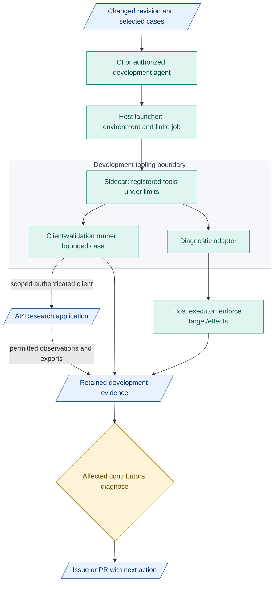
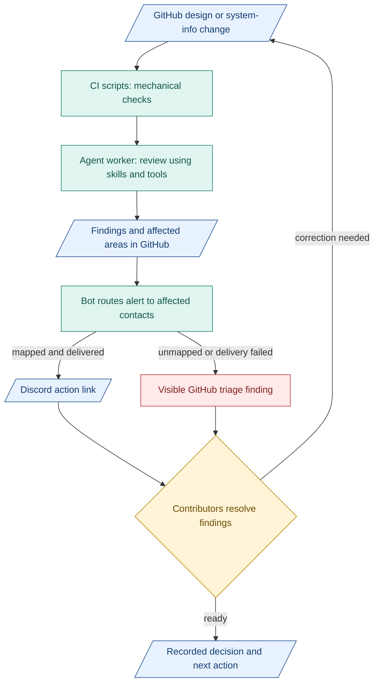

# 5. AI CI

**Proposal: cheap scripts, bounded agent review, targeted alerts.** Maintain design-check guidance. Get agreement for disputed changes.

## Design CI

| Part | Job |
|---|---|
| Scripts/tools | Path casing, links, glossary, schema references, diagram freshness |
| Skills | Reusable review instructions, examples, criteria |
| Workers | Flag unclear meaning, missing context, likely impact |
| People | Resolve consequential decisions |

Limit time/cost. Retain checked revision, inputs, findings. AI can be wrong. Document checks do not prove product acceptance.

## Runner and sidecar in AI CI

**Development tooling only.** AI workers operate outside the runner. CI triggers finite jobs.

Blue: records. Teal: tools. Amber: human decision. Boxes show responsibilities.

| Design | Purpose |
|---|---|
| [Sidecar](../development-tools/sidecar/README.md) | Registered diagnostics/validation, target/effect limits, retained results |
| [Runner](../development-tools/test-runner/README.md) | Readiness, submit, observe, assess, export through authenticated client interfaces |

- Missing readiness/authentication/compatibility blocks. Incomplete results stay visible.
- Launcher cleans up owned resources. Runner: no Docker socket or private product-state access.
- Reports cannot replace product verifiers/gates or insert accepted outputs.
- Separate tooling scope. Product startup/exits stay independent. Start with scripts and one worker.

## GitHub and Discord

- GitHub: drafts, issues, PRs, decisions/evidence. Existing TASK records retain authority. Relevant human review before design merge.
- Discord: action alerts/discussion links. Return decisions to GitHub.
- Route by assignees, reviewers, Git-tracked module/contact map. Group routine updates. Ping for action/blockers/shared contracts.

## Proposed notification flow

Blue: records. Teal: work/tools. Amber: human decisions. Red: unresolved.

Expose failed checks/jobs, unmapped contacts and failed delivery. Keep unanswered actions visible. Restrict mentions. Delivery does not prove reading. Integration is proposed, not deployed.

Measure alerts, misses, rework/review effort against cost. Token counts need tokenizer/version.

**Inspired by:** [GitHub Actions](https://docs.github.com/en/actions/get-started/understand-github-actions) for event triggers; [Anthropic agent patterns](https://www.anthropic.com/engineering/building-effective-agents) for simple, inspectable workflows.

**Example:** [pr-discord-notifier](https://github.com/asirago/pr-discord-notifier) posts opened/edited/closed PR notices. Routing needs separate logic. Start with a workflow and [Discord webhook](https://docs.discord.com/developers/resources/webhook).
