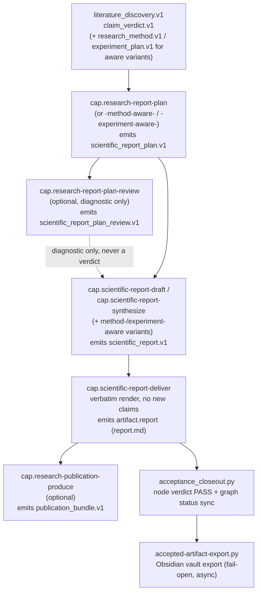
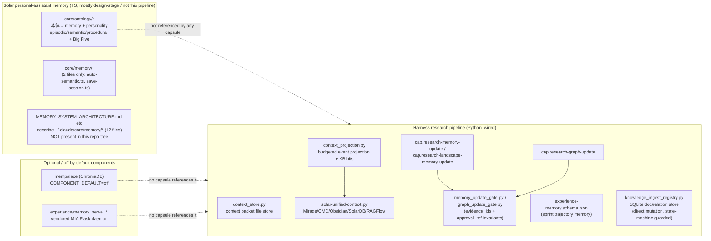

# AI4Research / OpenSolar — Memory, Context, Ontology, and Final Delivery Subsystem

Repo: `/home/muk/work/AI4Research`, branch `openJiuwen-Solar`, HEAD `b0bf165f9`.
Scope: memory & context management, ontology/knowledge-graph, and final delivery/reporting.
Method: direct code/doc reads plus three parallel research sub-agents (capsule/gate audit, delivery-chain audit, memory-docs audit). All claims below are tagged `[VERIFIED]` (I or a sub-agent read the code/doc directly and confirmed), `[DOC-CLAIM]` (a doc asserts it, not independently confirmed in code), or `[INFERRED]` (reasoned from adjacent evidence).

---

## Summary (5 bullets)

- **Two unrelated "memory" universes share this repo.** (1) The **harness research pipeline** (Python, under `harness/`) has a narrow, evidence-gated durable-memory system: `context_store.py`/`context_projection.py` for per-session working context, plus capability capsules (`cap.research-memory-update`, `cap.research-graph-update`, `cap.research-landscape-memory-update`) that *propose* memory/graph mutations, gated by `memory_update_gate.py`/`graph_update_gate.py`, which enforce "evidence_ids required" and "delete/remove requires `approval_ref`". (2) A **personal-assistant "Solar" memory/ontology system** (TypeScript, under `core/memory/`, `core/ontology/`, docs `MEMORY_SYSTEM_ARCHITECTURE.md`, `ONTOLOGY_*`, `MEMORY_*`) tracks the assistant's own episodic/semantic/procedural memory and a "Big Five personality" model for the guardian's Solar sessions — this is **not** the AI4Research paper/claim knowledge graph, and is mostly design-doc-stage, largely unwired into the harness capsule pipeline, and installed only under `~/.claude/core/memory/`, not present as that full file set in this repo tree.
- **`context_store`/`context_projection` is a small, deliberately bounded token-budget projector**, not a database: it reads an append-only session event log, includes "high-value" event types verbatim up to a token budget (default 8000 tokens `harness/lib/context_projection.py:217`), summarizes/drops "low-value" event types, redacts secrets, and optionally folds in bounded KB hits from a fail-open unified-search layer (`solar-unified-context.py`, Mirage/QMD/Obsidian/Solar DB/optional RAGFlow). It never mutates the session log except via an explicit `context_injected` audit event.
- **Mempalace (ChromaDB semantic memory) and the vendored MIA Memory-Serve Flask daemon are explicitly optional/off-by-default and standalone** — `components.d/mempalace/component.sh` sets `COMPONENT_DEFAULT="off"`; no capability-capsule yaml references either; both appear only in benchmark/health-check scripts.
- **Delivery is a strict 5–6 stage capsule chain** — `cap.research-report-plan` (+ method-/experiment-aware variants) → optional `cap.research-report-plan-review` (diagnostic only, never a pass/fail verdict) → `cap.scientific-report-draft` / `cap.scientific-report-synthesize` → `cap.scientific-report-deliver` (verbatim-only render, no new claims) → optional `cap.research-publication-produce`. The plan schema (`scientific_report_plan.v1`, strict `additionalProperties:false`) and the report schema (`scientific_report.v1`, looser) are intentionally separate: the plan is the audited planning contract (sections' `purpose`, `requirement_bindings`, `study_protocol`, `claim_status_mappings`), the report is the narrative rendering.
- **Report title-parsing was a real, repeatedly-recurring bug** (`harness/metadata/pre-scheduler-stabilization-log-20260829.md`, rows 32/33/39/40/41/42): the title extractor mis-parsed Planner-generated quoted/coordinated title phrases across at least 4 iterations before a fix landed (git `6bf56719d`), and a separate "report-plan schema identity" bug (row 39) — the report-plan bridge emitted evidence self-identified as `scientific_report.v1` instead of `scientific_report_plan.v1` — was logged but explicitly **left unresolved** ("Disposition: Recorded only after the no-intervention run; no code was changed"). A companion deterministic domain-term/CJK-bigram relevance gate was added to stop titles/action-sentences from being rejected or from masking irrelevant fixture content, and is designed to fail closed rather than be bypassed.

---

## Delivery chain (mermaid)



---

## Memory subsystems (mermaid: wired vs experimental)



---

## Detailed findings per question

### 1. What memory subsystems exist and how do they differ? Which are wired vs standalone?

`[VERIFIED]` There are at least **four distinct "memory" systems** in this repo that must not be conflated:

1. **Working/session context** — `harness/lib/context_store.py` + `harness/lib/context_projection.py`. File-based, session-scoped, budget-bounded projection over an append-only session event log. This is the only memory layer directly wired into worker-facing prompt assembly for the harness pipeline. **Wired.**
2. **Durable "research memory"** — the evidence-schema/capsule system: `research_memory_update.v1` / `research_graph_update.v1` schemas, produced by `cap.research-memory-update`, `cap.research-landscape-memory-update`, `cap.research-graph-update`, gated by `harness/evaluators/scientific/memory_update_gate.py` and `graph_update_gate.py`. This is scientific-claim/paper memory (e.g., paper→claim→memory-entry), proposal-first, approval-gated for destructive ops. **Wired** into the AutoSci/scientific capsule composition (`compatible_with`/`requires_after` chains), but writes to durable files only "when write_policy permits" — i.e., even the "wired" path is gated behind an external write policy, not unconditional.
3. **"Experience memory"** — `harness/schemas/experience-memory.schema.json`, a compact per-sprint trajectory record (`sid`, `status`, `phase`, `trigger_sig`, `events_summary`) used for routing/promotion heuristics, distinct from research content memory. Matches the `experience_record.v1` schema seen in `harness/metadata/"10-final delivery output"/experience_record/`. **Wired** into the delivery/promotion pipeline (see Q10).
4. **Knowledge ingest registry** — `harness/lib/knowledge_ingest_registry.py`, a SQLite-backed document/relation registry (`~/Knowledge/_registry/knowledge_ingest.sqlite`) for a personal Obsidian-style vault, mutated directly by `upsert_document()`/`transition_document()`/`knowledge_relations_backfill.py`. This is architecturally **separate** from the AutoSci evidence-and-gate system — no evidence_ids/approval_ref concept, guarded only by a document-lifecycle state machine (`VALID_TRANSITIONS`) and a `--dry-run` flag on the backfill tool. **Wired** as its own ingest control-plane, but not part of the research-memory-update chain.
5. **Solar personal-assistant ontology/memory** (`core/ontology/*`, `core/memory/*`, and the `MEMORY_*`/`ONTOLOGY_*` docs) — a four-layer model (episodic / semantic / procedural / links) plus a "Big Five personality" preference-dimension model (`ont_preference_dimensions`, `ont_value_dimensions` in `core/db/schema/59-ontology-v1-compat.sql`, `60-ontology-v2.sql`), explicitly framed as "本体 = 记忆库 + 个性 (不是大脑，大脑是 Claude)" — "ontology = memory store + personality (not the brain; Claude is the brain)" (`core/ontology/index.ts:2-3`, `core/db/schema/59-ontology-v1-compat.sql:2`). This is the *guardian's personal Solar assistant* memory, not the AI4Research scientific paper/claim knowledge graph. `[VERIFIED]` grep across the whole repo found **zero** references to `core/ontology` from `harness/` (capsules, evaluators, or lib code) — only from `core/bootstrap/*` setup scripts and test fixture JSON unrelated to ontology semantics. **Standalone / not wired into the harness pipeline.**
6. **Mempalace** (ChromaDB vector semantic memory, `mempalace/mempalace_mcp_server.py`) and the **vendored MIA Memory-Serve Flask daemon** (`harness/lib/experience/memory_serve_daemon.py`, `memory_serve_wrapper.py`) — both explicitly optional: `components.d/mempalace/component.sh:5` sets `COMPONENT_DEFAULT="off"` and `COMPONENT_DESC="Semantic memory MCP server (off by default)"`; grep of `harness/capability-capsules/` found no reference to `mempalace` or `memory_serve`; both are exercised only from `harness/lib/heavy_proof_benchmark.py` and `harness/lib/platform_workflow_benchmark.py` health-check probes. **Standalone / off by default.**

`[DOC-CLAIM]` `docs/MEMORY_SYSTEM_ARCHITECTURE.md:493-511` lists a 12-file "core code" set under `~/.claude/core/memory/` (e.g. `memory-hook.ts`, `learning-extractor.ts`, `session-reflector.ts`, `hybrid-search.ts`) that does **not** exist in this repo's `core/memory/` directory (which has only `auto-semantic.ts` and `save-session.ts`). `[INFERRED]` This doc describes the *installed runtime kernel* under `~/.claude/` (per `CLAUDE.md`'s own statement that "the installer generates the runtime kernel under `~/.claude/solar/SOLAR.md`"), i.e. it documents a target/generated architecture, not what ships in this source tree.

### 2. What is context_store / context_projection? How is context assembled, and what limits apply?

`[VERIFIED]` `harness/lib/context_store.py` (58 lines) is a trivial file-based key/value store for "context packets" referenced by task envelopes: `save()`/`load()`/`resolve_ref()`, storing JSON at `HARNESS_DIR/run/context-store/<packet_id>.json`. No projection logic lives here — it's pure ref resolution.

`harness/lib/context_projection.py` (540 lines) is the actual assembly logic:
- `ContextProjection.build_context()` (`context_projection.py:202-331`) reads `SessionLog.all_events()` (append-only event log) and classifies each event as high-value (`_HIGH_VALUE_TYPES`, e.g. `command_issued`, `activity_started/succeeded/failed`, `state_transition`, `human_feedback`, `model_call_*`), low-value/summarizable (`_LOW_VALUE_TYPES`: `log_message`, `activity_retry_scheduled`), or medium (everything else).
- **Budget enforcement**: default `budget_tokens = 8000` (`context_projection.py:217`, "~32K chars"), token-estimated at `len(text)//4` (`_estimate_tokens`, line 63-65). High-value events are included until the budget is hit, then the loop **breaks** (remaining events silently dropped, tracked in `dropped_ranges`). Medium-value events get an 80%-of-budget sub-ceiling (`budget * 0.8`, line 276). Low-value events are always collapsed into `summarized_ranges` entries like `"{n} {type} events summarized"` rather than included verbatim.
- **Secret redaction**: `_redact_secrets()` applies 8 regex patterns (API keys, tokens, passwords, secrets, credentials, AWS `AKIA...`, GitHub `ghp_...`, Anthropic-style `sk-...`) to every event and to the final text (`context_projection.py:33-42, 68-72`).
- **KB hits**: only pulled when a `query` is supplied, via `_retrieve_kb_hits()` (line 87-150), which lazily imports `solar-unified-context.py` and calls `.retrieve()`; explicitly **fail-open**: on any exception or missing module it returns a `degraded: True` placeholder rather than raising, with the code comment "fail-open by design: context projection must remain available even if QMD/Mirage are temporarily down, but it must not pretend a placeholder is real recall evidence" (line 96-99).
- **Provenance-not-truth discipline**: module docstring states "Context is a projection, never a source of truth — it never deletes or rewrites session events" (`context_projection.py:4-5`). The only way a projection becomes part of durable history is `record_context_injected()` (line 393-477), which appends an explicit `context_injected` event with an idempotency key `context_injected:{session_id}:{digest}` (SHA-256 of session/query/policy/budget/last_seq/included_ids/kb_paths) to avoid duplicate audit entries.
- `solar-unified-context.py` (`harness/lib/solar-unified-context.py`) is the underlying fan-out: routes through **Mirage search** to filesystem mounts, **QMD**, **Solar DB**, **Obsidian vault**, and optionally **RAGFlow** (`_ragflow_enabled()`); explicitly bounded and fail-open per its own docstring (line 4-5).

This avoids "dumping everything into a prompt" via three independent mechanisms: (a) a hard token budget with graceful degradation (include → summarize → drop, in that priority order by event-type class), (b) capped/truncated KB hits (`max_hits=6, max_chars=2200` defaults in `_retrieve_kb_hits`), and (c) redaction before anything reaches the text the worker sees.

### 3. What is the ontology / knowledge-graph layer? Entities/relations? Is it populated during runs?

`[VERIFIED]` There is **no** research-paper/claim knowledge graph called "ontology" in this repo. The only code literally named "ontology" (`core/ontology/*`, `core/db/schema/59-ontology-v1-compat.sql`, `60-ontology-v2.sql`) is the **Solar personal-assistant personality/memory ontology**:
- Entities: `ont_preference_dimensions` (work_style/communication/priority/risk, continuous/categorical/ranking values, confidence, sample_count, evidence), `ont_value_dimensions` (values with weight, `conflicts_with`), plus (v2) `ont_snapshots` (full versioned state snapshots), `ont_preference_timeline` (per-dimension history), `ont_memory_timeline` (episodic/semantic/procedural memory lifecycle events: created/updated/recalled/decayed/archived).
- `docs/ONTOLOGY_V2_DESIGN.md` describes a "dual personality comparison" (`## 2. 双人格对比`), Big Five trait computation, "Core Memory (immutable)" and personality snapshots with a protection mechanism, and a "context detector (JPAF)".
- This system is TypeScript, lives under `core/`, and per the grep in Q1 is **not referenced anywhere in `harness/`**. `[INFERRED]` It is populated (if at all) by the Solar personal-assistant runtime under `~/.solar/` / `~/.claude/`, driven by hooks (`hooks/memory-*.sh`, `hooks/enhanced-memory-writer.sh`) — none of which are capsules in the AI4Research scientific pipeline.

For the actual **research** knowledge-graph analogue, the closest wired artifact is `research_graph_update.v1` (produced by `cap.research-graph-update`, schema at `harness/schemas/evidence/research_graph_update.v1.schema.json`), whose entities are `source`/`target`/`relation` edges with `operation ∈ {add, remove, confirm, propose, no_op}` and mandatory `evidence_ids` — a claim/paper relation graph, gated to never "infer graph edges without evidence ids or explicit provisional status" (`cap.research-graph-update.yaml` invariant, `[VERIFIED]` per sub-agent read). A second, unrelated "knowledge graph" capsule exists for code/repo understanding — `cap.understand-anything-knowledge-graph-builder.yaml` — writing `.understand-anything/knowledge-graph.json`, self-checked only (no external evaluator), and out of this scope's "research memory" focus.

Whether any of these graphs are actually **populated during a real run** — `[INFERRED]`: the fixture examples (`tests/harness/evaluators/scientific/fixtures/pass|fail/research_memory_update.json`) and the `harness/metadata/"10-final delivery output"/` directory are explicitly marked as **not-executed contract examples** ("EvidenceIR failed closed because the metadata contract example was not executed" — `final_delivery_manifest.json`), so no evidence in this repo confirms a live, end-to-end populated research graph from an actual completed run; only the schema/gate/capsule machinery for doing so is present and tested at the fixture level.

### 4. Which capsules mutate durable memory, and what guards them?

`[VERIFIED]` (sub-agent, cross-checked against schema/gate code):

| Capsule | Mutates durable memory? | Guard | Key invariant (verbatim) |
|---|---|---|---|
| `cap.research-memory-update` | Proposal by default; direct write only "when write_policy permits" | `memory_update_gate.py` (external verifier required) | "Destructive updates require explicit approval outside this capsule." |
| `cap.research-landscape-memory-update` | Proposal only (writes to `artifacts/` staging dir only) | same schema/gate | "Does not mutate global research memory without separate approval." |
| `cap.research-graph-update` | Proposal by default; conditional write | `graph_update_gate.py` | "Does not infer graph edges without evidence ids or explicit provisional status." |
| `cap.research-literature-discover` | **No** | n/a (`external_verifier.required: false`) | "Does not mutate durable research memory directly." (`verification.pass_conditions`: "No memory or ingestion artifact is created by this capsule alone.") |
| `cap.understand-anything-knowledge-graph-builder` | Writes `artifacts.knowledge_graph` (separate, code-understanding subsystem) | `self_check` only | "semantic_backend must remain ThunderOMLX for semantic analysis." |
| `knowledge_ingest_registry.py`/dispatcher | **Yes** — direct, unconditional SQLite mutation | only a from-state check in `transition_document()`; no evidence/approval gate | state transitions must follow `VALID_TRANSITIONS` |
| `knowledge_relations_backfill.py` | **Yes** — direct relation/document upserts | `--dry-run` flag only | deterministic, frontmatter-only lineage, "does not infer semantic meaning with an LLM" |

`memory_update_gate.py` (`harness/evaluators/scientific/memory_update_gate.py`, `[VERIFIED]`) enforces exactly two concrete checks beyond schema validation: (1) `outputs.changes` non-empty and each change carries ≥1 non-blank `evidence_ids` entry, via `has_any_evidence_ids()`; (2) any change with `operation == "delete"` must carry `approval_ref`. `graph_update_gate.py` mirrors this for graph edges, requiring `approval_ref` when `operation == "remove"`.

Fixture verification: `tests/harness/evaluators/scientific/fixtures/pass/research_memory_update.json` vs `fail/research_memory_update.json` differ in exactly one field — the fail fixture's `evidence_ids: []` — directly exercising the `has_any_evidence_ids` check.

The `research_memory_update.v1.schema.json` itself does **not** schema-require `approval_ref` (it's permitted via `additionalProperties: true` on the `change` object but not required) — `[VERIFIED]` the delete/approval invariant is enforced *only* by the Python gate, not by JSON Schema, which is a real enforcement gap if the gate is ever bypassed.

`cap.research-literature-discover` — the capsule this task explicitly flagged as non-mutating — states in `contract.invariants`: *"Does not ingest selected papers directly."* and *"Does not mutate durable research memory directly."*, and hands off via `compatible_with: [cap.research-paper-ingest, cap.research-memory-update]`.

### 5. The memory ISOLATION problem — resolved or not?

`[VERIFIED]` `docs/MEMORY_ISOLATION_PROBLEM.md` (title: "Solar 记忆隔离问题 - 真实案例", dated 2026-02-04 08:40) documents a **real incident**: the guardian reported that one Claude Code window (doing "community-net + memory optimization" work) had no visibility into another concurrent window's work (iMessage task processing) — "窗口 A 完全不知道窗口 B 的工作内容" ("Window A has no idea what Window B is doing", line 14-16). The doc's structure is: problem description → verification (found 5 session files containing the missing content, but current-window visibility was limited) → root-cause analysis → **three proposed solutions** (real-time cross-window sync [recommended], active session scanning, session index table) → a phased improvement plan (Phase 1 "urgent fix today", Phase 2 "global view tomorrow", Phase 3 "active scanning this week"). **The document ends at the proposal/design stage — there is no "resolved" or "verified fixed" marker anywhere in the file.** `[INFERRED]` Status: **open design problem, not confirmed resolved** as of the document's own content — it reads as a same-day incident report + remediation plan, not a postmortem confirming the fix shipped.

`docs/MEMORY_LOSS_ANALYSIS.md` ("Solar 记忆丢失分析报告") documents a related but distinct issue: lost work content across multiple parallel windows lacking unified persistence. It has an explicit status section (`## 立即行动` / "Immediate Actions", line 282-297) `[VERIFIED, quoted exactly]`:
```
### ✅ 已完成
1. ✅ 分析记忆丢失原因
2. ✅ 撰写此分析报告
### 🔄 进行中
3. 🔄 重新执行小区神经网分析（选项A）
### ⏳ 待执行
4. ⏳ 实现自动会话检查点Hook
5. ⏳ 实现SessionEnd保存Hook
6. ⏳ 增强 @Secretary 触发机制
```
Translation: only the *analysis and this report* are marked done; the actual remediation hooks (auto-checkpoint, session-end save, enhanced @Secretary trigger) are explicitly marked **pending (⏳), not yet implemented**, with one item "in progress". **Honest status: root-caused, partially triaged, remediation largely unimplemented at time of writing.**

Both documents concern the **Solar personal-assistant runtime's** cross-session/cross-window memory (multiple concurrent Claude Code panes sharing one guardian's semantic memory), not the AI4Research harness's per-run `context_store`/`context_projection` (which is explicitly single-session-scoped and does not claim cross-session sharing).

### 6. Artifact manifest & run artifact layout

`[VERIFIED]` `harness/lib/artifact_manifest.py` (866 lines; header cites "Lane 3, design §1.5 / R6") is the **per-node artifact discovery/proof authority**:
- After build/repair, the dispatcher writes `<sid>.<safe_node>-manifest.json` next to the sprint (`manifest_path()`, `artifact_manifest.py:47-48`).
- `write_manifest()` resolves each node's declared output paths against contract artifact roots (canonical first, then aliases) and computes, per row: `{declared, path, rel_path, resolved_root, exists, kind, size, sha256, entries, mtime}`. Files get a SHA-256; directories get a full recursive tree digest (names+sizes+hashes of every child) via `_path_snapshot()` — "a declared directory a content commitment instead of the old boolean 'this directory exists' claim" (docstring, lines 6-9).
- Sidecars keyed by **kind**, not filename shape: `SIDECAR_KINDS = ("handoff_md", "patch_diff", "guard_decision", "resource_binding", "eval", "test_log")` (line 32).
- Writes outside every declared root are flagged `ARTIFACT_ROOT_VIOLATION` (`artifact_manifest.py:29`) and surfaced via `presence_map()` for the "proof gate" to consume.
- `publish_workspace_outputs()` is the strict delivery-to-user-workspace materializer: no symlinks anywhere in the chain, destination must fall under a literal `workspace/` prefix, re-verifies SHA-256 immediately before staging, atomic tempfile+fsync+`os.replace`, same-directory backups before overwrite, and full rollback on failure — with a post-publish re-hash to catch races.
- Deliberately **fail-soft**: `write_manifest` "returns None on failure, never raises into the dispatch path" (module docstring, line 17) — whereas `publish_workspace_outputs` is the strict counterpart that does raise structured errors.

**Run artifact directory layout** `[VERIFIED via grep of harness/lib/*.py constants]`, all rooted at `HARNESS_DIR` (default `~/.solar/harness`, overridable via `HARNESS_DIR`/`SOLAR_HARNESS_DIR` env):

```
$HARNESS_DIR/
├── sprints/                          # sprint graphs + per-node manifests
│   └── <sid>.<safe_node>-manifest.json
├── run/
│   ├── context-store/<packet_id>.json    # context_store.py packets
│   ├── actor-evidence/                   # evidence_ledger.py
│   ├── actor-leases/                     # actor_lease.py
│   ├── browser-jobs/, operator-results/  # browser_job_runtime.py
│   ├── operator-status/, operator-health/# operator_flow_control.py
│   ├── quarantine/                       # autopilot.py
│   ├── dispatch-ledger.jsonl             # autopilot.py / intent_engine_adapter.py
│   ├── hands-sandbox/                    # hands_runtime.py
│   ├── pane-hygiene.json, pane-lifecycle-ledger.{jsonl,sqlite}
│   ├── state.db                          # capability_registry.py / evolution_engine.py
│   └── queue/*.jsonl
└── state/browser-profile-runtime/
```

The **`harness/lib/artifact_manifest.py`** proof and **`harness/lib/accepted-artifact-export.py`** wiki-export tools operate on this layout; the latter additionally exports to an external Obsidian vault (`~/Knowledge` or `OBSIDIAN_VAULT_PATH`) as `<sid>.accepted.md` plus JSON/JSONL sidecars, tracked by its own idempotency manifest at `<vault>/_raw/solar-harness/.manifest/accepted-artifacts.json`.

### 7. Final-delivery chain, capsule-by-capsule

`[VERIFIED]` (sub-agent, capsule yamls read in full):

- **`cap.research-report-plan`** — consumes `requirement_ir.v1`, `claim_verdict.v1`, `literature_discovery.v1`; emits `scientific_report_plan.v1` (+ optional `evidence_gap_list`). Invariants: does not draft unsupported claims as findings; does not compile publication artifacts. Variants: `cap.research-method-aware-report-plan` (adds `research_method.v1`/`research_source_assessment.v1`), `cap.research-experiment-aware-report-plan` (adds `experiment_plan.v1`/`experiment_result.v1`; invariant "Does not call a proposed experiment an executed experiment").
- **`cap.research-report-plan-review`** — consumes only `scientific_report_plan.v1`; emits `scientific_report_plan_review.v1` (+ optional `revision_recommendations`). `external_verifier.required: true`. Explicitly diagnostic: *"Does not substitute for the post-generation deterministic Evidence Gate."* and *"A pre-draft report-plan review is not interpreted as approval or rejection of the final report."*
- **`cap.scientific-report-draft`** — consumes `scientific_report_plan.v1` + `claim_verdict.v1`; emits `scientific_report.v1` (+ optional `draft_files`). Invariant: unsupported claims and study-protocol limitations from the plan "stay explicit, never silently resolved." Variants add plan-review consumption (`cap.scientific-method-aware-report-draft`, postcondition `plan_review_consumed`: "the final report records the reviewed plan hash and each review finding as addressed or explicitly retained") and experiment awareness.
- **`cap.scientific-report-synthesize`** — an alternate/mutually-exclusive drafting implementation for compare/disagreement/recommendation-style reports; distinguishing invariant: *"The deterministic scientific report verifier decides acceptance, not the writer."* `operator_compatibility.forbidden` mutually excludes the plain draft capsule's operator — these are alternate bindings for the same pipeline stage, not sequential.
- **`cap.scientific-report-deliver`** — consumes only `scientific_report.v1`; emits `type: artifact.report` (the user-facing deliverable, not a typed evidence schema). Invariant, verbatim: *"The deliverable adds no claim absent from the scientific_report evidence; unsupported_claims and limitations are carried verbatim."*
- **`cap.research-publication-produce`** — consumes `requirement_ir.v1` + `scientific_report.v1` (+ optional `artifact_review.v1`); emits `publication_bundle.v1`. Rich invariants: named deliverables can't collapse into one generic file or be satisfied by empty placeholders; the run manifest binds node statuses from a live Scheduler-owned execution snapshot ("frozen graph definitions never stand in for execution state"); publication evaluation/Scheduler Closure happen *after* materialization, so the manifest "records those outcomes as pending and never predicts a pass or failure"; a manifest declaring a failed Evidence Gate "cannot pass publication or close the run as completed." `incompatible_with: [cap.research-experiment-run]` (publication strictly follows, never overlaps with, experiment execution).
- The one persona referenced across the chain is `harness/personas/scientific-report-writer.md`, governing the Planner/Drafter/Publication-Producer logical operators: forbids fabricating citations/results/claim support, forbids hiding limitations/failed/inconclusive verdicts, forbids verifying new claims during drafting, forbids publishing/mutating external systems without human approval.

### 8. Why report_plan and report are separate schemas

`[VERIFIED]` structural diff (`harness/schemas/evidence/scientific_report_plan.v1.schema.json` vs `scientific_report.v1.schema.json`): the **plan** schema is `additionalProperties: false` throughout (strict audit contract) and carries fields the **report** schema entirely lacks: `sections[].purpose`, `requirement_bindings[]` (full `{requirement_id, statement, priority, check, acceptance{kind, required_values}}` objects), `unknown_resolution_traces[]`, `claim_status_mappings[]` (with `citation_spans[]` carrying exact character offsets + `source_text_sha256`), and a `study_protocol` object with an enum-closed `unresolved_fields[]` set (exactly 5 allowed field names: search_strategy, source_selection_criteria, time_range, inclusion_criteria, exclusion_criteria). The **report** schema's `outputs.report` requires only `report_id, title, sections, evidence_ids, unsupported_claims`, with `additionalProperties: true` and thinner `sections[]` items (`section_id, title, evidence_ids` — no `purpose`).

`[INFERRED]`: the plan schema is the machine-checkable *planning contract* that downstream drafting/review must satisfy or explicitly report as unresolved (hence strict, closed, and richly typed); the report schema is the looser *narrative output* contract. Notably, the report schema does **not** structurally require a `study_protocol` field by name — capsule postconditions (`study_protocol_rendered`, `plan_review_consumed`) require the draft to render plan content, but JSON-Schema validation alone cannot catch a draft that silently drops the study protocol; that check is pushed onto capsule `self_check` / the deterministic report verifier named in `cap.scientific-report-synthesize`, not the schema itself. This is a real soft spot in the enforcement chain.

### 9. Quality checks at delivery — topic relevance, evidence, title

`[VERIFIED]` `harness/metadata/NEW-MACHINE-START-HERE.md:52` states the delivery stage's own explicit checklist: *"科研 evidence → report plan → structured report + report.md；必须检查主题相关性、证据与标题"* — "research evidence → report plan → structured report + report.md; **must check topic relevance, evidence, and title**."

**Title bug, quoted from `harness/metadata/pre-scheduler-stabilization-log-20260829.md`:**
- Row 32 ("Final report artifact routing"): a run produced `report.md` with exit 0 but titled `"AutoSci Evidence-Linked Fixture Report"` containing only fixture claims, not the actual KV-cache topic — root cause: "Phase 14 report planning/drafting loaded only legacy named input fields and ignored frozen Scheduler `artifact_routes`. When no legacy fields existed, it silently used fixture evidence and generic fixture prose; the rapid structural gate could not detect semantic irrelevance."
- Row 33 ("Report title extraction"): title became `for the project "KV Cache Efficiency Landscape for Long-Context LLM Inference` (mangled) instead of the clean title — the fallback regex mis-parsed the phrase `report titled for the project "..."`.
- **Row 39 ("Report-plan Evidence ABI identity")** — this is the "report-plan schema identity" bug: *"the successful no-intervention run routed the report-plan node through the declared `scientific_report_plan.v1` artifact contract, but its bridge evidence envelope still identified itself as `scientific_report.v1`."* Root cause: "The legacy generic `plan_report` bridge reuses the final-report adapter." Disposition: **"Recorded only after the no-intervention run; no code was changed or task redispatched."** — i.e. logged and left open.
- Row 40, 41: further title-fallback misses (`report "..."` form not recognized; `report titled or organized as "..."` conjunction swallowed into the captured title). Disposition explicitly: "no code fix, redispatch, or retest was performed after this finding" for row 41.
- **Row 42 ("Portable report-title parsing")** — the actual fix: extended the quoted-title grammar to coordinated forms, stripped trailing sentence punctuation, rejected malformed conjunction candidates in the unquoted fallback; verified with a direct assertion returning the exact project title, git commit `6bf56719d`.

**Relevance gate** — same log, ~line 581-586 (Chinese, quoted and translated): root cause traced through `scientific_report_plan.title → Report Draft semantic writer → deterministic relevance admission`; the plan's `title` field could carry a whole action-sentence goal (e.g. "Perform Report Generation ..."), and the old gate required that *exact* sentence to appear verbatim in the Markdown — so normal human-readable titles got rejected even with matching domain content. The permanent fix **kept the gate** (never disabled it): the no-model deterministic fallback still requires an exact title; the structured-model path instead does a deterministic domain-word overlap check between the frozen title and the returned title/body, filtering generic report/action words, supporting CJK bigrams, requiring ≥3 distinct domain words for long action sentences (1–2 for short topics) — content with no domain overlap still **fails closed**.

**Enforcement code locations** `[VERIFIED, sub-agent]`: title extraction — `harness/plugins/autosci/bin/autosci_bridge.py` (`_report_title_from_request`), `harness/tools/research_operator_registry_adapter.py` (`_explicit_report_title`, `_report_title_from_frozen_context`), `harness/plugins/autosci/operators/scientific_lifecycle/action/delivery.py:1822` (`title = require_text(context.payload.get("topic") or plan.get("title"), "report title")`); domain-term relevance extraction — `delivery.py` around line 1639 (`_extract_domain_terms`-style helper, "Extract deterministic domain terms, including CJK bigrams").

### 10. Acceptance closeout — "accepted" vs "finished"

`[VERIFIED]` `harness/lib/acceptance_closeout.py` (110 lines) is a thin sprint-graph/status-sync utility, not a policy engine itself. `auto_closeout_graph_nodes()` loops per node: writes an eval sidecar JSON, and only calls `invoke_node_verdict()` (which delegates to `graph_node_dispatcher.node_verdict(..., "pass", ...)`) when the supplied `payload["verdict"].upper() == "PASS"`; otherwise the node is left at its current status (typically `blocked`) with `reason: "eval_verdict_fail"`. Nodes already `"passed"` are short-circuited as `already_passed`. It finishes by calling `graph_scheduler.sync_status_cache_from_graph()`.

So: **"finished"** = a node/run completed dispatch (produced output, possibly with failures). **"accepted"** = an external eval/verdict payload computed `PASS`, `node_verdict()` successfully flipped the graph node's status to `passed`, *and* (per `accepted-artifact-export.py`'s stricter gate) `status.json.status ∈ {"passed","eval_pass","finalized"}` or a `<sid>.finalized` marker exists, with `graph_scheduler.parent_ready_check(...)["ready"] == True` and every node with a handoff having an `eval_json` whose `verdict.upper() == "PASS"`. Only "accepted" runs are eligible for the wiki export (`accepted-artifact-export.py`), and per `harness/docs/accepted-artifact-knowledge.md`, this export runs fail-open, asynchronously, from `coordinator.sh`'s `handle_passed()` — "a failed export never blocks sprint finalization."

At the whole-run level, `harness/metadata/"10-final delivery output"/promotion_record/promotion_record.json` states the promotion rule explicitly: *"Experience memory may propose candidates, but only an independently green run can enter the approved registry"* — i.e. acceptance of an individual node ≠ promotion eligibility of the whole run, which additionally requires an independently-computed GREEN EvidenceIR.

### 11. report.md vs structured evidence

`[VERIFIED]` The clearest capsule-level statement is `cap.scientific-report-deliver`'s invariant: *"The deliverable adds no claim absent from the scientific_report evidence; unsupported_claims and limitations are carried verbatim."* — enforced structurally (the deliver capsule consumes only `scientific_report.v1` and its `pass_conditions` require the rendered report to cite the same evidence ids as the evidence artifact, and that unsupported claims/limitations appear in the deliverable).

`docs/product/lane4-spec-mismatches.md` documents a related design decision: `report.md`/`report.html` are assembled from `sections.jsonl` (structured, builder-authored per-section content), falling back to `final.md` only when no structured sections exist — i.e. the Markdown is *derived from* structured evidence, never the other way around.

No literal sentence "Markdown does not replace structured evidence" was found verbatim; the invariant is enforced functionally through (a) the deliver capsule's verbatim-carry-only contract, (b) the plan/report schema split (Q8), and (c) the `NEW-MACHINE-START-HERE.md:52` checklist requiring topic relevance/evidence/title checks specifically at the point where `report.md` is produced alongside the structured report.

### 12. Known bugs/limitations (memory & delivery)

- **Report-plan schema identity mismatch** (pre-scheduler-stabilization-log row 39) — the report-plan bridge emits evidence that self-identifies as `scientific_report.v1` instead of `scientific_report_plan.v1`. Logged, **not fixed** ("no code was changed or task redispatched"); "strict IO-contract parity remains unresolved."
- **Report title parsing** — required 4 documented iterations (rows 32→33→40→41→42) before landing a fix (`6bf56719d`) for coordinated/quoted title-phrase extraction; rows 33/40/41 were each explicitly left unfixed after being recorded, under a stated "no-intervention rule."
- **Delete/remove-approval invariant is gate-only, not schema-level** — `research_memory_update.v1.schema.json`'s `change` object permits but does not require `approval_ref`; only the Python gate (`memory_update_gate.py`) enforces it.
- **Study-protocol rendering is postcondition-only, not schema-enforced** — the report schema (`scientific_report.v1`) has no `study_protocol` field at all; a draft that silently drops the plan's study protocol would still pass schema validation.
- **Memory isolation (cross-window) and memory loss (cross-session persistence)** — both documented as open/partially-remediated in `MEMORY_ISOLATION_PROBLEM.md` and `MEMORY_LOSS_ANALYSIS.md`; remediation hooks explicitly marked pending in the latter.
- **Two disconnected "durable memory" systems** — the AutoSci evidence-gated system (`research_memory_update.v1`) and the Knowledge-ingest SQLite registry (`knowledge_ingest_registry.py`) have no cross-references in any capsule yaml, gate, or adapter found in this audit; they are architecturally separate stores with different (and unequal) mutation-safety guarantees.
- **Aspirational architecture docs describe an uninstalled file set** — `MEMORY_SYSTEM_ARCHITECTURE.md` documents 12 TypeScript files under `~/.claude/core/memory/` that do not exist in this repo's `core/memory/` (only 2 files present), consistent with `CLAUDE.md`'s statement that the installer *generates* a runtime kernel — but readers of the doc alone would over-estimate what ships in-tree.

---

## Wired-vs-experimental ledger

| Subsystem | Status | Evidence |
|---|---|---|
| `context_store.py` / `context_projection.py` | **Wired** | Used by harness session/context assembly; tests exist (`tests/harness/test_context_store_*`, `tests/harness/runtime/test_context_projection_policy.sh`) |
| `solar-unified-context.py` (Mirage/QMD/Obsidian/SolarDB/RAGFlow) | **Wired** | Called from `context_projection.py:_retrieve_kb_hits`, fail-open |
| `cap.research-memory-update` / `-landscape-memory-update` + `memory_update_gate.py` | **Wired** | Part of AutoSci capsule composition, fixture-tested |
| `cap.research-graph-update` + `graph_update_gate.py` | **Wired** | Same composition |
| `experience-memory.schema.json` (sprint trajectory) | **Wired** | Feeds `experience_record.v1` seen in delivery-output fixtures |
| `knowledge_ingest_registry.py` / dispatcher (SQLite) | **Wired** (separate control-plane) | Direct mutation, own CLI, own tests (`tests/harness/test_knowledge_ingest_*`) |
| Report-plan → draft/synthesize → deliver → publication capsule chain | **Wired** | Full `requires_after`/`compatible_with` composition traced |
| `artifact_manifest.py` / `acceptance_closeout.py` / `accepted-artifact-export.py` | **Wired** | Invoked by dispatcher/coordinator (`coordinator.sh handle_passed()`) |
| `core/ontology/*`, `core/memory/*` (personality/episodic/semantic ontology) | **Standalone / not wired into harness** | Zero references from `harness/` in repo-wide grep |
| `MEMORY_SYSTEM_ARCHITECTURE.md`'s 12-file `~/.claude/core/memory/` set | **Documented, not present in repo tree** | Doc lists files absent from `core/memory/` |
| `mempalace` (ChromaDB MCP server) | **Off by default, standalone** | `COMPONENT_DEFAULT="off"`, no capsule references |
| `experience/memory_serve_*` (vendored MIA Flask daemon) | **Standalone daemon, not capsule-wired** | No capsule references; manual `start()`/`status()` API only |
| `EXTERNAL_MEMORY_SERVICE_DESIGN.md` (event-sourcing + vector index + state compiler design) | **Design-stage proposal** | Doc's own "实现路线" (implementation roadmap) starts at "MVP Phase (Week 1-2)" |
| `MEMORY_DECISION_INFLUENCE_DESIGN.md` | **Design-stage proposal** | Cites external papers (MemR³, AgeMem, A-RAG, Memory-R1, DRAGIN) as inspiration; phased roadmap, not confirmed implementation |
| `MEMORY_ISOLATION_PROBLEM.md` / `MEMORY_LOSS_ANALYSIS.md` remediations | **Partially implemented / open** | Explicit ✅/🔄/⏳ status markers in the latter doc |

---

## Key references (file:line)

- `harness/lib/context_store.py:14-30` — HARNESS_DIR resolution, save/load
- `harness/lib/context_projection.py:44-56` — high/low-value event-type sets
- `harness/lib/context_projection.py:202-331` — `build_context()` budget logic
- `harness/lib/context_projection.py:217` — default `budget_tokens = 8000`
- `harness/lib/context_projection.py:393-477` — `record_context_injected()`, idempotent audit event
- `harness/lib/solar-unified-context.py:4-5` — fail-open, bounded docstring
- `harness/evaluators/scientific/memory_update_gate.py` — evidence_ids + approval_ref checks
- `harness/capability-capsules/cap.research-memory-update.yaml` — write_policy-gated mutation
- `harness/capability-capsules/cap.research-literature-discover.yaml` — non-mutation invariants
- `harness/capability-capsules/cap.scientific-report-deliver.yaml` — verbatim-carry invariant
- `harness/schemas/evidence/scientific_report_plan.v1.schema.json` vs `scientific_report.v1.schema.json` — plan vs report structure diff
- `harness/lib/artifact_manifest.py:1-17` (module docstring), `:47-48` (`manifest_path`), `:6-9` (directory digest rationale)
- `harness/lib/acceptance_closeout.py:64-109` — `auto_closeout_graph_nodes`
- `harness/lib/accepted-artifact-export.py` (`_is_passed()` gate, redaction, vault export)
- `harness/metadata/pre-scheduler-stabilization-log-20260829.md` rows 32, 33, 39, 40, 41, 42
- `harness/metadata/NEW-MACHINE-START-HERE.md:52`
- `harness/metadata/"10-final delivery output"/{compilation_trace,delivery_scope,experience_record,final_delivery_manifest,promotion_record}/*.json`
- `docs/MEMORY_ISOLATION_PROBLEM.md:1-16` — incident description
- `docs/MEMORY_LOSS_ANALYSIS.md:282-297` — status checklist
- `docs/MEMORY_SYSTEM_ARCHITECTURE.md:493-511` — file listing (installed-kernel scope)
- `core/ontology/index.ts:2-3`, `core/db/schema/59-ontology-v1-compat.sql:1-2` — "ontology = memory + personality" framing
- `components.d/mempalace/component.sh:5` — `COMPONENT_DEFAULT="off"`

---

## Notable quotes

- "Context is a projection, never a source of truth — it never deletes or rewrites session events." — `harness/lib/context_projection.py:4-5`
- "fail-open by design: context projection must remain available even if QMD/Mirage are temporarily down, but it must not pretend a placeholder is real recall evidence." — `harness/lib/context_projection.py:96-99`
- "Destructive updates require explicit approval outside this capsule." — `cap.research-memory-update.yaml`
- "Does not mutate durable research memory directly." — `cap.research-literature-discover.yaml`
- "The deliverable adds no claim absent from the scientific_report evidence; unsupported_claims and limitations are carried verbatim." — `cap.scientific-report-deliver.yaml`
- "The deterministic scientific report verifier decides acceptance, not the writer." — `cap.scientific-report-synthesize.yaml`
- "A pre-draft report-plan review is not interpreted as approval or rejection of the final report." — `cap.research-report-plan-review.yaml` / `cap.research-publication-produce.yaml`
- "Disposition: Recorded only after the no-intervention run; no code was changed or task redispatched." — pre-scheduler-stabilization-log row 39 (schema-identity bug)
- "本体 = 记忆库 + 个性 (不是大脑，大脑是 Claude)" ("Ontology = memory store + personality — not the brain; Claude is the brain") — `core/ontology/index.ts:2-3`
- "Semantic memory MCP server (off by default)" — `components.d/mempalace/component.sh:4`
- "EvidenceIR failed closed because the metadata contract example was not executed." — `final_delivery_manifest.json`
- "Experience memory may propose candidates, but only an independently green run can enter the approved registry." — `promotion_record.json`

---

## Open questions

1. Is there any runtime evidence (outside fixtures) that `research_memory_update.v1` / `research_graph_update.v1` have ever been written by a real, non-fixture run? All directly observed examples in this audit (`harness/metadata/"10-final delivery output"/`, test fixtures) are explicitly marked as non-executed contract examples.
2. Does the Solar personal-assistant ontology (`core/ontology/*`) ever feed *into* the harness research pipeline (e.g., as a personalization signal for report tone/audience), or is it fully partitioned? No wiring was found either way in this audit; absence of evidence is not proof of absence given the scale of the repo.
3. What is the current state of the "real-time cross-window sync" remediation recommended in `MEMORY_ISOLATION_PROBLEM.md`) — was any of the three proposed solutions actually implemented, or does the problem persist as of HEAD?
4. Is `knowledge_ingest_registry.py`'s SQLite store ever cross-referenced by report-drafting capsules (e.g., as a source for `literature_discovery.v1` inputs), or is it purely a personal-vault indexing side-system? Not established either way by this audit.
5. Has the "report-plan schema identity" bug (row 39) been fixed in any commit after the log's `6bf56719d` reference, or does it remain open at HEAD `b0bf165f9`? The log itself records it as explicitly unresolved at time of writing; this audit did not re-run the pipeline to check current behavior (read-only scope).
