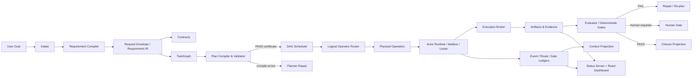

<!-- source: C:\Users\mukch\projects\work\AI4Research\README.md -->
<!-- lines: 179-311 -->
<!-- commit: b0bf165f9ab073aae23e45b3b2796973e5677eea -->

<translation>
## Architecture Overview



### Layers

| Plane | Primary responsibility | Key code |
|---|---|---|
| Intent/Requirement plane | Intake, classification, IR, PRD, contracts, traceability | `harness/lib/requirement_compiler/`, `compiled_sprint_planner.py` |
| Planning plane | Task graph, capsules, logical operators, plan certificates | `plan_validator.py`, `workflow_contract.py`, `apo_plan_compiler.py` |
| Scheduling plane | Readiness, conflicts, parallelism, quotas, routing | `graph_scheduler.py`, `multi_task_runner.py`, `concurrency_policy.py` |
| Execution plane | Actors, leases, mailboxes, action contracts, tool execution | `actor_runtime.py`, `actor_lease.py`, `actor_mailbox.py`, `execution_broker.py` |
| Evidence/State plane | Events, gates, routing, evidence, closure | `event_ledger.py`, `gate_ledger.py`, `evidence_ledger.py` |
| Context plane | Event projection, budget, redaction, knowledge recall | `context_projection.py`, `context_store.py`, `solar-unified-context.py` |
| Presentation plane | HTTP API, SSE, dashboard, deliverables, desktop shell | `harness/lib/symphony/status-server.py`, `harness/status-server/react-app/`, `desktop/` |
| Research plane | AutoSci workflow, evidence/claim/citation foundation | `harness/plugins/autosci/`, `harness/lib/research/`, `.agents/skills/` |

---

## End-to-end Execution Chain

### 1. Intake

After the user submits a goal, the system creates a sprint/request identifier, and writes the raw input, classification, repository context, and attachments into the request envelope.

### 2. Requirement Compilation

The requirement compiler outputs the PRD, a contract list, the task graph, the initial DAG state, and the closure record. Every key artifact has a stable path and a schema version.

### 3. Planning and Compile Checking

The planner maps requirements to nodes, dependencies, logical operators, capsules, read/write scopes, acceptance IDs, and gates.

The validator then checks:

```text
schema
→ graph validity
→ capsule admission
→ scope containment
→ operator resolvability
→ gate legality
→ repair budget
→ certificate
```

Compile failures do not proceed to the builder; errors are written into the plan-compile artifact for the planner to repair.

### 4. Scheduling

The scheduler only selects ready nodes, and excludes write conflicts within the same wave. The runtime may rebind physical operators based on quota, auth [AMBIGUOUS: authentication | authorization], health, and availability, but does not modify the already-certified [TN: 认证 here means having passed compile-time certification verification, not identity authentication] logical plan.

### 5. Dispatch and Execution

The actor runtime:

1. validates the capability token and the security boundary;
2. resolves the logical operator;
3. acquires the actor lease;
4. loads the context package;
5. writes to the file mailbox inbox;
6. writes scheduler/evidence records;
7. the executor processes the task envelope;
8. writes machine-readable results to the outbox.

For governed actions, the execution agent uses the following FSM:

```text
proposed
  → validated
  → policy_passed
  → leased
  → executing
  → verified
  → committed
```

Failure states include:

```text
schema_failed
policy_denied
lease_denied
exec_failed
verify_failed
```

### 6. Evaluation, Repair, and Human Gate

Only when the source, generation batch, author, and evidence satisfy the gate's admissibility rules is the evaluator's verdict accepted. By default, conclusions from self-evaluation, an expired generation batch, doctor backfill, or an unassigned evaluator cannot serve as the final gate.

A failure can enter bounded repair; once it exceeds the repair budget, it is converted to a failure or handed off for human handling — infinite self-looping is not allowed.

### 7. Closure

The closure projection summarizes the following:

- all nodes pass;
- all required gates pass;
- acceptance traceability coverage;
- tests/evaluations;
- changed files;
- residual risk;
- unclosed/failed/pending-human-review nodes.
</translation>
