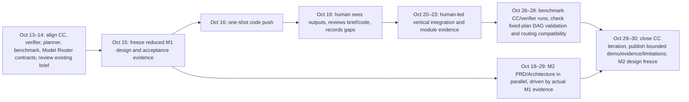

# AI4Research scope reset — working discussion note

**Status:** internal planning note; proposal only; not approved architecture or a delivery claim. Stored outside the Git repository at `C:\Users\m50066326\huawei\AI4Research_private_planning`. No workbook or tracked design files changed.

## New decision context from 2026-10-13

- Oct 16 is the first one-shot coding push. Oct 30 is the time-critical target for a demonstrable deliverable; completing all originally planned M1 features by then is not credible.
- The human plan ends when a person can see and assess an output. Weekend agent execution is output latency, not human effort.
- Human subtask floor: 1 day; avoid scheduling work under 8 hours. Design/push handoff Oct 16, then human review and verification continue through CC closeout.
- Dynamic planning remains a must-have, but only the simple frozen form: Intake → accepted Intent → Research Brief → planner produces a JSON fixed DAG with CC work/verifier subnodes → validate and freeze → dispatch. No graph mutation/replanning during dispatch.
- CC priority: declarative reusable capabilities with typed inputs/outputs and gates/verifiers so a planner can compose them, and impossible graphs can be rejected deterministically.
- Intent Compiler produced a functional IntentIR and Research_Brief.json, but the brief/results still need human review and acceptance evidence. Six independent compiler builds are preflight evidence, not six planned builds.
- RSI is off the hot path. Stretch target: by Oct 30, use RSI to improve one CC in an isolated/offline path. No dependency from the live planner/run to RSI.
- Benchmarking is urgent and targets CC plus verifier behavior (e.g., the Intent Compiler as a node) and repeatable workflow runs. It does not establish scientific quality or general software reliability.
- Model Router compatibility is important but may be partial. Cross-model verifier substitution/robustness is out of scope.
- Use role labels until people are confirmed. Keep KPI/demo evidence separate from maturity/reliability claims; state limitations accurately.

## Candidate Oct 30 critical path for discussion

All date ranges refer to planned human review/work. Agent work over Oct 17–18 is not human effort. Oct 19 human assessment is the first post-push dependency.

## Agreed graph boundary (2026-10-13)

The Intent Compiler and Planner are the only fixed front-end nodes. The Planner chooses the downstream CC work nodes from admitted declarations and assembles each selected CC's verifier/gate subnodes and dependencies into a JSON DAG. Deterministic validation checks references, typed port compatibility, required verifier/gate assignments, and cycles before execution. Freeze the accepted DAG; do not add or change nodes during dispatch. See the team-readable [meeting decisions](2026-10-13-meeting-decisions.md).
## Proposed minimum working path

1. Accept an input and produce an attributable Intent and `Research_Brief.json` through the CC subnodes, with each accepted output carrying its verifier assessment and gate decision.
2. Ask a planner CC to produce a **fixed** JSON DAG using an admitted CC catalogue. Each node declares typed inputs/outputs, dependencies, CC pins, and required checks.
3. Before any dispatch, deterministic host validation rejects malformed plans, missing/incompatible ports, unknown/unadmitted CCs, cycles, missing required verifier/gate assignments, and disallowed edges. Freeze the accepted plan; dispatch only that exact graph.
4. Verify planner quality with a small protected case set written/owned outside the planner and target CC authors (for example, feasible composition, incompatible ports, missing input, and cycle). Keep the test cases and expected results fixed before scoring.
5. Execute a small representative graph (Intent/Requirements compiler node plus a bounded consumer or benchmark node) and retain node outputs, verifier assessments, gate outcomes, and one whole-run verdict. A demo pass is not a general reliability claim.
6. Benchmark only the CC/verifier workflow and repeatability in this scope. Keep Model Router behind a compatibility seam; test one supported configured route, not replacement resilience.
7. Attempt RSI against one eligible CC only in the isolated/offline path. Success is a bounded improvement candidate plus reproducible evidence, not a live promotion or planner prerequisite.

## Design conflict to resolve

The staged architecture candidate `architecture-checks-2026-10-13/staged-design-candidate/docs/architecture/design-package-compact/` describes full M1 and a broad Phase 3 integration. Its `workflow.md` says Phase 1 uses a fixed graph without autonomous planning; `delivery-phases.md` places advanced/team planning and dynamic binding in Phase 3; `offline-rsi.md` describes a substantial isolated improvement system; `immediate-plan.md` expands the Intention Compiler to full verified Brief release. The revised Oct 30 proposal needs an explicit, authorized scope slice/change record across the PRD and architecture, with deferred obligations still visible. Do not imply full PRD/M1 completion from the demonstration.

The active Git checkout is `architecture-pr-ready` on branch `architecture-handoff` and already has unrelated uncommitted changes. Do not write to or reset it without reviewing those changes and selecting the exact intended design source. The staged candidate folder is outside that Git repo. Keep this note outside both.

## SMART check for the proposed slice

- **Specific:** names the frozen planner workflow, fixed DAG, CC/verifier, limited routing, benchmark, and optional RSI path.
- **Measurable:** require reviewed Brief; valid plan accepted; malformed/incompatible/cyclic plans rejected before dispatch; node and run evidence retained; fixed benchmark cases and outcomes recorded; limitations listed.
- **Achievable:** restrict live execution to a representative graph; no in-flight replanning, broad Phase 3 research graph, alternate verifier-model study, or full RSI platform. Confirm owner capacity against one/two sprint limits.
- **Relevant:** exercises reusable declarative CCs, planning, verification, and measurable end-to-end flow needed for the larger vision.
- **Time-bound:** design freeze Oct 15; one-shot Oct 16; human review starts Oct 19; integration/verification Oct 20–28; CC and Oct 30 evidence close Oct 29–30.

## Decisions still needed before this can become the revised DAG/design

1. Confirm the representative live graph: compiler subnodes only, or compiler plus one bounded downstream/benchmark CC.
2. Define the minimum independent plan-check mechanism: deterministic structural/contract checks plus a protected fixed acceptance suite; decide whether an independent verifier CC also assesses the plan.
3. Specify the Oct 30 result label: demo/workflow pass, not full M1 or reliability acceptance.
4. Pick exact Phase 3 obligations to defer, while keeping live-planner and CC/verifier benchmark work in the Oct 30 slice.
5. Confirm the one CC RSI target and owner when the RSI design arrives, without making it a hot-path dependency.
6. Reconcile the reduced scope with PRD authority and the exact design candidate before editing tracked artifacts. Keep the spreadsheet/Timeline unchanged until DAG approval and transfer.

