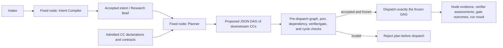

# AI4Research — meeting decisions and planning notes

**Meeting date:** October 13, 2026  
**Status:** Internal team notes; decisions and scope direction for planning. These notes are local and outside the Git repository. They are not a PRD change, implementation claim, or authorization to publish externally.

## Decisions and direction

### October 30 target

- October 30 is a time-critical target for a working, demonstrable deliverable. The team does not expect to complete every originally planned M1 feature by then.
- Keep the live scope small enough to build and show end to end. The presentation may include KPIs, but KPI/demo results must not be described as proof that the software is robust or production-ready.
- The deliverable should demonstrate a real workflow and report observed results and limitations honestly.

### Planning and graph execution

- Dynamic planning is in scope, in a simplified, bounded form.
- **Fixed front-end nodes:** Intent Compiler and Planner.
- The Intent Compiler accepts intake and produces the accepted intent/brief artifacts for planning.
- The Planner chooses downstream CC work nodes from the available declared capabilities and forms a JSON DAG, including each selected CC’s verifier/gate subnodes and dependencies.
- Validate the proposed graph before any work dispatch: confirm referenced CCs and ports exist, inputs and outputs match, required verifier/gate subnodes are present, and the graph has no cycles.
- Freeze the accepted graph before dispatch. Do not add or change nodes while dispatch is underway.
- A graph that cannot be composed from declared inputs and outputs is rejected before execution. Reusable declarations and their inputs, outputs, checks, and limits should make composition understandable and make impossible plans mechanically detectable.

### Capability Capsules and verification

- The central CC goal is a declarative system that makes capabilities reusable and plannable, with verifiers/gates attached in a way that makes checking possible.
- Keep the verification mechanism modest for this deliverable. Verification is needed to demonstrate the workflow and catch basic failures; this scope does not claim high verifier reliability or cross-model robustness.
- Have planner acceptance cases and expected outcomes prepared outside the Planner/CC authors’ own output. Check both a valid composition and basic invalid cases such as incompatible ports or a cycle.
- Benchmarking targets CC and verifier behavior and repeatable workflow runs, using the Intent Compiler as an example node. It does not establish the quality of the entire research system.

### Scope cuts and stretch work

- RSI is off the live planning/dispatch path. It is not a prerequisite for a successful run.
- The stretch RSI outcome is to improve one CC by October 30, using an isolated path and evidence. RSI design is expected October 14 for merge/review.
- Cut part of Phase 3 and defer other capabilities that are not required for the working planning path. Do not depend on the Ontario interns’ Intent Compiler schedule; the team owns the required work.
- Model Router compatibility matters, but full routing maturity is out of scope. Cross-model verifier substitution/robustness is explicitly out of scope.
- A simple implementation is acceptable if it works end to end; “simple” is not a reason to omit necessary checks or evidence.

### Human work and dates

- The one-shot coding push starts Friday, October 16 and covers the agreed reduced deliverable.
- Agent work over the weekend is not human work. Human review starts when results are visible, targeted for October 19.
- Plan human tasks in date ranges, generally at least one day and not under eight hours. Avoid weekly reorganization for minor schedule movement.
- Current working sequence: cross-module design alignment October 13–14; finalize design and acceptance evidence by October 15; coding push October 16; first human review October 19; human integration/verification October 20–23; benchmark and routing checks October 26–28; closeout and evidence October 29–30.
- In parallel, begin M2 PRD/Architecture during M1 work. Use observed M1 results to refine it; do not start its build before the agreed design/build gate.

## Role assignments

Use role labels until named owners and availability are confirmed. The CC owner will work on CCs and assist with CC verification; writing a CC requires verifying its behavior. Confirm workload against the one-to-two-sprint expectation per person before committing dates.

## Evidence and scope boundary

A successful October demonstration shows that the selected workflow ran and that the recorded checks produced their observed outcomes. It does not establish full M1 completion, scientific validity, production readiness, strong verification, or general reliability. List unimplemented/deferred work and known limitations alongside KPIs.

## Open planning items

- Merge and reconcile the RSI design expected October 14; keep its target isolated from the live hot path.
- Finalize the benchmark cases, measures, owner role, and dates as soon as possible.
- Confirm Model Router’s minimum compatibility contract and the exact scope of “partial” support.
- Select the smallest representative downstream CC set that demonstrates planner selection and fixed-graph dispatch.
- Specify the plan JSON and deterministic pre-dispatch graph checks in the October 15 design freeze.
- Identify which Phase 3 obligations are deferred and how that deferral is recorded against the PRD.
- Confirm exact owners, capacity, and availability; use role labels until then.

## Strawman graph shape (not a detailed implementation design)

Downstream nodes are chosen by the Planner; the graph is frozen after validation and before dispatch. Verifier/gate subnodes are part of the chosen plan, not all fixed nodes in the front-end workflow.
