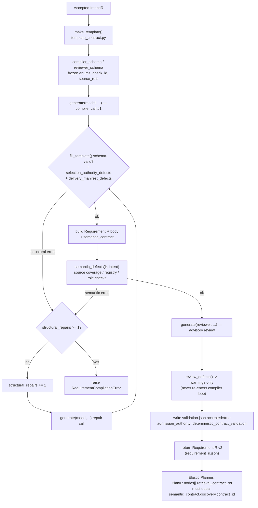

# Stage 3 — Requirement Compiler and Contracts

Repo: `/home/muk/work/AI4Research`, branch `openJiuwen-Solar`, HEAD `b0bf165f9`.
Scope: `harness/lib/requirement_compiler/`, its schemas, and the handoff to the
Elastic Planner. Planner/Scheduler internals are treated as boundary only.

## Summary

- RequirementIR v2 is the original deterministic envelope (`schema_version`,
  `requirement_ir_id`, `intent_ir_ref`, `intent_acceptance_ref`, `requirements`,
  `scope`, `assumptions`, `conflict_scan`, `approvals`, `rollback`) plus an
  **additive, optional, independently-versioned** `semantic_contract`
  (`solar.requirement_semantics.v1`). The base envelope is unchanged so older
  consumers still work; the semantic contract is where all LLM-authored
  structure (roles, discovery, selection authority, delivery manifest) lives.
  [VERIFIED]
- The default compiler is now LLM-based (`compile_semantic_requirement_ir` in
  `semantic.py`); the old deterministic function
  `compile_requirement_ir_legacy` in `compiler.py` still exists byte-for-byte
  but is reachable only via an explicit `legacy=True` kwarg — no production
  caller passes it, and no test in the current tree even imports it.
  [VERIFIED]
- The original Intent "constraint AST" is preserved exactly by deep-copying
  `intent.get("constraints", [])` verbatim into
  `semantic_contract.source_constraints` (`semantic.py:234`,
  `template_contract.py:119`), and `semantic_defects()` hard-fails compilation
  if that copy does not equal the source (`semantic.py:64-65`,
  `SOURCE_CONSTRAINT_POLARITY_OR_CATEGORY_CHANGED`). No model ever sees this
  as an editable field. [VERIFIED]
- The repair budget was **split** in commit `f463b861b` (separate
  `structural_repairs`/`semantic_repairs` counters, 5-call ceiling, blocking
  reviewer) but was **re-merged into a single counter** by a later commit,
  `5ade9d9f3` ("fix(harness): stabilize structured research pipeline"), which
  also made the reviewer permanently advisory and lowered the call ceiling to
  3. Current HEAD code and current tests agree with each other, but
  `harness/metadata/semantic-retrieval-contract.md` still describes the older
  (split-budget, blocking-review) behavior — that doc is stale. [VERIFIED,
  cross-checked against git history]
- `retrieval_contract` / discovery is bound only by an exact `contract_id`
  reference carried from RequirementIR → PlanIR → SchedulerInput → operator
  envelope; nothing downstream is allowed to synthesize a discovery topic from
  free text, and the Planner raises `ElasticPlannerError` if a discovery node
  lacks a matching `retrieval_contract_ref`. [VERIFIED]

## Diagram: compile → review → repair loop



Note: `calls` is a single global counter across compiler+reviewer generate()
calls, hard-capped at 3 (`calls >= 3`), inside an overall deadline of
`4 * SOLAR_REQUIREMENT_TIMEOUT_SEC` seconds (`semantic.py:155-172`).

## Detailed findings

### 1. RequirementIR v2 — fields and the envelope/semantic_contract split

Base envelope (unchanged since legacy days, defined by both
`compile_requirement_ir_legacy` in `compiler.py:264-281` and the LLM path's
`ir = {...}` in `semantic.py:214-235`, and cross-checked against the on-disk
template `harness/metadata/3-requirements compiler output/requirement_ir/requirement_ir.json`):

| Field | Type | Notes |
|---|---|---|
| `schema_version` | string | `"solar.requirement_ir.v2"` |
| `requirement_ir_id` | string | derived deterministically from `intent_ir_id` via `requirement_ir_id_for_intent()` (`compiler.py:60-65`) |
| `intent_ir_ref` | object | `{intent_ir_id, sha256}` — sha256 lower-cased |
| `intent_acceptance_ref` | object | `{acceptance_id: "intent-acceptance-{raw_intent_id}", required_decision: "accepted"}` — built by `_intent_acceptance_ref()` (`compiler.py:68-84`), which reads but does not re-run the Intent admission gate |
| `requirements` | array | see per-row shape below |
| `scope.research.{allowed,forbidden,network}` | object | deterministically derived from whether any IntentIR outcome has `class == "action"` |
| `assumptions` | array of `{source_ref, statement}` | model-authored in the LLM path |
| `conflict_scan.{result,detail}` | object | `"conflict"` iff `intent.get("conflicts")` is non-empty |
| `approvals` | array | always `[]` at compile time |
| `rollback` | null | always `null` at compile time |
| `semantic_contract` | object, optional/additive | see below |

`requirements[]` row fields (legacy shape + `semantic_role` added in v2 body
schema): `requirement_id`, `origin`, `statement`, `priority`
(`must`\|`should`\|`may`), `source_refs[]`, `acceptance.{kind,required_values[]}`
(`kind` ∈ `artifact_fields`\|`scope_coverage`\|`process`\|`delivery`\|`constraint`\|
legacy `coverage`), `check` (a registered check ID), `checkable` (const `true`),
`disposition` (const `null`), and — only inside `semantic_contract`, not on
the row copy in the base envelope — `semantic_role` ∈ `research_scope`\|
`process`\|`delivery`\|`outcome`\|`resolution`\|`constraint`. Confirmed by
`requirement-semantics.v2.schema.json:107-203` and by `semantic.py:211-212`
(`roles = {row["requirement_id"]: row.pop("semantic_role") for row in rows}`
— the role is popped out of the base `requirements[]` rows and lives only in
`semantic_contract.requirement_roles`).

`semantic_contract` (schema_version `solar.requirement_semantics.v1`,
built at `semantic.py:228-234`):
- `requirement_roles`: `{requirement_id: semantic_role}` map
- `discovery`: nullable retrieval contract object (see Q6) or `null`
- `selection_authority[]`: `{field_path, basis: "explicit_source_selection", source_refs[], justification}`
- `delivery_manifest`: nullable `{output_root, exact_file_set: true, files[]}` or `null`
- `runtime_policies`: deep copy of `contract["policies"]` (program-owned, e.g. `evidence_honesty`, `discovery_nonempty_handoff`)
- `template_ref`: deep copy of `template["contract_ref"]` (contract id/version/hashes)
- `source_constraints`: deep copy of the *entire, unmodified* IntentIR `constraints[]`

**"Envelope template + semantic_contract split"**: the v1 legacy shape
(historical readers, `evaluator.py`'s `_shape_defects`) validates everything
except `semantic_contract` against the static JSON template file at
`harness/metadata/.../requirement_ir/requirement_ir.json`
(`evaluator.py:76-79`, `legacy_shape = {... if key != "semantic_contract"}`).
`semantic_contract`, when present, is validated separately and strictly by
its own versioned JSON Schema (`requirement-semantics.v2.schema.json`) plus
program logic in `semantic_defects()`. This lets historical RequirementIR
artifacts without `semantic_contract` stay readable (`evaluator.py:80-83`,
also asserted by test `test_historical_semantic_contract_remains_readable`)
while the new LLM path adds a fully independent, strictly-versioned
sub-contract without touching the base shape.

### 2. What survived from the deterministic compiler; constraint AST preservation

`compile_requirement_ir_legacy` (`compiler.py:104-281`) is retained verbatim
and is the *only* deterministic path left; it is reachable solely via
`compile_requirement_ir(..., legacy=True)` (`compiler.py:284-294`,
`if legacy: return compile_requirement_ir_legacy(...)`). No non-test caller
in the repo passes `legacy=True`, and the current test tree has no reference
to `compile_requirement_ir_legacy` at all — it exists as an explicit escape
hatch/reference implementation, not a fallback (the module docstring in
`semantic.py:1-6` states this: *"No legacy literal-flattening fallback is
allowed on this path"*).

What survived structurally from the deterministic version, still enforced by
code:
- The envelope shape itself (`schema_version`, id derivation, `scope`,
  `conflict_scan`, `approvals: []`, `rollback: null`) — identical logic is
  duplicated in both `compile_requirement_ir_legacy` and
  `compile_semantic_requirement_ir`.
- `requirement_ir_id_for_intent()` and `_intent_acceptance_ref()` — shared
  helper functions imported by `semantic.py` from `compiler.py`
  (`semantic.py:17-21`).
- **Constraint AST preservation, exactly**: `template_contract.make_template()`
  copies `intent.get("constraints", [])` untouched into
  `read_only["source_constraints"]` (`template_contract.py:119`,
  `"source_constraints": copy.deepcopy(intent.get("constraints", []))`).
  This `read_only` block is never sent for editing — only `values` is
  editable by the model (`make_template` enforces
  `set(properties) != {"requirements","assumptions","discovery",
  "selection_authority","delivery_manifest"}` raises
  `REQUIREMENT_EDITABLE_SURFACE_MISMATCH`, `template_contract.py:63-71`).
  The filled template's `read_only["source_constraints"]` is copied again,
  unmodified, into `semantic_contract.source_constraints`
  (`semantic.py:234`). Finally, `semantic_defects()` asserts byte-for-byte
  equality against the live IntentIR at admission time: `if
  contract.get("source_constraints") != intent.get("constraints", []):
  errors.append("SOURCE_CONSTRAINT_POLARITY_OR_CATEGORY_CHANGED")`
  (`semantic.py:64-65`). So "polarity, category meaning, expression AST and
  source spans" (per `requirement-semantic-contract.v3.json` field
  definitions, `/read_only/source_constraints`) cannot silently drift — a
  mismatch is a hard compile failure, not a warning.

### 3. Independent semantic review — what `evaluator.py` actually is, vs. the real reviewer

Important correction to a naming assumption: **`evaluator.py` is not the
semantic reviewer.** It implements `evaluate_requirement_ir_format()`, a
purely deterministic, code-only structural/reference evaluator that diffs a
`RequirementIR` against the static template
(`_shape_defects`, recursive dict/list/type diff), checks
`DUPLICATE_REQUIREMENT_ID`, `EMPTY_REQUIRED_VALUES`,
`INTENT_REFERENCE_MISMATCH`, `INTENT_DIGEST_MISMATCH`,
`INTENT_ACCEPTANCE_*` gate checks, and `SOURCE_REFS_REQUIRED` /
`UNKNOWN_INTENT_REFERENCE`. It emits four named checks `RF1..RF4`
(`template_recursive_shape`, `requirement_identifier_and_acceptance_integrity`,
`intent_reference_integrity`, `intent_acceptance_handoff_integrity`) each
with `status: pass|fail`, plus a flat `defects[]` list of
`{path, code, ...}` objects. It does call into `semantic.py:semantic_defects`
for the `semantic_contract` portion (`evaluator.py:80-83`), so it is best
described as the **format/reference evaluator**, one layer of the
deterministic gate, not the LLM review.

The actual **independent semantic review** is the `reviewer` model invoked
inside `compile_semantic_requirement_ir()` (`semantic.py:238-266`). It is a
second, separately-configured LLM call (`stage_model("requirement",
"reviewer", ...)`, `semantic.py:141-143`, env override
`SOLAR_REQUIREMENT_REVIEWER_MODEL`) that receives the exact same
`filled_template` (read-only contract + filled values) the compiler produced,
plus the IntentIR, and must "Apply every fidelity_rule" from
`requirement-semantic-contract.v3.json`. It returns only the reviewer output
schema — `requirement-semantic-review.v2.schema.json`: `{accepted: bool,
errors: [{rule_id, field_path, evidence_refs[], reason}]}`. Each `rule_id`
must be one of the contract's `fidelity_rules` IDs (F01–F07 in v3, F01–F06 in
v2), `field_path` must be a resolvable JSON pointer into the compiler's
`values` object (checked by walking the pointer, `template_contract.py:236-247`),
`evidence_refs` must come from the union of frozen IntentIR source IDs and
declared `policy_id`s (`template_contract.py:99-100`), and `reason` is free
text. `review_defects()` (`template_contract.py:229-248`) additionally
enforces `REVIEW_VERDICT_INCONSISTENT` (accepted must equal `not errors`) and
`REVIEW_FIELD_NOT_FOUND` for bad pointers.

**Critically, in the current code this review is advisory only.** The
in-code comment states it explicitly (`semantic.py:151-154`): *"The
independent semantic reviewer is advisory: deterministic schema/source/
registry checks own admission, so subjective review never starts another
compiler generation or blocks Planner handoff."* Its output — even reported
rule violations — is written to `validation.json` under a `warnings` key,
never `errors`, and never triggers another repair generation (see Q4). If
the reviewer call itself throws, that is caught and converted to a single
non-sensitive typed warning `{"code":
"ADVISORY_REQUIREMENT_REVIEW_UNAVAILABLE", "error_type": ...}`
(`semantic.py:255-266`) — provider unavailability never blocks admission.

### 4. Repair budgets — exact constants, and the "split" claim verified

**Current HEAD (`semantic.py:150-172`, `205-207`, `289-291`):**
- One shared counter `structural_repairs = calls = 0` (`semantic.py:157`).
- `calls` is incremented on every `generate()` call (compiler *or* reviewer)
  and is hard-capped: `if calls >= 3 or remaining < 1: raise
  RequirementCompilationError("REQUIREMENT_COMPILE_BUDGET_EXHAUSTED")`
  (`semantic.py:162-163`). So **max 3 total model calls**, shared between
  compiler and reviewer.
- Deadline: `deadline = time.monotonic() + 4 * call_timeout` where
  `call_timeout = max(1, SOLAR_REQUIREMENT_TIMEOUT_SEC)` (default 240s)
  (`semantic.py:155-156`) — i.e. bounded total time of 4× one call's timeout,
  and each individual `generate()` call additionally clamps its own client
  timeout to `min(original, remaining)` (`semantic.py:166-171`).
- Repair budget: a structural failure (`fill_template`/`selection_authority_
  defects`/`delivery_manifest_defects` non-empty) or a semantic failure
  (`semantic_defects` non-empty) both check **the same** `structural_repairs`
  counter: `if structural_repairs >= 1: break` else `structural_repairs += 1;
  continue` (`semantic.py:205-207` for structural, `semantic.py:289-291` for
  semantic). So there is exactly **one total repair generation allowed,
  regardless of whether the failure was structural or semantic** — i.e. at
  most 2 compiler generations, plus (if generation 2 succeeds) 1 advisory
  reviewer call = 3 calls total, matching the `calls >= 3` ceiling exactly.
- Confirmed against tests: `test_structure_gets_one_repair_and_semantic_
  review_is_advisory` asserts `len(model.calls) == 2 and
  len(reviewer.calls) == 1` and `validation["model_calls"] == 3`
  (`tests/test_requirement_admission_repair.py:65-73`).
  `test_semantic_review_does_not_start_another_compiler_generation` confirms
  a reviewer rejection never triggers a second compiler generation
  (`tests/test_requirement_admission_repair.py:76-87`).

**Docs claim vs. code — discrepancy found.** `harness/metadata/
semantic-retrieval-contract.md:13-14` still says: *"Contract v2 allows one
structural and one semantic repair, at most three compiler/two reviewer
calls within the existing four per-call timeout slots."* That describes a
model with a **5-call ceiling and two independent counters**, not the current
3-call/1-counter model.

**Git history confirms both models actually existed, sequentially:**
- Commit `f463b861b` ("fix: freeze requirement admission identities and
  split repair budgets") introduced exactly the doc's model:
  `structural_repairs = semantic_repairs = calls = 0`, `if calls >= 5 or
  remaining < 1: raise ...`, two independent `if {structural,semantic}_
  repairs >= 1: break` blocks, and a **blocking** reviewer (its diff shows
  `errors = review_defects(...)` was still fed back into the repair loop as
  admission-relevant `errors`, not `warnings`).
- A later commit, `5ade9d9f3` ("fix(harness): stabilize structured research
  pipeline"), collapsed this to the current single-counter/3-call/advisory-
  review model — confirmed via `git log -p` diff hunks: `-
  structural_repairs = semantic_repairs = calls = 0` / `+ structural_repairs
  = calls = 0`; `- if calls >= 5` / `+ if calls >= 3`; the two `>= 1: break`
  blocks collapsing into one; and the compiler docstring/comment changing to
  "advisory Requirement Reviewer".

**Conclusion on Q4**: the docs' "one structural + one semantic repair,
5-call, split budget" claim was true as of `f463b861b` but is **stale**
relative to HEAD `b0bf165f9`. Current, verified-in-code behavior is: one
shared repair opportunity (either phase), 3-call ceiling, advisory-only
review, bounded by `4 × SOLAR_REQUIREMENT_TIMEOUT_SEC` wall-clock.

### 5. `selection_authority`

Schema (`requirement-semantics.v2.schema.json:92-106`): array of
`{field_path, basis: const "explicit_source_selection", source_refs[]
(minItems 1), justification}`.

Purpose (per `requirement-semantic-contract.v3.json` field definitions and
`template_contract.selection_authority_defects()`, `template_contract.py:
151-175`): it is the compiler's explicit accounting for **every "hard"
retrieval restriction** it wrote into `discovery` — specifically:
`/discovery/inclusion_criteria/<i>`, `/discovery/exclusion_criteria/<i>`,
`/discovery/coverage/<i>/required` when `required == true`, non-null
`/discovery/time_range/{start_year,end_year}`, and
`/discovery/minimum_candidates` when it exceeds the runtime floor (1).
`selection_authority_defects()` computes the exact set of `field_path`s that
*should* require authority (`required` dict, `template_contract.py:154-165`)
and hard-fails (`SELECTION_AUTHORITY_TARGET_MISMATCH`) unless the model's
`selection_authority[]` targets exactly that set (no more, no fewer) — and
also fails (`SELECTION_AUTHORITY_SOURCE_MISMATCH`) if a `source_refs` claim
doesn't cover the same source refs already recorded for that restriction.
The independent reviewer separately judges whether the *cited* Intent IDs
actually *justify* the restriction (deterministic code only checks
reference/target completeness, not semantic sufficiency — see field
definition text: *"The program checks references and exact target coverage;
the reviewer checks whether cited Intent actually supports the
restriction."*). It governs discovery-time hard filtering: anything not
listed as `selection_authority` must default to best-effort topic
queries/corpus coverage, never a hard filter, which is the structural
enforcement behind the "discovery must not guess topic from the objective"
policy discussed in Q6.

### 6. `retrieval_contract` and "must not guess topic from the objective"

`discovery` (nullable object) is the compiler-authored retrieval contract:
`contract_id, subject, search_queries[] (max 8), source_refs[],
inclusion_criteria[], exclusion_criteria[], coverage[], time_range, 
minimum_candidates` (`requirement-semantics.v2.schema.json:225-405`, mirrored
1:1 by the standalone `retrieval-contract.v1.schema.json` used downstream).
`minimum_candidates` defaults to 1 via the `discovery_nonempty_handoff`
runtime policy (`requirement-semantic-contract.v3.json` policies block,
enforced in `template_contract.make_template()`:
`if count_schema.get("minimum") != policy["default"]: raise ValueError(
"REQUIREMENT_COUNT_POLICY_SCHEMA_MISMATCH")`, `template_contract.py:104-109`).

Structural enforcement that discovery cannot be topic-guessed by later
stages: the Elastic Planner never invents or edits `discovery` prose. Instead
(`elastic_planner.py:6864-6885`, `_bind_retrieval_contracts`):
```
contract = semantic.get("discovery")
...
if not contract or parent.get("retrieval_contract_ref") != contract["contract_id"]:
    raise ElasticPlannerError("Discovery execution lacks an accepted PlanIR retrieval_contract_ref")
node["retrieval_contract"] = copy.deepcopy(contract)
```
i.e. a discovery-producing task-graph node is only allowed to carry the
`retrieval_contract` object if its PlanIR parent node's
`retrieval_contract_ref` **string-equals** the accepted
`discovery.contract_id` — an exact identity match, not a similarity/topic
match. There is also an earlier, PlanIR-fidelity-time check
(`elastic_planner.py:2757-2769`) that fails validation
(`RETRIEVAL_CONTRACT_REF_MISMATCH`, `RETRIEVAL_CONTRACT_REF_REQUIRED`) if any
node's `retrieval_contract_ref` doesn't match, or if a discovery node has no
ref at all, plus a `DISCOVERY_NON_SCOPE_OWNERSHIP` check
(`_discovery_non_scope_requirement_ids`) that looks for a Planner attempt to
smuggle non-research-scope requirement text into a discovery node. The
program never derives a discovery topic from the raw objective string at any
stage after Requirement compilation — it is copy-by-reference only, and the
copy is byte-identical (`copy.deepcopy`). This is the concrete mechanism
behind "discovery must not guess topic from the objective."

### 7. Registry / Intent IDs frozen as "actual-call schema enums"

`template_contract.make_template()` (`template_contract.py:55-133`) does two
enum-freezing passes on the **actual JSON Schema objects handed to the
provider** (not just prompt text):
- `check_ids = sorted({row["check_id"] for row in selectable_checks})` from
  `requirement_check_rows(registry)` (checks whose `applies_to.kind ==
  "bound_output"` only — artifact-type checks are deliberately excluded
  because the Planner hasn't chosen an output ABI yet, per docstring
  `template_contract.py:39-52`), then
  `properties["requirements"]["items"]["properties"]["check"]["enum"] =
  check_ids` (`template_contract.py:81`).
- `source_ids = sorted({... goal_id/outcome_id/constraint_id/unknown_id/
  ambiguity_id/conflict_id ...})` from the live IntentIR
  (`template_contract.py:73-76`), then a recursive `bind_refs()` walks the
  whole schema tree and sets `.enum = source_ids` on every
  `source_refs`/`source_ref` property found (`template_contract.py:83-96`).
- The same treatment is applied to the reviewer schema's `errors[].rule_id`
  (enum = contract's `fidelity_rules` IDs) and `.evidence_refs` (enum =
  `source_ids + policy_id`s) (`template_contract.py:97-100`).
- Both mutated schemas are re-validated as schemas
  (`Draft202012Validator.check_schema`, twice: before and after mutation,
  `template_contract.py:61-62,101-102`), then written to disk as
  `compiler-output.schema.json` / `reviewer-output.schema.json`
  (`semantic.py:147-150`) and passed as the literal `schema` argument into
  `generate()` — i.e. the *provider's* structured-output/JSON-schema
  mechanism itself rejects an invented ID, not just post-hoc code
  validation. Test `test_provider_gets_same_instantiated_schema_as_validator`
  (`tests/test_requirement_admission_repair.py:32-49`) asserts the schema
  written to disk for the model call is exactly
  `template["read_only"]["compiler_output_schema"]`, and that the enum
  actually rejects an unsuffixed check id via `Draft202012Validator`. A
  belt-and-suspenders code check also exists: `fill_template()` re-validates
  the returned `values` against the same frozen schema
  (`template_contract.py:141-145`), so even a provider that ignores its
  schema is still rejected deterministically
  (`REQUIREMENT_VALUES_INVALID`).

### 8. Handoff contract to the Elastic Planner

RequirementIR (with its `semantic_contract`) is the sole admitted input to
planning. The concrete contract points, all deterministically checked:
- `plan_ir.requirement_ir_ref.sha256` must equal `sha256_payload(requirement_ir)`
  exactly, else `REQUIREMENT_IR_REF_MISMATCH` (`elastic_planner.py:2743-2744`).
- Every PlanIR node's `retrieval_contract_ref`, if present, must equal
  `semantic_contract.discovery.contract_id` exactly
  (`RETRIEVAL_CONTRACT_REF_MISMATCH`, `elastic_planner.py:2758-2760`); every
  discovery-producing node must carry one at all
  (`RETRIEVAL_CONTRACT_REF_REQUIRED`, `elastic_planner.py:2761-2763`).
- `delivery_manifest.output_root` (from `semantic_contract`) is read by the
  Planner fidelity layer (`elastic_planner.py:2748-2755`) to check delivery
  node placement against the frozen manifest, not re-derive it.
  Downstream, `_bind_retrieval_contracts` (Q6) copies the exact `discovery`
  object into the frozen task-graph node and `graph_scheduler.py`/
  `scheduler_input.py` propagate it unchanged
  (`retrieval_contract`: `deepcopy(node["retrieval_contract"])`,
  `scheduler_input.py:414`) into the frozen `SchedulerInput`, which is
  hash-verified end to end per `semantic-retrieval-contract.md`'s claim of
  "The frozen hash and runtime projection verification cover it."
  (schema: `schemas/planning/scheduler-input.v1.schema.json`).
- The Planner does not compile requirements, does not rewrite `discovery`
  prose, and does not append requirement text into Discovery objectives
  (per doc and by the identity-only binding logic actually present in code).

### 9. Known bugs / limitations

- **[VERIFIED, doc-drift]** `semantic-retrieval-contract.md` describes a
  repair-budget model (split counters, 5 calls, blocking review) that no
  longer matches HEAD (see Q4). This is a documentation staleness bug, not a
  functional one — code and tests agree with each other; only the narrative
  doc is behind.
- **[DOC-CLAIM]** `pre-scheduler-stabilization-log-20260829.md` records
  Requirement-stage handoff bugs from GUI intake path defaults
  (`Path.home()` vs. `HARNESS_DIR`) that broke Requirement→Planner handoff
  (`intake_cli_failed`) — row #3 in that log — fixed at git `ebccdc03c`.
  These were plumbing/workspace-path bugs, not Requirement Compiler contract
  bugs per se, but they directly affected whether RequirementIR handoff
  artifacts were even found by the next stage. [Not independently
  re-verified against current HEAD in this pass — flagged as historical.]
- **[VERIFIED]** `structured-output-compatibility-20260831.md` states online
  status for the full structured-output migration (including Requirement's
  "dynamic compiler/reviewer schema... with actual registry/Intent ID
  enums") remains `NOT_TESTED` in a genuinely new environment/E2E sense; the
  284-passed test run cited is an offline/mocked regression suite, not live
  provider verification, and the doc explicitly disclaims proving "model
  generation is semantically correct" post-fix.
- **[VERIFIED]** The deterministic legacy compiler
  (`compile_requirement_ir_legacy`) is currently dead code from the
  production path's perspective — reachable but unused, and untested in the
  current test tree (no `legacy=True` call site, no `compile_requirement_ir_
  legacy` import found in `tests/` or `harness/tests/`). If it silently
  drifts out of sync with the v2 schema/contract, nothing would currently
  catch it.
- **[INFERRED]** The single shared `structural_repairs` counter means a
  structural failure on generation 0 consumes the *entire* repair budget, so
  if generation 1 then fails for a *semantic* reason, there is no further
  repair — the process fails outright rather than getting a dedicated
  semantic-repair attempt. This is a plausible behavioral cost of the
  Q4 budget merge (harder to recover from mixed failure sequences than the
  original split design promised), but it is exactly what current code and
  tests intend, not an unnoticed bug.
- **[INFERRED]** `harness/lib/requirement_compiler/artifacts.py` builds a
  different, sprint/PM-router-shaped set of artifact filenames
  (`request_envelope`, `prd.md`, `Contracts.yaml`, `task_graph.json`,
  `closure.json`, etc.) that do not correspond to anything else read in
  `semantic.py`/`compiler.py`/`evaluator.py`. It looks like a legacy/parallel
  "codex_pm_router" artifact-naming module bundled in this package but not
  wired into the Stage-3 pipeline documented above; not confirmed as dead
  code (out of scope to trace all callers), flagged for report author's
  attention.

## Field reference table — RequirementIR v2

See Q1 above for the full annotated table (base envelope + `requirements[]`
row shape + `semantic_contract` shape). Schemas of record:
`harness/schemas/compiler/requirement-semantics.v2.schema.json` (compiler
`values` body — also reused, filtered, as the `semantic_contract` body
schema by `semantic_defects`), `harness/schemas/compiler/
requirement-semantic-review.v2.schema.json` (reviewer output),
`harness/schemas/compiler/requirement-semantic-contract.v3.json` (current
governing contract: ownership rules, field definitions, policies, fidelity
rules F01–F07 — note v3 only *adds* `delivery_manifest`/F07 relative to v2;
it still points at the same v2 compiler/reviewer JSON schemas).

## Key code references (file:line)

- `harness/lib/requirement_compiler/semantic.py:47-129` — `semantic_defects()`
- `harness/lib/requirement_compiler/semantic.py:132-292` — `compile_semantic_requirement_ir()`, the compile/review/repair loop
- `harness/lib/requirement_compiler/semantic.py:155-172` — call budget/deadline/`generate()` wrapper
- `harness/lib/requirement_compiler/semantic.py:205-207`, `289-291` — the shared repair counter
- `harness/lib/requirement_compiler/compiler.py:60-65` — `requirement_ir_id_for_intent()`
- `harness/lib/requirement_compiler/compiler.py:68-84` — `_intent_acceptance_ref()`
- `harness/lib/requirement_compiler/compiler.py:104-281` — `compile_requirement_ir_legacy()`
- `harness/lib/requirement_compiler/compiler.py:284-294` — `compile_requirement_ir()` dispatch (`legacy` kwarg)
- `harness/lib/requirement_compiler/template_contract.py:55-133` — `make_template()` (enum freezing, `read_only`/`values` split)
- `harness/lib/requirement_compiler/template_contract.py:136-148` — `fill_template()` (schema re-validation, snapshot hash check)
- `harness/lib/requirement_compiler/template_contract.py:151-175` — `selection_authority_defects()`
- `harness/lib/requirement_compiler/template_contract.py:178-226` — `delivery_manifest_defects()`
- `harness/lib/requirement_compiler/template_contract.py:229-248` — `review_defects()`
- `harness/lib/requirement_compiler/evaluator.py:19-65` — `_shape_defects()` recursive template diff
- `harness/lib/requirement_compiler/evaluator.py:68-239` — `evaluate_requirement_ir_format()`, checks `RF1..RF4`
- `harness/lib/elastic_planner.py:2747-2769` — PlanIR fidelity checks for `retrieval_contract_ref`/delivery manifest
- `harness/lib/elastic_planner.py:6864-6885` — `_bind_retrieval_contracts()`
- `harness/lib/scheduler_input.py:414` — `retrieval_contract` propagated into frozen SchedulerInput node
- `harness/tests/test_requirement_admission_repair.py` — full regression for repair-budget/advisory-review/frozen-enum behavior
- Git: `f463b861b` (split-budget introduced) → `5ade9d9f3` (split budget merged back / review made advisory) — see `git log -p -- harness/lib/requirement_compiler/semantic.py`

## Notable code quotes

`semantic.py:1-6` (module docstring):
> "LLM semantic compilation; deterministic code only checks/binds contracts.
> The v2 envelope remains readable for historical consumers. Its optional,
> versioned semantic_contract is authoritative for new compilation and
> retrieval. No legacy literal-flattening fallback is allowed on this path."

`semantic.py:151-154`:
> "Structural compilation may receive one bounded retry. The independent
> semantic reviewer is advisory: deterministic schema/source/registry checks
> own admission, so subjective review never starts another compiler
> generation or blocks Planner handoff."

`template_contract.py:39-46` (`requirement_check_rows` docstring):
> "Return checks that evaluate a requirement-bound output. Artifact-type
> checks are attached automatically after the Planner chooses an output ABI.
> Offering them to the Requirement Compiler lets a semantic process
> obligation accidentally preselect an artifact type that does not yet exist
> at this handoff."

`elastic_planner.py:6866` (`_bind_retrieval_contracts` docstring):
> "Copy accepted semantics by explicit PlanIR reference; never infer a
> topic."

`semantic-retrieval-contract.md:13-14` (now-stale claim):
> "Contract v2 allows one structural and one semantic repair, at most three
> compiler/two reviewer calls within the existing four per-call timeout
> slots."

## Open questions

1. Was the `5ade9d9f3` repair-budget merge (split → shared counter,
   5 calls → 3, blocking → advisory review) an intentional design decision
   documented anywhere (commit message only says "stabilize structured
   research pipeline"), or an unintentional regression relative to
   `f463b861b`'s stated intent? The tests were updated to match the new
   behavior, suggesting intentional, but no design doc for `5ade9d9f3` itself
   was found under `harness/metadata/`.
2. Is `harness/lib/requirement_compiler/artifacts.py`'s sprint/PM-router
   artifact-naming scheme (`request_envelope`, `prd.md`, `Contracts.yaml`,
   `closure.json`, `codex_handoff.md`) still load-bearing anywhere, or is it
   vestigial from an earlier "codex_pm_router" design that predates the
   Intent/Requirement/Planner pipeline documented in this report? Out of
   this pass's scope to trace all callers.
3. Should `semantic-retrieval-contract.md` be corrected to describe the
   current single-counter/3-call/advisory-review model, given it is the
   canonical narrative doc for this subsystem and currently contradicts
   HEAD's actual behavior?
4. `compile_requirement_ir_legacy` has zero current test coverage — is it
   still considered supported/maintained, or should it be removed/marked
   explicitly deprecated given the "No legacy literal-flattening fallback
   allowed" docstring in `semantic.py`?
