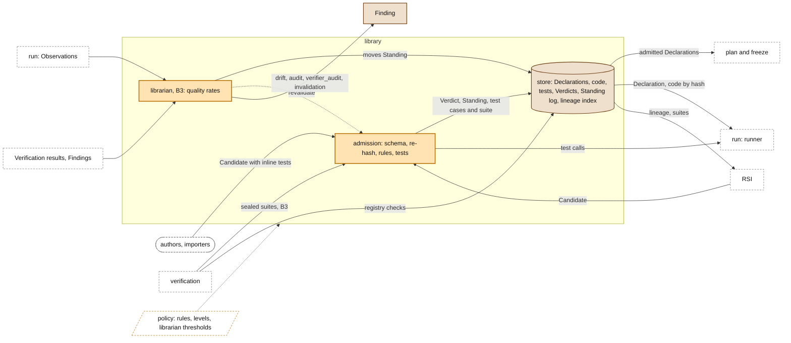

# The library

> **Owner:** Muk · Ramika · Xiaoyang · **Build steps:** B1 M1 capsules and the operator whitelist; B3 suites, levels, librarian

Everything admitted, and the only door in. In M1 it holds the PRD's six stage capsules, `benchmark_runner`, the `verifier_capsule` and the four operators; **the admitted operators are the PRD's operator whitelist**. **Admission** checks a Candidate and writes a Verdict; the **library** keeps it append-only, keyed by hash; the **librarian** (B3) keeps each capsule's Standing current from evidence. The only moving part is the Standing.

## Our understanding, to confirm

**For Muk and Ramika (admission), Xiaoyang (the store).**

- [ ] Admission is the only way a capsule, a test case or a test suite gets into the library. People, importers and RSI all submit a Candidate the same way. The library also keeps two things admission does not write: verification's registry checks, and each version of the port type vocabulary, written by its owner.
- [ ] Admission is never called a gate. The gates are the run-time ones ([naming decision 2](../schemas/schemas.md#naming-decisions-the-wording-conflicts)).
- [ ] Admission is the operator whitelist: `DeepSearch`, `CodeSearch` and workspace I/O are `tool` capsules, callable only once admitted and only from a stage capsule that pins them in `needs.external`. The permission rail's ALLOW list is generated from the admitted operators.
- [ ] The store holds only CC records and code. Research context lives in JiuwenSwarm's Task Memory and Coding Memory, not here.
- [ ] The library is append-only and keyed by hash. Declarations and code are stored apart, and the only moving part is the Standing. B1's "latest version" pointer is a Standing with one state.
- [ ] Admission runs a candidate's tests through the runner, so every test call is observed.
- [ ] The librarian (B3) moves a Standing only by citing a Verdict or a Finding, and a Finding moves it only toward less authority.
- [ ] It is stored in agent-core's KV store (`ShelveStore`, `exclusive_set`) through M1 ([question 11 back to the PRD](../process/prd-inputs.md#questions-back-to-the-prd)).

## Inside

### Admission

*Owner: Muk · Ramika · Build steps: B1 schema and policy; B3 suites and levels · Code: `cc/gate.admit`*

The only door into the library. Checks a Candidate against the schema, the policy and its tests, and writes a Verdict.

- validate shape (`cc.declaration.v1`) and the policy epoch
- re-hash every file; refuse a mismatch
- rules: `effect_class` agrees with `effects`; predicates are evaluable
- store the files in the code store by sha256 (content-addressed, so a rejected candidate's files are harmless), and write its test cases and one visible suite, computing `interface_hash`
- run those tests and, from B3, inherited and sealed suites, **through the runner**, so every test call is observed
- write the Verdict and, on admit, a Standing entry naming it (B1); add the lineage index entry

**Open:**

- Today's `validate_capsule.py` (in `capsule-openjiuwen`) checks shape only; the rules are new code.

### Library

*Owner: Xiaoyang · Muk · Build steps: B1 the M1 capsules; B3 growth · Code: `cc/store`*

Holds everything admitted, append-only and keyed by hash. The only moving part is the Standing.

- **CC library**: Declarations by `decl_hash`, never code
- **code store**: files by sha256
- **test store**: test cases by id, suites by id; sealed suites readable only by admission (B3)
- **Verdicts** by `decl_hash` and epoch; **Standing** log by name
- **lineage index**: `cc/lineage/<parent decl_hash>/<decl_hash>`, written at admission, so a version's children can be listed without scanning every Declaration
- agent-core: `core/foundation/store/kv` (`ShelveStore`)

### Librarian

*Owner: Muk · Build steps: B3 · Code: `cc/librarian`*

Keeps each capsule's Standing current from evidence (drift, audits, upstream revocations), and writes the Findings behind each move. How it measures quality, and its thresholds, are designed with B3.

- **Standing moves.** Admission writes the first entry (`admitted`); a rejected candidate gets a Verdict and no Standing entry. From B3 the librarian writes later moves (for example to `suspect`, `deprecated` or `revoked`, with the reason codes in the policy's `reason_code` registry), each citing a Verdict or a Finding; a Finding moves only toward less authority. A person may roll back to an earlier version (`REVERTED`).

