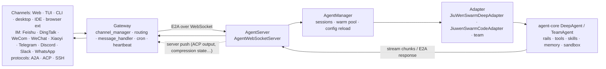

The runtime boundary that matters is **Gateway → AgentServer**. The maintainer docs describe it, and the code confirms it.

## Processes

| Process | Entry point (`pyproject.toml [project.scripts]`) | Default port |
|---|---|---|
| **AgentServer** | `jiuwenswarm-agentserver` → `jiuwenswarm/server/app_agentserver.py` | **18092** (`AGENT_SERVER_PORT`) |
| **Gateway** | `jiuwenswarm-gateway` → `jiuwenswarm/gateway/app_gateway.py` | **19000** WebChannel (`WEB_PORT`) and **19001** gateway server (`GATEWAY_PORT`) |
| Web frontend (static) | `jiuwenswarm-web` → `channels/web/app_web.py` | **5173** (`FRONTEND_PORT`, `app_web.py:2373`) |
| All of the above | `jiuwenswarm-start` (`start_services.py`) and `jiuwenswarm-app` | |

Also available: the TUI (a separate `packages/jiuwenswarm-tui`), a CLI, a desktop app, an ACP bridge (`jiuwenswarm-acp`) and a process CLI.

## Message flow

1. A **channel** adapter in the Gateway receives a platform message. IM platforms live in `gateway/channel_manager/im_platforms/`, and protocols (`a2a`, `acp`, `ssh`) in `.../protocol/`.
2. The Gateway **normalises it into an `E2AEnvelope`** (`jiuwenswarm/common/e2a/models.py`). E2A stands for *Everything-to-Agent* and is version `1.0`. It does not specify a transport.
3. `WebSocketAgentServerClient` sends it to **`AgentWebSocketServer`** (`server/agent_ws_server.py`). The server decodes it into an `AgentRequest` and handles control RPCs locally: sessions, history, team snapshots, slash commands, MCP, sandbox, extensions, harness packages, schedules. Chat goes to **`AgentManager`**.
4. `AgentManager` picks the **adapter** for the mode. The adapters in `server/runtime/agent_adapter/` import agent-core's `create_deep_agent` (`interface_deep.py:80`) and call it to build the agent. See [[Swarm 02 Modes, Agents and Teams]].
5. Output **streams back** as E2A responses, with heartbeats during long streams. Cancel and supplement interrupts go to the live stream task for that session.

## Session runtime, mid-migration

The session runtime is transport-neutral: `AgentRuntime` owns a `RuntimeSessionCoordinator`, a scheduler and an execution registry (`jiuwenswarm/runtime/`). The Process CLI uses it in process (`InProcessRuntimeClient`).

⚠ `.doc_project_maintainer/project/architecture.md` (2026-09-07) says the AgentServer stays on the legacy path. **The code has moved on.** The AgentServer builds an `AgentRuntime` (`agent_ws_server.py:2004`), and that runtime creates a coordinator by default (`runtime/service.py:342`). Plan, Team and background work still run on the AgentServer's own task map (maintainer doc claim). The maintainer docs call themselves *"status: partial, confidence: inferred"*.

The optional **A2A server** is a third listener, on **19100** (`A2A_SERVER_PORT`). It is off unless `A2A_SERVER_ENABLED` is set (`app_gateway.py:2302,2322`).

Sources: pyproject.toml, .doc_project_maintainer/project/{overview,architecture,glossary}.md, docs/en/E2A-protocol.md, jiuwenswarm/server/{app_agentserver.py,agent_ws_server.py,runtime/}, jiuwenswarm/gateway/{app_gateway.py,channel_manager/}, jiuwenswarm/common/e2a/
