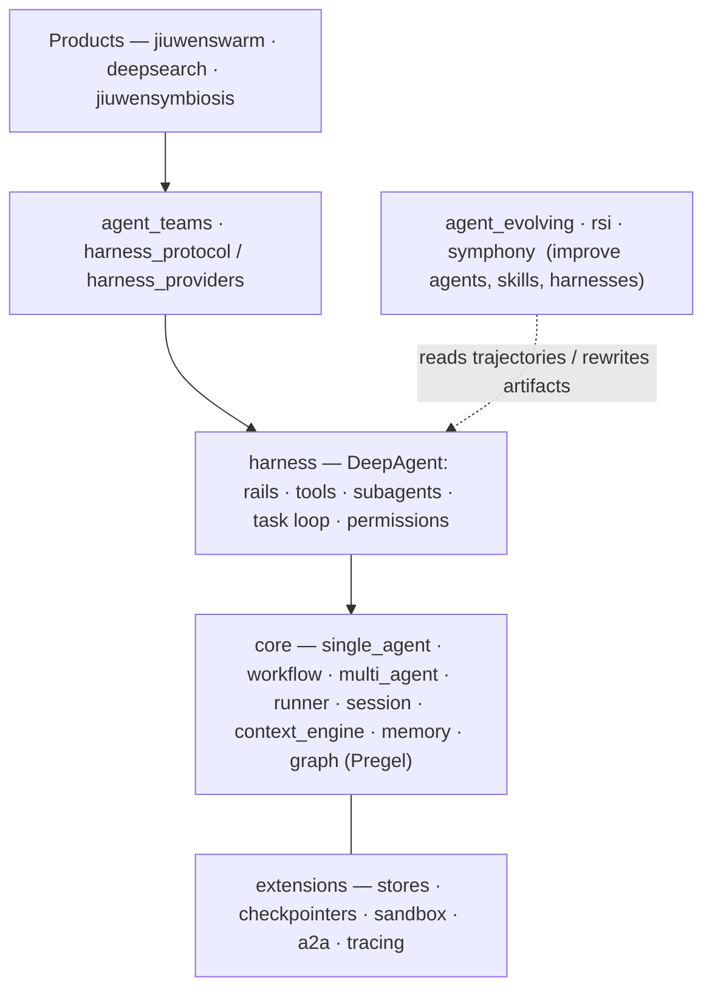

openJiuwen **agent-core** is the Python SDK (`openjiuwen` on PyPI, v0.1.18, Python ≥3.11,<3.14) that the openJiuwen DeepAgents are built on. Read from commit e23806c1, 2026-09-21.

## In their words

> *"a feature-rich AI agent SDK for developing, running, tuning, and improving your AI agents."* — `pyproject.toml`

The README gives two layers: an **SDK interface layer** (agents, workflows, LLM calls, prompts, tools) and an **agent engine** (ReAct and workflow controllers, an async parallel graph executor, streaming, checkpoint and resume). ⚠ **That picture is out of date.** The package has grown well past it, and most of the growth sits *beside* `core/` rather than inside it.

## What is actually in `openjiuwen/`

| Package | What it is (from its `AGENTS.md`/`README` where one exists, else `.claude/rules/architecture.md` and the tree) |
|---|---|
| `core/` | the public SDK and runtime: agents, workflows, graph engine, runner, session, context, memory, retrieval, security, sandboxed system operations |
| `harness/` | **DeepAgent**, the coding-agent framework built on core: rails, tools, subagents, task loop, workspace, permission engine — [[Core 02 DeepAgent Harness]] |
| `harness_protocol/` | a provider-neutral SPI for driving *third-party* harnesses — [[Core 03 Harness Protocol]] |
| `harness_providers/` | implementations of that SPI: `native` (DeepAgent), `claudecode`, `codex`, `dsh` |
| `agent_teams/` | Leader + Teammates over a message bus and a task database — [[Core 04 Multi-Agent and Teams]] |
| `agent_evolving/` | trainer, evaluators, optimisers, trajectories, skill experience, RL — [[Core 06 Evolution and Symphony]] |
| `rsi/` | recursive self-improvement: `artifact_rsi` (program, paper) and `harness_rsi` (auto-harness) |
| `symphony/` | capability assets: fingerprint, retrieval, orchestration, experience, evaluation — see [[openJiuwen Landscape]] |
| `auto_harness/` | a 39-line compatibility shim that re-exports `rsi.harness_rsi.auto_harness` |
| `extensions/` | optional integrations: a2a, checkpointers, stores, message queue, sandbox, OTel tracing |
| `dev_tools/` | agent builder, prompt builder, skill creator and evaluator, tuning |

## Layers

**Key point: "agent-core" now means much more than `core/`.** The harness, teams, evolution and Symphony are each subsystems of comparable size. `harness`, `harness_protocol`, `harness_providers`, `agent_teams` and `agent_evolving` each carry their own `AGENTS.md`, which is the most current documentation for them. Symphony has only a `README.md`. The user docs in `docs/en` mostly cover `core/`.

## Read order

[[Core 01 Agents, Workflows and Runs]] → [[Core 02 DeepAgent Harness]] → [[Core 03 Harness Protocol]] → [[Core 04 Multi-Agent and Teams]] → [[Core 05 Session, Context, Memory]] → [[Core 06 Evolution and Symphony]]

Where it sits: the "Agent Framework" layer of openJiuwen. [[Swarm 00 Overview]] depends on it, and so does deepsearch. ScienceDiscovery does not ([[openJiuwen Landscape]]). Capability Capsule builds on it ([[Dependencies]]).

Sources: README.md, AGENTS.md, pyproject.toml, docs/en/1. Product Overview.md, docs/en/SUMMARY.md, .claude/rules/architecture.md, `ls openjiuwen/`, openjiuwen/auto_harness/__init__.py
