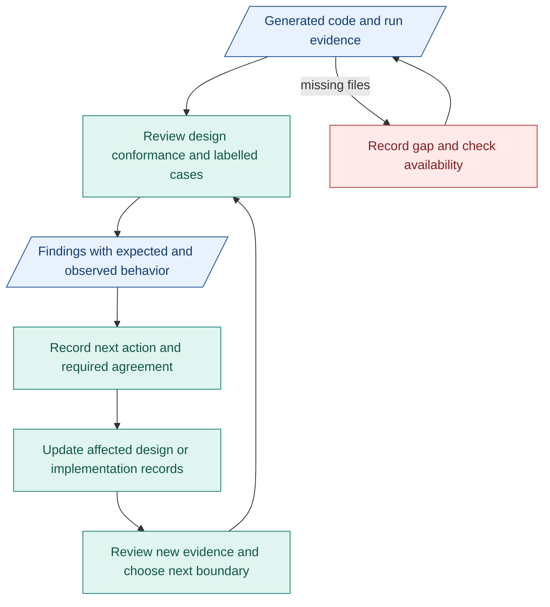

# My architecture plan toward M1

**Goal: unblock implementation and have reviewable evidence on time.** The proposed design is ready. Reported full-package builds look promising, but execution coverage and verifier quality remain unproven.

## Checklist

- [ ] **Receive generated code and run logs** for the four conditions. Record branch/commit, design/PRD revision, input and configuration. Mark missing files.
- [ ] **Locate the review evidence:** original request, Intent IR, Brief, checks, verifier assessments and gate decisions. Keep each result tied to its run.
- [ ] **Review code against design:** CC bindings, accepted-input use, verifier context and gate release. Record expected/observed behavior with file and commit links.
- [ ] **Prepare next week's verifier review:** labelled actionable, unclear and failure cases from the [verification matrix](../reference/compiler-verification.md#cases-and-evidence). Check case expectations with people working on requirements and verification.
- [ ] **Review results:** false acceptance/refusal, reasons, missing evidence and whether the gate behaves correctly. Unusable intent must halt before Requirements. Valid JSON alone is insufficient.
- [ ] **Resolve findings:** identify design, code, verification or unknown cause. Record the next action and any required agreement. Update only affected design and links.
- [ ] **Continue through M1 boundaries:** review each CC with its checks/verifier assignment, then connected cases. Track [RSI prerequisites](07-m1-capsules-and-rsi.md#rsi-can-prepare-alongside-product-work) in parallel. Use findings to decide compactness, detail and next review targets.

## Agreement needed

| Change | Agreement from |
|---|---|
| Product scope or required exit | People working on requirements and affected components |
| Shared interface or verifier criteria | People working on producing, consuming and checking components |
| Evidence availability and review target | People working on the relevant build/run |

Record agreements in existing issues/PRs and TASK records. This adds no separate approval stage.

## Review and update flow

Blue: records. Teal: my review/update work. Red: evidence gap.

## Risks and effort

| Risk | My response |
|---|---|
| Code/logs arrive too late | Agree needed files and review target early. Review available evidence and label gaps. |
| Verifier accepts weak intent or rejects valid intent | Review labelled cases and reasons. Check expectations before changing behavior. |
| Design churn or tooling delays the build | Prioritize blocking findings. Keep changes focused. Trial cheap AI CI only when useful. |

**Spend most effort on evidence, verifiers and blocking design questions.** Next, review connected CC boundaries. Keep documentation updates focused and automation small. A schedule slip alone changes planning, not design or required checks.
