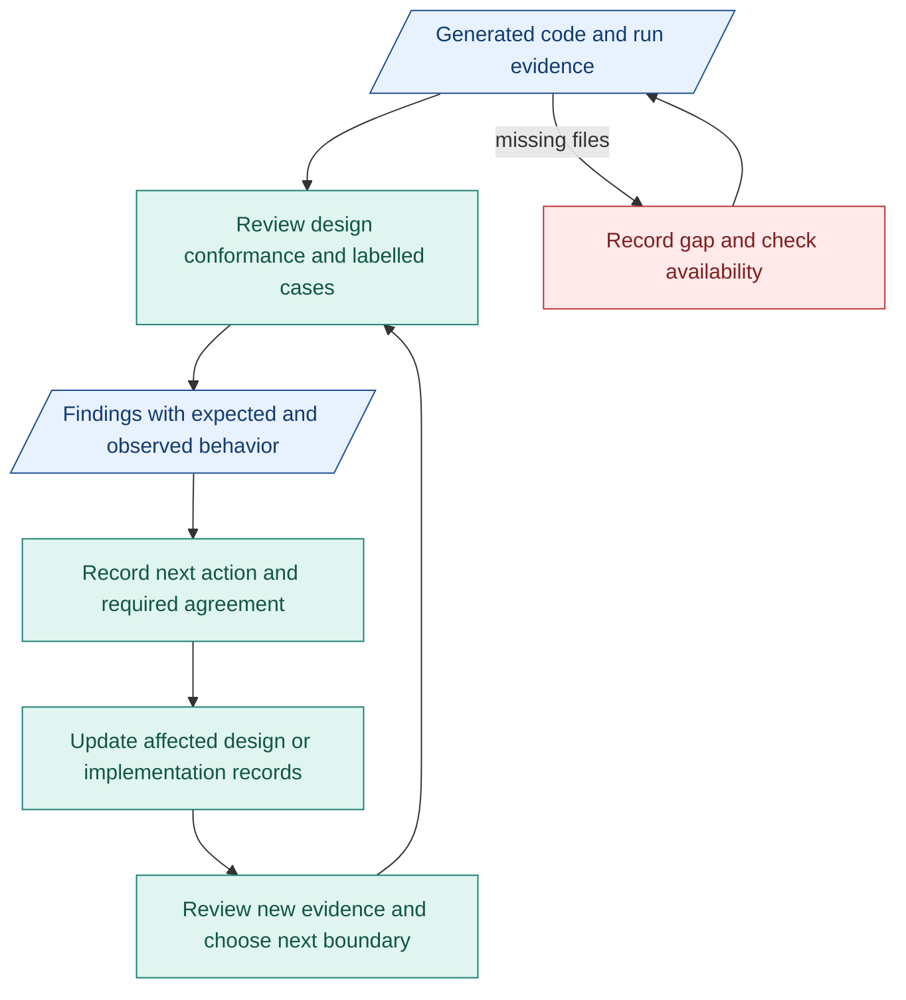

# My architecture plan toward M1

**Goal: unblock implementation and have reviewable evidence on time.** The proposed design is ready. Reported full-package builds look promising, but execution coverage and verifier quality remain unproven.

## SMART review targets

| Target time | My action | Measurable result |
|---|---|---|
| Before next week's review | Receive generated code and logs. Inventory all four build conditions. | Four entries with code/run identity, source revisions and evidence status. Missing items named. |
| During next week's review | Inspect Intention and Requirements verifier roles in each available full-package build. | Criteria/context/findings/gate comparison for both roles per reviewed build. File/commit links and gaps recorded. |
| By the end of next week | Prepare four labelled cases per runnable full build: actionable request, unusable intent, contradictory constraints and malformed output. Review available test results. | Expected/observed result, gate decision, evidence reference and assessment where applicable per case. Count false acceptances/refusals, unrun and blocked cases. |
| Before each new connected boundary | Review producer/consumer contracts and one connected case. Get agreement where shared meaning changes. | Linked contracts, case evidence and recorded agreement or unresolved question. This is an initial check, not complete acceptance. |
| At each progress review | Classify findings and update affected design. Choose the next boundary and evidence target. | Every material finding has an affected area, next action and required agreement. Untested branches stay visible. |

Use the [verification matrix](../reference/compiler-verification.md#cases-and-evidence) for expected behavior. **Unusable intent must halt before Requirements.** Valid JSON alone is insufficient. The four initial cases do not establish overall quality.

Review full builds first. Expand to compact builds as code and evidence become available. [CC boundaries](07-m1-capsules-and-rsi.md#inside-a-node) and [parallel RSI prerequisites](07-m1-capsules-and-rsi.md#rsi-can-prepare-alongside-product-work) guide the remaining M1 work.

## Agreement needed

| Change | Agreement from |
|---|---|
| Product scope or required exit | People working on requirements and affected components |
| Shared interface or verifier criteria | People working on producing, consuming and checking components |
| Evidence availability and review target | People working on the relevant build/run |

Record agreements in existing issues/PRs and TASK records. This adds no separate approval stage.

## Review and update flow

Blue: records. Teal: my review/update work. Red: evidence gap.

## Risks and effort

| Risk | My response |
|---|---|
| Code/logs arrive too late | Agree needed files and review target early. Review available evidence and label gaps. |
| Verifier accepts weak intent or rejects valid intent | Review labelled cases and reasons. Check expectations before changing behavior. |
| Design churn or tooling delays the build | Prioritize blocking findings. Keep changes focused. Trial cheap AI CI only when useful. |

**Spend most effort on evidence, verifiers and blocking design questions.** Next, review connected CC boundaries. Keep documentation updates focused and automation small. A schedule slip alone changes planning, not design or required checks.
