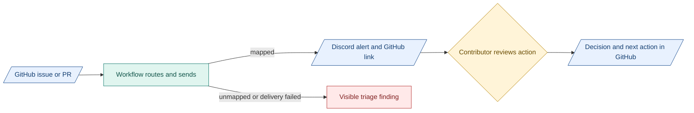

# 5. Automation

**Proposal: automate avoidable mistakes first.** Extend existing checks.

## Design CI

- Scripts: exact path casing, links, schema/version references, glossary spelling and diagram freshness.
- Agents: clarity, terminology, missing context and likely change impact.
- People: consequential decisions. Keep this separate from product gates.
- Run bounded, attributable jobs. Retain the checked revision, input identity and findings/results.
- Start small. Measure useful alerts, missed changes, rework and review effort. Token counts describe size. Name the tokenizer/version.

## GitHub and Discord

- Keep design drafts on topic branches. Merge after relevant human review. State scope, impact and evidence in the PR.

| GitHub | Discord |
|---|---|
| Issues, PRs, versioned design and evidence links | Targeted alerts and linked discussion |
| Existing TASK/specification records retain work authority | Return decisions and next actions to the GitHub record |

Recommend a small GitHub workflow plus [Discord webhook](https://docs.discord.com/developers/resources/webhook). [pr-discord-notifier](https://github.com/asirago/pr-discord-notifier) is an example that posts opened, edited and closed PR notices. Targeted recipient routing needs separate logic.

- Route by assignees, requested reviewers and a Git-tracked module/contact map with GitHub and Discord identities.
- Ping for blockers, requested action and shared-contract changes. Group routine updates.
- Surface missing mappings and delivery failures in GitHub/shared triage. Allow only intended mentions.
- Keep unanswered next actions visible in GitHub. Successful delivery does not prove someone read it.

## Proposed notification flow

Blue: information. Teal: automation. Amber: human action. Red: unresolved. Integration is proposed, not deployed.
