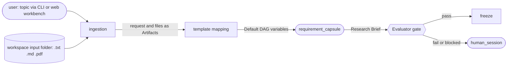

# Ingestion and the Research Brief

**Confirmed by:** PRD §3 (Ingestion; Requirement Compilation; Intention Compilers, Phase 1), §4.1 (`requirement_capsule`).

The front of the run: the user's topic and documents come in, template mapping fills the Default DAG's variables, and `requirement_capsule` writes the Research Brief. The gate must accept the Brief before freeze.

The Research Brief has four fields (PRD): research question, domain boundaries, hardware and compute constraints, target metrics. It is the M1 value of the [[semantic-contract|semantic contract]]; its target metrics become checks that the gate runs on the final report.

**Uses from Block 1:** [[intent]] (the request), [[artifact]] (documents), [[semantic-contract]] (the Brief).

**Open:** who owns the Brief's schema; whether PDFs are converted to text at ingestion ([[prd-inputs]]).
