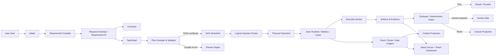

<!-- source: C:\Users\mukch\projects\work\AI4Research\README.md -->
<!-- lines: 179-311 -->
<!-- commit: b0bf165f9ab073aae23e45b3b2796973e5677eea -->

<translation>
## Architecture Overview



### Layers

| Plane | Primary Responsibility | Key Code |
|---|---|---|
| Intent / Requirement Plane | intake, classification, IR, PRD, contracts, traceability | `harness/lib/requirement_compiler/`, `compiled_sprint_planner.py` |
| Planning Plane | TaskGraph, capsule, logical operator, plan certificate | `plan_validator.py`, `workflow_contract.py`, `apo_plan_compiler.py` |
| Scheduling Plane | readiness, conflict, parallelism, quota, route | `graph_scheduler.py`, `multi_task_runner.py`, `concurrency_policy.py` |
| Execution Plane | actor, lease, mailbox, action contract, tool execution | `actor_runtime.py`, `actor_lease.py`, `actor_mailbox.py`, `execution_broker.py` |
| Evidence / State Plane | event, gate, route, evidence, closure | `event_ledger.py`, `gate_ledger.py`, `evidence_ledger.py` |
| Context Plane | event projection, budget, redaction, knowledge recall | `context_projection.py`, `context_store.py`, `solar-unified-context.py` |
| Presentation Plane | HTTP API, SSE, dashboard, deliverables, desktop shell | `harness/lib/symphony/status-server.py`, `harness/status-server/react-app/`, `desktop/` |
| Research Plane | AutoSci workflows, evidence/claim/citation substrate | `harness/plugins/autosci/`, `harness/lib/research/`, `.agents/skills/` |

---

## End-to-End Execution Chain

### 1. Intake

After the user submits a goal, the system creates a sprint/request identity, and writes the raw input, classification, repository context, and attachments into the request envelope.

### 2. Requirement Compilation

The Requirement Compiler outputs the PRD, contract manifest, TaskGraph, initial DAG state, and closure record. Every key artifact has a stable path and a schema version.

### 3. Planning and Compile-check

The Planner maps requirements into nodes, dependencies, logical operators, capability capsules, read/write scope, acceptance IDs, and gates.

The validator then checks:

```text
schema
→ graph validity
→ capsule admission
→ scope containment
→ operator resolvability
→ gate legality
→ repair budget
→ certificate
```

A compilation failure does not proceed to the Builder; the error is written to the plan-compile artifact for the Planner to fix.

### 4. Scheduling

The Scheduler selects only ready nodes, and excludes write conflicts within the same wave. The runtime may re-bind the physical operator based on quota, auth, health, and availability, without modifying the certified [TN: 认证 = certified/passed compile-time certification here, not authentication] logical plan.

### 5. Dispatch and Execution

Actor Runtime:

1. Validates the capability token and the safety boundary;
2. Resolves the logical operator;
3. Acquires the actor lease;
4. Loads the context packet;
5. Writes to the file mailbox inbox;
6. Writes the scheduler/evidence record;
7. The executor processes the task envelope;
8. Writes the machine-readable result to the outbox.

For governed actions, the Execution Broker uses the following FSM:

```text
proposed
  → validated
  → policy_passed
  → leased
  → executing
  → verified
  → committed
```

Failure states include:

```text
schema_failed
policy_denied
lease_denied
exec_failed
verify_failed
```

### 6. Evaluation, Repair, and Human Gate

An Evaluator verdict is consumed only when the source, generation, author, and evidence satisfy the gate-consumability rules. By default, conclusions from self-evaluation, a stale generation, doctor backfill, or an unassigned evaluator cannot serve as the final gate.

A failure may enter a bounded repair; once the repair budget is exceeded, it turns into a failure or manual handling — unlimited self-looping is not allowed.

### 7. Closure

Closure projection summarizes:

- all nodes passed;
- all required gates passed;
- acceptance traceability coverage;
- tests / evals;
- changed files;
- residual risks;
- open / failed / human-review nodes.
</translation>

## Translator notes
- Ambiguities: none.
- Pending terms: none — all jargon in this span (capsule, gate, operator, closure, etc.) already appears in English in the source text, or is covered by approved glossary rows.
- Modal decisions: "可依据...重绑定" (§4) → "may re-bind" (可 = may/can, not an obligation); "不会进入" (§3) → "does not proceed" (plain negation of the described behavior, not "cannot"); "默认不能作为最终 gate" (§6) → "by default...cannot serve" (不能 = cannot); "可以进入受限 repair" (§6) → "may enter a bounded repair" (可以 = may/can). Also added an inline [TN] at "已认证的逻辑计划" (§4) flagging that 认证 is used here for compile-time plan certification, not the glossary's default authentication/authenticate sense, per tcheck's override mechanism.
- Assumptions: rendered "capability capsule" as plural "capability capsules" in the §3 list of things nodes are mapped into, since the surrounding list items are plural categories, not a count claim. In the Actor Runtime numbered list (§5), items 1-6 and 8 have no explicit subject in the source (implicitly the Actor Runtime introduced by the lead-in colon) and are rendered without restating a subject; item 7 explicitly names 执行器 ("the executor") in the source and is rendered with that explicit subject, preserving the source's one deviation from the implicit-subject pattern.
