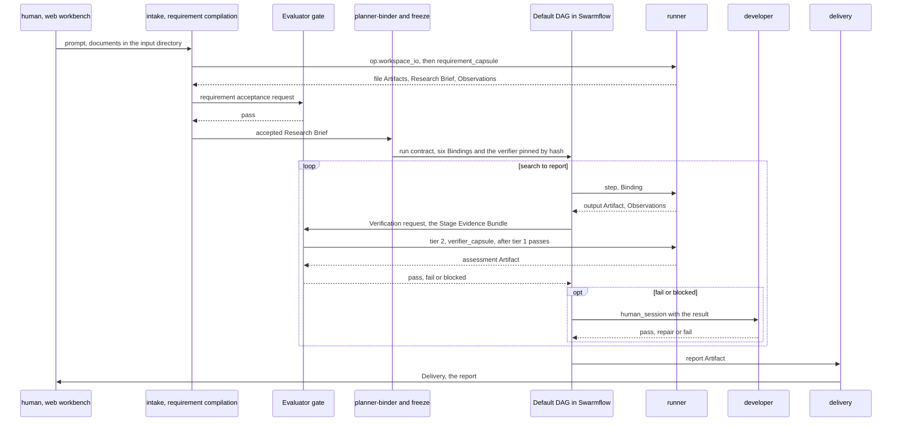

# Trace: B1, one run of the Default DAG

A researcher types a topic in the web workbench, with two reference PDFs in the workspace input directory. The run goes through every PRD stage: the Evaluator gate accepts the Research Brief before freeze, then checks each of the six steps. At the `poc` step the gate fails once and a developer sends the step back. Each row names the component that acts and the records it reads and writes, so a field can be followed from where it is written to where it is used.

| # | Component | Reads | Writes | What happens |
|---|---|---|---|---|
| 1 | [Admission](../components/library.md#admission) | [Candidate](../schemas/candidate.md), [Declaration](../schemas/declaration.md), [Check](../schemas/checks.md), [Port types](../schemas/port-types.md) | [Check](../schemas/checks.md) (test cases, suite), [Artifact](../schemas/artifact.md) (test inputs), [Verdict](../schemas/verdict.md), [Standing](../schemas/standing.md) | before any run: the six stage capsules, `benchmark_runner`, `verifier_capsule` and four operators are admitted under epoch `b1`; the admitted operators become the permission rail's whitelist |
| 2 | [Ingestion and intake](../components/request-to-contract.md#ingestion-and-intake) | [Policy](../schemas/policy.md) | [Intent](../schemas/intent.md) (RawIntent), [Artifact](../schemas/artifact.md) | the prompt becomes a `raw_intent` Artifact; each PDF, read through `op.workspace_io` (allowed by `control_operators`, observed with stage `intake`), a `file` Artifact; `op.deepsearch_index` indexes them for `op.deepsearch` |
| 3 | [Intention compilation](../components/request-to-contract.md#intention-compilation) | [Intent](../schemas/intent.md) | — | Phase 1 template mapping fills the Default DAG's variables (`topic`, `input_dir`); no capsule |
| 4 | [Runner](../components/run.md#runner) | [Declaration](../schemas/declaration.md), [Standing](../schemas/standing.md) | [Observation](../schemas/observation.md), [Artifact](../schemas/artifact.md) | `requirement_capsule`, resolved through its Standing, writes the Research Brief (stage `requirement`) |
| 5 | [Requirement compilation](../components/request-to-contract.md#requirement-compilation) | [Artifact](../schemas/artifact.md), [Observation](../schemas/observation.md), [Policy](../schemas/policy.md) | [Verification](../schemas/verification-record.md) (request) | requirement acceptance: the Brief, the template's fixed checks, the call's Observation |
| 6 | [Evaluator gate](../components/verification.md) | [Verification](../schemas/verification-record.md), [Check](../schemas/checks.md), [Port types](../schemas/port-types.md), [Artifact](../schemas/artifact.md), [Observation](../schemas/observation.md) | [Verification](../schemas/verification-record.md) (result) | tier 1 passes (`brief_matches_dag`, tokens within policy `routing`); tier 2 runs the `verifier_capsule`; `pass`, labelled `judge_unmeasured` |
| 7 | [Planner-binder](../components/plan-and-freeze.md#planner-binder) | [Semantic contract](../schemas/semantic-contract.md), [Standing](../schemas/standing.md), [Policy](../schemas/policy.md) | [Plan](../schemas/plan.md) | pass-through: the Default DAG's six steps from policy `planner`, against the accepted Brief |
| 8 | [Freeze](../components/plan-and-freeze.md#freeze) | [Plan](../schemas/plan.md), [Standing](../schemas/standing.md), [Verdict](../schemas/verdict.md), [Semantic contract](../schemas/semantic-contract.md), [Verification](../schemas/verification-record.md), [Declaration](../schemas/declaration.md), [Check](../schemas/checks.md), [Port types](../schemas/port-types.md), [Policy](../schemas/policy.md) | [Run contract](../schemas/run-contract.md) | six Bindings, each with `decl_hash`, `code_sha256`, the Verdict, the gate's `checks` and the `budget`; the metric check on the `report` Binding; `verifier` pinned, and refused if requirement acceptance (row 6) used another version |
| 9 | [Runner](../components/run.md#runner) | [Run contract](../schemas/run-contract.md), [Declaration](../schemas/declaration.md) | [Observation](../schemas/observation.md), [Artifact](../schemas/artifact.md) | `search`: `search_capsule` through `agent()` with the `idea_set` schema; its `op.deepsearch` calls pass the rail because the capsule pins it |
| 10 | [The Default DAG](../components/run.md#the-default-dag) | [Observation](../schemas/observation.md), [Artifact](../schemas/artifact.md) | [Verification](../schemas/verification-record.md) (request) | the Stage Evidence Bundle: the output, the Binding's checks, the call's Observation |
| 11 | [Evaluator gate](../components/verification.md) | [Verification](../schemas/verification-record.md), [Check](../schemas/checks.md), [Artifact](../schemas/artifact.md), [Observation](../schemas/observation.md), [Run contract](../schemas/run-contract.md) | [Verification](../schemas/verification-record.md) (result) | tier 1, then the pinned verifier (stage `gate`): `pass`; the same for `screening` and `hypothesis` |
| 12 | [Evaluator gate](../components/verification.md) | [Verification](../schemas/verification-record.md), [Check](../schemas/checks.md), [Artifact](../schemas/artifact.md) | [Verification](../schemas/verification-record.md) (result) | `poc`: the `poc_bundle` names a harness file that is not there; `check.files_present.v1` fails and tier 2 is skipped: `fail` |
| 13 | [The Default DAG](../components/run.md#the-default-dag) | [Verification](../schemas/verification-record.md) | [Verification](../schemas/verification-record.md) (request) | the run halts; a `human_approval` request; `human()` shows the result in the workbench and the run tree |
| 14 | [Evaluator gate](../components/verification.md) | [Verification](../schemas/verification-record.md) | [Verification](../schemas/verification-record.md) (result) | the developer answers `repair`; `poc` runs again with `repair_round: 1` and passes |
| 15 | [Runner](../components/run.md#runner) | [Run contract](../schemas/run-contract.md), [Declaration](../schemas/declaration.md) | [Observation](../schemas/observation.md), [Artifact](../schemas/artifact.md) | `benchmark`: `benchmark_runner` (a tool) runs the harness and writes a `benchmark_result`; its gate passes like any step |
| 16 | [Runner](../components/run.md#runner) | [Declaration](../schemas/declaration.md) | [Observation](../schemas/observation.md), [Artifact](../schemas/artifact.md) | `report`: `report_capsule` writes the Markdown `report`; the gate runs `check.metrics_reported.v1` and passes |
| 17 | [Delivery](../components/run.md#delivery) | [Run contract](../schemas/run-contract.md), [Artifact](../schemas/artifact.md), [Verification](../schemas/verification-record.md) | [Delivery](../schemas/delivery-record.md) | `answered`: the report, found through the run contract's `yields` |

**The `make_capsule.md` experiment** runs this trace twice per prompt, with full and with minimal Declarations, and compares rows 6 to 16 ([capsule](../capsule/capsule.md#the-make_capsulemd-experiment)).
