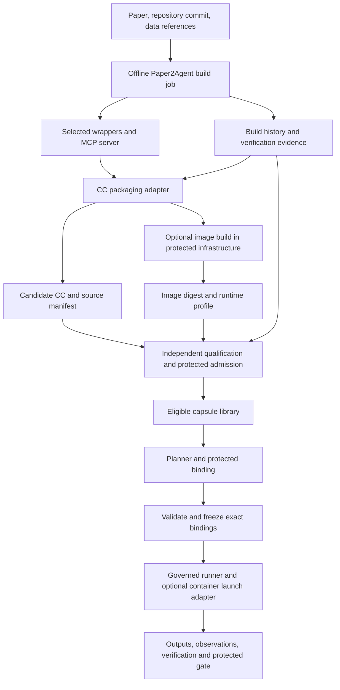

# Paper2Agent, Capability Capsules, and a container runtime proposal

Working design note · 19 October 2026 · one possible M2 workstream

Source checkout: `other-repos/Paper2Agent`, commit `8c2d059165ef8cdcb70dbea76655b9c2b55b38e6`. This note uses static source inspection. Statements about workflow requirements describe the repository's instructions; they do not establish that a scientific conversion or container deployment has run successfully. Existing M1 documents specify the intended design, not observed implementation readiness.

## Proposed connection

Use Paper2Agent as an **offline builder of candidate Capability Capsules**. Its repository-to-MCP route can discover useful scientific operations, run their upstream implementations, wrap them, and collect verification evidence. AI4Research turns those outputs into immutable CC versions and applies protected admission before they become selectable.

Add a container execution profile if a method needs its own scientific dependency environment. A containerized CC would consist of the existing capability declaration, an immutable runtime image reference, a launch profile, and evaluation evidence for that exact combination. Containers supply a packaging/execution boundary; admission, permissions, scientific checking and release remain separate responsibilities.

Paper2Agent also has a paper-to-skill route. That produces a reviewed reading package. It can support source attribution and method documentation, but a reading package alone does not produce an executable scientific capability. The code route requires existing repository implementations. [P1, P2]

## Lifecycle and ownership

The builder has a host-provided agent system and execution tools. Its role files are instructions for that host; the repository does not provide an independent production scheduler simply by defining those roles. Porting its orchestration into JiuwenSwarm requires mapping specialist assignments, phase barriers, independent verifier identities, retries and records to actual host facilities. [P3]

The build job should finish before a research run freezes a plan. It can produce no candidate, a blocked candidate, or an ineligible candidate with useful evidence. A failed research invocation must not automatically install packages, rebuild a capsule or alter its frozen binding.

## What belongs in each layer

| Layer | Contents and purpose | Ownership |
|---|---|---|
| Capability declaration | Purpose, typed ports, prerequisites, effects, checks, budgets, pinned implementation and lineage | Author proposes; admission validates |
| Build/source manifest | Paper/version, repository commit, exact upstream symbols, wrapper mapping, environment/build inputs, source/license notices, external dataset/model pins | Builder produces; trusted capture pins |
| Runtime image | Tested scientific implementation, minimal wrappers, MCP/runtime dependencies and necessary native libraries | Protected build infrastructure creates and records digest |
| Container execution profile | Image digest/platform, entrypoint, supported transport, internal paths, host-managed mounts, resource/isolation constraints and secret requirements | Author may propose needs; infrastructure binds permitted configuration |
| Evidence bundle | Upstream reference execution, changed-input comparisons, independent verification records, clean-runtime and deployment results, limitations | Separate build/evaluation storage with attributable custody |
| Invocation binding | Exact CC/image/profile/evaluation pins, input artifacts, route if needed, effective permissions and per-call limits | Protected binder/runner |

Paper2Agent normally delivers a runtime ZIP and keeps notebooks, tests, reports and agent records outside it. AI4Research therefore needs to capture both the runtime package and the evidence bundle; importing only the ZIP loses the basis for qualification. Hidden evaluation cases remain outside both the runtime image and builder-accessible evidence. [P4]

## How the existing M1 CC can represent the result

The declaration already has the right semantic categories. [C1]

| Existing element | Mapping for a Paper2Agent-generated CC | Needed work |
|---|---|---|
| `identity`, carrier/body closure | Immutable wrapper/adapter plus source closure; each generated version has exact pins | Package importer and manifest capture |
| `ports` | Selected tool's input/output schemas plus scientific units, metadata requirements and file artifact contracts | Review MCP schemas and enrich applicability; JSON shape alone is insufficient |
| `needs.external`, resources and network | Dataset/model/service pins, mounted artifact needs and permitted connectivity | Translate build-time dependencies into admitted runtime needs |
| `changes` | Outputs/files and any permitted service effects | Prevent unrestricted path parameters or upstream hidden effects from escaping declared scope |
| `guarantees` | Check definitions and references to tested outcomes | Separate producer tests, independent evaluation, and runtime mandatory checks |
| `budget` | Invocation limits and truthful enforcement mode | Container/process monitoring and cancellation integration |
| `identity.lineage` | Builder identity and immutable build history references | Existing provenance object is closed; detailed source/build fields need a separate linked manifest |
| `evolution` | Declared frozen promises for later authorized implementation improvements | Packaging/rebuild changes need independent validation; RSI authority remains bounded |

Start with one CC per independently useful scientific operation. Multiple CCs can share an immutable image when that saves space and startup cost. The protected adapter must bind the chosen tool name/schema and restrict accessible operations; a shared MCP server must not grant every tool to every CC invocation.

A paper may yield several operations and documentation resources. A server containing several tools does not by itself establish a reusable composite CC. M1 explicitly defers composite execution and internal CC dispatch. Initially, dependent operations can use separate planned work subnodes and protected checks under existing graph rules. [C2]

## Containerized CC update: a narrow proposal

Introduce a versioned **container execution profile** and a runner adapter before deciding whether the CC declaration needs new root fields. Treat the following as proposed concepts, not schema-compatible JSON:

| Proposed profile information | Reason |
|---|---|
| Immutable image/manifest digest and target platform | A mutable tag cannot reproduce the tested environment; a multi-platform image also needs the tested platform identified |
| Wrapper/source manifest hash and CC-to-profile binding | Prevent an admitted declaration from being launched against an unrelated image |
| Entrypoint, internal working directory, transport and exact tool binding | Make invocation explicit and auditable |
| Artifact mount contract and output directory convention | Translate host artifact references into container paths and collect results after exit |
| Runtime user, read-only areas, writable areas, network and resource requirements | Let protected policy derive effective launch restrictions; proposed needs grant no authority |
| Required credential/service references and external model/data pins | Supply authorized runtime access without embedding secrets or large/private datasets |
| Runtime/API compatibility and qualified evidence references | Block unsupported hosts or stale validation |

For a proof of concept, the profile can be a pinned file in the adapter's existing implementation closure. Production use requires a registered profile format, consumer validation, binding/hashing rules and admission checks. A file merely being present does not make M1 able to interpret it. The existing `ext` field is diagnostic and must not become an unofficial permissions or execution-policy channel. The environment-lock contract also has a closed, package-oriented meaning; image/profile semantics need a separately versioned agreement rather than silently overloading it. [C1, C3]

Retain existing CC kinds where they fit: `tool` for a local operation and `mcp` for an MCP-backed operation. Container is an execution/packaging choice. It does not require every capability to gain a new `container` kind.

## M1 boundary that this update would change

M1 places the whole application in one image and restricts generated POC execution. It explicitly disallows Docker socket access and per-POC orchestration. It also separates trusted preparation from generated code. [C4]

Supporting dedicated capsule containers therefore requires an explicit M2 execution-profile decision and a protected launch service/adapter. Worker code must not receive a host container-management socket or general container-launch capability. Build/install activity runs under a separate authorized preparation profile; it cannot inherit into a scientific execution merely because Paper2Agent needed it during conversion.

Start with a trusted local launcher on an authorized host. Its request accepts an admitted capsule/profile identity and artifact bindings, rather than arbitrary image names, mount paths or shell fragments from an agent. The launcher verifies the allowlisted pins, applies host policy, and reports lifecycle/exit/usage evidence back to AI4Research. Hosting it beside the M1 application is a deployment decision that needs an explicit interface; it is not achieved by letting the application container use the host socket.

This note does not settle the exact OS sandbox or service deployment. The profile must state supported isolation guarantees and block execution if required enforcement is unavailable. Container packaging alone does not establish confinement or scientific validity.

## Minimal container pilot

Use one CPU-only Python method with runnable public examples and one independently useful operation. Give it one supported platform and local MCP stdio transport. Keep HTTP deployment, GPU profiles, R/CLI environments, remote scheduling and automatic image publication outside the first pilot.

1. Run the upstream operation and record reference inputs/results before wrapping it.
2. Produce a small MCP wrapper and current-format CC declaration. Preserve actual parameter/metadata requirements; remove tutorial-only demonstration defaults where they would misrepresent user data.
3. Build a runtime image from pinned source/dependencies and base-image identity. Keep build and scientific execution permissions distinct. Record the resulting image digest and build provenance; a Dockerfile alone is not the execution identity.
4. Validate the final image on the chosen host: exact inventory/tool/schema, successful scientific result comparison, changed/invalid inputs, repeated calls, output persistence after termination, and applicable path/network/resource restrictions.
5. Preserve observations and independent qualification results for the exact CC/image/profile tuple. Admit only within the demonstrated scope; retain the configured human or automatic eligibility policy as an explicit M2 choice.
6. Demonstrate a future frozen plan using that admitted tuple through the governed runner. Preserve outputs and evidence even when the runtime is removed.

The bundled server verifier launches a local Python server over stdio. It cannot, unchanged, certify a container launcher or HTTP endpoint. Reuse its case inventory/comparators where practical and add a transport/launcher-specific test path. Resources and prompts need separate checks because the bundled verifier covers tools. [P5, P6]

## Updating a capsule after containerization

An update creates a new immutable candidate. Keep four identities distinct: capability contract, wrapper/source closure, runtime image/platform, and invocation binding.

- A wrapper/method change requires new source/image pins and affected independent scientific checks.
- A base-image, dependency or native-runtime update can change numerical behavior even when the wrapper is unchanged. Rebuild and rerun compatibility/scientific checks; unchanged contract meaning does not make old evidence cover the new image.
- A port, effect, guarantee or permission requirement change is a contract/compatibility change as well as a packaging change; re-admit accordingly.
- A changed dataset/model/service must be pinned and evaluated under its declared dependency/compatibility policy. An image digest does not pin external scientific inputs.

Capture a content-addressed admission/evaluation link to the full tested tuple. Keep source/build identity on the candidate package/profile side and authority/effective policy in protected records. Do not create hash cycles by embedding an admission decision into the immutable object that the decision assesses.

Future runs may use the new eligible version. In-progress frozen runs retain their bindings. Rollback affects future selection and preserves historical decisions. An RSI-generated child may trigger a protected rebuild after its allowed implementation change; it must not edit the image builder policy, evaluator, profile permissions or activation authority.

## Scope and effort implications

The earlier estimate of 20–35 engineering person-days for a narrow paper-to-CC path remains a provisional design estimate. Source inspection shows reusable workflows, record checkers and MCP verification code, but most orchestration is host-directed instructions. It does not establish a ready-to-embed JiuwenSwarm subsystem or justify reducing the estimate without a pilot.

For container support, budget provisionally **6–12 additional engineering person-days and 2–3 review days** for one CPU/Python/local-stdio profile if M1's artifact, invocation, admission and evidence interfaces are usable. Suggested decomposition: profile/binding contract 1–2 days; image preparation and provenance 1–2; protected launch/artifact adapter 2–4; exact-image qualification and lifecycle failure handling 2–4. These are estimated incremental tasks, not observed velocity or a quoted delivery commitment.

That allowance excludes an entirely new hardened host launch service, registry operations infrastructure, GPU scheduling and remote execution. Missing host enforcement or M1 interfaces require separate sizing. Do not add this allowance twice if the base work package already includes container provisioning or deployment validation; replace overlapping environment/adapter tasks with the container versions.

First spend **3–5 engineering days on one repository and one host** to establish source reproducibility, candidate mapping, an image build, and a launcher feasibility record. It can reuse the feasibility spike already proposed in the earlier effort note. Re-estimate from actual failures and host readiness before treating the containerized CC as a committed M2 deliverable.

## Decisions for discussion

1. Is the first outcome an offline candidate package or an admitted capability used by a frozen plan?
2. Should containers initially be optional profiles for methods with conflicting dependencies, or required for every imported method? Optional profiles minimize migration work.
3. Can the chosen execution host provide protected container launch and artifact capture without worker access to infrastructure control?
4. Is one operation per CC with shared images acceptable, and how will tool-specific access be enforced?
5. Who maintains independent scientific expectations and approves new image/dependency versions?
6. Which parts of M1 are actually available? Implemented registry, runner and evidence interfaces determine how much adapter work is real reuse.

## Source map

References below use local paths at the pinned Paper2Agent checkout; follow them for targeted inspection. Existing repository skill text was read as source material, not invoked as a conversion workflow.

- **P1:** [Paper2Agent input routing and combined delivery](C:/Users/m50066326/huawei/other-repos/Paper2Agent/skills/paper2agent/SKILL.md:8).
- **P2:** [Paper2MCP stages, source reuse and independence](C:/Users/m50066326/huawei/other-repos/Paper2Agent/skills/paper2agent/paper2mcp/SKILL.md:17).
- **P3:** [Host orchestration and records](C:/Users/m50066326/huawei/other-repos/Paper2Agent/skills/paper2agent/paper2mcp/references/orchestration.md:1).
- **P4:** [Runtime package and separate delivery evidence](C:/Users/m50066326/huawei/other-repos/Paper2Agent/skills/paper2agent/paper2mcp/references/output-delivery.md:5).
- **P5:** [Optional containers, transport and deployment qualification](C:/Users/m50066326/huawei/other-repos/Paper2Agent/skills/paper2agent/paper2mcp/references/extensions.md:26).
- **P6:** [Actual stdio verifier](C:/Users/m50066326/huawei/other-repos/Paper2Agent/skills/paper2agent/paper2mcp/scripts/verify_mcp_server.py:2) and [runtime validation instructions](C:/Users/m50066326/huawei/other-repos/Paper2Agent/skills/paper2agent/paper2mcp/references/runtime.md:89).
- **C1:** [Current CC contract and diagnostic-only extensions](C:/Users/m50066326/huawei/outputs/m1-core-review-2026-10-14/design-package-compact/capsule/declaration.md:7).
- **C2:** [Capsule lifecycle and composition boundary](C:/Users/m50066326/huawei/outputs/m1-core-review-2026-10-14/design-package-compact/capsules.md:19).
- **C3:** [Package-based environment-lock contract](C:/Users/m50066326/huawei/outputs/m1-core-review-2026-10-14/design-package-compact/reference/field-catalog.md:50).
- **C4:** [M1 application placement and generated execution restrictions](C:/Users/m50066326/huawei/outputs/m1-core-review-2026-10-14/design-package-compact/placement.md:39).
