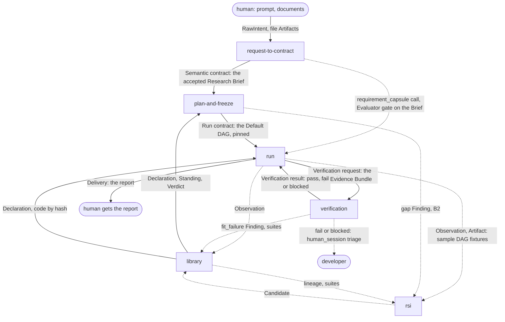

# The design for milestone 1 (M1)

**The [PRD](../process/prd.md) (owner Ramika) sets the boundaries of milestone 1 (M1). Where the PRD decides something, this design follows it.** M1 runs a hardcoded **Default DAG** in JiuwenSwarm's Swarmflow, from Ingestion to Delivery, with the **Evaluator gate** between stages. Capability Capsule (CC) supplies the schema for each stage's capsule, pins each capsule version by hash, records every call, and shapes the Evaluator gate. How each PRD feature maps onto this design, the choices we made where the PRD is silent, and our questions back to the PRD are in [PRD alignment](../process/prd-inputs.md).

- **Final** here means: the schemas, the component boundaries, the [invariants](../schemas/invariants.md) and the shape of the [policy](../schemas/policy.md). These are what we ask the team to sign off.
- **Temporary** means: the [build steps](#build-steps-b1-to-b3-inside-m1) and the policy's starting values. Both change without changing the design.

## The system: six parts

The workflow is split into six parts, one page each, along the lines of who owns them. Every arrow is labelled with the records that cross it. In Obsidian, click a part to open it. Solid arrows are the M1 path; dotted ones are the stage capsule calls, the human triage, and the parallel tracks (B3). Who owns each part is in the table below.

| Part | Lead owner | What it does in M1 | Main records it writes |
|---|---|---|---|
| [Request to contract](../components/request-to-contract.md) | Xiaoyang | Ingestion; Phase 1 intention compilation (template mapping); Requirement Compilation, whose `requirement_capsule` writes the Research Brief | [Intent](../schemas/intent.md) (the RawIntent), [Artifact](../schemas/artifact.md) |
| [Plan and freeze](../components/plan-and-freeze.md) | Muk | a pass-through that emits the Default DAG as a Plan; freeze pins one capsule per step, and the verifier, by hash | [Plan](../schemas/plan.md), [Run contract](../schemas/run-contract.md) |
| [Run and deliver](../components/run.md) | Xiaoyang | Swarmflow runs the Default DAG; our runner wraps each capsule call; single-model routing through Codex CLI; observability joined to the run tree; delivery of the report | [Observation](../schemas/observation.md), [Artifact](../schemas/artifact.md), [Delivery](../schemas/delivery-record.md) |
| [Verification](../components/verification.md) | Ramika | the Evaluator gate between stages: deterministic assertions, then the `verifier_capsule`; `pass`, `fail` or `blocked`; human triage | [Verification](../schemas/verification-record.md) (result), [Check](../schemas/checks.md) |
| [Library](../components/library.md) | Muk | admission of the stage capsules and operators (the whitelist); the store | [Verdict](../schemas/verdict.md), [Standing](../schemas/standing.md) |
| [RSI](../components/rsi.md) | Saurav | a parallel track on sample DAG fixtures; submits like any author | [Candidate](../schemas/candidate.md), [Finding](../schemas/finding.md) |

Every part reads the [policy](../schemas/policy.md) for its "how", and every record extends [common](../schemas/common.md). Each part page lists **how we understand it, for its owner to confirm**. The [B1 trace](../traces/b1-one-task.md) follows one run of the Default DAG through all stages.

## The PRD's stages, and where each lives

Ingestion, intention compilation and Requirement Compilation run first. The Evaluator gate checks the Research Brief; once it passes, freeze pins the Default DAG's six remaining steps against it, and the gate runs after each. Stage capsules are Markdown skills (`kind: skill`). Operators are admitted `tool` capsules that stage capsules name in `needs.external`; Benchmarking's capsule is a `tool` too.

| PRD stage | Part | Step | Capsule | Operators | Output (port type) |
|---|---|---|---|---|---|
| Ingestion | [request to contract](../components/request-to-contract.md#ingestion-and-intake) | before the DAG | none: control code | workspace I/O | `raw_intent`, `file` |
| Intention compilation, Phase 1 | [request to contract](../components/request-to-contract.md#intention-compilation) | before the DAG | none: template mapping, control code | | the Default DAG's variables |
| Requirement Compilation | [request to contract](../components/request-to-contract.md#requirement-compilation) | before freeze | `requirement_capsule` | | `semantic_contract` (the Research Brief) |
| Search & Ideation | [run](../components/run.md#the-default-dag) | `search` | `search_capsule` | `DeepSearch` | `idea_set` |
| Screening | run | `screening` | `screening_capsule` | | `screening_result` |
| Hypothesis | run | `hypothesis` | `hypothesis_capsule` | | `hypothesis` |
| POC Implementation | run | `poc` | `poc_capsule` | `CodeSearch`, workspace I/O | `poc_bundle` |
| Benchmarking | run | `benchmark` | `benchmark_runner` (`tool`): runs the POC harness in the workspace, collects runtime metrics | | `benchmark_result` |
| Delivery | run | `report`, then [delivery](../components/run.md#delivery) | `report_capsule`; the Delivery record is control code | workspace I/O | `report`, then the Delivery |
| Evaluation | [verification](../components/verification.md) | on the Brief, then after every step | `verifier_capsule` (tier 2) | | `assessment`, then the Verification result |

**The Research Brief is the M1 value of the [semantic contract](../schemas/semantic-contract.md).** Its four PRD fields are the contract's `brief`; its target metrics become the contract's requirements. Requirement acceptance (the Evaluator gate on the Brief) accepts it, and freeze pins the rest of the run against it.

## Build steps B1 to B3, inside M1

B1 to B3 are our internal order of work inside M1, redefined against the PRD. They are not milestones.

| Step | PRD | What it delivers | On the M1 release path? |
|---|---|---|---|
| **B1** | Phase 1: deterministic baseline | the Default DAG in Swarmflow through every stage; the Evaluator gate on the Research Brief and after every step; `human_session` on `fail` or `blocked`; every capsule pinned by hash and every call observed; token budget ceilings; one model through the Codex CLI adapter; the `make_capsule.md` experiment ([capsule](../capsule/capsule.md#the-make_capsulemd-experiment)) | yes: this is the M1 path |
| **B2** | Phase 2: concurrent tests | Cluster Mode as planner against the baseline, with our planner-binder chaining by port type and writing gap Findings; the Leader Agent's intention compilation (IntentIR, `decide_acceptance`); the Code Mode builder for POC Implementation | no: runs beside B1, on its sample data |
| **B3** | the parallel tracks | the dynamic planner, aimed at Cluster Mode as the future default (Symphony `plan()` with the CC provider as an option); RSI on sample DAG fixtures; dynamic model routing (`needs.model`); sealed suites, calibrated judges and the librarian | no: merged only when B1 is stable (the PRD's integration gate) |

The **From** column on schema pages uses these steps. A field *From B1* is needed on the M1 path. A field *From B2* or *From B3* is needed by a Phase 2 test or a parallel track; on the M1 path it is stored and not read.

**After M1**, not designed in detail now: the dynamic planner or Cluster Mode as the default; live RSI; automatic repair at the node gate; composing and merging capsules; installing capabilities mid-run; improving the whole workflow (meta-RSI).
