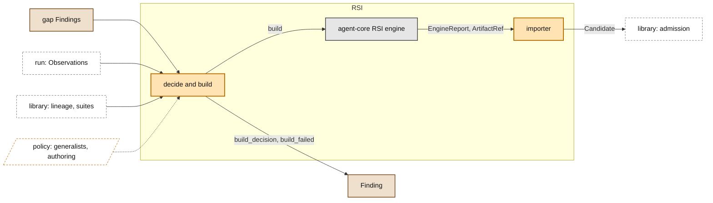

# RSI

> **Owner:** Saurav · **Build steps:** B3, a parallel track on sample DAG fixtures

The cold path: builds what is missing. RSI reads gaps and history, builds a new capsule or version, and submits it through admission like any author. It never writes to the library directly. In M1 it is a PRD parallel track: it runs on static sample DAG fixtures (the records of B1 runs), not on live pipeline outputs, and nothing it builds joins the M1 path until the baseline is stable.

## Our understanding, to confirm

**For Saurav.**

- [ ] RSI starts from gap Findings (written by the planner-binder, from B2), and from the failed Evaluator results and Observations in the sample DAG fixtures.
- [ ] It submits a Candidate through admission and never writes to the library directly. Its builder evidence is kept apart from admission's evidence.
- [ ] A decision not to build is a `build_decision` Finding, and a failed build is a `build_failed` Finding; both cite the gap. A successful build is a Candidate.
- [ ] It branches from our lineage by `decl_hash`; RSI's own tree ids are joined through `builder_evidence.ext.rsi`.
- [ ] agent-core's RSI engine output (`EngineReport`, `ArtifactRef`) comes in through an importer.
- [ ] RSI works on sample DAG fixtures: stored Observations, Artifacts and Verification results from B1 runs of the Default DAG. It is not coupled to the M1 path (PRD integration gate).
- [ ] Its Candidates go through admission under a track name (e.g. `rsi.search_capsule`), so the M1 path's capsule names and Standing do not change. A person promotes a version to the M1 name after the integration gate.

## Inside

*Owner: Saurav · Build steps: B3 · Code: RSI (Saurav's component)*

- read gap Findings, pick a parent through `lineage`, build, and submit a Candidate with its builder evidence kept apart; or record `build_decision` or `build_failed`
- RSI may read visible and inherited suites; it never sees a sealed suite, only admit or reject (INV-10)
- CC keeps the version tree; RSI's own policy chooses where to branch. CC keeps no score
- how RSI chooses what to build is designed with the B3 track
