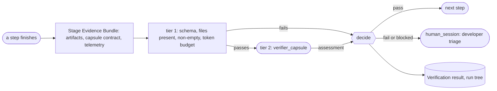

# The Evaluator gate

**Confirmed by:** PRD §3 (Evaluator), §4.3 (gate architecture and payload).

A synchronous gate after the Research Brief and after every DAG step. Tier 1 is cheap code checks; tier 2 is the semantic verifier. `pass` moves on; `fail` or `blocked` stops the run and asks a developer.

| PRD term | Block 1 record or field |
|---|---|
| Stage Evidence Bundle | the [[verification-record\|Verification request]]: `subjects` (artifacts), `checks` (from the capsule's contract), `invocation_ref` (telemetry) |
| verdict `PASS` / `FAIL` / `BLOCKED` | the result's `decision`: `pass`, `fail`, `blocked` |
| capsule contract (`make_capsule.md`) | the capsule's [[declaration\|Declaration]]: ports and checks |
| token budget | the run contract's Binding `budget`; policy `routing` |

The verifier capsule only writes an assessment; the gate, which is code, decides.

**Open:** what exactly `blocked` means and what the developer can do at triage (questions in [[prd-inputs]]).
