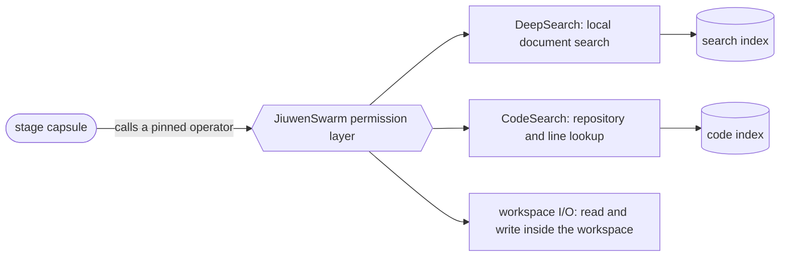

# Operators

**Confirmed by:** PRD §3 (Operators), §4.4 (tool and operator architecture).

Capsules decide *when* an action is needed; operators *do* it. M1 has a fixed whitelist of three, each going through JiuwenSwarm's tool permission layer.

| Operator | Used by | CC kind | Note |
|---|---|---|---|
| DeepSearch | `search_capsule` | `tool` | needs its own index and embedding service |
| CodeSearch | `poc_capsule` | `tool` | writes its own index, so `idempotent` |
| workspace I/O | ingestion, `poc_capsule`, delivery | `tool` | limited to the workspace |

Each operator is an admitted capsule; a stage capsule names the ones it may call in `needs.external`. DeepSearch and CodeSearch pin other agent-core versions than JiuwenSwarm does, so they run as separate services.

**Uses from Block 1:** [[declaration]] (`needs.external`, `effect_class`), [[integration#Fit with the code|fit with the code]].
