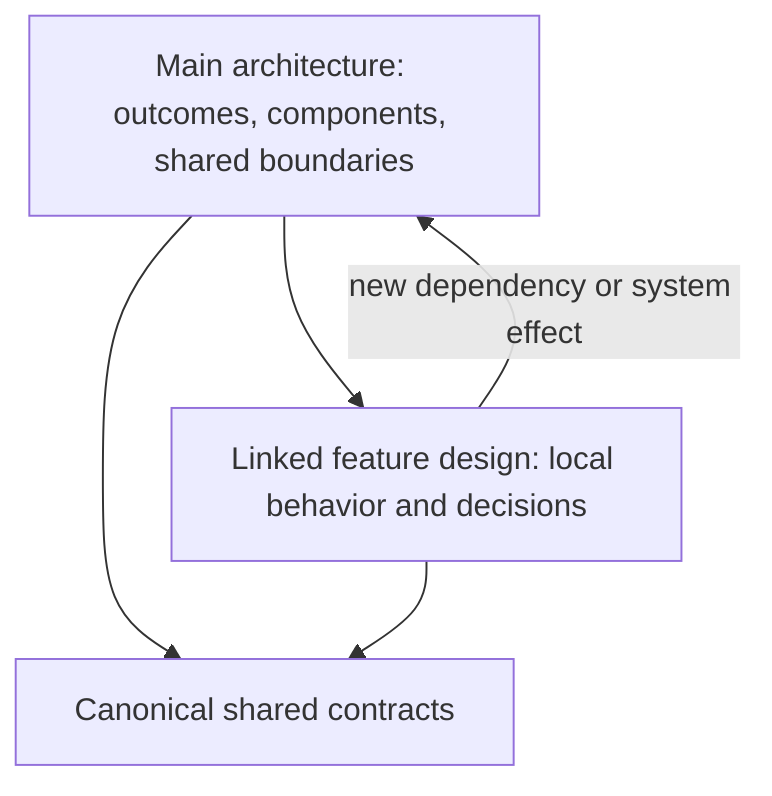

# 4. Grow the design package safely

**Key point:** Keep one authoritative architecture. Add focused design pages when a new feature needs depth, and connect them to the shared system picture.

## Update the shared design when shared behavior changes

Revise existing architecture pages when a requirement changes a product outcome, shared interface, dependency, authority, failure path, phase exit or evidence obligation. Update the main system view and affected module pages so readers see both the local change and its system effects.

## Add a focused design area when the new material has its own shape

A separate feature area helps when the work has a coherent responsibility, multiple internal decisions, its own inputs and outputs, or enough detail to overwhelm the immediate reading route. It should be linked from the package index and show its dependencies and connections to the main design.

| Situation | Preferred document change |
|---|---|
| Small local change with no new shared boundary | Update the owning design page and its evidence links |
| Existing cross-component contract changes | Update the one authoritative contract and affected producer/consumer pages |
| Large, coherent new capability | Update the shared system view, then add a linked feature-area design for the detailed behavior |
| New requirement that changes existing workflow broadly | Update the relevant shared workflow and phase/acceptance pages. Add feature detail only where needed. |

## Preferred pattern: shared core plus linked detail

For a large feature set, avoid choosing between putting every detail in the main design and creating a disconnected package. Update the shared architecture with the new outcome, placement, dependencies and phase impact. Put detailed component behavior in a linked feature area. Keep each shared contract in one authoritative home. Let the main page summarize and link, not copy the contract.

This keeps the change review bounded while preserving enough whole-system context. It also lowers risk of different packages describing the same interface differently. A focused area is an extension of the maintained package, not an independent authority or a fork.

## Safe addition checklist

- State the feature's PRD source and scope.
- Link producers, consumers, shared contracts and affected phases.
- Name assumptions, failure behavior and required evidence.
- Identify which existing pages or evidence need updates.
- Check for duplicate or conflicting definitions before implementation planning.

The [design method's change trace](../design-method.md#change-and-knock-on-effects) remains the source for impact review. The checklist is a concise reading aid, not a new gate.
