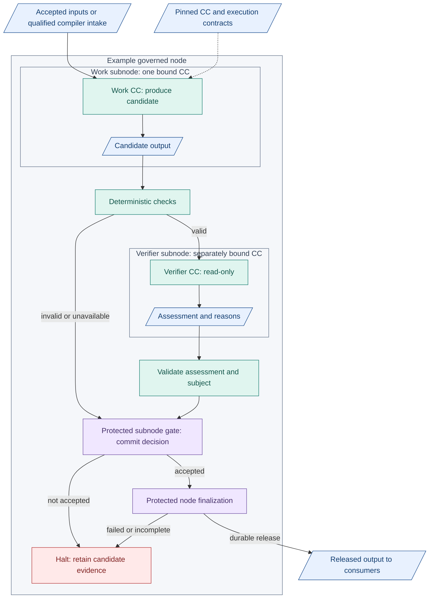
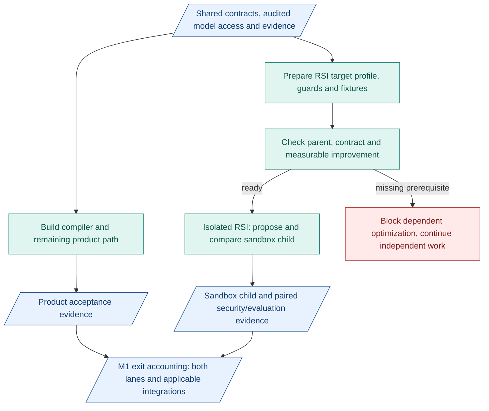

# M1 capsules and parallel RSI work

**A node owns a responsibility. Its subnodes bind pinned capability capsules (CCs).** Work CCs produce candidates. Verifier CCs assess. Protected gates commit acceptance.

## Inside a node

Blue: records. Teal: execution/checking. Purple: protected control. Red: halt. Internal candidates and assessments are handled by the CC system, not external deliverables. Repeat this pattern for additional work subnodes before node release.

## Baseline capsules to build for M1

| Area | Work CC responsibilities |
|---|---|
| Current compiler build | Intention, Requirements |
| Ground and register | Search, Screening, Hypothesis |
| POC node | Builder, Benchmark |
| Conclude | Evaluation, Delivery |

Provide separately pinned verifier CC assignments for each work output. These are responsibilities, not a requirement for nine different verifier implementations. Build declarations, implementation pins and checking profiles together. Phase 3 integration responsibilities follow the [phase plan](../delivery-phases.md). Gates, binder and runner are protected infrastructure, not CCs.

[Node detail](../m1-design.md#execution-and-model-routing) | [CC rules](../capsules.md) | [Authoring](../capsule/authoring.md)

## Build work and verification together

- Define each CC's inputs, outputs and acceptance criteria before its implementation is judged.
- Build checks and verifier assignments alongside work CCs. Use actual candidates to assess fidelity, usefulness and reasonable conclusions.
- Test verifier behavior with labelled good, bad and unclear cases. A verifier is not automatically correct because an AI agent built it.
- Check connected subnodes before extending the path. Keep failures and reasons visible. Verifiers assess, gates release.

## RSI can prepare alongside product work

- **Target 1, required:** Screening's pure `rank_opportunities` helper. Preserve sum-of-three scores, stable ascending-ID ties and Top-1. Improve only a sandbox copy. Live ranking stays unchanged in M1.
- **Target 2, conditional:** allowed Screening prompt/work-rubric text. Required dimensions, interfaces and verifier/referee stay fixed. Defer to M2 if bounded headless model support is unavailable.
- **Parallel means development:** prepare RSI without a finished planner. Optimization needs its own eligible parent and meaningful fixtures. Integrated completion still needs predecessor exits.
- **Freeze protection:** no edits to verifier, referee, hidden fixtures, gate policy or activation. No automatic promotion. Any future use needs admission and explicit human activation.

[RSI targets and protocol](../offline-rsi.md) | [M1 phases](../delivery-phases.md)
