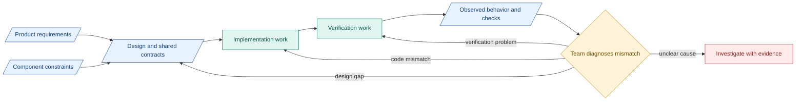

# 1. Design connections

**Design connects the SDLC:** requirements, design, implementation, verification and updates. SDLC means software development life cycle.

## Authority and reasoning

| Source | Defines |
|---|---|
| PRD | Product outcomes and obligations |
| Design | Boundaries, interfaces, authority and failures |
| Native specifications | Implementation and acceptance cases |
| Run evidence | What happened |

- Follow current design for implementation. Changed product obligations need a recorded, authorized decision.
- Separate requirements, decisions, assumptions and proposals. Cite sources. State unknowns.
- Decisions: question, alternatives, choice, reason, revisit signal. Preserve earlier decisions.

## Minimum design content

- Purpose, phase, approach, inputs/producers and outputs/consumers.
- Boundaries, permissions, dependencies, limits, failures/recovery.
- Checks, release conditions, evidence and rationale.

Define shared fields. Keep independent checking and protected durable release. [Principles](../principles.md) | [Contracts](../reference/README.md) | [Component obligations](../research-design.md#architectural-component-obligations).

## Example coordination flow

Blue: records. Teal: work/tools. Amber: human decisions. Red: unresolved.

Coordination decisions are separate from product gates.

**Inspired by [NASA systems engineering](https://www.nasa.gov/reference/systems-engineering-handbook/):** trace changes to reasons and impacts. Use a lighter process for our exploratory team.
