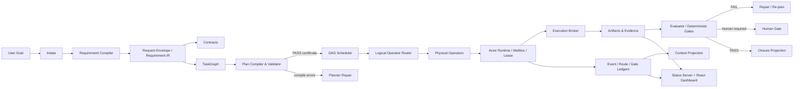

<!-- source: C:\Users\mukch\projects\work\AI4Research\README.md -->
<!-- lines: 179-311 -->
<!-- commit: b0bf165f9ab073aae23e45b3b2796973e5677eea -->

## 架构总览



### 分层

| Plane | 主要职责 | 关键代码 |
|---|---|---|
| Intent / Requirement Plane | intake、分类、IR、PRD、contracts、traceability | `harness/lib/requirement_compiler/`, `compiled_sprint_planner.py` |
| Planning Plane | TaskGraph、capsule、logical operator、plan certificate | `plan_validator.py`, `workflow_contract.py`, `apo_plan_compiler.py` |
| Scheduling Plane | readiness、conflict、parallelism、quota、route | `graph_scheduler.py`, `multi_task_runner.py`, `concurrency_policy.py` |
| Execution Plane | actor、lease、mailbox、action contract、tool execution | `actor_runtime.py`, `actor_lease.py`, `actor_mailbox.py`, `execution_broker.py` |
| Evidence / State Plane | event、gate、route、evidence、closure | `event_ledger.py`, `gate_ledger.py`, `evidence_ledger.py` |
| Context Plane | event projection、budget、redaction、knowledge recall | `context_projection.py`, `context_store.py`, `solar-unified-context.py` |
| Presentation Plane | HTTP API、SSE、dashboard、deliverables、desktop shell | `harness/lib/symphony/status-server.py`, `harness/status-server/react-app/`, `desktop/` |
| Research Plane | AutoSci workflows、evidence/claim/citation substrate | `harness/plugins/autosci/`, `harness/lib/research/`, `.agents/skills/` |

---

## 端到端执行链路

### 1. Intake

用户提交目标后，系统创建 sprint/request 身份，并把原始输入、分类、仓库上下文和附件写入 request envelope。

### 2. Requirement Compilation

Requirement Compiler 输出 PRD、contract manifest、TaskGraph、初始 DAG state 和 closure record。每个关键 artifact 都有稳定路径和 schema version。

### 3. Planning 与 Compile-check

Planner 将需求映射为节点、依赖、logical operator、capability capsule、read/write scope、acceptance IDs 与 gates。

随后由 validator 检查：

```text
schema
→ graph validity
→ capsule admission
→ scope containment
→ operator resolvability
→ gate legality
→ repair budget
→ certificate
```

编译失败不会进入 Builder；错误会写入 plan-compile artifact，供 Planner 修复。

### 4. Scheduling

Scheduler 只选择 ready nodes，并在同一 wave 中排除 write conflicts。运行时可依据 quota、auth、health 和 availability 重绑定 physical operator，而不修改已认证的逻辑计划。

### 5. Dispatch 与 Execution

Actor Runtime：

1. 校验 capability token 与 safety boundary；
2. 解析 logical operator；
3. 获取 actor lease；
4. 装载 context packet；
5. 写入 file mailbox inbox；
6. 写入 scheduler/evidence record；
7. 由执行器处理 task envelope；
8. 将机器可读结果写入 outbox。

对受治理 action，Execution Broker 采用以下 FSM：

```text
proposed
  → validated
  → policy_passed
  → leased
  → executing
  → verified
  → committed
```

失败状态包括：

```text
schema_failed
policy_denied
lease_denied
exec_failed
verify_failed
```

### 6. Evaluation、Repair 与 Human Gate

Evaluator verdict 只有在来源、generation、author 和证据满足 gate-consumability 规则时才会被消费。自评、过期 generation、doctor backfill 或未分配 evaluator 的结论默认不能作为最终 gate。

失败可以进入受限 repair；超过 repair budget 后转为失败或人工处理，不允许无限自循环。

### 7. Closure

Closure projection 汇总：

- all nodes passed；
- all required gates passed；
- acceptance traceability coverage；
- tests / evals；
- changed files；
- residual risks；
- open / failed / human-review nodes。
