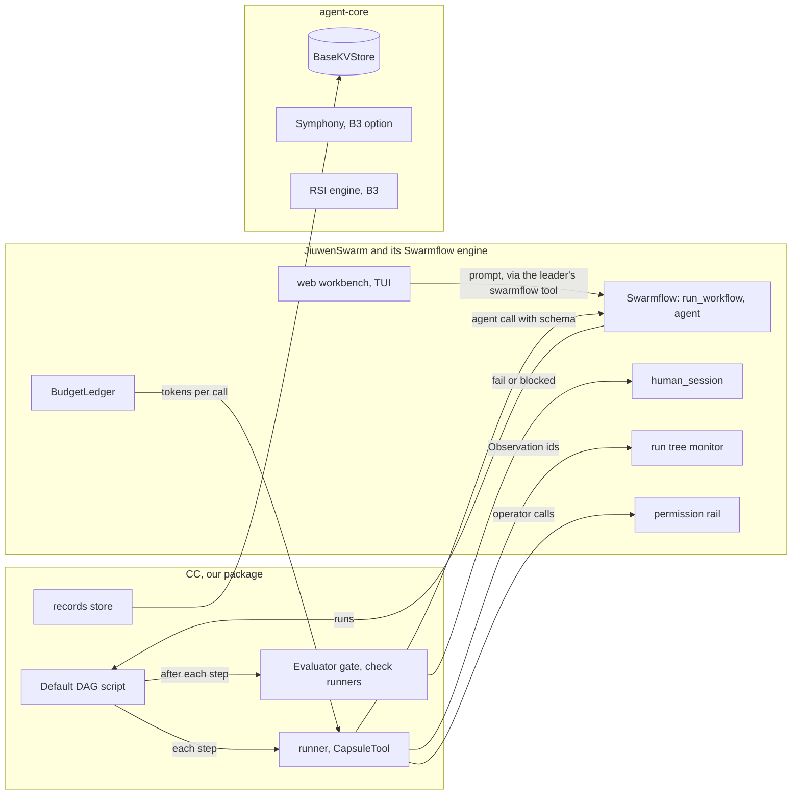

# Where Capability Capsule connects

The exact places in openJiuwen's code where CC plugs in, read in the source. **jiuwenswarm is at commit `143395a1`** (paths under `jiuwenswarm/jiuwenswarm/`, written `JS/`). **agent-core is read at commit `e23806c1`** (paths under `openjiuwen/agent-core/openjiuwen/`). jiuwenswarm pins agent-core `9e339019`, which is not in our clone: every agent-core line number below must be re-checked at that pin before B1 code starts. CC ships as an extension package (the Default DAG script, a runner, the Evaluator gate, rails and a records store); we fork neither repository.

In M1, **Swarmflow runs the Default DAG** and JiuwenSwarm supplies the UI, HITL, token budgets, memory and the run tree. CC adds the pins, the records and the gate around each node.

## jiuwenswarm and Swarmflow: the M1 path

**Swarmflow.** jiuwenswarm configures and monitors Swarmflow; the engine is in agent-core under `agent_teams/workflow/` (written `WF/`). A workflow is a Python script that calls primitives such as `agent()`, `phase()`, `parallel()` and `human()`. There is no declarative DAG: **our Default DAG is such a script.**

| What | Where | How CC uses it |
|---|---|---|
| switches | `JS/common/config.py:40-41` (`enable_swarmflow`, `swarmflow_budget` under `modes.team.jiuwen_team`); defaults `JS/resources/config.yaml:1567-1574` | turn Swarmflow on; set the team budget |
| launching a run | `WF/tool_swarmflow.py:70` `SwarmflowTool`, `run_background` `:537`, inputs `script_path` and `args` (`:127`, `:136`) | the leader launches `default_dag.py` with the prompt verbatim as `args` |
| engine entry | `WF/runner.py:228` `run_swarmflow(script_path, model=..., args=...)`; `WF/engine/runner.py:294` `run_workflow(..., budget, workflow_budget)` | one `model` per run: the single-model routing of M1 |
| script loading | `WF/engine/loader.py:97` `load_workflow_source` | loads the Default DAG script; freeze pins its hash |
| **node execution, our hook** | `WF/engine/primitives.py:540` `agent(prompt, *, label, phase, schema, options)`: abort check, `_check_budget` (`:264`), concurrency gate, `_attempt_calls` (`:645`, retries and schema validation), journal, completed or failed event | the Default DAG calls **our runner**, which calls `agent()` with the capsule's skill as the prompt, `label = step_id`, `phase` = the PRD stage, and `schema` = the output port type's `value_schema` from the vocabulary. The runner writes the Observation and the Artifact around it |
| wrapping without editing the script | `WF/engine/seam.py:37` `Provider`, `use_provider` `:155`; backend `WF/engine/backends/base.py:39,102` `AgentBackend.run` | fallback hook, if calls must be wrapped outside the script |
| a stage's phase | `WF/engine/primitives.py:1506` `phase(title)` | one phase per PRD stage, so the run tree groups calls by stage |
| engine's own `verify()` | `WF/engine/primitives.py:882`; tally in `WF/engine/verify.py` (`pass`/`fail` votes) | not used in M1: our gate needs three outcomes and our records |

**Human in the loop.**

| What | Where | How CC uses it |
|---|---|---|
| `human_session`, `human()` | `WF/engine/primitives.py:1329`, `:1378` | on `fail` or `blocked`, the gate calls `human()` with the Verification result and a schema for the reply (`pass`, `repair`, `fail`) |
| the wait | `WF/backends/avatar_session_backend.py:921` `_await_human_reply`; timeout 600 s (`:82`) | the run does not pause, the coroutine waits. **Choice:** a timeout records the triage as `fail` |
| prompt and reply events | `WF/runner.py:298`, `:309`; `JS/agents/harness/team/handlers/workflow_state.py:1187`, `:1209` | the workbench shows the pending triage |
| reply path | `JS/server/runtime/agent_adapter/interface_deep.py:14071` `handle_swarmflow_reply` (method `chat.swarmflow_reply`) | the developer answers from the web workbench or the TUI |

**Token budget.**

| What | Where | How CC uses it |
|---|---|---|
| team budget in config | `JS/common/config.py:2515` `update_swarmflow_budget_in_config`; validated in `JS/agents/harness/team/config_loader.py:597` | the ceiling for all Swarmflow runs of the team |
| the ledgers | `openjiuwen/agent_teams/agent/agent_configurator.py:798` `BudgetLedger`; `WF/backends/budget_rail.py:27` `SwarmflowBudgetRail` | live enforcement: a call that would exceed stops |
| on exceed | `WF/engine/errors.py:78` `BudgetExhausted` (`scope` `session` or `workflow`) | the runner records the call as `outcome: error`, `reason: BUDGET_EXCEEDED`; the gate returns `blocked` |
| tokens per call | `AgentResult.tokens`, carried on the completed event (`WF/engine/primitives.py:98-109`) | copied into the Observation's `cost.tokens`; tier 1 compares it with the Binding's `budget` |

**The run tree and observability.**

| What | Where | How CC uses it |
|---|---|---|
| run id | `WF/tool_swarmflow.py:53` `new_swarmflow_run_id` (`wf_` + 12 hex), on `Runtime.run_id` (`WF/engine/runtime.py:49`) | our `run_id` is this id |
| run, phase and agent states | `JS/agents/harness/team/handlers/workflow_state.py:200` `WorkflowRunState` (run: running, paused, completed, failed, stopped); agent states `:144` (running, completed, failed, waiting_for_human); `apply` `:345` | the tree is run → phases (`parent_phase`, `:92`) → agents. No `halted` state: a halted run waits in `waiting_for_human` |
| monitor | `JS/agents/harness/team/handlers/workflow_monitor_handler.py:27` `WorkflowMonitorHandler`, `get_run_states` `:216` | the workbench's Swarmflow view |
| pause and stop | `JS/agents/harness/team/team_manager.py:2399` `_pause_swarmflow_runs`; `WF/engine/errors.py:50` `WorkflowAborted` | a `fail` triage ends the run through a stop |
| telemetry | `JS/agents/harness/team/team_manager.py:129` `sync_team_observability`; `JS/observability/models.py:17-30` span ids | Swarmflow nodes have no spans of their own; Observations join the tree by `run_id`, the call's journal key (`agent_id`) and the phase |

**Model, memory, permissions, UI.**

| What | Where | How CC uses it |
|---|---|---|
| Codex CLI | `JS/common/config.py:44-46` (`external_cli_agents`, allowed `claude` and `codex`); `:2261` `_normalize_external_cli_agents` (`cli_path`, legacy `codex_bin`); agent-core `agent_teams/external/cli_agent/codex/options.py:19` | **Codex is an external CLI agent here, not a model provider**; agent-core has a `CodexHarness` (`harness_providers/codex/harness.py:95`) that the fork's `common/external_cli_catalog.py:82` imports. See [fit with the code](#fit-with-the-code) and the questions back to the PRD |
| Task Memory | `JS/agents/harness/common/tools/task_tools.py:96` `_is_task_memory_enabled`; config `JS/resources/config.yaml:791` | M1's durable context; not a CC record |
| Coding Memory | `JS/server/runtime/agent_adapter/interface_code.py:139` `CodingMemoryRail`; `JS/common/coding_memory_paths.py:70` | the POC stage's code context; not a CC record |
| permissions rail | `JS/agents/harness/common/rails/permissions/permission_interrupt_rail.py:44`; off by default (`JS/resources/config.yaml:1139`) | the operator whitelist: ALLOW the admitted operators, DENY the rest |
| user rails | `JS/agents/harness/common/plugins/rail_manager.py:65-77,124` | our runner rail on `before_tool_call` and `after_tool_call`: one Observation per operator call |
| Code Mode, Cluster Mode, leader | `JS/agents/harness/code/spec.py:91`; Cluster Mode is the UI name of team mode (`interface_deep.py:1732`); leader spec `config_loader.py:540` | B2 tests only |

## agent-core: kept for B1, and the B2 and B3 seams

| What | Where | Step | How CC uses it |
|---|---|---|---|
| `Tool`, `ToolCard` | `core/foundation/tool/base.py:216,78` | B1 | operators as `CapsuleTool(Tool)`; card flags from `effect_class` (policy `mappings`) |
| `LocalFunction` | `core/foundation/tool/function/function.py:48` | B1 | wraps operator code the loader fetched by hash |
| `SkillSpec`; `SkillManifestParser` | `harness/schema/extension_spec.py:76`; `symphony/shared/fingerprint/parser.py:129` | B1 | load stage capsules (Markdown skills) and read their frontmatter |
| `PermissionEngine.check_permission` | `harness/security/permission_engine/core.py:272` | B1 | the request has no effect class: the runner asks for `capsule.effect.<class>` |
| `BaseKVStore.exclusive_set`, `get_by_prefix`; object store | `core/foundation/store/base_kv_store.py:42,93`; `core/foundation/store/object/base_storage_client.py:7` | B1 | the records store; code by sha256 |
| `ShelveStore.get_by_prefix` | `core/foundation/store/kv/shelve_store.py:126-135` | B1 | returns the raw `{value, expiry}` wrapper: unwrap it |
| `CapabilityProvider`, `CapabilityDescriptor` | `symphony/interfaces/capability.py:13,28`; `symphony/models/capability.py:61` | B3 | the CC provider |
| graph type filter | `symphony/orchestration/graph/build.py:161` | B3 | accepts only `skill`, `subagent`, `agent`: M1's stage capsules are skills, so they fit; operators do not |
| `OrchestrationService.plan` | `symphony/orchestration/service.py:83,238` | B3 | the dynamic planner track |
| `Evaluator`, `MetricResult`, `EvidenceRef` | `symphony/evaluation/base.py:139`; `models/evaluation.py:223,57` | B1 | check runners may be Evaluators; `EvidenceRef` is reused as is |
| `RsiTaskCreateRequest`, `EngineReport` | `rsi/schema.py:23,165`; `ArtifactType` only `program` or `paper` (`:9`) | B3 | the RSI importer maps reports into Candidates |

## Fit with the code

Checked 2026-09-28 against the local clones: deepsearch `ff243bca` (written `DS/`), sciencediscovery `cee1974` (`SD/skills/`), jiuwenswarm fork `143395a1` and upstream `02b37f47`, agent-core `e23806c1`. **Fits** means the schema or tool can wrap the code as it is; **partly** means it fits after the change named.

| Schema or tool | Code it wraps | Fits? | What the design must account for |
|---|---|---|---|
| `op.deepsearch` (`tool`) | `local_search_tool(query, search_engine_name)`, an agent-core `LocalFunction` (`DS/deepsearch/openjiuwen_deepsearch/framework/openjiuwen/tools/local_search.py:81`); `native` backend (`config/config.py:138`) | partly | Wrap only this function, not the DeepSearch research agent. It needs Milvus and an embedding API (`needs.network: egress`, two `needs.external` service ids) and a prebuilt index (`state_kind: reads_external`). Hits carry `document_name`, `chunk_id`, `score` and a `localdataset://` URL: its output port is `json` with that `value_schema`. "Verified citations" are an LLM pass inside the full agent, not in this function |
| indexing for `op.deepsearch` | the knowledge-base upload and chunking (`server/local_retrieval/core/manager/knowledge_base.py:137,1512-1567`); PDF via agent-core `PDFParser` | no tool yet | Ingestion must index the documents before Search. Proposed: an operator `op.deepsearch_index` (`idempotent`, effect on the collection `ds_kb_<id>_chunks`), listed in `control_operators` |
| `op.codesearch` (`tool`) | `CodeSearchRetriever.index_repository` and `.search(query, top_k)` (`DS/codesearch/openjiuwen_codesearch/api/retriever.py:32,241,297`) | partly | Use the `retropus` engine (`config/agent.py:13,55`): no Milvus, index on disk. Every search runs its own LLM loop (`CODESEARCH_LLM_*`, `config/config.py:42-46`), which conflicts with M1's single model. Output `FinalHit {file_path, start_line, end_line, text}`. Writes `agent_logs/` and the index: `effect_class: idempotent`, not `read_only` |
| both operators, packaging | deepsearch pins agent-core `0.1.17`, codesearch `0.1.10.post3` (`pyproject.toml:27`; base unpinned); jiuwenswarm pins `9e339019` | no | Not importable in one process. Run each as its own service (both have HTTP servers) and declare it with `identity.remote {endpoint, version}`, or as an MCP server; the pin then proves the version, not the code |
| stage capsules as `kind: skill` | all six are `SKILL.md` folders; frontmatter `name`, `description`, `license`, `compatibility`, `allowed-tools`, `metadata` (sciencediscovery loader `packages/specialist/src/skills.ts:115-122`) | yes, as files | `body[]` hashes them as is. Their tools are sciencediscovery's own runtime (below), so each port is a rewrite of the prompt against our ports, not a copy |
| `search_capsule` from `idea-tree-team` | a wrapper that calls `create_idea_research` on a Python engine (`SD/skills/idea-tree-team/SKILL.md:15`) | no | The engine is not in JiuwenSwarm. Port the method (ideation, assessment, aggregation) into the skill, or wrap the engine as an operator |
| `screening_result` from `assessment-screening` | three expert subagents scoring catalyst materials (activity, stability, sustainability), `final_score = 0.35A + 0.35B + 0.30C` (`SKILL.md:51,56-60`) | partly | No feasibility, novelty or compute-alignment rubric exists: the PRD's rubric is new. Keep its shape (per-dimension `{score, analysis}`, one subagent per perspective) |
| `hypothesis` from `evolve-design` | a search designer that calls `create_evolve_run` (`SKILL.md:247`) | no | It produces no hypothesis with variables, metrics or failure criteria. `hypothesis_capsule` is effectively custom |
| `report` from `report-writer` | 7-section Markdown report written to `/mnt/user-data/outputs/` (`SKILL.md:180,186-224`); status COMPLETE, PARTIAL, FAILED | partly | Write into the run's workspace instead. Add the PRD's methodology, benchmark analysis and limitations sections |
| `assessment` from `result-evaluator` | `verdict` ACCEPT_AND_PROCEED, CONDITIONAL, REVISE_AND_RETRY, six dimensions scored 0 to 10 (`SKILL.md:92-99,162-189`) | yes | The gate maps it: ACCEPT gives `pass`, REVISE gives `fail`, CONDITIONAL gives `pass` with label `verifier_conditional`; the raw verdict goes in `source_verdict` |
| citation checks from `citation-reviewer` | one citation per run; MCP literature search, then web (`SKILL.md:21-23`); findings `CITATION_CLAIM_NOT_SUPPORTED`, else INCONCLUSIVE | partly | Needs the network, and M1 is local. INCONCLUSIVE maps to `unknown`, so `blocked`. One call per citation multiplies cost |
| Codex as the model | agent-core `harness_providers/codex` `CodexHarness` (`harness.py:95`), imported by the fork's `common/external_cli_catalog.py:82` | partly | Codex is an agent harness per call, not an LLM provider: the runner's `agent()` call would run on Codex, and tokens come from its events |
| jiuwenswarm fork vs upstream | the fork is upstream `02b37f47` plus 108 commits (104 newer upstream, 4 docs) | yes | Swarmflow keys, `human_session`, Task and Coding Memory, the permissions block and the TUI are unchanged; `team_manager.py` adds round state after a flow, Code Mode drops the default `max_iterations`. Build on the fork |

## Rules for B1 code, so later steps are not blocked

| So that later we can | B1 code must |
|---|---|
| plan dynamically (B2, B3) | keep the planner-binder's output a Plan and freeze's a run contract, even though the Plan is the fixed Default DAG |
| select from a library (B3) | resolve capsule names only through the Standing; never hard-code a capsule's path |
| move off Swarmflow scripts (after M1) | call capsules only through the runner, and keep the gate out of the script's logic: the script calls `gate(step)` and obeys its result |
| branch versions for RSI (B3) | write `lineage.parent` on every version and never overwrite one |
| run skills, tools and agents | the runner switches on `identity.kind` |
| run steps in parallel | the Default DAG script reads only the run contract; steps share no mutable state |

## Blocking gaps

| Gap | Where | Our answer |
|---|---|---|
| no Codex model provider | `JS/common/config.py:44-46` | ask the PRD (question 1 in [PRD alignment](../process/prd-inputs.md#questions-back-to-the-prd)); until then, the configured model |
| two agent-core commits | jiuwenswarm pins `9e339019`; our clone has `e23806c1` (upstream is at `b6db2733`) | fetch `9e339019` and re-check every agent-core line above |
| Swarmflow nodes have no spans | `WF/` has no span code | join by `run_id`, journal key and phase in the Observation's `ext.swarmflow` |
| no per-run tool allowlist | `JS/runtime/agent_definition.py:163-165` | the permissions rail plus our runner rail refuse operators not pinned by the calling capsule or listed for control code in the Default DAG template |
| skill hashes change under one version | `JS/server/runtime/skill/archive_store.py:267-285` | load stage capsules from a read-only copy, by hash |
| human wait times out after 600 s | `WF/backends/avatar_session_backend.py:82` | a timeout is recorded as a `fail` triage |

## Connection order for B1

1. **Pin agent-core** at jiuwenswarm's `9e339019` and re-check the lines above.
2. **Configuration** (`~/.jiuwenswarm/config/config.yaml`): `enable_swarmflow: true`, `swarmflow_budget`, `permissions.enabled: true`, the model endpoint, the workspace directories.
3. **Records store** on `BaseKVStore`; code files on the object store, keyed by sha256.
4. **Admission** of the six stage capsules, `benchmark_runner`, the `verifier_capsule` and four operators (run as services, see [fit with the code](#fit-with-the-code)); the admitted operators become the permission rail's ALLOW list.
5. **The runner:** a function the Default DAG script calls per step. It checks hashes and ports, calls `agent()`, writes the Artifact and the Observation (with `ext.swarmflow`). A user rail records operator calls.
6. **The Evaluator gate:** tier 1 check runners, then the `verifier_capsule` through the runner; on `fail` or `blocked`, `human()`, then the human's decision as a Verification result.
7. **The Default DAG script:** intake and template mapping, the `requirement_capsule` and requirement acceptance, the pass-through planner and freeze, then the six steps in order, each followed by the gate, then delivery.
8. **Launch** from the web workbench or the TUI through the leader's swarmflow tool; watch it in the run tree.
9. **B2 and B3**, beside the M1 path: Cluster Mode, the Leader Agent and Code Mode tests; the dynamic planner (Cluster Mode, Symphony `plan()` as an option), RSI and routing tracks.
