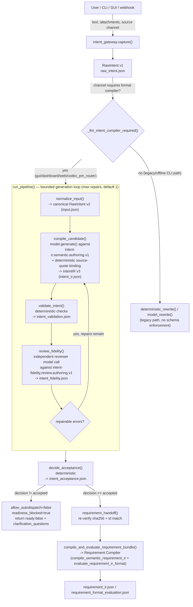

# Stage 1 & 2 — Intake and Intent Compilation

Repo: `/home/muk/work/AI4Research`, branch `openJiuwen-Solar`, HEAD `b0bf165f9`.
Scope: `harness/lib/intent_gateway.py`, `harness/lib/intent_compiler.py`,
intake-side boundary of `harness/lib/intent_consumer.py`, the `intent-*`
compiler schemas, `harness/lib/symphony/status-server.py` intake surface,
intent-related tests, and the intent-related rows of
`harness/metadata/pre-scheduler-stabilization-log-20260829.md`.

## Summary

- Intake is a two-layer pipeline: `intent_gateway.py` (`capture()`) writes a
  `RawIntent` envelope (schema `solar.raw_intent.v1`) from any entrypoint
  (CLI/dashboard/GUI/webhook), then, for channels that require it, hands that
  envelope to `intent_compiler.run_pipeline()`, which normalizes it into a
  canonical `solar.raw_intent.v2` (`normalize_input`) and runs a strict
  4-artifact LLM-in-the-loop admission pipeline: IntentIR → Validation →
  Fidelity review → Acceptance. [VERIFIED]
- IntentIR (`solar.intent_ir.v3`) deliberately separates a **mechanical
  envelope** (id/generation/producer/raw_intent_ref, schema `intent-ir.v3`)
  from a **semantic body** (goals/outcomes/constraints/ambiguities/
  conflicts/unknowns, schema `intent-ir.semantic.v1`) — the model is only ever
  asked to produce the semantic body (via an even narrower "authoring" schema
  variant, `intent-ir.semantic.authoring.v1`, that additionally requires
  `source_quotes`); the compiler code stitches on the envelope fields
  afterward. [VERIFIED — `intent_compiler.py:1016-1060`]
- Four separate persisted artifacts exist per compile: `intent_ir.json`
  (produced by the model, "compiler"), `intent_validation.json` (produced
  entirely by deterministic Python, `validate_intent()`), `intent_fidelity.json`
  (produced by a second, independent model call, "reviewer",
  `review_fidelity()`), and `intent_acceptance.json` (produced by
  deterministic Python, `decide_acceptance()`, which is the only artifact
  authorized to permit Requirement Compiler handoff). [VERIFIED]
- Rejection/clarification is enforced by refusing to advance the pipeline: a
  non-`accepted` `decision` in `intent_acceptance.json` sets
  `routing_hints.allow_autodispatch=False` and
  `routing_hints.readiness_blocked=True` on `raw_intent.json`, and
  `intent_gateway.capture()` returns early (`ready: False`) without ever
  calling `compile_and_evaluate_requirement_bundle()`. `requirement_handoff()`
  in `intent_compiler.py` additionally raises `IntentCompilerError` if called
  on anything but an `accepted` decision, and re-verifies the IntentIR hash
  matches the one referenced by the acceptance record — a second, defense-in-
  depth "must not continue" check. [VERIFIED — `intent_gateway.py:1100-1132`,
  `intent_compiler.py:1508-1524`]
- Bounded repair: at most `SOLAR_INTENT_MAX_REPAIRS` (default 1, hard-capped
  at 4) automatic model repairs per IntentIR generation
  (`_configured_intent_max_repairs()`); after repairs are exhausted, remaining
  *fidelity reviewer* errors (but not deterministic validation errors, and not
  blocking ambiguities/conflicts) are demoted to advisory warnings so the
  reviewer cannot become an unbounded second admission authority
  (`_demote_exhausted_fidelity_findings`). This exact defect and fix is
  documented in the stabilization log (row "Intent 最终 LLM Reviewer 不再成为
  第二准入权威", 2026-09-02). [VERIFIED + DOC-CLAIM]

## Data flow (mermaid)



## Detailed findings

### 1. Raw intake normalization

Two distinct normalizations exist, at two different layers:

**Gateway-level capture** (`harness/lib/intent_gateway.py:976` `capture()`):
Takes CLI args (`--text`/`--file`/`--stdin`, `--source-channel`, `--actor`,
`--repo`, `--cwd`, attachments via `SOLAR_INTAKE_ATTACHMENTS_JSON`, optional
research-artifact fields, clarification answers as `FIELD=VALUE`) and writes
a `RawIntent` envelope, schema `solar.raw_intent.v1`
(`intent_gateway.py:987-1027`):

```
{
  schema_version: "solar.raw_intent.v1",
  intent_id, source: {channel, actor, device, session_id, thread_ref},
  raw: {text, attachments, quoted_context, received_at},
  context: {repo, cwd, related_sprints, knowledge_query},
  routing_hints: {urgency, mode, allow_autodispatch, requires_human_confirm,
                  require_research_artifact},
  trust: {source_trust, prompt_injection_risk: "unknown", contains_secrets: "unknown"},
  clarifications?: {answers},
  research?: {path, project_name, conversation_id, source_url}
}
```
[VERIFIED — `intent_gateway.py:987-1031`]

**Compiler-level normalization** (`harness/lib/intent_compiler.py:356`
`normalize_input()`): re-projects the gateway `RawIntent` (v1 or v2 shape)
into one canonical input envelope, schema `solar.raw_intent.v2`:

```
{
  schema_version: "solar.raw_intent.v2",
  raw_intent_id,
  raw: {text, encoding, sha256, received_at},
  source: {channel, actor_ref},
  context_refs: [...],   # "session:<id>", "thread:<ref>", "sprint:<id>"
  attachments: [...]
}
```
It fails closed with `IntentCompilerError` if `raw.text` is empty, if
`raw_intent_id`/`intent_id` is missing, or if a declared `sha256` doesn't
match the recomputed sha256 of the raw text (`intent_compiler.py:360-368`).
This confirms the metadata example directory
(`harness/metadata/"1-input normalizer output"/raw_intent/raw_intent.json`)
is exactly `solar.raw_intent.v2` shape — matches `normalize_input()`'s output
contract. [VERIFIED — sampled that file directly]

The docstring at the top of `intent_compiler.py` states its narrow charter:
> "The compiler owns only semantic interpretation and admission. It does not
> compile requirements, select workflows, or mutate runtime state."
[VERIFIED — `intent_compiler.py:4-6`]

### 2. IntentIR — required fields, semantic/mechanical split

`IntentIR` (`solar.intent_ir.v3`, schema `harness/schemas/compiler/
intent-ir.v3.schema.json`) has 11 top-level required fields:
`schema_version, artifact_role, intent_ir_id, generation, raw_intent_ref,
producer, goals, outcomes, constraints, ambiguities, conflicts, unknowns`.
[VERIFIED — schema `required` array]

The **semantic body** schema (`intent-ir.semantic.v1.schema.json`) requires
only the 6 content collections: `goals, outcomes, constraints, ambiguities,
conflicts, unknowns` — no id/provenance fields. There is also a stricter
**authoring** variant (`intent-ir.semantic.authoring.v1.schema.json`) that the
model is actually asked to fill in; it additionally requires
`source_quotes` per cited item (verbatim substrings of raw text) instead of
letting the model author `source_spans` directly.

Why the split: `compile_candidate()` (`intent_compiler.py:1016-1060`) calls
`model.generate(...)` against the **authoring** schema only, then:
1. Runs `_schema_errors()` against the authoring schema.
2. Calls `_bind_semantic_source_quotes()` to replace model-authored
   `source_quotes` with deterministically computed `source_spans`
   (`_bind_exact_source_quotes` finds exact, unique offsets in raw text;
   fails with `SOURCE_QUOTE_NOT_FOUND`/`SOURCE_QUOTE_AMBIGUOUS` otherwise).
3. Re-validates the resulting semantic body against the canonical
   `intent-ir.semantic.v1` schema.
4. Only then merges the semantic body with compiler-owned envelope fields
   (`schema_version`, `artifact_role`, `intent_ir_id`, `generation`,
   `raw_intent_ref`, `producer`) to build the final IntentIR v3 object.

This means the LLM never gets to assert its own character-offset math for
evidence spans (which the stabilization log records as unreliable — "live
models could return reversed or inaccurate character coordinates even when
the quoted source text was correct", row dated within the log's "Intent
source-span issue" entry) — the deterministic code always recomputes spans
from quotes. [VERIFIED — code; DOC-CLAIM — the specific historical
motivation, from the stabilization log]

Key semantic-body invariants enforced by mechanical code (not just JSON
Schema), all in `intent_compiler.py`:
- A bounded expression DSL (`_OPERATOR_CONTRACTS`, ~19 operators:
  `all_of, any_of, not, equals, not_equals, contains_all, contains_any,
  contains_none, at_least, at_most, less_than, less_than_or_equal,
  greater_than, greater_than_or_equal, exactly, select_by, bounded_by,
  before, after, implies, triggers`) with explicit arity and positional
  operand-shape checks (`_expression_arity_errors`,
  `_expression_operand_shape_errors`).
- `_distinct_cardinality_errors`: rejects a plain count/cardinality operator
  (`at_least/at_most/exactly`) when the source statement uses
  "distinct"/"unique" wording, because the DSL has no distinct-count
  operator — must fall back to a literal expression.
- Reference integrity: every `ref`/`unknown_ref` inside a constraint
  expression must resolve to an existing goal/outcome/constraint id or
  unknown id (`_iter_expression_references`, checked in `validate_intent`).

### 3. The four artifacts, why fidelity is independent, and producers

| Artifact | File | Schema | Producer |
|---|---|---|---|
| IntentIR | `intent_ir.json` | `intent-ir.v3` (envelope) + `intent-ir.semantic.v1`/`.authoring.v1` (body) | Model ("compiler" role), via `compile_candidate()` |
| Validation | `intent_validation.json` | `intent-validation.v1` | 100% deterministic Python, `validate_intent()` |
| Fidelity review | `intent_fidelity.json` | `intent-fidelity.v1` (canonical) / `intent-fidelity.review.v1` and `.review.authoring.v1` (reviewer output body) | A **second, independently invoked** model ("reviewer" role), via `review_fidelity()` |
| Acceptance | `intent_acceptance.json` | `intent-acceptance.v1` | 100% deterministic Python, `decide_acceptance()` |

Why fidelity review is independent from generation: the same model call that
produced IntentIR cannot be trusted to certify its own output preserved
meaning — the pipeline explicitly instantiates a separate `reviewer_model`
(`model_from_environment("reviewer")`, distinct from `model_from_environment
("compiler")`, both created in `intent_gateway.capture()`,
`intent_gateway.py:1044-1045`) and calls it against a *different* prompt
(`_fidelity_prompt`, `intent_compiler.py:1063-1101`) whose instruction says:
> "You are an independent semantic reviewer... You may judge but may not
> rewrite the IntentIR." [VERIFIED — `intent_compiler.py:1100`]

The reviewer's own source-span claims are likewise never trusted: any
reviewer-reported `SOURCE_SPAN_OUT_OF_BOUNDS`/`INVALID_SOURCE_SPAN` finding is
stripped and replaced with a `REVIEWER_MECHANICAL_CLAIM_REJECTED` warning
(`review_fidelity`, `intent_compiler.py:1124-1148`), and reviewer-cited quotes
are re-bound to deterministic spans the same way as compiler quotes
(`_bind_reviewer_source_quotes`), *raising* (fail-closed) if a reviewer quote
doesn't bind. The reviewer must also report each of 6 fixed check kinds
exactly once (`goals_supported_by_source, outcomes_supported_by_source,
constraints_supported_by_source, no_material_omissions,
no_unrequested_execution, ambiguity_unknown_classification`) or the whole
call raises `IntentCompilerError` (`intent_compiler.py:1170-1180`).

`decide_acceptance()` (`intent_compiler.py:1272-1348`) is the sole authority
that turns {intent_ir, validation, fidelity} into a `decision` in
`{accepted, needs_clarification, failed}`, and it is what sets
`requirement_compiler_handoff_allowed`.

### 4. Rejection / clarification paths and "must not continue" enforcement

`decide_acceptance()` logic (deterministic, in order):
1. If an internal `failure` string was passed in (e.g., `IntentCompilerError`
   caught by `run_pipeline`) → `decision = "failed"`.
2. Else if `intent_ir`/`validation`/`fidelity` is missing → `"failed"`
   ("Required Intent Compiler artifacts are missing.").
3. Else if `validation.status == "fail"` → `"failed"` ("IntentIR mechanical
   validation failed.").
4. Else, collect `blocking` ambiguities (`ambiguity.blocking == True`) and
   `conflicts`. If any conflict has `resolution == "reject"` → `"failed"`,
   reasons = conflict descriptions.
5. Else if there are any blocking ambiguities or (non-rejected) conflicts →
   `decision = "needs_clarification"`, and `questions` is built from each
   blocking ambiguity's `question` field and each conflict's generic
   "Which conflicting instruction should take priority?" question, each
   carrying `source_spans` for UI display.
6. Else → `"accepted"`.

`requirement_compiler_handoff_allowed` is simply `decision == "accepted"`.
[VERIFIED — `intent_compiler.py:1272-1348`]

Enforcement of "must not continue" happens at **two independent layers**:

- In `intent_gateway.capture()` (`intent_gateway.py:1100-1132`): if
  `acceptance["decision"] != "accepted" or not accepted_intent`, the code
  mutates `raw_intent["routing_hints"]` to set `allow_autodispatch=False` and
  `readiness_blocked=True`, re-persists `raw_intent.json`, writes
  `requirement_trace.json`, and **returns early** — it never calls
  `compile_and_evaluate_requirement_bundle()`. The returned payload has
  `"ready": False` and surfaces `acceptance["clarification_questions"]`.
- In `intent_compiler.requirement_handoff()` (`intent_compiler.py:1508-1524`):
  a second, code-level gate that raises `IntentCompilerError("only accepted
  IntentIR may reach the Requirement Compiler")` if `decision != "accepted"`
  or `requirement_compiler_handoff_allowed` is falsy, and additionally
  recomputes `sha256_payload(intent_ir)` to confirm it matches
  `acceptance["intent_ir_ref"]["sha256"]` — i.e. even a caller that already
  has an "accepted" acceptance record cannot hand off a *different* (e.g.
  tampered or stale) IntentIR object than the one the acceptance actually
  covers.

At the GUI/status-server layer, `_extract_intent_admission()`
(`status-server.py:959-973`) parses the intake CLI's JSON stdout for a
`readiness_status` of `needs_clarification` or `failed` plus an `intent_id`,
and `_intake_payload()` (`status-server.py:1421-1436`) turns that into an
HTTP response with `"error": "intent_needs_clarification"` or
`"intent_compilation_failed"` and forwards `clarification_questions` — no
sprint is ever created for a non-accepted intent.

A legacy/offline path also exists: `compile_ambiguity_readiness()`
(`intent_gateway.py:631-777`) is a **separate, deterministic**
(non-LLM) blocking-question detector used only in the `legacy_deterministic`
compiler mode (when `SOLAR_INTENT_COMPILER_PROVIDER` is unset and the channel
does not require the formal compiler). It looks for missing objective, an
explicit "either X or Y" choice, and three hardcoded contradiction rules
(execution_network, mutation_policy, delivery_format). This is architecturally
distinct from the LLM IntentIR ambiguities/conflicts mechanism, and is marked
in code comments as a "bounded, deterministic preflight" fallback, not the
production semantic authority (see `intent_gateway.py:6-8` and
`_llm_intent_compiler_required` docstring).

### 5. LLM calls: budgets, limits, retries

Two model roles are instantiated per compile, both via `model_from_environment
(role)` → `stage_model("intent", role, timeout_seconds=...)`
(`intent_compiler.py:351-353`):
- `"compiler"` role: generates IntentIR semantic body.
- `"reviewer"` role: generates fidelity findings.

Concrete implementation for each is `CodexJsonModel` (`intent_compiler.py:220-348`,
a dataclass with `model: str`, `timeout_seconds: int = 240`,
`provider: str = "codex"`). Its `.generate()`:
- Invokes `codex exec --json --ephemeral --ignore-user-config --ignore-rules
  --skip-git-repo-check --sandbox read-only --output-schema <schema>
  --output-last-message <output> [--model <model>] -` as a subprocess, piping
  the prompt via stdin.
- Timeout: `effective_call_timeout(self.timeout_seconds)`, which is bounded
  by a shared cross-process deadline read from env var
  `SOLAR_MODEL_CALL_DEADLINE_UNIX` (`MODEL_CALL_DEADLINE_ENV`) if set; the
  call is refused outright (raises `IntentCompilerError`) if fewer than
  `MIN_MODEL_CALL_SECONDS = 5` seconds remain.
- Default per-call timeout is controlled by
  `SOLAR_INTENT_MODEL_TIMEOUT_SEC` env var (default `"240"` seconds),
  set in `model_from_environment()`.
- Failure classification via `_provider_failure()`: `malformed_provider_events`,
  `invalid_json_schema`, `provider_quota` (matches "usage limit"/"quota"/
  "rate limit"), `provider_auth`, `provider_output_missing`, or generic
  `provider_error`. Every call (success or failure) writes a
  `model_call_receipt.json` (`_model_call_receipt`) recording provider,
  model, status, exit_code, duration_ms, and error code/detail.
- **No automatic provider-level retry** on transient failure inside
  `CodexJsonModel.generate()` — a raised `IntentCompilerError` propagates up
  through `compile_candidate`/`review_fidelity` into `run_pipeline`'s
  `try/except (IntentCompilerError, StructuredModelError,
  OutputContractError)`, which converts it directly into a `"failed"`
  acceptance decision (`decide_acceptance(..., failure=str(exc))`). Retry, if
  any, happens only at the *generation/repair* level below, not at the raw
  subprocess-call level.

Repair budget (retry loop, not a raw-call retry): `_configured_intent_max_repairs()`
(`intent_compiler.py:210-217`) reads `SOLAR_INTENT_MAX_REPAIRS`
(default `1` if unset/unparseable, clamped to `[0, 4]`). `run_pipeline()`
(`intent_compiler.py:1368-1479`) loops `generation` in
`range(max_repairs + 1)`:
- generation 0: initial `compile_candidate()` → `validate_intent()` →
  (if schema-readable) `review_fidelity()`.
- If any `repairable` errors remain from validation/fidelity, and repairs
  remain, it writes a `repair_record.json` and calls `compile_candidate()`
  again with `previous=intent_ir` and `defects=<repairable errors>` — the
  model gets exactly one shot per generation to fix everything at once
  (prompt: "Correct every listed error in one response.").
- Loop breaks early once no repairable errors remain.
- After the loop, if validation passed but fidelity still failed (repairs
  exhausted), `_demote_exhausted_fidelity_findings()` converts the fidelity
  `fail` into `pass_with_warnings` (advisory-only) rather than blocking
  admission further — this exact mechanism is the fix recorded in the
  2026-09-02 stabilization-log entry "Intent 最终 LLM Reviewer 不再成为第二准入权威".

So per intent capture: up to `(max_repairs + 1)` compiler calls and up to
`(max_repairs + 1)` reviewer calls — default config = 2 compiler + 2 reviewer
calls maximum (generation 0 + one repair).

### 6. Handoff contract to the Requirement Compiler

`intent_gateway.compile_and_evaluate_requirement_bundle()`
(`intent_gateway.py:951-973`) is the actual handoff function called from
`capture()` only when `acceptance["decision"] == "accepted"` and
`accepted_intent` is present:
1. `requirement_handoff(intent_ir, intent_acceptance)` — the fail-closed gate
   described in Q4, returns `{status: "received", intent_ir_id,
   intent_ir_sha256, next_component: "requirement_compiler",
   execution_started: False}`.
2. `compile_semantic_requirement_ir(intent_ir, intent_ir_sha256=..., work_dir=...,
   model=None, reviewer=None)` (imported from
   `requirement_compiler.semantic`) — produces `requirement_ir`.
3. `evaluate_requirement_ir_format(requirement_ir, intent_ir=..., intent_ir_sha256=...,
   intent_acceptance=...)` (from `requirement_compiler`) — produces
   `requirement_evaluation`, itself gating further with a `status != "pass"`
   check back in `capture()` (writes `requirement_format_evaluation.json`,
   sets `allow_autodispatch=False` again if the evaluation fails).

So the contract handed across the Stage1/2 → Stage-3 (Requirement Compiler)
boundary is: **the accepted IntentIR object plus its sha256, plus the
acceptance record proving it was accepted** — not raw text, and not the
gateway's `RawIntent`. `requirement_ir_id_for_intent(intent_id)` (imported
from `requirement_compiler`) derives a deterministic requirement id from the
intent id. The written artifact set at the gateway level after a full
successful run includes: `raw_intent.json`, `intent/input.json`,
`intent/intent_ir.json`, `intent/intent_validation.json`,
`intent/intent_fidelity.json`, `intent/intent_acceptance.json`,
`requirement_ir.json`, `requirement_format_evaluation.json`,
`requirement_trace.json` (schema `solar.requirement_trace.v1`, with a
`stages` array recording ok/failed per pipeline stage).

`intent_consumer.py` (the next hop after gateway/compiler, at the intake-side
boundary only) reads `raw_intent.json` and `requirement_ir.json`
(`load_intent()`, `intent_consumer.py:173-207`); if there is no legacy
`rewritten_intent.json`, it reconstructs a compatibility "planning view" from
`intent/intent_ir.json` via `_semantic_intent_compatibility_view()`
(`intent_consumer.py:134-170`), and cross-checks that the requirement's
`intent_ir_ref.intent_ir_id` matches the actual `intent_ir.json`'s
`intent_ir_id`, raising `SystemExit` on mismatch — another mechanical
consistency gate at the Stage-2→Stage-3 handoff. Per the module docstring:
> "The gateway captures raw user intent. This consumer is the next hop...
> raw natural language is never sent directly to operators." [VERIFIED —
> `intent_consumer.py:4-7`]

### 7. Known bugs/limitations (from the stabilization log and code)

From `harness/metadata/pre-scheduler-stabilization-log-20260829.md`
(dated entries through 2026-09-02), intent-relevant rows/entries
[DOC-CLAIM — these are the log's own claims about historical defects/fixes]:

- Row 2: `intent_gateway.py` defaulted intent/sprint directories to
  `Path.home()` and ignored `HARNESS_DIR`, so GUI intake wrote compiler
  artifacts to the wrong runtime location. Fixed to derive defaults from the
  portable runtime root.
- Row 3: `intent_consumer.py` independently repeated the same stale
  `Path.home()` default-path bug, causing `intake_cli_failed` even after
  IntentIR/RequirementIR were accepted.
- "Intent source-span issue": live models could return reversed/inaccurate
  character coordinates even when the quoted text was correct. Fixed by the
  `source_quotes` → deterministic `source_spans` binding described in Q2/Q3
  above.
- Repeated pattern across several dated web-retry entries: single-repair
  budget exhaustion causing the run to fail closed after the reviewer
  surfaces a *second* class of finding only after the first repair (e.g. the
  "网络用途白名单" (network-purpose allowlist) `contains_none` mis-approximation
  bug, the "8–12 source target vs. degraded-mode fallback" unconditional-bound
  bug, the "distinct/unique cardinality" bug) — several of these directly
  match hardening logic now present in `intent_compiler.py` (e.g.
  `_distinct_cardinality_errors`, the "whitelist must be literal, never
  contains_none over synthetic outside-set" prompt language at
  `intent_compiler.py:988-995`, and the "target/range/minimum with fallback
  must not become unconditional bound" prompt language at lines 977-981).
  This suggests these were once *live-only* failure modes, subsequently
  encoded into the deterministic/prompt contract as attempted fixes.
- "Intent 最终 LLM Reviewer 不再成为第二准入权威" (2026-09-02): identifies that
  a second post-repair reviewer opinion could terminate an otherwise
  deterministically-valid IntentIR, since the reviewer is a single (random)
  model call that cannot guarantee enumerating every finding in one pass.
  Fixed via `_demote_exhausted_fidelity_findings()` (Q3/Q5 above) — the
  reviewer keeps its one bounded repair proposal, but stops being able to
  block admission a second time once deterministic validation passes.
- Several entries note a *diagnostic/telemetry* defect, explicitly recorded
  as "not fixed": the CLI's error summary sometimes misattributes a
  **Requirement Compiler** stage failure (e.g. `RequirementCompilationError`,
  provider-capacity errors during Requirement's own model calls) as "the
  Intent Compiler did not produce an accepted IntentIR," even though
  `intent_acceptance.json` on disk correctly says `"accepted"`. This is an
  operator-facing error-message/observability bug at the Stage 2 → Stage 3
  seam, not a correctness bug in the artifacts themselves.
- The legacy-path code comment in `intent_gateway.py:1264-1266` itself flags
  a known limitation as a runtime `warnings` entry:
  `"intent_compiler_unconfigured: SOLAR_INTENT_COMPILER_PROVIDER is unset; no
  semantic validation ran"` — i.e. the deterministic legacy path openly
  documents that it provides no semantic (LLM) validation at all.

No entries were found describing unresolved *open* bugs specifically inside
`intent_gateway.py`/`intent_compiler.py`/`intent_consumer.py` as of the
snapshot examined (all intent-stage rows found were resolved, i.e. paired
with a "Fix"/commit hash), except the observability/error-attribution issue
above, which the log explicitly marks unfixed.

## Key code references

| File:Line | What it does |
|---|---|
| `harness/lib/intent_gateway.py:42` | `_llm_intent_compiler_required()` — decides which source channels must use the formal LLM IntentIR compiler (default: `cli_intake, dashboard, gui, webapp, web, codex_pm_router`) |
| `harness/lib/intent_gateway.py:501` | `infer_mode()` — legacy deterministic mode classifier (debug/monitor/strategy/delivery/research/direct_answer), used only in the non-formal path |
| `harness/lib/intent_gateway.py:527` | `deterministic_rewrite()` — legacy fallback rewrite when no LLM compiler is configured |
| `harness/lib/intent_gateway.py:631` | `compile_ambiguity_readiness()` — deterministic blocking-question detector for the legacy path only |
| `harness/lib/intent_gateway.py:976` | `capture()` — top-level entrypoint; builds `RawIntent`, branches formal vs legacy compiler, enforces `allow_autodispatch=False` on non-accept |
| `harness/lib/intent_gateway.py:951` | `compile_and_evaluate_requirement_bundle()` — the actual handoff call into the Requirement Compiler |
| `harness/lib/intent_compiler.py:33-44` | Module-level schema path constants for all 6+2 compiler schemas |
| `harness/lib/intent_compiler.py:210` | `_configured_intent_max_repairs()` — env `SOLAR_INTENT_MAX_REPAIRS`, default 1, capped [0,4] |
| `harness/lib/intent_compiler.py:220` | `CodexJsonModel` dataclass — subprocess-based `codex exec` model call, default 240s timeout |
| `harness/lib/intent_compiler.py:200` | `effective_call_timeout()` — bounds a call by a shared cross-process deadline env var |
| `harness/lib/intent_compiler.py:356` | `normalize_input()` — RawIntent v1/legacy → canonical v2, sha256 integrity check |
| `harness/lib/intent_compiler.py:477` | `_bind_exact_source_quotes()` — deterministic quote→span binding, fails on not-found/ambiguous |
| `harness/lib/intent_compiler.py:636` | `_OPERATOR_CONTRACTS` — the bounded constraint-expression DSL's arity/shape table |
| `harness/lib/intent_compiler.py:782` | `validate_intent()` — deterministic IntentIR validator, 7 check kinds |
| `harness/lib/intent_compiler.py:949` | `_compiler_prompt()` — full prompt text sent to the "compiler" model role |
| `harness/lib/intent_compiler.py:1016` | `compile_candidate()` — model call + schema binding + envelope assembly for one IntentIR generation |
| `harness/lib/intent_compiler.py:1063` | `_fidelity_prompt()` — full prompt text sent to the "reviewer" model role |
| `harness/lib/intent_compiler.py:1109` | `review_fidelity()` — independent reviewer call, rejects reviewer's own span claims |
| `harness/lib/intent_compiler.py:1230` | `_demote_exhausted_fidelity_findings()` — post-repair fidelity `fail`→`pass_with_warnings` demotion |
| `harness/lib/intent_compiler.py:1272` | `decide_acceptance()` — the sole admission-decision function |
| `harness/lib/intent_compiler.py:1368` | `run_pipeline()` — orchestrates the whole bounded generation/repair loop |
| `harness/lib/intent_compiler.py:1508` | `requirement_handoff()` — second fail-closed gate before Requirement Compiler |
| `harness/lib/intent_compiler.py:1527` | `verify_artifact_chain()` — recomputes every hash reference across a completed compile directory (audit/debug tool) |
| `harness/lib/intent_consumer.py:134` | `_semantic_intent_compatibility_view()` — projects IntentIR into legacy PM planning-view shape |
| `harness/lib/intent_consumer.py:173` | `load_intent()` — cross-checks requirement's `intent_ir_ref` against actual IntentIR id |
| `harness/lib/symphony/status-server.py:959` | `_extract_intent_admission()` — parses intake CLI stdout for a fail-closed IntentIR stop |
| `harness/lib/symphony/status-server.py:1288` | `_intake_payload()` — GUI/webhook intake entrypoint, returns `intent_needs_clarification` / `intent_compilation_failed` without creating a sprint |
| `harness/schemas/compiler/intent-ir.v3.schema.json` | Envelope schema, 11 required fields |
| `harness/schemas/compiler/intent-ir.semantic.v1.schema.json` | Canonical semantic-body schema, 6 required collections |
| `harness/schemas/compiler/intent-ir.semantic.authoring.v1.schema.json` | What the model is actually asked to produce (adds `source_quotes`) |
| `harness/schemas/compiler/intent-validation.v1.schema.json` | Deterministic validation artifact schema, 11 required fields |
| `harness/schemas/compiler/intent-fidelity.v1.schema.json` | Canonical fidelity artifact schema, 9 required fields |
| `harness/schemas/compiler/intent-acceptance.v1.schema.json` | Acceptance artifact schema, 12 required fields incl. `requirement_compiler_handoff_allowed` |

## Notable quotes

- `intent_compiler.py:4-6` (module docstring): "The compiler owns only
  semantic interpretation and admission. It does not compile requirements,
  select workflows, or mutate runtime state."
- `intent_gateway.py:6-8` (module docstring): "Interactive production
  channels require the formal LLM IntentIR compiler; deterministic rewriting
  remains an offline/CLI compatibility path and must never silently classify
  GUI requests."
- `intent_compiler.py:953-956` (compiler prompt): "Represent what the user
  requested without choosing a workflow, DAG, capsule, worker, or
  implementation. Every goal, outcome, constraint, ambiguity, and conflict
  must cite exact zero-based character spans... source_spans remains
  required for the provider contract, but the deterministic compiler ignores
  model-authored coordinates and replaces them from source_quotes."
- `intent_compiler.py:961-964` (compiler prompt, blocking-ambiguity rule):
  "Only an ambiguity that changes the deliverable, scope, authorization, or
  irreversible effect is blocking. If workflow discovery, analysis, or design
  can resolve a choice without changing those boundaries, record an unknown
  with the correct resolution stage instead of a blocking ambiguity."
  (This is the operative "what counts as clarification-worthy" rule.)
  Continues: "an unreferenced missing object that defines the requested
  deliverable is blocking."
  (This is the operative rule for what counts as clarification-worthy.)
- `intent_compiler.py:1064-1066` (fidelity prompt): "You are an independent
  semantic reviewer... Report an error only when the IntentIR materially
  changes or omits a requested deliverable, scope, constraint, authorization,
  or meaning. Awkward wording and harmless differences are warnings or
  passes."
- `intent_compiler.py:1100` (fidelity prompt): "You may judge but may not
  rewrite the IntentIR."
- `intent_compiler.py:943` (in `validate_intent`'s `failure_policy` field):
  "Return repairable defects for one bounded model repair; never repair user
  ambiguity."
- `intent_compiler.py:1231-1236` (`_demote_exhausted_fidelity_findings`
  docstring): "The reviewer can propose the one compiler repair, but it is
  not a second admission authority. Deterministic validation, explicit
  ambiguity and explicit conflict handling remain blocking."
- `intent_consumer.py:4-9` (module docstring): "The gateway captures raw user
  intent. This consumer is the next hop: it turns an intent directory into an
  immutable RequirementIR sprint package... raw natural language is never
  sent directly to operators."
- `intent_gateway.py:1264-1266` (runtime warning literal in legacy path):
  `"intent_compiler_unconfigured: SOLAR_INTENT_COMPILER_PROVIDER is unset; no
  semantic validation ran"`.

## Open questions & uncertainties

- The `intent-fidelity.review.v1.schema.json` and `.review.authoring.v1`
  files were located and their `required` fields inspected
  (`checks, decisions, errors, warnings`), but their nested `$defs` (e.g. the
  exact shape of an `errors[]` issue object, or the `checks[].kind` enum
  values) were not read in full — could be worth a follow-up read for a
  reader needing the literal issue-object schema.
  [scope limitation — not required by the questions asked, but flagged.]
- `model_from_environment()` / `stage_model()` (defined in
  `harness/lib/structured_model.py`) is the factory that ultimately decides
  which concrete `JsonModel` implementation and specific model name/provider
  get used for "compiler" vs "reviewer" roles in a given deployment; I
  confirmed `stage_model` exists (`structured_model.py:259`) but did not read
  its body — so I cannot state from direct code reading whether provider
  choice can differ between compiler/reviewer roles, or what the default
  concrete provider is beyond the fallback `CodexJsonModel` shown directly in
  `intent_compiler.py`. [INFERRED / not fully verified — flagged as a gap]
- The `_planner_workflow_candidates()` function in `intent_gateway.py` (used
  only by the **legacy** `build_requirement_ir()` path, not the formal
  IntentIR path) imports `workflow_router.classify_research_request` — this
  is a Stage 2→3 boundary detail belonging more to the Requirement
  Compiler/Planner side; noted but not investigated further per scope.
- I did not execute or run any tests (per instructions); test files
  (`tests/harness/test_intent_gateway.py`, `test_intent_compiler.py`,
  `test_intent_consumer.py`, `test_intent_gateway_readiness.py`,
  `test_intent_telemetry_audit.sh`, `test_intent_engine_adapter.sh`,
  `test_migrate_intent.sh`, `tests/harness/requirement_compiler/
  test_intent_ir_requirement_compiler.py`, `tests/harness/
  research_orchestration/test_research_intent.py`, and the JSON case files
  under `tests/foundation/intention_compilers/` and
  `tests/workflow/requirement_compilation/`) were located but not opened in
  detail — their exact assertions were not cross-checked against this
  report's code-reading conclusions. A closer pass through these would be
  the natural next step to corroborate section 4/5 claims with test evidence
  rather than code-reading alone.
- The stabilization log is very long (133+ lines matched "intent"); I read a
  meaningful majority (through 2026-09-02 entries) but did not exhaustively
  read every single line/row of the full document — later rows beyond what
  was previewed may contain additional intent-relevant entries not captured
  here.
