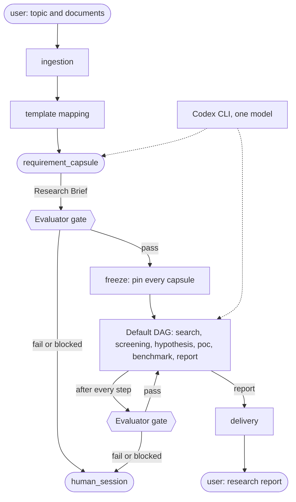
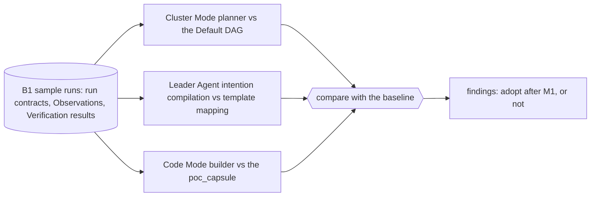
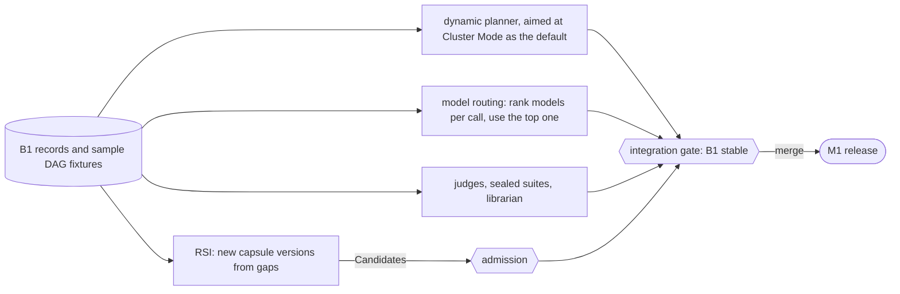

# B1, B2 and B3 at a high level

B1 to B3 are our order of work inside M1 (the PRD's milestone 1). **B1 is the M1 release path.** B2 and B3 run beside it on B1's sample data, and are merged only once B1 is stable (PRD §2, the integration gate). Definitions: [[overview#Build steps B1 to B3, inside M1|Block 1 overview]].

## B1: Phase 1, the deterministic baseline

One research request through the hardcoded Default DAG in Swarmflow, with the Evaluator gate after every step.

Detail: [[default-dag|the Default DAG]], [[evaluator-gate|the Evaluator gate]], [[ingestion-and-brief|ingestion and the Research Brief]], [[operators|operators]], [[model-access|model access]], [[runtime-and-records|runtime and records]].

## B2: Phase 2, concurrent tests

Three tests of JiuwenSwarm's own features against the B1 baseline, using B1's sample runs. Each reports how it compares; none replaces the baseline in M1.

## B3: the parallel tracks

Components developed offline against B1's records and sample DAG fixtures; merged only through the integration gate.

