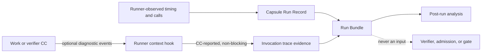

# Workload profiling

`Knowledge · M1 design context and M2 direction · No PRD change`

## Purpose

Workload profiling shows where a run spends time and resources, which CC version did the work, and which tool or model calls contributed. The design already captures much of the execution trace. This page records a small M1 extension and the larger host-level work that should wait for M2.

| Term | Meaning here | Main record or owner |
|---|---|---|
| CC invocation | One work or verifier CC execution, including wrapped tools and agent work. | Protected CC runner and Capsule Run Record. |
| CC diagnostic event | Optional CC-authored description of an internal phase the runner cannot see. | Raw invocation trace. Informational only. |
| Container profile | CPU, memory, network, and block I/O for the shared app container. | Host-level collector. Not attributable to one CC by itself. |
| Storage profile | Bytes retained by one run or by Docker volumes. | Run evidence accounting or host-level collector, respectively. |

## What is already designed

| Existing design | Profiling value | Limit |
|---|---|---|
| [Invocation observation](reference/field-catalog.md#invocation-observation) | Exact CC identity, start/end, duration, model-call count, outcome, effects, usage, and evidence refs. | Runner-observed values. It does not sample live CPU or memory. |
| [Per-call evidence](reference/derived-records.md#records-folder-layout) | `model_calls.jsonl`, `tool_calls.jsonl`, full `trace.jsonl`, prompt, CC files, inputs, outputs, and workspace. | Only detail visible to current capture hooks. No CC-authored event API is specified. |
| [Run Bundle and derived records](reference/derived-records.md) | Links invocations to immutable evidence and supports later conformance, scorecards, and exports. | Derived records never decide gate outcomes. |
| [Docker deployment](platform/README.md#data-foundation) | App container writes persistent SQLite state, artifacts, and `records/` volumes. Run-start evidence records host facts. | Host facts are a snapshot, not live container use or volume growth. |
| [Sidecar](development-tools/sidecar/README.md) | Runs benchmark and test clients off the hot path. | No Docker socket, private app-volume access, or host shell. It cannot directly measure Docker volumes or app-container resource use. |

## Small M1 design addition

Keep the PRD, CC declaration, IR, node behavior, verification inputs, and admission rules unchanged. Add an optional reporting hook to the CC execution context for CCs that want to describe internal work hidden from the runner.

| Proposal | Design location | Contract |
|---|---|---|
| Optional `profile_event(name, attributes)` helper | [CC invocation and evidence layout](reference/derived-records.md#records-folder-layout) | CC may emit bounded phase or child-operation labels and safe attributes. It does not supply run identity or authoritative timestamps. |
| Separate diagnostic trace file | Per-call `trace/` folder and existing `trace_refs` | Runner timestamps and associates events with the invocation, marks them CC-reported, and stores them separately, for example in `cc-events.jsonl`. Do not merge them into trusted runner observations. |
| Failure behavior | [Evidence release rule](reference/derived-records.md#release-rule) | Missing, malformed, or failed diagnostic events are ignored or marked unavailable. They never block execution or release. |
| Trust boundary | [Checking architecture](checking/README.md) and [admission](capability-capsules/library-and-checking.md#library-lifecycle) | Output is not a CC output port, declaration, conformance claim, verifier input, mandatory check, admission signal, or gate input. It is optional observability data only. |

This is a small runtime-context and capture-hook addition. It needs no new IR or CC schema. It does add a helper and a file format, so it should be treated as optional M1 work. October 30 acceptance must not depend on it. If the hook is absent or broken, normal execution and checking proceed unchanged.

CC authors provide semantic labels when useful. The runner supplies identity and time. Verifiers, deterministic checks, admission, and the gate do not assess or consume these events. Events can be wrong or absent and remain diagnostic evidence, not proof.

## Docker resources and storage

| Measure | Practical source | M1 fit | M2 direction |
|---|---|---|---|
| CC elapsed time and calls | Existing runner hooks and invocation observation. | Already designed. | Add child phase labels through the optional hook. |
| Run evidence bytes | Sum files written under that run's `records/runs/<run_id>/` evidence tree. | Could be an optional run-end summary. It measures retained run evidence, not all Docker storage. | Trend sizes across runs and report retention growth. |
| App-container CPU, memory, network, block I/O | Docker runtime/host metrics. | Deferred. Run-start host facts are context only. | Sample externally and correlate by run window. These are shared-container totals, not per-CC measures. Overlapping runs make per-run attribution ambiguous. |
| Docker volume usage | Docker host API or host filesystem accounting. | Deferred. App-side evidence sizes do not equal total volume usage. | Measure named volumes and total usage through a narrowly scoped host collector. |

Do not give the existing sidecar a Docker socket or private volume mounts to collect these metrics. Its current contract is an authenticated client. If M2 requires Docker-wide metrics, add a separate host collector with a narrow read-only interface, or an explicitly isolated host executor. The sidecar may request a report through that interface, but should not own daemon credentials. This adds a new privilege boundary and needs separate design and verification.

## What changes where

| Page | Suggested design edit |
|---|---|
| [Derived records](reference/derived-records.md) | For optional M1 support, specify event shape, bounds, `cc-events.jsonl`, trace reference, and non-blocking failure behavior. |
| [Field catalog](reference/field-catalog.md) | No schema change proposed. Revisit only if consumers need a stable event reference field beyond existing `trace_refs`. |
| [Checking and admission](checking/README.md) / [CC library](capability-capsules/library-and-checking.md) | Add a short exclusion: diagnostic events are not verified, admitted, or gate inputs. |
| [Sidecar](development-tools/sidecar/README.md) | No M1 privilege change. M2 may document a client to a separately designed host collector. |
| [Platform](platform/README.md) | M2 should define host/volume metrics, permissions, retention, sampling, and run correlation. |

## Users and value

| User | Useful information |
|---|---|
| CC authors | Which version is slow or failing, what tools it uses, and which internal phases explain opaque work. |
| Evaluator Gate and verifier owners | Existing trusted durations, call counts, outcomes, and required budget evidence. Optional CC events do not affect verdicts. |
| Data Foundation | Run-to-CC identity, trace references, retained evidence, and later storage growth. |
| RSI Workbench and platform benchmark runner | Version-linked records and matched-run comparisons. Shared host metrics need controlled benchmark conditions. |
| Infrastructure owners | App-container and Docker-volume resource trends from a host-level collector. |

## Design references

Follow [OpenTelemetry](https://opentelemetry.io/docs/concepts/signals/) for traces and spans, [Grafana Pyroscope](https://grafana.com/docs/grafana/latest/datasources/pyroscope/configure-traces-to-profiles/) for linking traces to code profiles, and [Docker runtime metrics](https://docs.docker.com/engine/containers/runmetrics/) for container measures. These are reference patterns, not integrations or compatibility claims.
