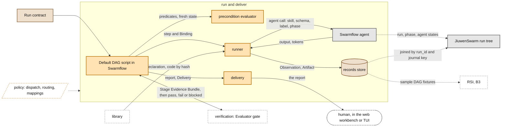

# Run and deliver

> **Owner:** Xiaoyang · Muk · **Build steps:** B1 the Default DAG in Swarmflow; B3 fan-out, fallbacks, routing, claims

Executes the run contract and answers the human. **Swarmflow** runs the **Default DAG** script and does the scheduling; the **runner** wraps every capsule call inside it and records it; **routing** is one fixed model in M1; the **precondition evaluator** checks preconditions; **observability** joins our records to Swarmflow's run tree; **delivery** returns the report.

## Our understanding, to confirm

**For Xiaoyang (the Default DAG script, runner, routing, observability, delivery; agent architecture per PRD 4.2), Muk (precondition evaluator).**

- [ ] The Default DAG is one Swarmflow Python script: intake, template mapping, Requirement Compilation and its acceptance, the pass-through planner and freeze, then six steps in order, each followed by the Evaluator gate, then delivery. Swarmflow does the scheduling, the journal and resume.
- [ ] The script reads only the run contract for what to run. Each step: the precondition evaluator on fresh state, the runner, then the gate. `pass` starts the next step; `fail` or `blocked` halts at the gate's `human_session`.
- [ ] Every capsule call goes through the runner: the stage capsules, `benchmark_runner`, the `verifier_capsule`, admission's test calls, and each operator call (through the runner's rail), including intake's. A call with no Observation is a bypass.
- [ ] The runner refuses code whose hash changed (`CARRIER_CHANGED`), checks inputs and outputs against the port types, asks the permission engine by `effect_class`, and calls Swarmflow's `agent()` with the skill, the output port type's `value_schema` from the vocabulary as `schema`, the step id as `label` and the stage as `phase`.
- [ ] **Routing** in M1 is one model, the one the run is started with, through the Codex CLI adapter (PRD). `needs.model` is not read. The model is recorded on each Observation.
- [ ] Token use comes from Swarmflow (`AgentResult.tokens`) and goes on the Observation. Swarmflow's `BudgetLedger` stops a call at the team or run ceiling; the gate checks each step against its Binding's `budget`.
- [ ] Our records store holds only CC records. Context memory is JiuwenSwarm's Task Memory and Coding Memory.
- [ ] Observations join the Swarmflow run tree by `run_id` (Swarmflow's `wf_` id), the call's journal key and the phase, kept in `ext.swarmflow`. A gate failure shows in the run tree as the step's failed agent state and the pending human turn.
- [ ] Delivery is control code, never a capsule: the `report_capsule` writes the report in the `report` step; delivery writes the Delivery record and returns the report to the workbench.
- [ ] No retries or repair in M1 beyond Swarmflow's own call retries. A person decides after `fail` or `blocked`.

## Inside

### The Default DAG

*Owner: Xiaoyang · Build steps: B1; B2 compared with Cluster Mode · Code: `default_dag.py`*

The PRD's hardcoded workflow, as one Swarmflow script. Requirement Compilation runs first, before freeze ([request to contract](request-to-contract.md#requirement-compilation)); the steps below are the run contract's Bindings, in order.

| Step | Stage (`phase`) | Capsule | Inputs, bound from | Output |
|---|---|---|---|---|
| `search` | Search & Ideation | `search_capsule` | `contract`, `given.documents` | `ideas` (`idea_set`) |
| `screening` | Screening | `screening_capsule` | `contract`, `search.ideas` | `screening` (`screening_result`) |
| `hypothesis` | Hypothesis | `hypothesis_capsule` | `contract`, `screening.screening` | `hypothesis` (`hypothesis`) |
| `poc` | POC Implementation | `poc_capsule` | `contract`, `hypothesis.hypothesis` | `poc` (`poc_bundle`) |
| `benchmark` | Benchmarking | `benchmark_runner` (`tool`): runs the POC harness in the workspace | `poc.poc` | `benchmark` (`benchmark_result`) |
| `report` | Delivery | `report_capsule` | `contract` and every earlier output | `report` (`report`) |

- `contract` is the accepted Research Brief; `given.documents` are the ingested files
- steps run one at a time in M1 (`max_parallel: 1`); the order is fixed, so there is no cycle
- **B2:** the same stages planned by Cluster Mode, compared on the same prompts; never on the M1 path

### Runner

*Owner: Xiaoyang · Muk · Build steps: B1 · Code: `cc/runner`*

Makes every capsule call. Nothing calls a capsule except through it, so every call is checked and observed.

For each call, in order:

1. read the Declaration by `decl_hash` (from the Binding, the run contract's `verifier`, or before freeze the Standing)
2. **loader**: fetch the files by hash and check `code_sha256`; a mismatch stops the call with `CARRIER_CHANGED`; skills load from a read-only copy
3. validate the inputs against their port types
4. ask the permission engine by `effect_class`
5. call by kind (`identity.kind`): a `skill` through Swarmflow's `agent()`, with the output port type's `value_schema` (from the vocabulary; a `json` port's own `value_schema`) as `schema`, the step id as `label` and the stage as `phase`; a `tool` directly; `a2a`, `subagent` and `agent_template` after M1
6. validate the outputs and store each as an Artifact, with the tokens Swarmflow reports
7. write one Observation, with the run tree ids in `ext.swarmflow`

**Operator calls** made inside a call, or by control code, go through the runner's rail. It allows an operator only when the calling capsule pins it in `needs.external`, or when the caller is control code and the Default DAG template lists it in `control_operators` (intake's `op.workspace_io`, stage `intake`). Anything else is refused with `OPERATOR_NOT_ADMITTED`.

### Routing

*Owner: Xiaoyang · Build steps: B1 one model; B3 dynamic · Code: routing (Xiaoyang's component)*

- **B1:** one model for every call, bound through the Codex CLI adapter; no switching (PRD)
- **B3, parallel track** (Xiaoyang's router): picks the model at call time, inside the Binding's limits. Model metadata lives in the router's own registry, not in CC
- **freeze pins limits, never a model:** the Binding's `model_constraints` (from `needs.model`) and `budget`. The Observation records the model chosen; `ext.routing` may record the ranked list and the router version
- tested on sample DAG fixtures, not on the M1 path, until the integration gate

### Precondition evaluator

*Owner: Muk · Build steps: B1 (before each step); B2 adds planning · Code: `cc/evaluator`*

One function that runs a precondition against a state and answers pass, fail or defer. It is not the PRD's Evaluator, which is the [Evaluator gate](verification.md).

- `evaluate(predicate, state) → pass | fail | defer`
- unknown never passes: an unknown fact gives what `on_unknown` says, `defer` or `fail` (policy `defaults`)
- stale state (older than `max_age_s`) counts as unknown
- the state is `{inputs, workspace, external, observed_at}`
- **predicate parity:** planning (from B2) and each step call this one evaluator with the same predicates, so on the same state they give the same answer

### Observability

*Owner: Xiaoyang · Build steps: B1 · Code: `cc/observe`*

Our append-only records, joined to JiuwenSwarm's run tree.

- **records store**: Observations and Verification records by `run_id`, in agent-core's KV store, key `cc/obs/<scope>/<id>`
- **run tree** (have): Swarmflow's run, phase and agent states, shown in the workbench. The tree has no spans, so each Observation carries `ext.swarmflow {run_id, agent_key, phase}`
- **tokens and budget** (have): the team token budget and Swarmflow's ledgers
- a capsule call with no Observation is a bypass, and shows as a gap

### Delivery

*Owner: Xiaoyang · Build steps: B1 report; B3 claims · Code: `cc/deliver`*

Assembles what goes back to the human. Control, never a capsule.

- `answered`: the `report` Artifact from the `report` step, as Markdown in the workspace and in the workbench
- `failed`: when a person ends the run at triage, with the gate's reason
- claims with their support labels (B3)
