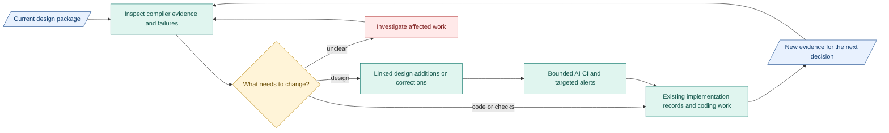

# Today: design plan

**Design is ready to build and review.** Reported full builds appear to follow it. Untested branches and verifier quality remain open.

## First: review verification next week

- Receive generated code/logs. Compare verifier criteria, context, findings and gates with [design](../reference/compiler-verification.md).
- Prepare labelled cases. Get agreement on disputed expectations. Record wrong decisions and missing evidence.
- Unclear intent may yield a faithful candidate IR. Without workable purpose/result, the gate must halt before Requirements. No invented intent. Valid JSON is insufficient.

## Build capsules throughout the work

Review each CC's design, checks, verifier and actual output before connecting the next boundary. [M1 work split](07-m1-capsules-and-rsi.md).

## Decisions still open

- Compactness: use full context now. Both PRD/design changed in the comparison. Cause remains unproven.
- Granularity: adjust detail from clarification, rework, boundary failures and total effort.

Keep the existing package. Append linked detail. Correct affected definitions.

## Where we go next

Blue: records. Teal: work. Amber: human decision. Red: unresolved.

**Build:** [compiler](../immediate-plan.md) through released `Research_Brief.json`, then remaining [M1 path](../m1-design.md). AI CI has separate tooling scope.

[My checklist and risks](08-build-and-review-sequence.md) | [Decisions](06-decisions-and-next-trial.md)
