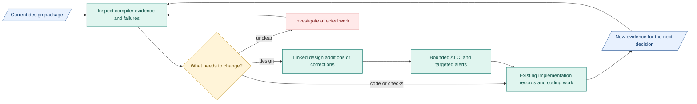

# Today: design in the SDLC

**Plan: use evidence to choose the next work.** Link requirements, design, implementation and verification. Add focused designs and bounded AI CI as the work needs them.

## How we got here

| Work | Result |
|---|---|
| Interpret PRD and component constraints | Shared boundaries, authority and [recorded decisions](../decision-review.md) |
| Define workflow and shared fields | [Node/subnode views](../m1-design.md), readable [contracts](../reference/README.md) |
| Separate reading levels | Immediate overview, component detail, exact reference |
| Compare full/compact implementations | Meeting reports: full worked, compact needs debugging. Cause and reliability remain unverified. |

Both PRD and design changed in the comparison. It does not isolate design length or settle Spec Kit's value. Keep fuller context for now. Reduce repetition before cutting explanations.

## Where we go next

Each cycle: choose the next useful change, check its result and update scope, order or design. Record why. Keep accepted artifacts and active-run pins unchanged.

Blue: records. Teal: work/tools. Amber: human decision. Red: unresolved.

**Next product boundary:** [complete Intention Compiler](../immediate-plan.md) through durably released `Research_Brief.json`. This contributes to M1, not full M1 completion.

**Next coordination trial:** document checks, one review worker and notifications. Sidecar/runner integration follows separate tooling scope and readiness. These are plans, not claims of deployed CI or accepted builds.

**M1 work split:** [capsules and RSI](07-m1-capsules-and-rsi.md) show product responsibilities and independent improvement preparation.

## When the plan changes

| Signal | Adjustment |
|---|---|
| New requirement or design finding | Update affected design and implementation records. Recheck affected evidence. |
| Dependency delayed | Resequence independent work. Agree changed commitments. |
| Repeated rework or missed interfaces | Add context or resize the next unit of work. |
| AI CI costs more than it helps | Narrow checks, improve skills or remove the noisy step. |

Use [decisions and revisit signals](06-decisions-and-next-trial.md). Update this plan as results arrive.

[October checkpoints](08-october-checkpoints.md) give the near-term review sequence.
