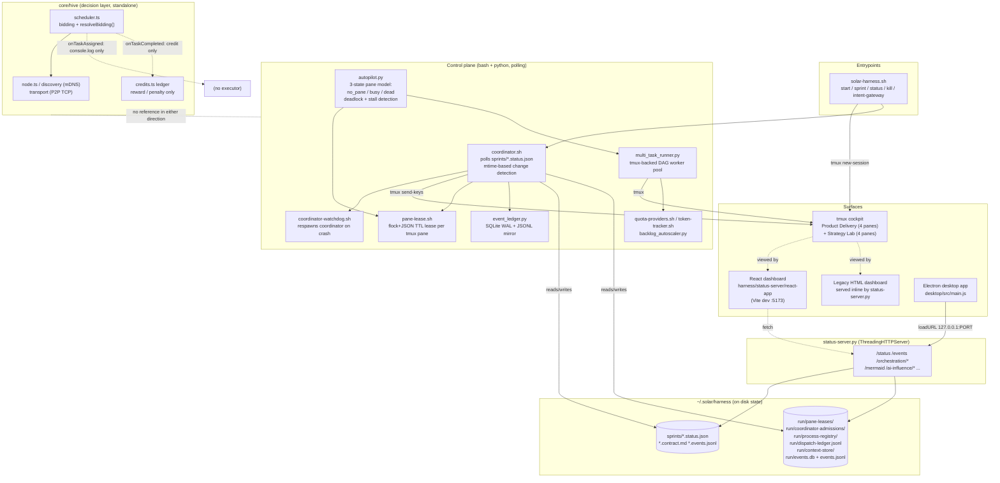

# 08 — Orchestration & Control Plane

Repo: `/home/muk/work/AI4Research`, branch `openJiuwen-Solar`, HEAD `b0bf165f9`.
Scope: orchestration / control-plane layer only (not the Intent/Requirement/Planner
compiler or evidence schemas — those are covered elsewhere).

## Summary

- **`solar-harness.sh`** (6,447 lines) is a monolithic bash CLI that boots a 4-pane
  tmux "cockpit" (`pm`, `planner`, `builder`, `evaluator`) for a **sprint**-based
  delivery loop, plus a second 4-pane "Strategy Lab" window (`architect`,
  `lab-builder`, `lab-evaluator`, `observer`) — 8 agent personas total across two
  tmux windows in the default `farm-layout.json`, though a plain `start` only
  launches 3–4 panes in "Product Delivery" unless the lab is separately enabled.
- **`coordinator.sh`** (6,651 lines) is a polling state machine: it watches
  `~/.solar/harness/sprints/*.status.json`, and on a state transition
  (`drafting → active → reviewing → passed/failed`) uses `tmux send-keys` to push
  the next persona's prompt into its pane. It has a **documented, self-acknowledged
  mtime detection bug**: macOS APFS does not bump a directory's mtime when a file's
  *contents* change, so a directory-level `stat` missed in-place status edits; the
  fix scans `max(mtime)` across all `sprint-*.status.json` files individually.
- The **status server** (`harness/lib/symphony/status-server.py`, ~15.5k lines) is
  a raw `http.server.ThreadingHTTPServer`, not Flask/FastAPI. It binds
  `127.0.0.1:8765` (falling back through `8765–8775`) on macOS/Linux, and `0.0.0.0`
  under WSL NAT mode; it issues an auth token that is *enforced* only when bound
  off-loopback. `harness/status-server/` (the newer package with `research_routes.py`,
  `routes/orchestration_routes.py`, `routes/livework_routes.py`, and a Vite/React
  app) is a separate, in-progress dashboard layer, not the same process.
- **HIVE** (`core/hive/`) is confirmed **decision-only**: `TaskScheduler.onTaskAssigned`
  (`core/hive/index.ts:168`) only does `console.log`, and `onTaskCompleted`
  (`core/hive/index.ts:172`) only calls into `this.incentive`/`this.ledger` to
  award/penalize credits. Nothing in `core/hive/` references `tmux`, `solar-harness`,
  or the harness coordinator, and nothing in `harness/` references `core/hive`. It
  is fully disconnected from real task execution — a bidding/reputation simulation
  with no executor.
- Human intervention is file- and command-based, not a GUI approval widget baked
  into the loop: `plan-verdict <sid> approve|reject`, `eval-verdict`, `graph-dispatch
  node-verdict|resume-human-review|escalate-terminal-failure|approve-fixed-experiment`,
  and `kill` (which marks in-flight sprints `interrupted` before tearing tmux down).
  A metadata log entry (`pre-scheduler-stabilization-log-20260829.md`, item #31)
  documents a real "watchdog historical-sprint revival" bug where every Coordinator
  restart caused an unrelated old sprint to get a bogus `wake` dispatch.

## Control plane diagram

## Port & path map

| Surface / component | Port / binding | Source |
|---|---|---|
| Legacy/production status server (`status-server.py`) | `127.0.0.1:8765`, fallback range `8765–8775` via `SOLAR_STATUS_PORT_START/END`; `0.0.0.0` under WSL NAT mode | `harness/lib/symphony/status-server.py:21,25,169-170,174-176,15394-15405` |
| Status server auth token | issued always; **enforced only when `BIND_HOST` not in (`127.0.0.1`,`::1`,`localhost`)** | `harness/lib/symphony/status-server.py:179-190` |
| React dashboard dev server | Vite, `--host 127.0.0.1`, default port `5173` (or `$PORT`) | `harness/status-server/react-app/package.json:17`, `vite.config.ts:23` |
| Electron desktop app | reads `~/.solar/harness/run/status-server.port` and probes `GET http://127.0.0.1:<port>/healthz` | `desktop/src/main.js:47,536-627,1031-1057` |
| Wiki upload / config sub-UIs (linked from status page) | `127.0.0.1:8788` (upload), `127.0.0.1:8789/setup` (config) | `harness/lib/symphony/status-server.py:12507-12521,12574-12590` |
| Observed live runtime backend in stabilization log evidence | `8767` (a different instance/config than the documented default 8765) | `harness/metadata/pre-scheduler-stabilization-log-20260829.md` (multiple entries, e.g. "port 8767", "0.0.0.0:8767") |
| HIVE node P2P/mDNS | example port `9876` (per-node CLI `--port`) | `core/hive/README.md` |
| ThunderoMLX bridge (external model backend referenced by status server) | `http://127.0.0.1:8002` default | `harness/lib/symphony/status-server.py:105` |
| Sprint state | `~/.solar/harness/sprints/<sid>.status.json`, `.contract.md`, `.events.jsonl`, `.handoff.md` | `harness/coordinator.sh:47-50`, `harness/solar-harness.sh:2130-2236` |
| Pane leases | `~/.solar/harness/run/pane-leases/<pane_safe>.json` (+ `.lock`) | `harness/pane-lease.sh:17-20` |
| Coordinator admission leases | `~/.solar/harness/run/coordinator-admissions/` | `harness/coordinator.sh:59-60` |
| Process registry / terminal markers | `~/.solar/harness/run/process-registry/*.terminal` | `harness/solar-harness.sh:1095,1379-1395` |
| Dispatch ledger (autopilot) | `~/.solar/harness/run/dispatch-ledger.jsonl` | `harness/lib/autopilot.py:44` |
| Event ledger (SQLite + JSONL) | `<base>/run/events.db`, `<base>/run/events.jsonl` (base = `harness/run` by default) | `harness/lib/event_ledger.py:22,44-46` |
| Context packet store | `~/.solar/harness/run/context-store/<packet_id>.json` | `harness/lib/context_store.py:16-27` |
| Quarantine inbox | `~/.solar/harness/run/quarantine/`, `run/prompt-quarantine` | `harness/lib/autopilot.py:47`, `harness/lib/prompt-quarantine.sh` |
| Backlog autoscaler snapshot | policy-derived path via `snapshot_path()` | `harness/lib/backlog_autoscaler.py:65` |
| Multi-task runner session | tmux session `solar-harness-multi-task` (separate from main `solar-harness` and lab `solar-harness-lab` sessions) | `harness/multi_task_runner.py:29-31` |

## Detailed findings

### 1. Incarnation / sprint / session, and what `solar-harness.sh start` launches

- A **sprint** is the unit of delivered work: a tuple of `sprints/<sid>.status.json`
  (state machine: `drafting/queued/active/planning/approved/reviewing/
  ready_for_review/failed_review/passed/done/failed/eval_pass/cancelled/
  interrupted/superseded/needs_human_review/blocked` — full enum at
  `harness/solar-harness.sh:901`) plus a `.contract.md` (requirements/DoD) and an
  append-only `.events.jsonl`. `new_sprint()` (`harness/solar-harness.sh:2130-2236`)
  creates the id as `sprint-YYYYMMDD-HHMMSS`, renders the contract from
  `templates/contract-template-v2.md`, and emits a `phase_transition` event.
- An **incarnation** (化身, literally "avatar") is a persona pane: `pm`, `planner`,
  `builder`, `evaluator` (Product Delivery window) or `architect`, `lab-builder`,
  `lab-evaluator`, `observer` (Strategy Lab window), each a Claude Code CLI process
  launched via `pane-launcher.sh` inside one tmux pane, bound to a model in
  `farm-layout.json:personas` (e.g. `pm`/`planner`/`architect` → `opus`,
  `builder`/`evaluator`/lab roles → `glm-5.1`).
- `start_harness()` (`harness/solar-harness.sh:1081-1290`) creates one tmux session
  (`SESSION_NAME`, default `solar-harness`) with a single window `Product Delivery`
  split into a 2×2 grid (`tmux split-window -v` then two `-h` splits). Mode `"3"`
  (default) launches 4 personas (`pm`, `planner`, `builder`, `evaluator`); a
  non-`"3"` mode launches only 3 (`pm`, `planner`, `builder`). Under
  `SOLAR_PRODUCT_MODE=1` no persona panes are dispatched at all — "the operator
  pool executes" instead (an operator-pool execution path, not persona chat panes).
  The Strategy Lab window/session (`ensure_parallel_builder_lab`, `harness/
  solar-harness.sh:1489`) is a separate, optionally-managed 4-pane lab, not started
  by a plain `start`.
- So: **default agent count is 4** (Product Delivery cockpit), extensible to 8 if
  the Strategy Lab is also brought up, and the CLI supports `intent-gateway
  capture --text "..."` (`harness/solar-harness.sh:1894-1896`, `lib/intent_gateway.py`)
  as the structured intake path that a sprint is bound to (`intent_gateway.py bind
  --intent-id --sprint-id`, line 2038).
- `kill_harness()` (`harness/solar-harness.sh:1363-1417`) marks any `active`/
  `reviewing` sprint `interrupted` via `runtime_status.py` **before** tearing down
  tmux, tears down both sessions, stops background processes, and reaps
  Codex trust profiles it owns.

### 2. Coordinator's job, loop, and the mtime bug

- `coordinator.sh` (`harness/coordinator.sh`) is the automatic-dispatch engine
  documented at the top of the file (comment block, lines 6-23): Planner writes a
  contract → status flips to `active` → coordinator detects it and `tmux
  send-keys`s the Builder pane → Builder implements → status flips to `reviewing`
  → coordinator dispatches Evaluator → Evaluator returns `passed`/`failed` →
  coordinator either finalizes or bounces back to Builder.
- Change detection: `get_latest_sprint_file()`-style logic
  (`harness/coordinator.sh:979-1012`) scans **all** `sprint-*.status.json`
  individually and takes `max(mtime)` using `solar_file_mtime`, specifically
  because of a documented root cause in `DISPATCH-PROTOCOL.md:26-49` ("Bug 2:
  mtime 目录级检测漏检" — macOS APFS content writes don't bump the parent
  directory's mtime, only create/delete do; the coordinator used to `stat -f %m
  "$SPRINTS_DIR"` which silently missed in-place status edits). The documented fix
  is per-file mtime scanning plus a `last_state != current_state` guard against
  double-dispatch (`DISPATCH-PROTOCOL.md:236-240`).
- Other documented dispatch bugs in the same file worth noting for the report:
  Bug 1 "send-keys 吞键" (tmux send-keys can swallow rapid text+Enter — mitigated
  by splitting into two sends with `sleep 0.8`), Bug 3 "pane 忙时吞键" (pane-busy
  detection + 120s timeout), a "zombie pidfile" bug (#9, `DISPATCH-PROTOCOL.md:366+`)
  where `kill -9` bypasses the `trap EXIT` that would clean up the pidfile, letting
  a second coordinator instance start against a stale/dead pidfile.
- `coordinator-watchdog.sh` (967 lines) is the supervisor: `find_live_coordinator_pids`
  / `find_live_watchdog_pids` (`harness/solar-harness.sh:920-931`) and
  `start_coordinator_sync` / `start_watchdog_sync` (`harness/solar-harness.sh:967-1080`)
  launch both with SIGHUP isolation (`nohup`-style) so closing the terminal that
  ran `solar-harness.sh start` doesn't kill them.
- `coordinator.ts` (248 lines) is a much smaller TypeScript counterpart — not
  investigated in depth here since the bash coordinator is the primary/authoritative
  implementation referenced throughout the rest of the harness; it appears to be a
  thinner/alternate control surface (worth a follow-up if TS orchestration is in
  scope elsewhere).
- `coordinator_hooks.py` (274 lines) provides Python-side hook glue the bash
  coordinator shells out to for structured decisions (e.g., admission checks) —
  keeps the heavy state-machine logic in Python while bash still owns
  tmux/send-keys mechanics.

### 3. Status server

- Real server: `harness/lib/symphony/status-server.py`. Built on
  `http.server.ThreadingHTTPServer` + a custom `StatusHandler` (`do_GET`/`do_POST`
  dispatch via a long `elif path == "..."` chain, `status-server.py:14893-15376`),
  **not** a web framework. Binding policy (`_default_bind_host()`,
  lines 160-170): loopback-only (`127.0.0.1`) on macOS/Linux and WSL "mirrored"
  networking; `0.0.0.0` under WSL "NAT" mode because NAT's `localhostForwarding`
  intermittently drops 127.0.0.1 (comment at line 163). Port selection scans
  `PORT_RANGE = range(8765, 8776)` and binds the first free one
  (`start` logic ~line 15394-15410), writing the chosen port to
  `~/.solar/harness/run/status-server.port` (consumed by the Electron app).
- Auth: a bearer/query token is always issued but only *enforced* when
  `BIND_HOST` is not loopback (`TOKEN_ENFORCED = BIND_HOST not in ("127.0.0.1",
  "::1", "localhost")`, line 190) — i.e. it's a defense specifically for the
  WSL-NAT LAN-exposed case, covered by `harness/tests/test_status_server_auth_boundary.py`.
- Representative GET routes (from the dispatch chain): `/healthz`, `/runtime-info`,
  `/status`, `/contract-summary`, `/orchestration/dashboard`,
  `/orchestration/projection`, `/usage`, `/settings`, `/auth/status`, `/events`,
  `/integrations`, `/assets`, `/knowledge/subscriptions`, `/ai-influence/*`
  (a content-farm digest subsystem, out of orchestration scope but sharing the
  server), `/mermaid`, `/mermaid/view`, `/file/open`, `/file/view`, `/api/capability`,
  `/api/evolution`, `/benchmark/latest`, and `/` (dashboard shell). POST routes
  include `/settings`, `/auth/login`, `/knowledge/subscriptions/*`, and
  `/api/thunderomlx/start`.
- **GUI intake/observe path**: the Electron `desktop/src/main.js` reads the port
  file, polls `/healthz`, then `win.loadURL("http://127.0.0.1:<port>/")` to show
  the dashboard shell served by the very same status-server process — i.e. the
  desktop "app" is a thin native shell around the local HTTP dashboard, with WSL
  cross-boundary handling (Windows Electron ↔ WSL2 backend via `wsl.exe`, IP
  discovery, and a "forwarding-broken" state) baked in (lines 237-1128).
- Separately, `harness/status-server/` (package with `research_routes.py`,
  `routes/orchestration_routes.py`, `routes/livework_routes.py`, plus a Vite+React
  `react-app/`) is a **newer, apparently in-progress dashboard** — its
  `orchestration_routes.py`/`livework_routes.py` names suggest it's meant to
  become (or already partially serves) the orchestration-facing UI, distinct from
  and likely eventually replacing the giant single-file `status-server.py`. I did
  not find solar-harness.sh wiring this package to a specific standalone `app.run`
  port in this pass — it reads as route modules meant to be mounted, not a
  self-contained server; treat this as [INFERRED] pending a runtime trace of how
  `routes/__init__.py` is imported/served.

### 4. tmux pane-lease system

- `harness/pane-lease.sh` implements `acquire_pane_lease <pane> <sid> <dispatch_id>
  [ttl_sec=600]`, `release_pane_lease`, `check_pane_lease`, `reap_expired_leases`.
  Lease files live at `run/pane-leases/<pane_safe>.json`, written atomically via a
  Python helper that takes an `fcntl.flock` on a sidecar `.lock` file, then
  writes tmp+rename (`harness/pane-lease.sh:1-60`).
- **Why leases are needed**: a tmux pane running an interactive Claude Code TUI is
  a single-threaded, stateful terminal — only one dispatch can safely
  `send-keys` into it at a time, and a busy pane can silently swallow
  keystrokes (the send-keys-swallow bug above). The lease turns "is this pane
  free" into an atomic, TTL-bounded claim so the coordinator/autopilot/multi-task
  runner don't race each other into double-dispatching the same terminal.
  `autopilot.py`'s three-state model (`no_pane` / `busy` / `dead`) is built
  directly on top of `pane_lease.pane_state()` (imported at
  `harness/lib/autopilot.py:38`).
- A "synthetic deadlock" is explicitly modeled: a pane can hold a live lease
  (`busy`) while `tmux capture-pane` shows no fresh Claude prompt activity for
  `DEADLOCK_STALL_SEC` (default 300s) — autopilot reclassifies this as
  `STALLED`, releases the lease, and re-queues (`harness/lib/autopilot.py:8-17,45`).
  Also documented in `DISPATCH-PROTOCOL.md` bug #31 (watchdog historical-sprint
  revival, see §12) is a related failure mode where "any pane lease" was
  historically treated as coordinator admission authority — since fixed by
  replacing it with a distinct, short-lived, atomically refreshed **Coordinator
  admission lease** (`run/coordinator-admissions/`, separate directory from pane
  leases).

### 5. Autopilot

- `harness/lib/autopilot.py` — "S6 Control Plane: three-state pane autopilot +
  deadlock detection." CLI subcommands: `scan [--sprint SID]`, `status [--sprint
  SID]`, `resolve-deadlock --pane --sprint --dispatch-id`, `fault-report
  [--sprint SID]`, `drain-queue --sprint SID`.
- Decisions it makes autonomously (from its own docstring, lines 4-24):
  - Reclaim or drain a `dead` pane (expired lease) without asking a human.
  - Detect and resolve `STALLED` (synthetic deadlock) panes by releasing the
    lease and re-queuing the task.
  - Diagnose four fault classes: `handoff_stall` (sprint stuck in `reviewing`
    past `STALL_SEC`=900s with no eval dispatched), `eval_stall` (stale eval-pane
    lease with no new output), `dispatch_backlog` (`task_queue` depth exceeds
    `BACKLOG_THRESHOLD`=3 with no free worker), `hook_failure` (unresolved
    entries in the quarantine inbox `run/quarantine`).
  - Drain the pending-task queue onto free workers (`drain_queue`), and dispatch
    "runtime repair" work at an elevated priority (`RUNTIME_REPAIR_PRIORITY=92`).
  - `autopilot_operator_dispatcher.py` (companion module, not fully read in this
    pass) appears to extend autopilot's automatic decisions into the operator-pool
    execution model used under `SOLAR_PRODUCT_MODE=1`.
- All thresholds are environment-tunable (`AUTOPILOT_DEADLOCK_STALL_SEC`,
  `AUTOPILOT_STALL_SEC`, `AUTOPILOT_BACKLOG_THRESHOLD`, `AUTOPILOT_RUNTIME_REPAIR_PRIORITY`).

### 6. Event ledger / activity runtime / on-disk artifacts

- `harness/lib/event_ledger.py`: `EventLedger` is an **append-only, dual-write**
  store — SQLite (WAL mode, source of truth) plus a JSONL mirror. Write order is
  strict: validate required fields (`event_type`, `sprint_id`, `actor`) → SQLite
  INSERT → JSONL append; **if SQLite fails the JSONL write is skipped** (so the
  mirror never gets ahead of the source of truth), while a JSONL failure only
  logs a warning (comment/docstring, lines 1-40). Default base dir is
  `<harness>/run/`, i.e. `events.db` + `events.jsonl`.
- `harness/lib/activity_runtime.py` layers a typed lifecycle on top of a
  `SessionLog`: `command_issued → activity_started → {activity_succeeded |
  activity_failed | activity_cancelled | activity_retry_scheduled} |
  activity_handoff`. This is the auditable, replayable trail of what each
  persona/operator was asked to do and what happened — the docstring explicitly
  frames it as an "arc" per activity id.
- Auditable artifacts and their disk homes (all under `~/.solar/harness/` by
  default, overridable via `HARNESS_DIR`/`SOLAR_HARNESS_DIR`):
  - `sprints/<sid>.status.json` / `.contract.md` / `.events.jsonl` / `.handoff.md` —
    per-sprint state, contract, event stream, handoff notes.
  - `run/events.db`, `run/events.jsonl` — the unified event ledger.
  - `run/dispatch-ledger.jsonl` — autopilot/dispatch decisions.
  - `run/pane-leases/`, `run/coordinator-admissions/`, `run/process-registry/` —
    control-plane concurrency/ownership state.
  - `run/context-store/<packet_id>.json` — externalized context packets (see §Q8/context).
  - `run/quarantine/`, `run/prompt-quarantine` — hook/prompt failures parked for
    review instead of silently dropped.
  - `reports/` — generated reports (referenced pervasively by `status-server.py`,
    e.g. `REPORTS_DIR / sid`, mermaid diagrams, benchmark output).

### 7. Quota, cost, and backlog governance

- `harness/quota-providers.sh` — "real provider quota/balance probes," explicitly
  documented to **never print credentials**; network failures degrade to a
  compact warn string rather than crashing (`quota-providers.sh:1-4`). Results are
  cached under `state/quota-providers` with a TTL (`SOLAR_QUOTA_PROVIDER_TTL_SECONDS`,
  default 300s) and emitted as either text or JSON (`emit_text`/`emit_json`).
- `harness/token-tracker.sh` — `baseline` / `measure <sid>` / `report <sid>`
  subcommands that measure and diff token consumption per sprint, writing
  Markdown reports to `~/.solar/reports/token-savings-<sid>.md`.
- `harness/lib/backlog_autoscaler.py` — computes `backlog_metrics()` (queue depth
  by status/phase) and `operator_capacity_by_role()`, then derives per-profile and
  global scaling targets (`_profile_targets`, `_logical_targets`,
  `_builder_pool_targets`, `_global_targets`) and persists a `build_snapshot()` /
  `refresh_snapshot()` to a policy-driven `snapshot_path()`. This is the mechanism
  that decides how many builder/evaluator workers *should* be running given
  current backlog — an autoscaling control loop over the pane/operator pool, not
  a hard concurrency cap.
- `quota_ok` is a **declarative binding condition**, not a function: the logical
  operators config (`harness/config/logical-operators.json`, dozens of hits) lets
  each operator→actor candidate binding declare `"condition": "quota_ok"` (schema
  at `harness/config/logical-operators.schema.json:139`: "Optional condition for
  when this candidate is eligible: always, quota_ok, low_load"). `QuotaBroker` is
  one of the fixed **P0 logical operators**
  (`harness/lib/logical_operator_router.py:17-22`, alongside `SecurityGate`,
  `ContextCompressor`, `ArtifactCurator`, etc.) — i.e. quota gating is modeled as
  a routable operator in the same operator/capsule framework used for compiler
  work, rather than a bespoke orchestration-only mechanism. [INFERRED: the actual
  runtime evaluator for `quota_ok` conditions — which reads quota-providers.sh
  output to decide eligibility — lives in the dispatcher/router code that
  consumes `logical-operators.json`; I did not trace that specific evaluator
  function in this pass, only the declarative schema and the P0 operator list.]

### 8. Multi-task runner and `multi-task-profiles.json`

- `harness/multi_task_runner.py` — "tmux-backed DAG worker pool for Solar Harness
  multi-task execution." Runs in its **own** tmux session
  (`SOLAR_HARNESS_MULTI_TASK_SESSION`, default `solar-harness-multi-task`),
  separate from the main cockpit (`solar-harness`) and lab (`solar-harness-lab`)
  sessions. Config knobs: `DEFAULT_MAX_WORKERS=2`, `DEFAULT_INTERVAL=15s`,
  `DEFAULT_COOLDOWN=30s` between launches, `DEFAULT_MEMORY_RESERVE_GB=4`,
  `DEFAULT_QUOTA_BACKOFF=900s`. It maintains a `graph-summary-cache.json` (TTL 5s)
  and reads/writes the shared `dispatch-ledger.jsonl`.
- `harness/multi-task-profiles.json` defines named **execution profiles** — e.g.
  `builder` (persona `builder`, backend `claude-cli`, model `sonnet`,
  `approval_mode: yolo`, `max_parallel: 2`), `planner` (model `sonnet`,
  `approval_mode: auto_edit`, `max_parallel: 1`), `evaluator` (model `opus`,
  `approval_mode: auto_edit`, `max_parallel: 1`), plus a `pm` profile (truncated
  in my read but present). Each profile pins persona/backend/model/approval mode
  and a parallelism cap — this is the config the multi-task runner consults to
  decide *what kind* of worker to spin up for a queued DAG node.
- Relation to the graph scheduler: the multi-task runner is a **tmux worker pool
  consumer** of the task graph, not the scheduler itself. It pulls queue items
  (via `graph_node_dispatcher.dispatch_queue_item`, also imported by
  `autopilot.py`) and launches/monitors tmux panes running the profile-specified
  persona/model/approval-mode combination to execute one DAG node at a time,
  respecting `max_parallel` per profile and the global `DEFAULT_MAX_WORKERS`. The
  actual DAG/graph compilation and node-state semantics belong to the
  Planner/Scheduler compiler pipeline (out of this report's scope) — the runner
  is the execution/worker-pool half of that pairing.

### 9. Runtime surfaces and ports

| Surface | What it is | Port |
|---|---|---|
| tmux cockpit (`Product Delivery` + `Strategy Lab`) | The actual multi-agent TUI; primary human interaction surface | n/a (tmux, local terminal) |
| Legacy status dashboard | Served inline by `status-server.py`'s HTML routes (`/`, `/mermaid`, `/ai-influence`, etc.) | `127.0.0.1:8765` (8765–8775 fallback) |
| React dashboard (`status-server/react-app`) | Newer SPA, Vite dev server | `127.0.0.1:5173` (dev only) |
| Electron desktop app | Native shell that loads the status-server dashboard URL; handles WSL↔Windows port/IP discovery | connects to whatever port is in `run/status-server.port` |
| Sub-UIs linked from the dashboard | Wiki upload, Solar config UI | `127.0.0.1:8788`, `127.0.0.1:8789/setup` |
| HIVE node (separate, unconnected subsystem) | mDNS + P2P TCP node | example `9876` (per-node, CLI-configurable) |

No canonical single "port map" file was found; the above is assembled from the
binding logic in `status-server.py`, the Vite config, and the Electron client.

### 10. HIVE integration verdict

**[VERIFIED] HIVE is a self-contained decision/simulation layer with no wiring
into harness execution.**

- `core/hive/scheduler.ts` (`TaskScheduler`) exposes exactly three optional
  callbacks: `onTaskAssigned`, `onTaskCompleted`, `onBiddingTimeout`
  (`core/hive/scheduler.ts:43-45`), invoked at `scheduler.ts:154` (after
  `resolveBidding` picks a winner) and `scheduler.ts:185` (after `receiveResult`).
- The **only** place these are wired up is `core/hive/index.ts:167-190`
  (`setupSchedulerCallbacks`):
  - `onTaskAssigned = (task, assignedNodeId) => { console.log(...) }` — literally
    a log line, no dispatch, no tmux call, no HTTP call, no queue write.
  - `onTaskCompleted = (task, result) => { ... this.incentive.calculateTaskReward
    / calculatePenalty(...); this.ledger.rewardForTask(...) ... }` — updates an
    in-memory/credits ledger (`core/hive/credits.ts`), nothing more.
- Confirmed via exhaustive grep in both directions:
  - `grep -rl "core/hive\|HiveNode\|hive_bridge" harness/` → **zero matches**.
  - `grep -rl "tmux\|solar-harness" core/hive/` → the only hits are HIVE's own
    unrelated files named `coordinator.ts` (HIVE's internal leader-election module,
    a different concept from `harness/coordinator.sh`) — no actual references to
    tmux or solar-harness.
- Bidding/task-market mechanics (`selectWinner()` scoring by confidence 40% /
  latency 30% / cost 30%, `scheduler.ts:194-200+`) and reputation-based
  coordinator election are real, implemented TypeScript logic — but they resolve
  to nothing more than console output and a credits ledger update. There is no
  code path anywhere that takes a HIVE `winnerId` and turns it into a tmux
  `send-keys`, an HTTP call to the status server, or a write to
  `sprints/*.status.json`.
- **Conclusion**: HIVE is architecturally and operationally isolated from the
  harness. It is a distributed-systems prototype (mDNS discovery + P2P transport +
  election + bidding + a credits/reputation economy) that could theoretically be
  wired to real execution later, but as of this HEAD it dispatches nothing.

**Remote dispatch (`README-remote-dispatch.md`, `actor-hosts.json`) is a
completely separate mechanism from HIVE** [VERIFIED]: it is SSH/rsync-based —
`solar-remote-dispatch dispatch <sid>` generates a file manifest, computes
SHA-256 checksums, `rsync`s the sprint files to a remote host (config via
`~/.solar/remote-config.json` or `SOLAR_REMOTE_USER/HOST/PATH` env vars or CLI
flags), verifies checksums remotely, and (per the doctor subcommand) checks
`ssh`, `rsync`, remote harness presence/version, and remote tmux session/panes.
It has no discovery, no bidding, no P2P protocol — a single named remote host is
configured explicitly, and dispatch is push-based file sync plus a remote wake,
not a discovered/negotiated task market. `harness/config/actor-hosts.json` exists
as the static host registry this mechanism consults (not read in full detail in
this pass, but its existence and naming confirm the static/config-driven model as
opposed to HIVE's dynamic mDNS discovery).

### 11. Human intervention

- **Approval gates**: `plan-verdict <sid> approve|reject [reason]` — atomic
  command (`do_plan_verdict`, `harness/solar-harness.sh:2757-2781`) that flips
  status to `approved` or back for planning output. `eval-verdict` similarly
  gates evaluator output (`do_eval_verdict`, line 2782).
- **Graph-level human gates**: `graph-dispatch node-verdict --graph ... --node S1
  --verdict pass|fail`, `graph-dispatch resume-human-review --graph ... --node S1
  --generation N --actor NAME --reason TEXT`, `graph-dispatch
  escalate-terminal-failure`, and `graph-dispatch approve-fixed-experiment`
  (`harness/solar-harness.sh:6186-6198`) — these are the DAG/scheduler-level human
  checkpoints (a `needs_human_review`/`blocked` status class exists in the sprint
  status enum at line 901).
- **Interruption**: `kill` (`kill_harness`) marks any sprint currently `active` or
  `reviewing` as `interrupted` (not silently abandoned) before tearing tmux down,
  and `wake --help`/`wake <sid>` (`wake_sprint`, `harness/solar-harness.sh:2240+`)
  is the explicit recovery path for a crashed/interrupted sprint — it lists
  unfinished sprints and, per case `interrupted`, moves status to `reviewing` with
  reason `wake_resumed_interrupted` and re-dispatches a "resume from interrupted"
  handoff to the builder pane (`harness/solar-harness.sh:2501-2507`).
- **Direct terminal interaction**: because personas are literal tmux panes running
  Claude Code TUIs, a human can always attach (`tmux attach -t solar-harness`),
  click a pane, and type directly — the coordinator's automated `send-keys`
  dispatch and manual human keystrokes share the same interaction surface, which
  is exactly why the pane-lease/busy-detection machinery in §4 exists.

### 12. Known bugs / limitations for orchestration

From `harness/DISPATCH-PROTOCOL.md`:
- Bug 1: `tmux send-keys` swallows rapid text+Enter sends (mitigated: two sends
  with `sleep 0.8` between them).
- Bug 2 [the mtime bug]: directory-level mtime detection missed in-place
  `status.json` content edits on macOS APFS; fixed by per-file mtime scanning.
- Bug 3: pane-busy state causes `send-keys` to be silently swallowed; mitigated
  with busy detection + a 120s timeout.
- Bug "get_latest_sprint_file skips terminal states" caused `handle_passed` to
  never trigger; fixed by removing the "skip terminal" filter and relying on pure
  mtime ordering plus the `last_state != current_state` guard.
- Bug A "plan-review 卡死" (deadlock) and Bug B "handle_passed 漏触发" (missed
  trigger due to an mtime race between `reviewing`→`passed`) and Bug C
  ("last_state only tracks a single sprint" — implies the coordinator's dedup
  state didn't scale to multiple concurrently-active sprints without a keyed
  map).
- Bug #9 "zombie pidfile": `kill -9` bypasses `trap EXIT`, leaving a stale pidfile
  that can desync from the live process if a second coordinator instance starts
  concurrently (race or `nohup`), a scenario the original kill-0 self-heal (added
  for bug #6) couldn't catch because it only ran at startup, not for detecting
  **multiple co-existing instances**.

From `harness/metadata/pre-scheduler-stabilization-log-20260829.md` (a large
running incident log; row numbers are the log's own numbering):
- **#31 — Watchdog historical-sprint revival**: every Coordinator process exit
  caused an unrelated, already-finished 2026-08-29 sprint to get a bogus
  `wake_sprint recovery` Builder dispatch, transiently blocking the actual
  current research DAG. Root cause: the watchdog trusted stale
  `.pane-assignments` state and unconditionally invoked `solar-harness.sh wake`
  after every restart, and separately the coordinator treated *any* pane lease as
  sufficient authorization to admit that revived sprint. Fix: replaced pane-lease-based
  admission with a dedicated, short-lived, atomically-refreshed **Coordinator
  admission lease** (`run/coordinator-admissions/`) that the watchdog must check
  before restarting, and the watchdog no longer calls `wake` automatically at all.
- **#26 — Coordinator admission continuity**: a sprint created seconds before
  Coordinator startup was admitted via a live Planner lease; once that lease was
  released, admission was recomputed as `false` and the coordinator "forgot" an
  already-authorized sprint mid-flight. Fix: cache every successful admission for
  the lifetime of the coordinator process.
- **#24 — Stale-session operator cooldown**: a legacy closeout-recovery path for
  an old sprint rewrote a shared operator's cooldown timestamp, blocking a
  current, unrelated sprint's dispatch for 15 minutes even though the actual
  operator work had finished ~12 hours earlier. Fix: attribute cooldown freshness
  to the immutable per-result timestamp, not a rewritten shared clock.
- **#44 — Cockpit rebuild side effect**: using the official `kill`/`start`
  lifecycle to rebuild an incomplete 3-pane cockpit reconciled eight unrelated
  *historical* sessions from `active` to `interrupted` as a documented side
  effect of the kill path's stale-active reconciliation (not a data-loss bug, but
  a surprising blast radius worth flagging).
- A UI-only defect (row "同一复跑：Session Timeline 只显示两个可见条目", around
  line 850-853): the Session Timeline narrative projection collapses
  high-frequency `typed_scheduler_tick`/`watchdog_restart` polling events and
  same-actor/same-node consecutive completions so aggressively that early
  intake/planning/dispatch/worker/evaluation milestones get pushed out of the
  visible window entirely, making a sprint with 431 real scoped events look like
  it only did two things. Documented as a UI/projection bug (front end + status
  server narrative builder), not a scheduler/TaskGraph correctness issue.

## Key references (file:line)

- `harness/solar-harness.sh:1081-1290` — `start_harness()`
- `harness/solar-harness.sh:2130-2236` — `new_sprint()`
- `harness/solar-harness.sh:2240+` — `wake_sprint()`
- `harness/solar-harness.sh:1363-1417` — `kill_harness()`
- `harness/solar-harness.sh:901` — full sprint status enum
- `harness/solar-harness.sh:2757-2782` — `do_plan_verdict` / `do_eval_verdict`
- `harness/solar-harness.sh:6186-6200` — `graph-dispatch` human-gate subcommands
- `harness/coordinator.sh:1-40` — module header, documented bug log
- `harness/coordinator.sh:979-1012` — per-file mtime scan (`solar_file_mtime`)
- `harness/DISPATCH-PROTOCOL.md:26-49` — mtime detection bug root cause
- `harness/DISPATCH-PROTOCOL.md:236-240,366-380` — dedup + zombie pidfile bugs
- `harness/pane-lease.sh:1-60` — lease acquire/release/reap contract
- `harness/lib/autopilot.py:1-70` — three-state model + fault classes
- `harness/lib/event_ledger.py:1-60` — dual-write ledger semantics
- `harness/lib/activity_runtime.py:1-40` — activity lifecycle arc
- `harness/lib/context_store.py:1-38` — file-based context packet store
- `harness/lib/backlog_autoscaler.py` — `backlog_metrics`, `operator_capacity_by_role`, `build_snapshot`
- `harness/lib/logical_operator_router.py:17-22` — P0 logical operators incl. `QuotaBroker`
- `harness/config/logical-operators.schema.json:139` — `quota_ok` condition definition
- `harness/multi_task_runner.py:1-45` — session/profile/worker-pool constants
- `harness/multi-task-profiles.json:1-40` — profile definitions
- `harness/lib/symphony/status-server.py:21,160-190,174-176,15394-15410` — bind policy, token enforcement, port scan
- `harness/lib/symphony/status-server.py:14893-15376` — route dispatch table
- `desktop/src/main.js:47,536-627,1031-1057` — Electron port discovery + health probe
- `core/hive/scheduler.ts:43-45,154,185` — callback hook points
- `core/hive/index.ts:167-190` — the only callback wiring (log + credits, no execution)
- `harness/README-remote-dispatch.md:1-45` — SSH/rsync remote dispatch protocol
- `harness/metadata/pre-scheduler-stabilization-log-20260829.md` rows #24, #26, #31, #44, and the Session Timeline projection entry (~line 850-853)

## Notable quotes

- `harness/DISPATCH-PROTOCOL.md:29`: "macOS APFS 文件系统行为: 修改文件**内容**
  (echo/python写status.json) **不更新父目录的 mtime**。只有创建/删除文件才会更新目录
  mtime。协调器依赖 `stat -f %m "$SPRINTS_DIR"` 检测变化，导致内容修改被漏检。"
  ("macOS APFS behavior: modifying a file's *content* does not update the parent
  directory's mtime — only create/delete does. The coordinator relied on
  `stat -f %m "$SPRINTS_DIR"` to detect change, so content modifications were
  silently missed.")
- `core/hive/README.md`: "**核心原则**: 不传参数、不传权重、只传任务" ("Core
  principle: no parameters passed, no weights passed, only tasks are passed") —
  and yet, per §10, no task actually crosses into harness execution at all.
- `harness/lib/symphony/status-server.py:21`: "Binds 127.0.0.1:8765 (loopback) on
  mac/Linux; 0.0.0.0 under WSL so the Windows host can reach it."
- `harness/lib/autopilot.py` docstring: "Synthetic deadlock scenario handled:
  Pane has a live lease (reports busy) BUT captures show no Claude Code prompt
  activity for > DEADLOCK_STALL_SEC seconds. Autopilot classifies as STALLED
  rather than busy; releases lease + re-queues."
- Stabilization log #31: "Watchdog trusted stale `.pane-assignments` before
  current runtime authority and invoked `solar-harness.sh wake` after every
  restart. Separately, Coordinator treated any pane lease as admission
  permission, so the wake dispatch could authorize the history it had just
  revived."

## Open questions

1. Is `coordinator.ts` (TypeScript, 248 lines) an active alternate control path,
   a deprecated experiment, or scaffolding for a future rewrite of
   `coordinator.sh`? Not established in this pass — worth a targeted diff against
   `coordinator.sh`'s responsibilities.
2. `harness/status-server/routes/orchestration_routes.py` and
   `livework_routes.py` — is this package already mounted into a running server
   process (and if so, on which port relative to `status-server.py`'s 8765), or
   is it inert scaffolding for a planned dashboard rewrite? I could not confirm a
   live mount point in this pass.
3. The stabilization log shows live evidence of a backend on port **8767**, which
   doesn't match the documented default 8765 range (8765-8775) or an obvious
   `SOLAR_STATUS_PORT_START` override in the files I read — likely a
   test/rapid-mode-specific override, but the exact source of `8767` wasn't
   traced.
4. `autopilot_operator_dispatcher.py` and the "operator pool" that executes under
   `SOLAR_PRODUCT_MODE=1` were only referenced, not read in depth — this is the
   likely superseding execution path for persona panes in newer runs and would
   merit its own pass if "operator pool vs. persona panes" becomes report-relevant.
5. `harness/config/actor-hosts.json` (static remote-dispatch host registry) was
   located but not read in detail — worth confirming its schema against the
   `README-remote-dispatch.md` narrative if remote/distributed execution needs
   deeper coverage.
