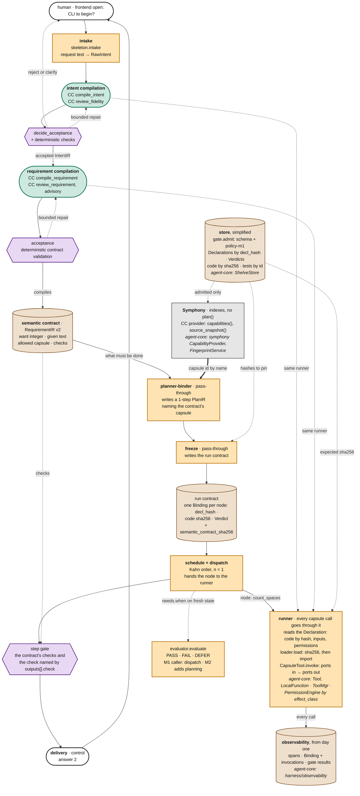
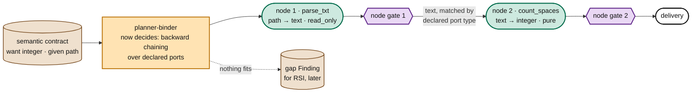

# M1 design, draft 1: one task, capsules in every stage, on openJiuwen

> **Temporary.** This is the working design the team reads and edits in the week of 28 September. Edit it through
> pull requests; put a question inline as `> Q (name): ...` right under the part it is about. Muk keeps it consistent
> and merges. Anything marked *proposed* is open.

**Where this sits.**

- **This file** is the overall design for M1 and M2.
- **The boundaries** of M1 and M2 (what is in, what is out, and what we must demonstrate) are set by the PRD, which
  Ramika owns. **This file designs the inside:** how M1 is structured, and what is possible within those boundaries.
- **The schema** every capability declares is explained in [SCHEMA-EXPLAINED.md](SCHEMA-EXPLAINED.md).
- **The binding M1 decisions** are in `tundle/obby/Directives.md` (2026-09-25). This file follows them.
- **The detailed M1 map** is `merged/figures/big-picture/m1_picture.py`, with a rendered page at
  https://claude.ai/artifact/Xh72oWggRhSTc5WuuXh5GS. It uses the same stage and module names as this file.

The code is new and sits on top of agent-core `e23806c1`. We ship one extension package and edit nothing in
agent-core. The old AI4Research harness is an archive: we learn from it but never extend it.

## 1. What "done" means

| | M1: one task | M2: a few chained nodes |
|---|---|---|
| **The demo** | "How many spaces are in `a b c`?" goes through every stage and is answered `2` by the capsule `count_spaces` | "How many spaces are in `report.txt`?" is answered through two capsules, `parse_txt → count_spaces` |
| **What it proves** | capsules work in every stage they apply to, chained with gates; the code that was checked is the code that ran; every capsule call is observed | a wrong capability is caught before it can poison the nodes downstream |
| **Must also hold** | a changed code file is refused and no Binding names it; an intent the gate rejects goes back to the human; each run leaves one run contract and one Binding per node | a node gate checks each output; when no capsule fits, the planner writes a gap Finding and never guesses |
| **Kept simple on purpose** | **planning, dispatch and the library**: a hardwritten one-step plan, one fixed node, and a fixed capsule set instead of a library | the planner starts deciding: backward chaining over declared ports |

**The M1 capsule set.** The set is fixed; there is no library selection.

| Stage | Capsule | What it does | Kind |
|---|---|---|---|
| intent compilation | `compile_intent` | normalizes the request and produces the IntentIR | model |
| intent compilation | `review_fidelity` | an independent reviewer: does the IntentIR say what was asked? | model |
| requirement compilation | `compile_requirement` *(name proposed)* | turns the accepted IntentIR into RequirementIR v2 from a template | model |
| requirement compilation | `review_requirement` *(name proposed)* | a semantic review of the RequirementIR; advisory only | model |
| schedule and dispatch | `count_spaces` | text → integer, pure. The one task | tool |

**Never capsules:** the acceptance gates, the planner-binder, freeze and delivery. Control decides; a capsule may
only assess or produce.

## 2. The M1 run, end to end

The stages use the AI4Research names: intake, intent compilation, requirement compilation, semantic contract,
planner-binder, freeze, schedule and dispatch, delivery.

In the diagram:

- **green** is a capsule, a **purple** diamond is a gate, **orange** is our control code, **brown** is a record and
  **grey** is agent-core as it is;
- the italic lines inside a box name the agent-core part it plugs into.

**The run in ten steps:**

1. **Intake** captures the request text as a RawIntent. The frontend is open; a CLI is the default for M1.
2. **Intent compilation.**
   - `compile_intent` normalizes the request and produces the IntentIR.
   - `review_fidelity` checks independently that the IntentIR says what was asked.
   - The `decide_acceptance` gate runs deterministic checks and decides: accept, repair (bounded), or send a reject
     or clarify back to the human. Nothing else hands work to the next stage.
3. **Requirement compilation.**
   - `compile_requirement` fills the RequirementIR v2 template.
   - `review_requirement` advises; it cannot block.
   - The acceptance gate validates the contract deterministically. On a defect, bounded repair; otherwise it fails.
4. **The semantic contract is central.** It is the accepted RequirementIR v2: *want* an integer, *given* a text, the
   **allowed capsule**, and the **checks**. It drives the planner-binder and the step gate.
5. **Planner-binder, a pass-through.** It is hardwritten: no model, no filter, no selection.
   - It resolves the contract's one capsule to an id through Symphony, which the CC provider feeds.
   - It writes a one-step PlanIR.
6. **Freeze, a pass-through.**
   - It pins what the plan names in one Binding per node: `decl_hash`, the code's sha256 and the Verdict. It also
     pins the semantic contract's hash (`semantic_contract_sha256`). It is not the schema's `contract_hash`,
     which is a capsule's own hash without its body.
   - The result is the **run contract**. From here on, nothing is chosen again.
7. **Schedule and dispatch.**
   - Kahn order, with one node in M1; the scheduler is still written for n.
   - Before the node runs, `needs.when` is re-evaluated on fresh state, through the one shared evaluator.
   - The node goes to the runner.
8. **The runner makes every capsule call** (including the four model capsules in intent and requirement
   compilation):
   - it reads the Declaration;
   - `loader.load` hashes the code and refuses a mismatch (`CARRIER_CHANGED`);
   - `CapsuleTool.invoke` checks the ports in and out;
   - the permission engine decides by `effect_class`;
   - the invocation is appended to the node's Binding. Intent and requirement capsules run before freeze, when
     there is no node yet, so their invocations go to a record keyed by run id and stage, with the same shape
     (*proposed*).

   Wrapping the tool itself matters: workflow `ToolComponent` calls skip rails today.
9. **The step gate** runs the contract's checks and the check named by `outputs[].check`.
10. **Delivery** answers the human. It is control, never a capsule.

**Observability runs underneath all of it.** Every capsule call and every gate result is recorded from day one, as
spans plus the Binding. These are the records every later loop (RSI, the librarian, merge) reads.

## 3. Modules, owners and where each one plugs in

One package, name *proposed*: `cc/`. Owners are *proposed*, as writer · reviewer, and are confirmed in the week of
28 September. Every pull request is reviewed against section 6.

| Module | Interface (in → out) | Plugs into agent-core | Owner (proposed) |
|---|---|---|---|
| `cc/schema` | `capsule.schema.json`, `policy-m1.json`, `validate(decl, policy)` | none | Muk |
| `cc/store` | `put(decl) → decl_hash`; `get(hash)`; `latest(name)`; `put_code(files) → sha256` | `core/foundation/store/kv` (`ShelveStore`) | Xiaoyang · Muk |
| `cc/gate` | `admit(decl_hash, policy) → Verdict` | none | Muk · Ramika |
| `cc/provider` | `capabilities()`, `source_snapshot()` over admitted capsules | `symphony/interfaces/capability.py` `CapabilityProvider`. **The first concrete one** | Muk · Xiaoyang |
| `cc/skeleton` | `intake(text) → RawIntent`; `deliver(outputs) → answer` | none | Xiaoyang |
| `cc/stages` | intent and requirement compilation: the capsule chain, the two acceptance gates, bounded repair | model calls through the runner; routing picks the model | Xiaoyang · Muk |
| `cc/contract` | the RequirementIR v2 schema, and its deterministic validation | none | Muk · Ramika |
| `cc/planner_binder` | `plan(contract) → PlanIR` (pass-through); `freeze(plan) → run contract` | Symphony index, id by name | Muk · Xiaoyang |
| `cc/evaluator` | `evaluate(predicate, state) → PASS \| FAIL \| DEFER` | none | Muk |
| `cc/dispatch` | `run(run contract) → outputs`, Kahn order | none | Xiaoyang |
| `cc/runner` | `call(node, Declaration) → outputs + invocation`: loader, `CapsuleTool`, permission | `core/foundation/tool` (`Tool`, `ToolCard`, `LocalFunction`); `ToolMgr`; wraps `Tool.invoke` as `decorate_tool_with_trace` does; `harness/security/permission_engine` | Xiaoyang · Muk |
| `cc/observe` | spans, Binding and invocations, gate results | `harness/observability`; the KV stores | Xiaoyang |
| `cc/seeds` | the five M1 capsules: Declaration, code or prompt, tests | none | Muk (Declarations) · Xiaoyang |

**Component owners, and where their components meet M1 and M2.**

| Person | Project role this month | Their component | Where it meets M1 and M2 |
|---|---|---|---|
| Muk | architect: overall design, not the PRD; also codes | Capability Capsule | the schema, the gate, the contract, the provider, the evaluator, the seed Declarations |
| Xiaoyang | primary coder | routing | picks the model for the four model capsules in M1; `needs.model` is declared but inert until M3 |
| Ramika | PRD | verification | the acceptance gates' deterministic checks and the step gate (M1), then the node gate (M2) |
| Saurav | blue team: attacks our work | RSI | tries to break M1 and M2 (section 7); checks that observability, lineage, tests by id and gap Findings give RSI what it needs later |

## 4. What M2 adds

- **The planner stops being a pass-through.** When the contract gives a path but wants an integer, the planner searches
  backwards for a capsule whose output is the missing input. It checks `needs.when` at planning through **the same
  evaluator** dispatch uses, which is why there is only one evaluator.
- **Node gate.** Each node's output is checked. Part of the check comes from the capsule's Declaration, and part from
  the step's acceptance, which verification writes.
- **Gap Finding.** When nothing fits, the planner records the unmet need as a typed record. M2 only writes gap
  Findings; RSI reads them later.
- **State read from outside.** `parse_txt` reads a file, so each of its tests ships its own fixture, and its
  `needs.when` (the file exists) is checked at dispatch.
- **The Binding records its edges:** `inputs_hash`, `output_hash`, `upstream[]`. These become the merge engine's
  evidence at M4.

## 5. Records

| Record | Key | Written by | May change? |
|---|---|---|---|
| code object | sha256 of its files | the gate, at admission | never |
| Declaration | `decl_hash` | the author, through the gate | never: a change is a new version |
| Verdict (minimal in M1) | `decl_hash` and policy epoch | the gate | append-only |
| test case | test id; inputs stored by hash | the gate, verification | never |
| semantic contract | its hash | requirement compilation, after its gate | never within a run |
| run contract (one Binding per node) | run id | freeze | never |
| invocations in each Binding | run id and node | the runner appends one per capsule call | append-only |
| stage record (*proposed*) | run id and stage | the runner, for capsules that run before freeze | append-only |
| gate result, span | run id and step | the gates; observability | append-only |

Everything is keyed by hash or run id, and everything is append-only except one pointer: the latest version.

## 6. Designed in, not built yet: review rules from week 1

| So that later we can... | M1 code must... |
|---|---|
| let the planner decide (M2) and score (M3) | keep the planner-binder's input (the contract) and output (a PlanIR with Symphony's plan shape) as they are, even while it is a pass-through |
| select from a library (M3) | resolve capsules only through Symphony's index, fed by our provider; never hard-code an import path |
| install and uninstall mid-run (M5) | load only through the runner, write one record per load, and keep no global state in wrappers |
| merge capsules into blocks (M4) | address every capsule by `decl_hash`, and record upstream edges in the Binding |
| branch versions for RSI (M3, M4) | write `lineage.parent` on every version, and never overwrite one |
| run skills, MCP tools and agents | dispatch on `identity.kind`: M1 already runs model capsules and a tool |
| run nodes in parallel (later) | let dispatch read only the run contract; nodes share no mutable state |

## 7. What can go wrong, and the blue-team drill for each

Saurav runs these as drills, and adds his own. Each finding becomes a typed failure, a test and an owner.

| Attack or failure | Caught by | Expected result | Rung |
|---|---|---|---|
| one byte of a capsule's code changed after admission | runner (loader) | refused, `CARRIER_CHANGED`; no Binding names it | M1 |
| a request that tries to steer `compile_intent` (prompt injection) | `review_fidelity`, then `decide_acceptance`'s deterministic checks | rejected, or sent back to clarify; never compiled into the contract | M1 |
| a RequirementIR that names a capsule outside the fixed set | contract acceptance gate, then planner-binder | rejected at the gate; the planner-binder finds no id | M1 |
| a Declaration whose precondition is prose | gate | rejected (`needs.when` needs `op` and `evaluable_at`) | M1 |
| `effect_class: pure`, but an effect that writes | gate | rejected, `EFFECT_CLASS_INCONSISTENT`. The gate must add this rule: today's `validate_capsule.py` checks shape only | M1 |
| a precondition that cannot be read at dispatch | evaluator | DEFER; dispatch fails with a typed reason | M1 |
| a model capsule returns output that does not match its port | runner (`CapsuleTool`) | the call fails; bounded repair, or the stage fails | M1 |
| the tool raises | runner | outcome `error`; the node fails; retry only if `effect_class` allows it | M1 |
| a capsule call that bypasses the runner | review rule, plus observability | the call has no span or invocation, so it shows up as a gap in the record | M1 |
| two capsules fit, or none fits | planner | an error naming both; or `needs_input` plus a gap Finding | M2 |
| a cycle in the plan | dispatch | rejected before any node runs | M2 |
| wrong output type passed downstream | node gate | the node fails; nothing downstream runs | M2 |
| a "pure" tool that secretly writes a file | **not caught in M1 or M2**: effects are seen only at the tool-call level | recorded as a known gap | later |

## 8. Open decisions for the week of 28 September

| Decision | Default if nobody objects |
|---|---|
| **Symphony's graph accepts only skill, subagent and agent capsules** (`symphony/orchestration/graph/build.py:161`). `count_spaces` is a tool | Symphony **indexes** the M1 capsules without graphing them, and the graph waits for M2. The other option is to make the M1 capsules skills |
| Frontend | a CLI |
| The IR schemas (RawIntent, IntentIR, RequirementIR v2), and who owns each | draft them from the AI4Research stage notes; the contract belongs to `cc/contract` |
| Names of the two requirement-compilation capsules | `compile_requirement`, `review_requirement` |
| Field name: `identity.carrier` or `identity.code_id` | `carrier`, as the schema file has it |
| The JSON and the text of `SCHEMA.md` disagree field by field ([SCHEMA-EXPLAINED.md §8](SCHEMA-EXPLAINED.md)) | fix the M1-required fields first, in WP0; the JSON wins until then |
| `changes.state` and `guarantees.test_aids` (proposed v2.11) | adopt both, in WP0 |
| Which agent-core line to pin (jiuwenswarm pins `b6db2733`, which is not an ancestor of `e23806c1`) | `e23806c1`; upstream changes wait until after M2 |
| Where invocations of pre-freeze capsules (intent and requirement compilation) are recorded | a stage record keyed by run id and stage, with the Binding's shape |
| Package name and repository | `cc/`, in the team repository |
| Module owners (section 3) | as proposed |

## Changelog

- **draft 1.1, 2026-09-25 (Muk):** after the Opus review of the maps: `semantic_contract_sha256` is named
  apart from the schema's `contract_hash`; pre-freeze capsule calls get a stage record (proposed).
- **draft 1, 2026-09-25 (Muk):** reconciled with the M1 map (draft 8) and the M1 Directives of 2026-09-25.
  - Symphony is in M1.
  - Capsules run in intent and requirement compilation.
  - The semantic contract is central, and the planner-binder and freeze are pass-throughs.
  - A runner makes every capsule call, and observability exists from day one.
  - The AI4Research stage names are used throughout.
  - `regex` is dropped: M1 has no selection.
- **draft 0, 2026-09-25 (Muk):** first version, built from the layer 2 design of 24 September.
