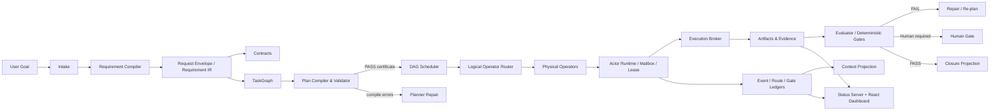

<!-- source: C:\Users\mukch\projects\work\AI4Research\README.md -->
<!-- lines: 179-311 -->
<!-- commit: b0bf165f9ab073aae23e45b3b2796973e5677eea -->

<translation>
## 架构概览



### 分层

| 平面 | 主要职责 | 关键代码 |
|---|---|---|
| 意图/需求平面 | 接收、分类、IR、PRD、合同、可追溯性 | `harness/lib/requirement_compiler/`, `compiled_sprint_planner.py` |
| 规划平面 | 任务图、胶囊、逻辑算子、计划证书 | `plan_validator.py`, `workflow_contract.py`, `apo_plan_compiler.py` |
| 调度平面 | 就绪性、冲突、并行性、配额、路由 | `graph_scheduler.py`, `multi_task_runner.py`, `concurrency_policy.py` |
| 执行平面 | Actor、租约、邮箱、动作合同、工具执行 | `actor_runtime.py`, `actor_lease.py`, `actor_mailbox.py`, `execution_broker.py` |
| 证据/状态平面 | 事件、门禁、路由、证据、闭合 | `event_ledger.py`, `gate_ledger.py`, `evidence_ledger.py` |
| 上下文平面 | 事件投影、预算、脱敏、知识召回 | `context_projection.py`, `context_store.py`, `solar-unified-context.py` |
| 展示平面 | HTTP API、SSE、仪表盘、交付物、桌面壳层 | `harness/lib/symphony/status-server.py`, `harness/status-server/react-app/`, `desktop/` |
| 研究平面 | AutoSci 工作流、证据/论断/引用基础 | `harness/plugins/autosci/`, `harness/lib/research/`, `.agents/skills/` |

---

## 端到端执行链

### 1. 接收

用户提交目标后，系统会创建 sprint / 请求标识符，并将原始输入、分类、仓库上下文和附件写入请求信封（request envelope）。

### 2. 需求编译

需求编译器（requirement compiler）会输出 PRD、合同清单、任务图、初始 DAG 状态和闭合记录。每个关键产物都有稳定的路径和 schema 版本。

### 3. 规划与编译检查

规划器（planner）将需求映射到节点、依赖、逻辑算子、胶囊、读/写域、验收 ID 和门禁。

随后，校验器（validator）会检查：

```text
schema
→ graph validity
→ capsule admission
→ scope containment
→ operator resolvability
→ gate legality
→ repair budget
→ certificate
```

编译失败不会进入构建器（builder）；错误会被写入计划编译产物（plan-compile artifact），供规划器修复。

### 4. 调度

调度器（scheduler）只选择就绪节点，并排除同一波次（wave）内的写冲突。运行时可以根据配额、auth [AMBIGUOUS: authentication | authorization]、健康状况和可用性重新绑定物理算子，但不会修改已通过认证的 [TN: 认证 here means having passed compile-time certification verification, not identity authentication] 逻辑计划。

### 5. 分发与执行

Actor 运行时（actor runtime）：

1. 校验能力令牌和安全边界；
2. 解析逻辑算子；
3. 获取 actor 租约；
4. 加载上下文包；
5. 写入文件邮箱的收件箱；
6. 写入调度器/证据记录；
7. 执行器（executor）处理任务信封（task envelope）；
8. 将机器可读的结果写入发件箱（outbox）。

对于受治理的动作，执行代理（execution agent）使用如下有限状态机（FSM）：

```text
proposed
  → validated
  → policy_passed
  → leased
  → executing
  → verified
  → committed
```

失败状态包括：

```text
schema_failed
policy_denied
lease_denied
exec_failed
verify_failed
```

### 6. 评估、修复与人工门禁

只有当来源、生成批次、作者和证据满足门禁的可采纳规则时，评估器（evaluator）的判定才会被接受。默认情况下，来自自评估、已过期生成批次、doctor 回填或未分配评估器的结论，都不能作为最终门禁。

失败可以进入有界修复（bounded repair）；一旦超出修复预算，就会被转换为失败，或交接给人工处理——不得无限自循环。

### 7. 闭合

闭合投影（closure projection）汇总以下内容：

- 所有节点通过；
- 所有必需门禁通过；
- 验收可追溯性覆盖率；
- 测试/评估；
- 变更文件；
- 残余风险；
- 未闭合/失败/待人工评审节点。
</translation>
