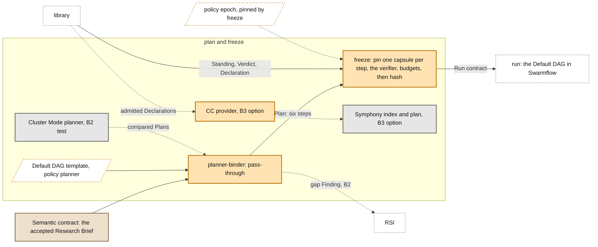

# Plan and freeze

> **Owner:** Muk · Xiaoyang · **Build steps:** B1 Default DAG pass-through; B2 chaining beside Cluster Mode; B3 dynamic planner

Turns the accepted semantic contract into a **Plan** (steps and their needs, capsules only proposed), then freezes it into the **run contract**: one capsule per step and the run's verifier, pinned by hash, with the Verdicts that allowed them and the token budgets. After freeze nothing is chosen again. **In M1 the Plan is the PRD's hardcoded Default DAG**: once requirement acceptance passes the Research Brief, the planner-binder emits the six remaining steps and freeze pins them.

## Our understanding, to confirm

**For Xiaoyang (builds it with Muk).**

- [ ] M1's plan is the hardcoded Default DAG (PRD). Requirement Compilation runs before planning; the Plan holds the six steps after it (`search`, `screening`, `hypothesis`, `poc`, `benchmark`, `report`). The planner-binder is a pass-through that writes it, with no model and no choice. The Default DAG template lives in policy `planner`.
- [ ] The planner-binder proposes capsules by name; only freeze binds a `decl_hash`, through the Standing. Freeze pins every step's capsule and each operator it names, by hash, and the `verifier_capsule` in the run contract's `verifier`. It refuses when requirement acceptance used another verifier version.
- [ ] The Plan and the run contract point at the accepted Research Brief (`contract_ref`) and its acceptance (`contract_accepted_by`). The Brief's `must` checks reach the Bindings: a metric requirement's check goes on the last step's Binding (INV-9).
- [ ] Freeze copies each step's token `budget` from policy `routing` into its Binding, and the verifier's into `verifier.budget`, so the Evaluator gate can check them from B1.
- [ ] The run contract is hashed and never changes. Calls made under it are Observations that point at it.
- [ ] **B2:** Cluster Mode is tested as a planner beside the baseline; our planner-binder chains by port type and writes a gap Finding when nothing fits. Neither is on the M1 path.
- [ ] **B3:** the dynamic planner track aims at Cluster Mode, the PRD's future default. Symphony's `plan()` with our CC provider is an option inside that track; its graph accepts skills and drops tools (`build.py:161`).

## Inside

### Planner-binder

*Owner: Muk · Xiaoyang · Build steps: B1 pass-through; B2 chaining; B3 dynamic planner · Code: `cc/planner_binder.plan`*

Writes a Plan: steps, their needs, and the edges between them. It proposes capsules; it never binds them.

- **B1, pass-through**: the Default DAG from policy `planner`, planned against the accepted Brief; each step proposes its stage capsule by name
- **B2, chain**: backward chaining from `want` to `given` over declared port types, beside Cluster Mode; checks `needs.when` through the precondition evaluator; writes a gap Finding when nothing fits
- **B3, dynamic planner**: Cluster Mode's planner, or Symphony's `plan()` over admitted capsules as an option

### Freeze

*Owner: Muk · Xiaoyang · Build steps: B1 · Code: `cc/planner_binder.freeze`*

Pins exactly what will run: one capsule per step, by hash, with the Verdict that allowed it. After freeze nothing is chosen again.

- pick the current `decl_hash` for each step's proposed name from the Standing
- copy what the run needs into the Binding: `code_sha256`, `effect_class`, `bind[]`, the predicates (Declaration `needs.when` and step `requires.when`), the Evaluator gate's `checks[]` with their sources, and the `budget`
- check `effect_class` against the step and the run's ceiling; check the level against the step (B3)
- add pre-approved fallbacks (B3)
- **generalists** (B3, policy `generalists`): an `exempt` general-purpose agent bound to a step; rules set with that track
- hash the whole record: `run_contract_sha256`

### Symphony

*Owner: Muk · Xiaoyang · Build steps: B3, an option in the planner track · Code: `cc/provider`*

Symphony already indexes, ranks and plans. Our provider is its first concrete `CapabilityProvider`: it feeds admitted capsules in as `CapabilityDescriptor`s. Not used on the M1 path.

- **CC provider**: `capabilities()`, `source_snapshot()` over capsules whose Standing is `admitted`
- **plan()**: a ranked plan graph, for the dynamic planner track
