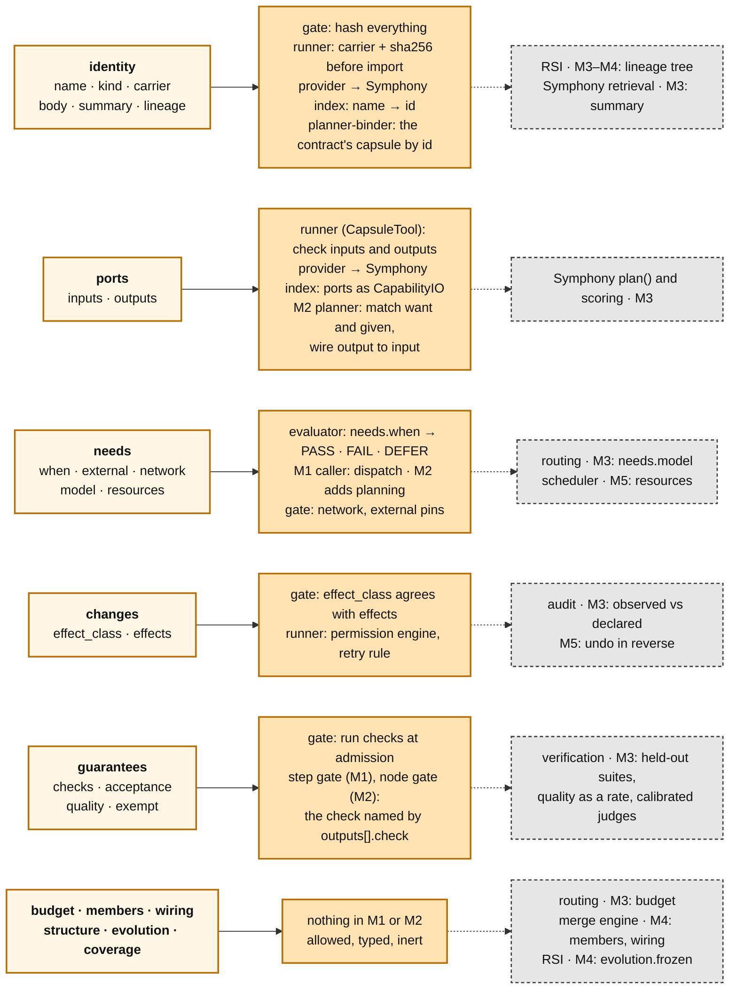

# The Capability Capsule schema, explained: every part, what it is for, and where it plugs in

> **Shared and editable.** This file explains the schema for the whole team. Edit it through pull requests, and put a
> question inline as `> Q (name): ...` under the field it is about. **The normative files are
> [`capsule.schema.json`](../merged/capsule.schema.json)** (shape) **and
> [`policy-m1.json`](../merged/policy-m1.json)** (what the gate requires at M1). This page explains them. If this page
> and the JSON disagree, the JSON wins, and the difference goes in section 8. The full text with its reasons and
> evidence is [`SCHEMA.md`](../merged/SCHEMA.md) (v2.10b). Muk owns the schema and merges changes.

## 1. What a Declaration is, in five sentences

- A 能力胶囊 (capability capsule) is a **Declaration**: a JSON record that says what a capability takes, gives, needs,
  changes and guarantees.
- It **points at code and never holds it**. `identity.carrier` names the code and pins its sha256. If the code
  changes, the hash no longer matches, and the runner's loader refuses it.
- It is either a **leaf** (points at code) or a **composite** (made of other capsules), never both.
- It **holds no task**. There are no step names, stages or workflows in it, so the same capsule can serve any step
  whose ports fit.
- **Declare first, then check.** Every field gives a check a target, which is why the planner can pick cheaply and
  the gate can verify.

**One schema, enforced progressively.** Every field below exists from day one. The policy for each milestone decides
which fields are *required*. A field nobody reads yet is *inert*: allowed, typed, and ignored. So later milestones
are code changes on our side, and capsule authors never have to migrate.

## 2. Where each part plugs in

Each row is one section of the Declaration. The orange box says **which code we are writing now reads it, and for
what** (M1 and M2; module names as in [M1-DESIGN.md](M1-DESIGN.md)). The grey box says **who reads it later**, and from which milestone.



## 3. A whole Declaration: `count_spaces`, the M1 task capsule

It is one of the five M1 capsules (see [M1-DESIGN.md §1](M1-DESIGN.md)).
[`examples/count_spaces.json`](examples/count_spaces.json) passes the M1 gate
(`python merged/validate_capsule.py team/examples/count_spaces.json`). Its hashes are placeholders until the file
exists.

```json
{
 "schema_version": "2.10",
 "identity": {
  "name": "seed.count-spaces", "kind": "tool",
  "carrier": {"ref": "cc/seeds/count_spaces.py:count_spaces", "sha256": "000…"},
  "summary": "Count the space characters (U+0020) in a text.",
  "body": [{"path": "cc/seeds/count_spaces.py", "sha256": "000…"}],
  "lineage": {"parent": null, "builder": "muk"}
 },
 "ports": {
  "inputs":  [{"name": "text",  "type": "text",    "required": true}],
  "outputs": [{"name": "count", "type": "integer", "check": "count_matches_cases"}]
 },
 "needs": {
  "when": [{"check": "text_present", "path": "inputs.text", "op": "present",
            "evaluable_at": "both", "on_unknown": "defer"}],
  "network": "none"
 },
 "changes": {"effect_class": "pure", "effects": []},
 "guarantees": {
  "checks": [{"id": "count_matches_cases", "kind": "deterministic", "anchor": "deterministic",
              "target": "ports.outputs.count", "runner": "unit_cases", "over": "outputs",
              "author": "muk", "written_before_body": true, "held_out": false,
              "signal_source": "harness", "owner": "external"}],
  "acceptance": "count_matches_cases"
 }
}
```

## 4. Every field

**How to read the "From" column:**

- **M1** means the M1 policy requires the field.
- **M1 (opt.)** means M1 reads the field if it is present.
- A later milestone means the field is inert until then.
- **later** means the field is written now but nothing checks it yet (for example `lineage`, whose reader, RSI, arrives
  at M3 or M4).

Names follow `capsule.schema.json`.

### 4.1 `identity`: what this is, and which code it points at

| Field | What it is | Why it exists | Written by → read by | From |
|---|---|---|---|---|
| `schema_version` | the schema version the Declaration is written under | an old Declaration is read under its own rules | author → every reader | M1 |
| `name` | a stable handle, e.g. `seed.count-spaces` | versions hang off a name, and the version list is keyed by it; the semantic contract names its allowed capsule by it. A changed contract means a new name | author → store, Symphony index, planner-binder | M1 |
| `kind` | `tool`, `skill`, `mcp`, `a2a`, `subagent`, `agent_template`, `prompt_section`, `bundle`, `composite` | the runner chooses how to call it from this field alone. A tool needs no agent; a model capsule or a skill does. M1 runs both kinds | author → runner, Symphony index | M1 |
| `carrier {ref, sha256}` | where the code is (a module path, tool name or MCP tool id) and the hash it must resolve to | "a hat on a head": the capsule never holds the code, and the hash is how a changed head is noticed | author (hash computed at admission) → runner | M1 |
| `body[] {path, sha256}` | every file the Declaration covers, each with its hash | a mismatch at load aborts the load | author, gate → runner, gate | M1 (or `remote`) |
| `remote {endpoint, version}` | used instead of `body` for a service we do not host (a remote MCP server, an A2A agent) | we cannot hash what we do not have, so we pin its endpoint and version | author → runner | M1 (opt.) |
| `summary` | at most 400 characters of what it does | the only prose a model sees when choosing. It must never name steps, stages or other capsules | author → Symphony retrieval (M3) | M1 |
| `load_mode` | `eager` or `on_demand` | whether it shares the agent's context or loads when called; this matters for skills, where context drift grows with each skill loaded | author → planner | M3 |
| `overlays[]` | experience or guidance loaded with it, each hashed | so a sprint pins exactly what was loaded alongside the capsule | author, jiuwenswarm → freeze | M3 |
| `lineage {parent, relation, builder, …}` | the parent version and how this one relates to it (`supersedes`, `specialises`, `rollback_of`, `migrated_from`, `composes`, `fuses`) | versions form a **tree**, so RSI can branch from any node and a rollback is itself a new node. M1 plans with the latest version only, a linked list | author, RSI → store now; RSI, librarian later | written from M1, read later |
| `lineage.context_capsules[]`, `provenance {…}` | what was in the builder's context, and which model, prompt and trajectory produced it | if a capsule turns out to be harmful, its descendants can be found | RSI → librarian, audit | later |

### 4.2 `ports`: what goes in and what comes out

| Field | What it is | Why it exists | Written by → read by | From |
|---|---|---|---|---|
| `inputs[] {name, type, required}` | each input, with a type from one shared vocabulary | the runner checks every call against it; from M2 the planner matches *given* to inputs by type, in code, with no model | author → runner, Symphony index (M1), planner (M2) | M1 |
| `outputs[] {name, type, check}` | each output, with its type and **the id of the check that validates it** | the step gate knows which check to run on each output; from M2 the planner matches *want* to outputs. An output with no check cannot be gated | author → runner, step gate; planner and wiring (M2) | M1 |

Our provider gives Symphony the ports as `CapabilityIO` from M1. Using its names means that switching to Symphony's
`plan()` at M3 changes no Declaration. Who owns the type vocabulary is still open.

### 4.3 `needs`: what must be true before it runs, and what it depends on

| Field | What it is | Why it exists | Written by → read by | From |
|---|---|---|---|---|
| `when[] {check, path, op, value, evaluable_at, on_unknown}` | preconditions as **evaluable predicates**, e.g. `inputs.text present` | a sentence of prose is not a precondition: nothing can run it. **One evaluator** answers PASS, FAIL or DEFER. Dispatch calls it in M1, and planning becomes the second caller in M2, so the two can never disagree | author → evaluator (dispatch in M1; planning from M2) | M1 |
| `when[].evaluable_at` | `planning`, `dispatch` or `both` | some facts exist only once upstream nodes have run | author → planner | M1 |
| `when[].on_unknown` | `defer` or `block` | a missing fact must never silently pass | author → evaluator | M1 (opt.) |
| `external[] {ref, decl_hash, pinned, unpinned_purpose}` | the capability's own dependencies, pinned by hash, or unpinned with a stated purpose | a changed dependency changes the capability; an unpinned one keeps it at a lower trust level | author → gate | M1 (opt.) |
| `network` | `none`, `egress`, `ingress`, `both` | filtering and sandboxing | author → gate, planner | M1 (opt.) |
| `model {min_context, families, excludes}` | constraints on the model, never a choice of model | **routing** picks a model that satisfies them, and the Binding records which one | author → routing | M3 |
| `resources[]`, `injects[]` | shared resources and services it needs | scheduling and composition | author → scheduler, screener | M5 |

### 4.4 `changes`: what it does to the world, declared up front

| Field | What it is | Why it exists | Written by → read by | From |
|---|---|---|---|---|
| `effect_class` | one of `pure`, `read_only`, `idempotent`, `compensable`, `irreversible` | **the author answers for state and undo.** Everything keys off this: whether a retry is safe, whether it runs in parallel, whether the permission engine says ALLOW, ASK or DENY | author → gate, runner, dispatch | M1 |
| `effects[] {resource_key, scope, idempotent, reversibility, undo}` | each individual effect | the gate checks that the class agrees with the effects (`EFFECT_CLASS_INCONSISTENT` otherwise). Later, what is observed at run time is checked against them | author → gate, audit | M1 (opt.) |
| `provides[]`, `invariants[]` | services it installs, and invariants it keeps, each with a check | install and uninstall mid-run; screening | author → screener | M2 |
| `state {kind, scope, reset}` *(proposed, v2.11)* | `none`, `reads_external`, `session` or `persistent` | this decides how the capsule is tested. For example, `parse_txt` reads a file, so each of its tests ships a fixture | author → gate, verification | decided in WP0 |

### 4.5 `guarantees`: what it promises, and how that is checked

| Field | What it is | Why it exists | Written by → read by | From |
|---|---|---|---|---|
| `checks[] {id, kind, target, runner, …}` | each check, with its id, what it checks and what runs it | **every promise has a target.** Checks carry ids, so tests are saved by id and a child version can re-run its parent's tests | author, verification → gate, step gate | M1 |
| `checks[].anchor` | `deterministic`, `reference` or `judged` | a judged check counts only when its judge's error is measured. **Block only for safety; label for quality** | author → gate | M1 (opt.) |
| `checks[].held_out`, `author`, `written_before_body`, `owner` | who wrote the check, and whether the builder ever saw it | **no capsule is its own final judge**: internal checks are allowed but are never evidence | author, verification → gate | M3 |
| `acceptance` | which check ids must pass for admission | makes admission explicit | author → gate | M1 (opt.) |
| `evals[]`, `quality {criterion, judge, target_rate, window, min_observations}` | quality as **a rate over a window**, not a single verdict | "good often enough" needs a minimum number of observations and a calibrated judge | verification → librarian | M3 |
| `exempt` | true only for a **generalist**, the low-trust capsule that can attempt anything | so something can run when nothing else fits, and RSI has material to improve on. Plan gates still apply to it | library owner → planner, freeze | M3 |
| `test_aids` *(proposed, v2.11)* | example inputs, fixtures and reset commands from the author | help for RSI and for testing. **Never evidence** | author → RSI | decided in WP0 |

### 4.6 The rest: budget, composites, evolution, coverage

| Field | What it is | Why it exists | From |
|---|---|---|---|
| `budget {tokens, time_s, money, concurrency}` | limits per call | agents can run up costs; a capsule that exhausts its budget has not passed | M3 |
| `members[] {role, decl_hash}` | a composite's member capsules, each pinned by hash | **leaf xor composite**: a Declaration with both `members` and `carrier` is rejected | M4 |
| `wiring[] {from, to}`, `structure {…}` | how the members connect: a small DAG inside one block | a merged block can be placed in the outer DAG as one node | M4 |
| `evolution.frozen[]` | which parts the author promises to keep stable (e.g. `ports`) | tells RSI where it may change the capsule and where it may not | M4 |
| `evolution.notes_for_builder[]` | advice for whoever builds the next version | advisory only, never enforced | M4 |
| `coverage.undeclared_notes[]` | what the author knowingly left out | the screener looks at these capsules first | M3 |

### 4.7 Computed by the gate, never written by the author

| Value | What it is |
|---|---|
| `decl_hash` | SHA-256 over the canonical Declaration, including body hashes. **Everything is addressed by it** |
| `contract_hash` | the hash of everything except the body, lineage and coverage, so a test suite written before the code is bound to the contract it tests |
| agent-core flags | `ToolCard`'s `parallel_safe`, `stateless` and `idempotent`, derived from `changes` |
| a composite's derived needs and changes | the union of its members', computed by the gate and never written by hand |

## 5. The records kept around a Declaration

The Declaration is written once. Everything learned about it afterwards goes into separate, append-only records.

| Record | Written by | Holds | From |
|---|---|---|---|
| **Verdict** | the gate | the outcome (admit, reject, defer), typed reasons, the checks run and the policy epoch. M1 keeps a minimal one: pass, `decl_hash`, epoch | M1 minimal; M3 full |
| **test case** | the gate, verification | saved by id, with inputs stored by hash, so a child version can run its parent's tests | M1 |
| **version list** | the gate | latest version per name. This is the only moving pointer | M1 |
| **Binding** | freeze writes one per node into the run contract; the runner appends one invocation per capsule call | exactly which `decl_hash`, code hash and Verdict ran, for which run and node, plus one entry per invocation | M1 |
| **Finding** | the planner (gaps), screeners, verification | typed observations, e.g. a gap: nothing fitted this need | M2 (gaps) |
| **Standing** | the librarian | the capsule's current state (admitted, suspect, revoked, …), with every move logged. **Never a numeric trust score** | M3 |

## 6. Rules that hold for every field

1. **Nothing that decides is a capsule.** A capsule may assess, but control decides: the planner, the gates and
   delivery are never capsules.
2. **No task inside a capsule.** Where it is used lives in the plan and the Binding, never in the Declaration.
3. **Required-ness lives in the policy, not the schema.** Protocol Buffers' rule is "never add a required field", so a
   milestone's policy can be relaxed later without breaking any Declaration.
4. **Block only for safety; label for quality.** A changed hash, a protected write or an undeclared effect refuses the
   run. A provisional capsule or an unmeasured judge only labels the claims.
5. **Append-only, keyed by hash.** A change is a new version, never an edit.

## 7. How the teammates' components use the schema

| Component | Reads | Writes | From |
|---|---|---|---|
| Verification (Ramika) | `guarantees.checks`, `ports.outputs[].check`, Bindings (to trace a failure to exact hashes) | the acceptance gates' deterministic checks and the step gate (M1); node-gate acceptance (M2); held-out suites and judge calibration (M3) | M1 |
| RSI (Saurav) | `lineage`, tests by id, observability records, gap Findings, `evolution.frozen` | new Declarations with `lineage` set. It never writes to the library directly: new versions go through the gate | M3, M4 |
| Routing (Xiaoyang) | `needs.model`, `budget` | the model used, recorded in the Binding | M1: picks the model for the four model capsules in intent and requirement compilation; `needs.model` enforced from M3 |

## 8. Known mismatches to fix in WP0

`capsule.schema.json` and the §3.1 text of `SCHEMA.md` disagree field by field. This is the same class of bug as
the three found after 23 September.

- Until each is fixed, **the JSON is what the gate enforces**, and this page follows the JSON.
- `identity`, `ports`, `needs`, `changes`, `guarantees`, `budget` and each `changes.effects[]` entry **refuse
  unknown fields**.
- So a Declaration written to the text can be rejected by the gate. `identity.version_label` is one example; an
  effect's `op` or `risk` is another.

Audited on 2026-09-25, first against the M1-required fields, then the rest.

**A. In fields M1 requires.** Fix these first.

| Field | `capsule.schema.json` | `SCHEMA.md` §3.1 text | Proposed |
|---|---|---|---|
| a port's type | `type` | `artifact_type` (plus `schema_ref`, absent from the JSON) | decide one name; add `schema_ref` or drop it |
| an output's check | `ports.outputs[].check` | `check_id` | decide one name |
| a precondition's shape | flat: `check`, `path`, `op`, `value` | an `id`, and a nested `check {path, operator, value}` | keep the flat JSON form; update the text |
| precondition fields | no `state_source`, `max_age_s`, `on_unavailable`, `parity_check` | all four | add the ones the evaluator needs for M1 (at least `max_age_s`) |
| `needs.when[].on_unknown` | `defer`, `block` | `defer`, `exclude` | one list |
| `needs.when[].evaluable_at` | `planning`, `dispatch`, `both` | `planning` or `dispatch` | keep `both`; update the text |
| `changes.effect_class` | five values, including `read_only` | four | keep five (`parse_txt` needs `read_only`) |
| carrier | `identity.carrier {ref, sha256}` | the decision notes say `identity.code_id` | keep `carrier` |

**B. In fields that are optional or inert at M1.**

| Field | `capsule.schema.json` | `SCHEMA.md` §3.1 text |
|---|---|---|
| `identity.version_label` | absent, and `identity` refuses unknown fields | a free-text version |
| `identity.load_mode` | `eager`, `on_demand` | `invoked`, `context_injected` |
| `identity.overlays[]` | strings | `{kind, ref, sha256, source}` |
| `needs.external[]` | `{ref, decl_hash, pinned, unpinned_purpose}` | `{kind, pin}` or `{kind, floating {purpose, role, contracts}}` |
| `needs.network` | `none`, `egress`, `ingress`, `both` | `none`, `allowlist`, `open` |
| `needs.model` | `{min_context, families, excludes}` | `{tool_calling, min_context, modalities}` |
| `needs.injects[]`, `needs.resources[]` | strings | `{service_key, interface_version_range}`; `{resource_key, mode}` |
| `changes.effects[]` | `{scope, resource_key, idempotent, reversibility, undo}` | also `id`, `op`, `risk`, `assurance` |
| `changes.effects[].reversibility` | `none`, `compensable`, `reversible` | `inverse`, `scoped`, `compensate`, `emission` |
| `changes.provides[]`, `changes.invariants[]` | strings | `{service_key, interface_version, commutative}`; `{id, statement, check_id}` |
| a check's runner | `runner` and `runner_hash` | `runner {ref, sha256}` |
| `guarantees.evals[]` | strings | `{suite_ref, sha256, metric, threshold, held_out}` |
| `guarantees.unanchored` | absent | aspects no check covers |
| `guarantees.exempt` | a boolean | `{reason: generalist}` |
| `budget` | `tokens`, `time_s`, `money`, `concurrency` | `per_call`, `enforcement`, `on_exhaust` |
| the schema's own description | says "Schema version 2.9" | v2.10b |

**C. Inside the JSON itself.** `guarantees.checks[].kind` has `judge`, but `anchor` has `judged`. Pick one
spelling.

**Also in the text itself.** §0.1 requires `lineage.relation` even for a root version (`parent` empty), but no
`relation` value fits a root. The JSON does not require it, so the example omits it. Decide in WP0: add `root`, or
require `relation` only when `parent` is set.

**D. Not a mismatch, a proposal.** `changes.state {kind, scope, reset}` and `guarantees.test_aids` are proposed for
v2.11 (in the layer 2 notes and the obby vault). Neither is in the JSON or in `SCHEMA.md` yet. Decide in WP0.

## Changelog

- **draft 1, 2026-09-25 (Muk):** readers aligned with the M1 map and Directives: the runner calls every capsule,
  Symphony indexes from M1, the planner is a pass-through until M2, and routing picks models for M1's model capsules.
- **draft 0, 2026-09-25 (Muk):** first version for the team, explaining v2.10b as `capsule.schema.json` implements
  it. §8 widened the same day after a review: a full field-by-field audit, grouped by whether M1 requires the field.
