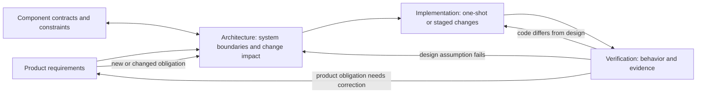

# Design and team coordination

**A short presentation route from the architecture perspective.** Read these pages in order. Each expands one topic. They explain how design connects product changes, component work, implementation and verification. The [design method](../design-method.md) remains authoritative.

## Route

1. [Design connects the project](01-design-connects-the-team.md): where design fits across the PRD, modules, implementation and verification.
2. [Changes, decisions and timelines](02-changes-decisions-timelines.md): how design responds to PRD changes, defects and milestone movement.
3. [Choose and adjust work granularity](03-adaptive-granularity.md): how design detail and implementation size adapt to risk.
4. [Grow the design package safely](04-growing-design-package.md): when to update existing pages and when to add a focused area.
5. [Coordination support and continuity](05-coordination-support.md): how Git, automation and agents can keep information aligned.

## One-minute view

Design is the shared map between what the project wants, how its parts connect and what implementation must demonstrate. Component responsibilities remain with their component owners. Cross-component changes need shared understanding and a recorded decision, not a new PM role.

## Scope

These pages explain the architecture perspective and mark new ideas as proposals. They do not change PRD requirements, design authority, task identities or acceptance gates. Adopt a proposal only after the team agrees and updates the authoritative design page.
