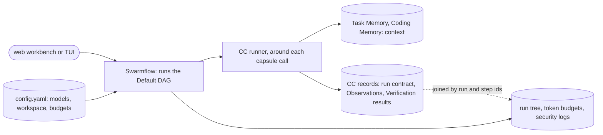

# Runtime and records

**Confirmed by:** PRD §3 (Harness Core; Data Foundations; Visibility / Statistics; UI; System Configurations).

JiuwenSwarm is the runtime: Swarmflow runs the DAG, its memory holds context, and its run tree shows progress. CC's records sit beside it and join it by ids.

**Uses from Block 1:** [[run-contract]], [[observation]], [[verification-record]], [[integration]] (Swarmflow connection points).

**Open:** whether CC's records store conflicts with the PRD's "no custom database schema" in M1 ([[prd-inputs]]).
