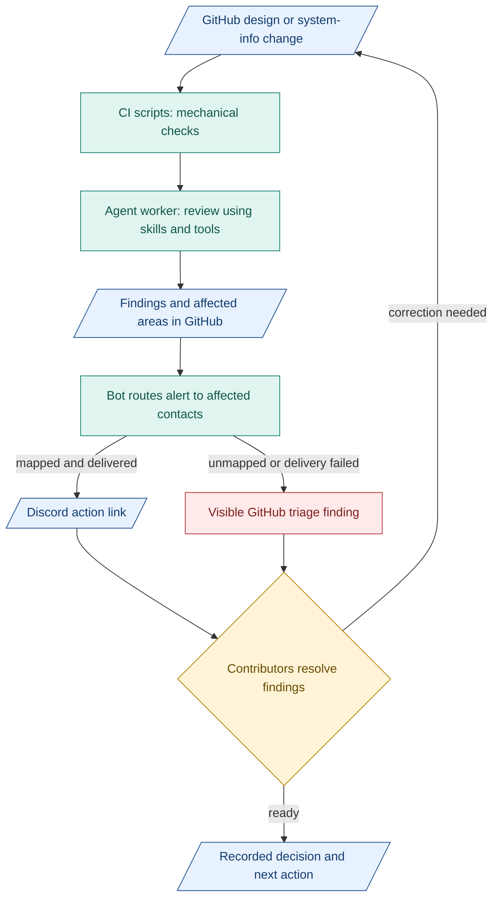

# 5. Automation

**Proposal: cheap checks and targeted alerts around each change.** Architecture maintains design-check guidance. Affected contributors resolve findings.

## Design CI

| Part | Job |
|---|---|
| Scripts/tools | Case-sensitive paths, links, glossary spelling, schema references, diagram freshness |
| Agent skills | Reusable instructions, examples and review criteria |
| Agent workers | Use skills/tools to flag unclear meaning, missing context and likely impact |
| People | Resolve disputed meaning and consequential decisions |

Bound jobs by time/cost. Save checked revision, input identities and findings. AI review can be wrong. Document checks do not prove product acceptance.

## GitHub and Discord

- **GitHub:** drafts, issues, PRs, decisions and evidence. Existing TASK/specification records retain work authority. Merge design after relevant human review.
- **Discord:** targeted alerts and discussion links. Return decisions to GitHub.
- **Routing:** assignees, requested reviewers and Git-tracked module/contact map. Ping for action/blockers/shared contracts. Group routine updates.

## Proposed notification flow

Blue: records. Teal: work/tools. Amber: human decisions. Red: unresolved.

Surface failed checks/jobs too. Keep unanswered actions visible. Delivery does not prove reading. Restrict mentions to intended recipients. Integration is proposed, not deployed.

**Start small:** scripts and one bounded review worker, then routing. Extend existing sidecar tooling in its separate development scope. Product startup/exits remain independent. Keep tools only when useful alerts, fewer missed changes or lower rework justify cost/review effort. Token counts measure size, with tokenizer/version recorded.

**Inspired by:** [GitHub Actions](https://docs.github.com/en/actions/get-started/understand-github-actions) for event-driven checks, and [Anthropic's agent patterns](https://www.anthropic.com/engineering/building-effective-agents) for simple workflows before added autonomy. Useful because steps stay inspectable and cost can be bounded.

**Bot example:** [pr-discord-notifier](https://github.com/asirago/pr-discord-notifier) posts opened, edited and closed PR notices. Our recipient routing needs separate logic. Start with a GitHub workflow and [Discord webhook](https://docs.discord.com/developers/resources/webhook).
