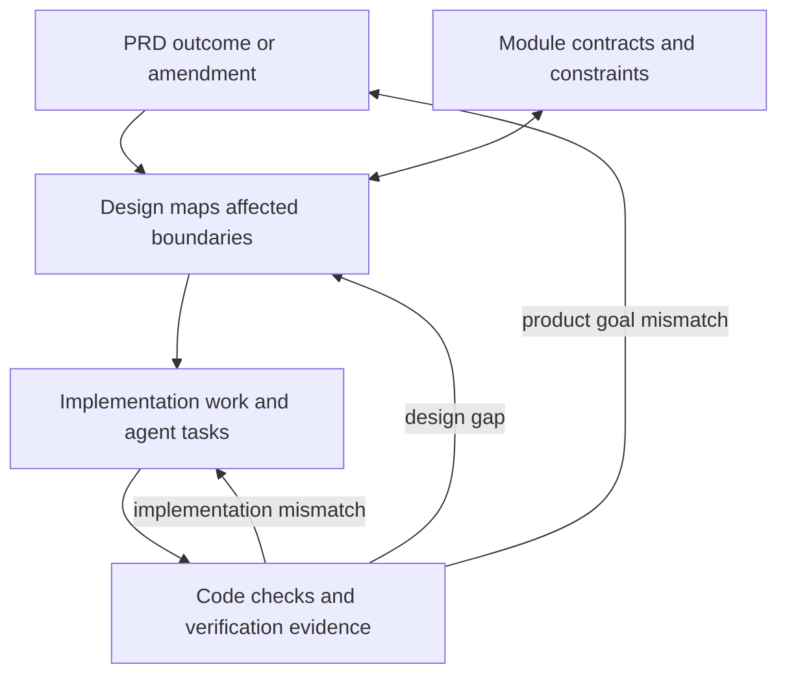

# 1. Design connects the project

**Key point:** Design connects product intent to module boundaries, implementation choices and verification evidence.

## What design contributes

Project coordination happens through shared decisions and component responsibility. From the architecture perspective, design keeps the whole-system view clear while each component remains responsible for its own behavior and interfaces.

| Project area | What design needs to make clear |
|---|---|
| PRD | Which outcome, constraint or phase commitment changed |
| Modules | Which producers, consumers, interfaces, dependencies and failure paths are affected |
| Implementation | What must be built, which choices can vary and what must remain compatible |
| Verification | What evidence demonstrates the intended behavior and which evidence a change invalidates |

Architecture is high enough to connect module decisions and low enough to clarify implementation boundaries. It does not need to own every coding detail or tell another component how to work internally.

The existing [design method](../design-method.md#team-decisions-and-implementation-handoff) describes this relationship. The diagram summarizes connections. It does not assign personal roles or add a new approval step.

## Why this matters in AI-native development

Coding agents can draft implementation and review output, but they need stable names, contracts, context and acceptance evidence. Clear architecture reduces inconsistent assumptions across people, agents and parallel changes. Human attention can then focus on whether the shared behavior and evidence are sound.
