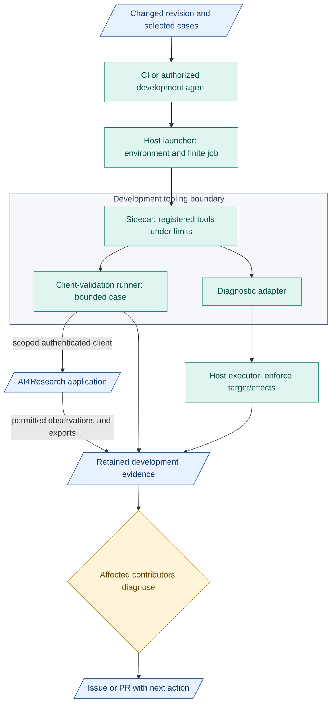
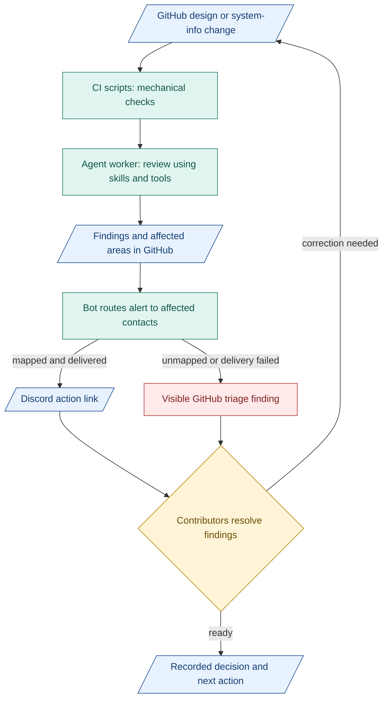

# 5. AI CI

**AI CI proposal: scripts, bounded agent review and targeted alerts.** Architecture maintains design-check guidance. Affected contributors resolve findings.

## Design CI

| Part | Job |
|---|---|
| Scripts/tools | Case-sensitive paths, links, glossary spelling, schema references, diagram freshness |
| Agent skills | Reusable instructions, examples and review criteria |
| Agent workers | Use skills/tools to flag unclear meaning, missing context and likely impact |
| People | Resolve disputed meaning and consequential decisions |

Bound jobs by time/cost. Save checked revision, input identities and findings. AI review can be wrong. Document checks do not prove product acceptance.

## Runner and sidecar in AI CI

**Use the designed tooling boundary.** AI workers operate outside the runner. CI triggers jobs. Neither tooling design adds authority to product agents.

Blue: records. Teal: work/tools. Amber: human decision. Boxes show responsibilities, not extra required services.

| Tooling design | What it contributes |
|---|---|
| [Sidecar](../development-tools/sidecar/README.md) | Registered validation/diagnostic tools, explicit target, effects, limits and retained results |
| [Client runner](../development-tools/test-runner/README.md) | Readiness, submit, observe, assess and export through supported client seams |

- Missing authentication, readiness or client compatibility blocks the job. Interrupted/inconclusive results stay visible.
- Launcher owns lifecycle/cleanup of its resources. Runner has no Docker socket or private product-state access.
- Development reports inform diagnosis. They cannot replace product verifiers/gates or insert accepted outputs.
- Start with existing scripts and one review worker. Add this integration when useful and separately scoped. Product startup and exits stay independent.

## GitHub and Discord

- **GitHub:** drafts, issues, PRs, decisions and evidence. Existing TASK/specification records retain work authority. Merge design after relevant human review.
- **Discord:** targeted alerts and discussion links. Return decisions to GitHub.
- **Routing:** assignees, requested reviewers and Git-tracked module/contact map. Ping for action/blockers/shared contracts. Group routine updates.

## Proposed notification flow

Blue: records. Teal: work/tools. Amber: human decisions. Red: unresolved.

Surface failed checks/jobs too. Keep unanswered actions visible. Delivery does not prove reading. Restrict mentions to intended recipients. Integration is proposed, not deployed.

**Measure value:** useful alerts, missed changes, rework and review effort against tool cost. Token counts describe size, with tokenizer/version recorded.

**Inspired by:** [GitHub Actions](https://docs.github.com/en/actions/get-started/understand-github-actions) for event-driven checks, and [Anthropic's agent patterns](https://www.anthropic.com/engineering/building-effective-agents) for simple workflows before added autonomy. Useful because steps stay inspectable and cost can be bounded.

**Bot example:** [pr-discord-notifier](https://github.com/asirago/pr-discord-notifier) posts opened, edited and closed PR notices. Our recipient routing needs separate logic. Start with a GitHub workflow and [Discord webhook](https://docs.discord.com/developers/resources/webhook).
