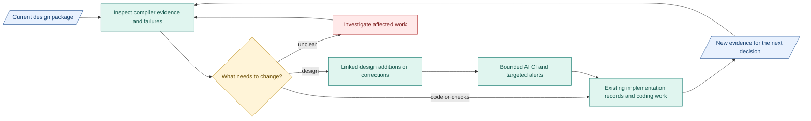

# Today: our design plan

**The proposed design is ready for implementation and review.** Reported full-package builds appear to produce the intended results and follow the design. We have not tested all execution branches, so overall quality is not established.

## First: review verification next week

- Check with people working on compiler and verification. Review AI-built verifier criteria, inputs, findings and gate behavior against the [verification design](../reference/compiler-verification.md).
- Prepare labelled unclear, actionable and failure cases. Review available results with contributors. Record false acceptance, false rejection and missing evidence.
- **Unclear intent:** a faithful candidate IR may exist. If no workable purpose/result can be established, the verifier must identify the gap and the gate must halt before Requirements. It must not invent intent or accept JSON just because it has valid fields.

## Build capsules throughout the work

Check with people working on each CC as it is built. Keep its design, checks and verifier assignment connected. Review actual outputs before connecting the next boundary. This lets verification expose missing context and unreasonable results early. [M1 capsules and RSI](07-m1-capsules-and-rsi.md) show the work split.

## Decisions still open

- **Compactness:** use full context for now. Both PRD and design changed in the comparison, so design length alone is not proven to explain the result.
- **Granularity:** add or remove detail where clarification, rework or boundary failures show a need. Compare total implementation and review effort.

Keep the existing package. Add linked feature detail. Correct affected definitions when findings justify it.

## Where we go next

Blue: records. Teal: work/tools. Amber: human decision. Red: unresolved.

**Build overview:** complete the [Intention Compiler](../immediate-plan.md) through released `Research_Brief.json`, then the remaining [M1 research path](../m1-design.md). AI CI supports coordination under separate tooling scope.

[Our actions, targets and effort](08-build-and-review-sequence.md) | [Decisions](06-decisions-and-next-trial.md)
