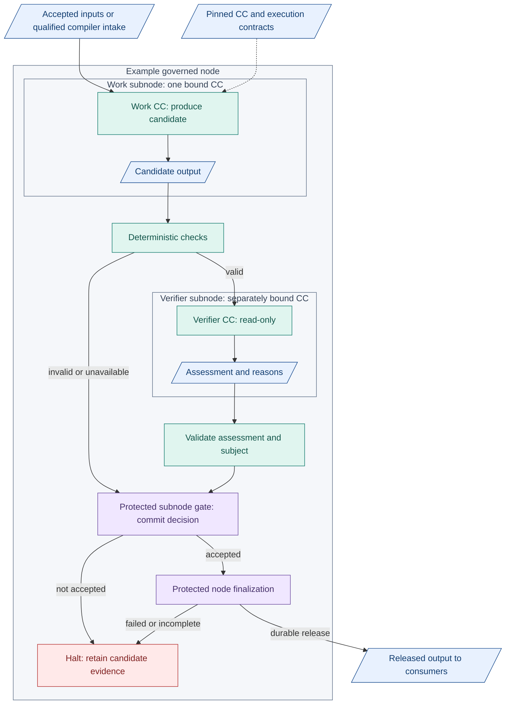
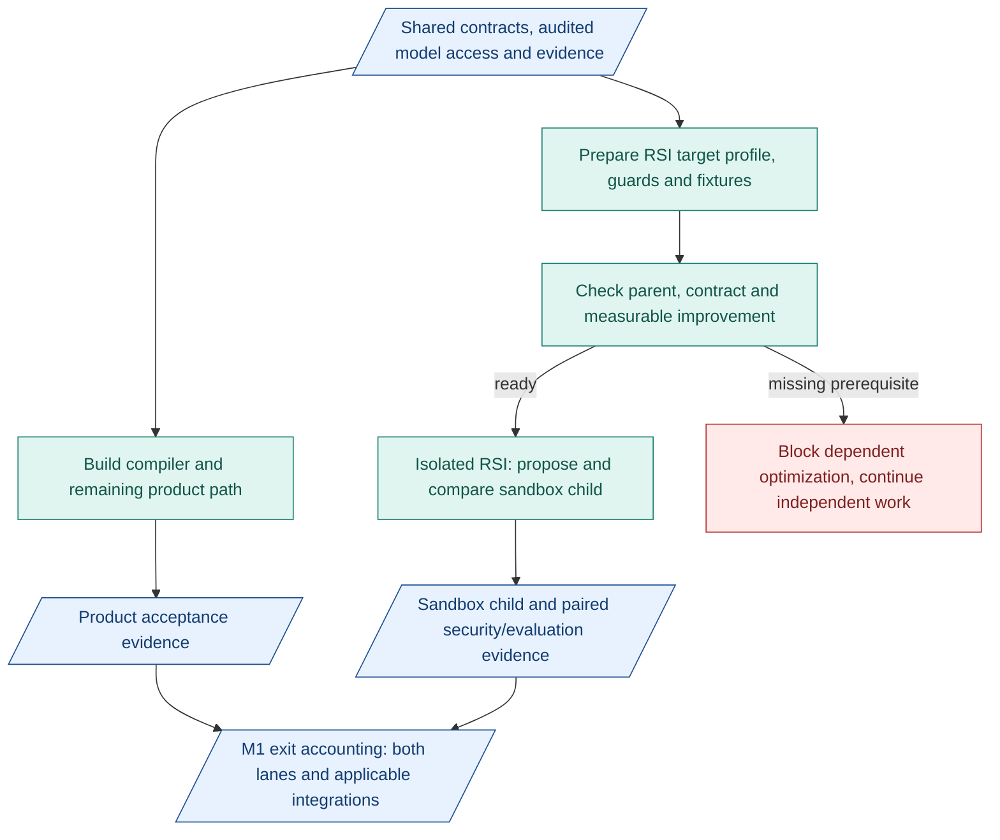

# M1 capsules and RSI

**Nodes own responsibilities. Subnodes bind pinned capability capsules (CCs).** Work CCs produce candidates. Verifier CCs assess. Protected gates accept/release.

## Inside a node

Blue: records. Teal: execution/checks. Purple: protected control. Red: halt. Candidates/assessments stay inside the CC system. Additional work subnodes repeat this pattern before node release.

## Baseline capsules to build for M1

| Area            | Work CCs                      |
| --------------- | ----------------------------- |
| Compiler        | Intention, Requirements       |
| Ground/register | Search, Screening, Hypothesis |
| POC             | Builder, Benchmark            |
| Conclude        | Evaluation, Delivery          |

Pinned verifier assignment per work output. Nine distinct verifier implementations are not required. Build declarations, implementation pins and checking profiles together. Gates/binder/runner are infrastructure. [Phase 3 scope](../delivery-phases.md).

[Node detail](../m1-design.md#execution-and-model-routing) | [CC rules](../capsules.md) | [Authoring](../capsule/authoring.md)

## Build work and verification together

- Define inputs/outputs and acceptance criteria before judging implementation.
- Review actual candidates for fidelity, usefulness and reasonable conclusions.
- Check verifiers with good, bad and unclear cases. AI-built does not mean correct.
- Check connected subnodes before extending the path. Keep failures/reasons.

## RSI can prepare alongside product work

- Target 1, required: sandbox Screening `rank_opportunities`. 
- Target 2, conditional: permitted Screening prompt/work-rubric text. Dimensions/interfaces/referee stay fixed. Defer to M2 without bounded headless model support.
- Parallel development: prepare without a finished planner. Optimization needs eligible parent, meaningful fixtures and measurable headroom. Completion needs predecessor exits.
- Never mutate verifiers/referee, hidden fixtures, gate policy or activation. No automatic promotion. Future use requires admission and human activation.

[RSI protocol](../offline-rsi.md) | [M1 phases](../delivery-phases.md)
