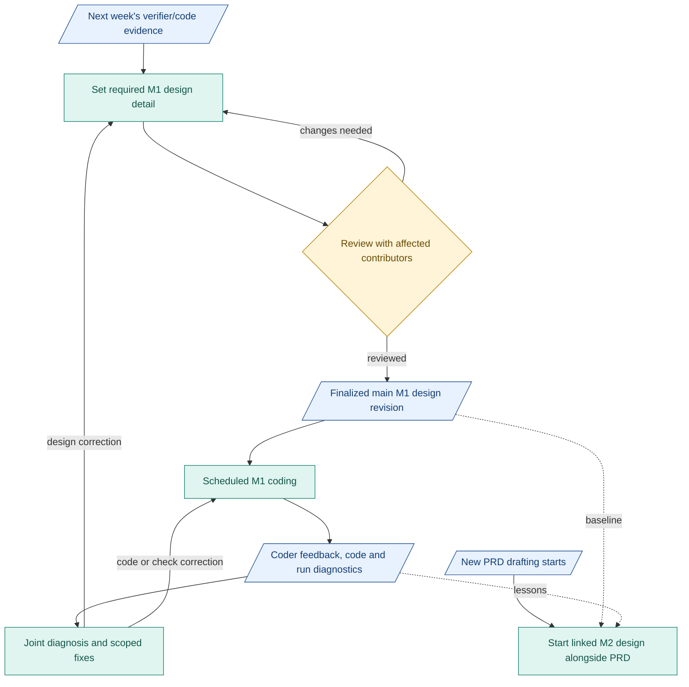

# Today: design plan

**M1 design covers the planned parts. Finalization needs a detail decision and peer review.** Reported full builds appear to follow it. Untested branches and verifier quality remain open.

## First: review verification next week

- Receive generated code/logs. Compare verifier criteria, context, findings and gates with [design](../reference/compiler-verification.md).
- Agree cases, expected behavior and evidence with people working on benchmarking and verification. Include requirements contributors for disputed expectations. Record wrong decisions and missing evidence.
- Unclear intent may yield a faithful candidate IR. Without workable purpose/result, the gate must halt before Requirements. No invented intent. Valid JSON is insufficient.

Share pinned cases, build/settings and failure evidence for joint review. Benchmark scores compare builds; compiler gates decide release. Keep scoring outside the compiler.

## Build capsules throughout the work

Review each CC's design, checks, verifier and actual output before connecting the next boundary. [M1 work split](07-m1-capsules-and-rsi.md).

## Decisions still open

- Compactness: use full context now. Both PRD/design changed in the comparison. Cause remains unproven.
- Granularity: adjust detail from clarification, rework, boundary failures and total effort.

Keep the existing package. Append linked detail. Correct affected definitions.

## Finalize, build and keep learning

- Use next week's findings to settle M1 granularity. Get review/agreement from affected contributors.
- Resolve review findings. Record the reviewed revision as the **finalized main M1 design package**.
- Use it for scheduled M1 coding. Build speed depends on capacity and dependencies.
- Receive coder feedback, code/logs and diagnostics. Diagnose together. Correct the affected design, code or checks and review new evidence.
- Start M2 design when new PRD drafting starts. Check emerging goals with people working on the PRD. Explore options/interfaces in parallel; mark unsettled requirements. Keep M1 history and active-run pins intact.

Design depends on PRD for product outcomes. Reuse, options, interface impacts and risks can be explored during drafting and fed back into PRD discussion.

## Where we go next

Blue: records. Teal: work. Amber: human review.

**Build:** [compiler](../immediate-plan.md) through released `Research_Brief.json`, then remaining [M1 path](../m1-design.md). AI CI has separate tooling scope.

[My checklist and risks](08-build-and-review-sequence.md) | [Decisions](06-decisions-and-next-trial.md)
