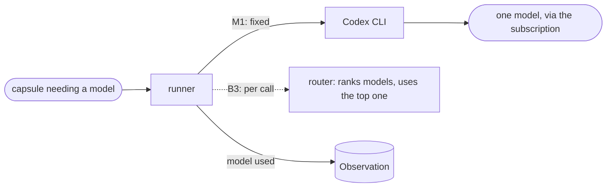

# Model access

**Confirmed by:** PRD §3 (Codex CLI Integration, the first step to implement; Foundational Models), §2 (routing is a parallel track).

In M1 every model call goes to one model through the Codex CLI, using the team's subscription. Dynamic routing is a B3 track.

**Uses from Block 1:** [[observation]] (records the model), [[run-contract]] (the Binding's budget and model limits).

**Open:** Codex exists in JiuwenSwarm only as an external CLI agent, not a model provider; what "Codex CLI adapter" means for M1 is question 1 in [[prd-inputs]].
