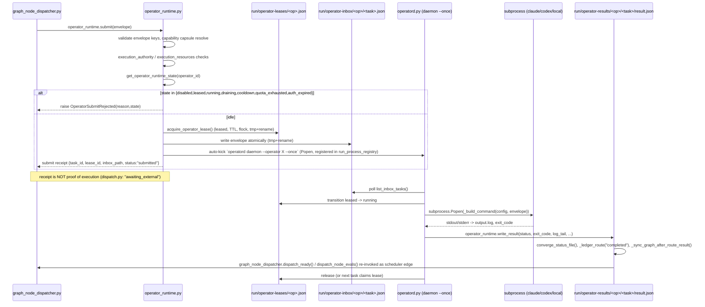

# Stage 6 — Dispatch, Operator Runtime, Leases, and the Backend Abstraction

Scope: from "node ready to dispatch" through operator execution to result
publication. Repo: `/home/muk/work/AI4Research`, branch `openJiuwen-Solar`,
HEAD `b0bf165f9`. All claims are `[VERIFIED]` (read from code/config at the
cited path) unless marked `[DOC-CLAIM]` (asserted only in a `.md` file) or
`[INFERRED]` (reasoned from code shape, not explicitly stated).

## Summary

- There are **two parallel actor/operator abstractions** in the tree: an
  `AgentActor` layer (`actor_lease.py`/`actor_mailbox.py`/`actor_registry.py`/
  `actor_runtime.py`/`actor_profiles.py`, mailbox under `~/.solar/harness/actors/<id>/`)
  and a `physical operator` layer (`operator_runtime.py` + `operatord.py`,
  inbox/results under `~/.solar/harness/run/operator-{inbox,results,leases,status}/`).
  `graph_node_dispatcher.py` — the real scheduler-side dispatch path — calls
  **`operator_runtime.submit()`**, not `actor_runtime.py`'s `ActorRuntime.submit()`.
  The `AgentActor` layer appears to be an alternate/earlier design still present
  and unit-testable but not on the hot path from the graph scheduler. `[INFERRED]`
- Dispatch is a **filesystem mailbox / lease-file protocol**, not RPC: submit
  writes a JSON envelope to `run/operator-inbox/<operator_id>/<task_id>.json`
  (atomic tmp+rename), a `operatord daemon` process polls that inbox, claims
  a task by transitioning a JSON lease file `run/operator-leases/<operator_id>.json`
  from `leased`→`running`, executes a subprocess, and writes
  `run/operator-results/<operator_id>/<task_id>/result.json` plus a
  `graph-callback.json`. All state is JSON files guarded by `flock` (see
  `harness/lib/file_lock_compat.py` usage throughout) — no network/RPC server.
- A **submit receipt is explicitly documented as not proof of execution**:
  `harness/lib/research_orchestration/dispatch.py`'s
  `operator_runtime_submit_adapter()` returns `"status": "awaiting_external"`,
  `"status_is_terminal": False`, and literally
  `"limitations": ["Submitted receipt is not completed worker evidence."]`.
  Real evidence is `result.json` (written by `operator_runtime.write_result()`),
  the `graph-callback.json` convergence record, and ultimately an evaluator's
  `eval.json` verdict that `_finalize_node_pass()` in `graph_node_dispatcher.py`
  checks before committing a PASS.
- The **logical→physical binding `condition` field** (`always` / `quota_ok` /
  `plugin_autosci_available` / `emergency_only`) declared in
  `harness/config/logical-operators.json` `bindings` is read by a
  normalizer (`unified_selector.py::_normalize_bound_candidates`) that stores
  it on each candidate dict — but **no code path in `harness/lib` or
  `harness/tools` ever reads that `condition` value again** for filtering.
  `select_bound_candidate()`/`LogicalOperatorRouter.select_actor()` only
  consult `priority` order plus externally-supplied `unavailable` /
  `quota_blocked` / `risk_denied` sets. `graph_node_dispatcher.py` doesn't
  import `logical-operators.json` bindings at all; it drives physical operator
  selection through `apo_plan_compiler.py::enumerate_physical_candidate_decisions()`,
  a completely separate scoring path keyed off `physical-operators.json`
  `role`/`task_classes`/`preferred_for`. The `condition` taxonomy is
  effectively **inert configuration metadata** on the code paths grepped. `[VERIFIED — absence]`
- `capability_token.py`'s `check_path_access()` (the allow/deny path scoping
  method) has **zero call sites** anywhere in `harness/lib` or `harness/tools`.
  The token class is only exercised for `is_expired()`/`validate_for_lease()`
  (in `actor_runtime.submit()`) and for two boolean flags
  (`file_scope.secret_paths_allowed`, `file_scope.destructive_allowed`,
  `shell_scope.destructive_commands_allowed`) read directly off
  `token.to_dict()` in `browser_job_runtime.py::validate_browser_job_policy()`.
  Actual filesystem confinement at dispatch time is done a different way: by
  `operatord.py`'s `_materialize_envelope_context()` computing an
  `SOLAR_OPERATOR_ALLOWED_OUTPUTS_JSON` / staged-output-publish mechanism and
  (per code comments) OS-level Landlock rules keyed to those exact paths —
  not through `CapabilityToken`.

## Sequence diagram: dispatch → lease → execute → result



## Detailed findings

### Q1 — Task envelope / operator request format

`[VERIFIED]` Defined implicitly by `_REQUIRED_ENVELOPE_KEYS` in
`harness/lib/operator_runtime.py:689` and by every field `operatord.py`
reads out of the envelope dict. There is no single schema class; the
envelope is a plain `dict[str, Any]` that flows: `graph_node_dispatcher.py`
builds it → `operator_runtime.submit()` augments it → written to inbox JSON
→ `operatord.py` reads it.

Required (raises `ValueError` if missing, `operator_runtime.py:785-787`):
`task_id`, `sprint_id`, `node_id`, `operator_id`, `task_type`, `objective`.

Observed/consumed optional fields (collected from `operator_runtime.py` and
`operatord.py::_materialize_envelope_context`):

| Field | Purpose |
|---|---|
| `lease_ttl_seconds` | lease TTL override (default 3600s, `_DEFAULT_LEASE_TTL`) |
| `capability_native` / `capability_capsule_id` / `execution_capsule_id` | triggers `capability_capsules.resolve_capability_capsule_for_envelope()` |
| `command` | explicit shell/argv override, highest priority in `_build_command()` |
| `dispatch_text` / `dispatch_file` | materializes `dispatch.md`, exported as `SOLAR_MULTI_TASK_DISPATCH_FILE` / `DISPATCH_FILE` |
| `handoff_path`, `graph_path` | exported as `HANDOFF`, `GRAPH` env vars |
| `strict_filesystem_boundaries`, `read_scope`, `write_scope` | exported as `SOLAR_OPERATOR_STRICT_FS_SCOPE`, `SOLAR_OPERATOR_READ_SCOPE_JSON`, `SOLAR_OPERATOR_WRITE_SCOPE_JSON` |
| `work_dir` | worker cwd; defaults to `sprints/<sid>/workdir`; exported as `WORK_DIR`/`CODEX_WORKDIR` |
| `result_path` | exported `RESULT_PATH`/`PM_RESULT_PATH`; must resolve inside `allowed_output_roots` |
| `expected_artifacts` (list) | pre-created and validated against allowed roots; staged via `declared-outputs/` if outside a direct-write root |
| `dispatch_id`, `attempt_id`, `correlation_id`, `causation_id`, `graph_dispatch_id`, `scheduler_input_sha256`, `span_id`, `parent_span_id`, `frozen_candidate_ids` | identity/observability fields exported as env vars (`DISPATCH_ID`, `ATTEMPT_ID`, ...) and echoed back into `result.json` |
| `operator_backend` | e.g. `"research_operator_registry"` — changes handoff-path write-root trust |
| `pm_context` | exported `PM_CONTEXT` |
| `human_approved` | required if `check_safety_boundaries()` flags `requires_approval` (actor_runtime path only) |
| `task_graph_node`, `capsule_plan`, `logical_operator` | consumed by `_ensure_execution_plan_metadata()` (actor_runtime.py) to compile `capsule_plan_ir`/`physical_plan_ir` via `apo_plan_compiler.compile_execution_plan_for_node()` |

Fields **added by the runtime before persisting** to inbox
(`operator_runtime.py:855-857`): `submitted_at`, `lease_expires_at`.

### Q2 — Operator-inbox filesystem queue protocol

`[VERIFIED]`

Directories (all under `HARNESS_DIR = ~/.solar/harness` unless overridden by
`HARNESS_DIR`/`SOLAR_HARNESS_DIR` env, `operator_runtime.py:216-230`):

- `run/operator-inbox/<operator_id>/<task_id>.json` — submitted envelopes
- `run/operator-leases/<operator_id>.json` (+ `.lock`) — one lease file per operator (single-slot, not per-task)
- `run/operator-status/<operator_id>.json` (+ `.lock`) — heartbeat / dynamic override (cooldown, quota_exhausted, auth_expired)
- `run/operator-results/<operator_id>/<task_id>/result.json`, `output.log`, `envelope.json`, `dispatch.md`, `graph-callback.json`, `declared-outputs/`
- `run/operator-daemons/<operator_id>.lock` / `.json` — daemon-slot mutex (one live daemon per operator id)

**Submit** (`operator_runtime.submit()`, `operator_runtime.py:768-905`):
1. Validate required keys.
2. Resolve capability capsule if requested.
3. Look up operator config in `physical-operators.json`; run
   `execution_authority.check_operator()` / `execution_resources.check()`.
4. `get_operator_runtime_state(operator_id)`; reject via
   `OperatorSubmitRejected` if in a non-dispatchable state (`_NON_DISPATCHABLE_STATES`:
   disabled/leased/running/draining/cooldown/quota_exhausted/auth_expired).
5. `resolve_persona()` — persona binding must exist.
6. `acquire_operator_lease()` — atomic (`flock` on `.lock`, refuses if an
   unexpired lease already exists → `OperatorSubmitRejected("operator_busy")`).
7. Write envelope to inbox atomically (`tmp` file + `os.replace`).
8. **Auto-kick**: unless `SOLAR_OPERATORD_AUTO_KICK=0`, spawn
   `operatord daemon --operator <id> --once --poll-interval 0.2` via
   `subprocess.Popen(..., start_new_session=True)` and register the PID
   in `run_process_registry` (so `solar-harness kill` can reap it). A
   bootstrap failure rolls back the inbox write and the lease
   (`operator_runtime.py:864-880`).
9. Append a `"submitted"` route record to the sprint gate ledger
   (`_ledger_route`, best-effort, gated by `SOLAR_GATE_LEDGER=1`).
10. Return receipt `{task_id, operator_id, lease_id, inbox_path, status:"submitted", submitted_at, expires_at, daemon_pid}`.

**Accept / claim** (`operatord.py::cmd_daemon`, `harness/tools/operatord.py:1128+`):
- Acquires the process-level daemon slot (`_acquire_daemon_slot`, flock on
  `run/operator-daemons/<id>.lock`) — refuses to run a second daemon instance
  for the same operator.
- Polls `list_inbox_tasks(operator_id)` (`operator_runtime.py:932-949`, sorted
  by filename).
- Re-orders so an already-leased task is processed first if it's not at the
  inbox head (recovers from a stuck head); releases an "orphaned lease" whose
  task is missing from inbox.
- Detects and recovers a stale `running` lease (worker/daemon PID dead, or
  `status.json` disagrees) by resetting the lease to `leased`
  (`operatord.py:1478-1516`).
- Transitions lease `leased`→`running` (`update_operator_lease_state`).
- Materializes envelope context to files/env vars
  (`_materialize_envelope_context`), snapshots pre-execution writable state
  (`_persistent_writable_snapshot`) for the later effects receipt.
- Spawns the worker subprocess (`_build_command`), records `worker_pid`/`daemon_pid`
  into the lease (`update_operator_lease_metadata`), registers the worker PID
  in `run_process_registry` for teardown.

**Result** (`operator_runtime.write_result()`, `operator_runtime.py:1019-1131`):
- Writes `result.json` (task_id, operator_id, status, exit_code, timestamps,
  scrubbed `log_tail`, model_route, identifiers, optional `error`,
  `failure_flow_control`, `effects_receipt`, `provider_invocation_receipt`)
  atomically.
- `converge_status_file()` — updates `run/multi-task/<task_id>/status.json`.
- Appends a `"completed"` route record to the gate ledger.
- Calls `_sync_graph_after_route_result()`, which loads the sprint's task
  graph, converges the node's execution-attempt result
  (`converge_execution_attempt_result`), saves the graph, and then — this is
  the key "active scheduler edge" — **re-invokes**
  `graph_node_dispatcher.dispatch_ready()` and `dispatch_node_evals()` so
  result publication itself triggers the next scheduler tick, rather than
  waiting for an external poller. A non-blocking, graph-scoped lock inside
  `dispatch_ready` prevents a concurrent autopilot tick from double-dispatching.
- Writes `graph-callback.json` recording that convergence outcome.

**Why filesystem instead of RPC** — `[INFERRED]`, not stated as a design
rationale in a single doc, but consistent across the whole tree:
1. Every actor (Claude Code panes, Codex CLI, native workers, potentially a
   remote Mac mini over SSH) is a separate OS process/host with no shared
   in-process runtime; JSON files + `flock` give crash-safe, restart-safe,
   host-agnostic message-passing with no server to keep alive.
   `harness/README-remote-dispatch.md` explicitly extends this to a remote
   host via rsync — the same "files are the API" model.
2. `capsule_execution_gate.py`, `operator_runtime.py`, `pane_lease.py`,
   `actor_lease.py` all use the identical pattern of "tmp write + os.replace"
   + `.lock` file `flock`, which is the idiom the whole harness standardizes
   on for durable state across process restarts (the daemon, the coordinator,
   and the scheduler are frequently killed and restarted — see Q12).

### Q3 — Lease lifecycle

`[VERIFIED]` Two distinct lease implementations exist:

**A. `operator_runtime.py` physical-operator lease** (the one on the live
dispatch path):
- File: `run/operator-leases/<operator_id>.json`. Fields: `operator_id`,
  `task_id`, `sprint_id`, `node_id`, `leased_at`, `expires_at`, `state`
  (member of `VALID_STATES`), plus later-merged `worker_pid`/`daemon_pid`.
- **Acquire**: `acquire_operator_lease()` (`operator_runtime.py:476-539`) —
  `flock` the `.lock` file, check for an existing unexpired lease (raises
  `OperatorSubmitRejected("operator_busy")` if found), otherwise write a new
  lease with `state="leased"` and `expires_at = now + ttl_seconds`.
- **Transition**: `update_operator_lease_state()` moves `leased→running`,
  raises `RuntimeError` if the lease is missing or already expired.
  `update_operator_lease_metadata()` merges in `worker_pid`/`daemon_pid`.
- **Renew**: no explicit renew API found; the lease's `expires_at` is a
  bound on how long a lease can sit un-run before being considered stale —
  the daemon transitions state (leased→running) but does not appear to bump
  `expires_at`. `[INFERRED — no renewal call site found via grep]`
- **Release**: `release_operator_lease(operator_id, reason)` deletes the
  lease file (`operator_runtime.py:603-617`).
- **Operator death**: `get_operator_runtime_state()`
  (`operator_runtime.py:622-672`) treats a `leased`/`running` lease whose
  recorded PIDs (`worker_pid`/`daemon_pid`) are all dead
  (`_active_record_processes_dead`) as stale and calls
  `release_operator_lease(reason="stale_dead_pid")` plus clears any stale
  status override. Independently, `operatord.py`'s daemon loop cross-checks
  `status.json` vs the lease on every poll (`stale_reasons` block,
  `operatord.py:1474-1516`): if `status.state != "running"`, the recorded
  `current_task_id` mismatches, or `worker_pid`/`daemon_pid` are dead, it
  SIGTERMs the worker process group and resets the lease to `leased` so the
  task can be retried. `_active_status_without_process_stale()` adds a
  heartbeat-age fallback (`SOLAR_OPERATOR_ACTIVE_STATUS_STALE_SECONDS`,
  default 900s) when no PID evidence exists at all.
- Daemon shutdown (SIGTERM/SIGINT/`SOLAR_OPERATORD_SHUTDOWN_FILE`) drives a
  `draining` state, SIGTERMs the current worker process group
  (`_terminate_worker` → `os.killpg(pid, SIGTERM)`), then writes a final
  `idle` heartbeat before exiting (`operatord.py:1300-1348`).

**B. `actor_lease.py` `LeaseBroker`** (AgentActor path, not on the live
graph-dispatch hot path per Q's opening finding): a fuller explicit state
machine — `READY, LEASED, RUNNING, FINALIZING` plus exception states `STALE,
QUOTA_BLOCKED, AUTH_BLOCKED, POLICY_BLOCKED, HUMAN_REQUIRED, CRASHED,
DRAINING, DISABLED` with an explicit `TRANSITIONS` adjacency map
(`actor_lease.py:44-57`) enforced by `LeaseBroker.transition()`, which
rejects any transition not present in `TRANSITIONS[current.state]`.
`acquire()` treats any lease not in `{READY, STALE, CRASHED}` and not
expired as busy (returns `None`); a malformed `expires_at` is treated as
already-expired ("fail closed", `actor_lease.py:236-239`).

### Q4 — `capability_token.py` lease scoping

`[VERIFIED]` `CapabilityToken` (`harness/lib/capability_token.py`) carries
`scopes` (set), `expires_at`, `allow_paths`/`deny_paths` (flat lists), and
structured `file_scope`, `shell_scope`, `network`, `git`, `secrets` dicts.

`check_path_access(path)` (lines 50-67) implements deny-first, then
allow-list matching:
```python
for deny in self.file_scope.get("deny_paths", []) or []:
    if path.startswith(str(deny)):
        return {"allowed": False, "reason": f"deny_path: {deny}"}
for deny in self.deny_paths:
    if path.startswith(deny):
        return {"allowed": False, "reason": f"deny_path: {deny}"}
file_allow_paths = self.file_scope.get("write_paths") or self.file_scope.get("read_paths") or []
if file_allow_paths:
    allowed = any(path.startswith(str(a)) for a in file_allow_paths)
    if not allowed:
        return {"allowed": False, "reason": "not_in_file_scope_paths"}
if self.allow_paths:
    allowed = any(path.startswith(a) for a in self.allow_paths)
    if not allowed:
        return {"allowed": False, "reason": "not_in_allow_paths"}
return {"allowed": True, "reason": ""}
```
Note this is plain `str.startswith` prefix matching (no path normalization,
no symlink resolution) — a naive scope check if it were used.

**Enforcement reality**: a repo-wide grep for `check_path_access(` finds
**no call sites** outside its own definition (also duplicated verbatim in
`harness/tools/capability_token.py`). `has_scope()` is similarly uncalled.
The only live consumers of `CapabilityToken`:
- `actor_runtime.submit()` calls `capability_token.validate_for_lease()`
  (expiry-only check) before acquiring an AgentActor lease.
- `browser_job_runtime.validate_browser_job_policy()`
  (`harness/lib/browser_job_runtime.py:103-150`) reads two booleans off
  `token.to_dict()["file_scope"]["secret_paths_allowed"]` and
  `["destructive_allowed"]` / `token_dict["shell_scope"]["destructive_commands_allowed"]`
  directly — it never calls `check_path_access`.

**Actual filesystem scoping at dispatch time** is done a different way, in
`operatord.py::_materialize_envelope_context()` (`harness/tools/operatord.py:356-490`):
it computes `allowed_output_roots` (harness dir, sprints dir, the task's
result dir, and `work_dir`), validates every `expected_artifacts` entry
against those roots via `authorized_output()` (raises `ValueError` if
outside), and exports `SOLAR_OPERATOR_ALLOWED_OUTPUTS_JSON`,
`SOLAR_OPERATOR_READ_SCOPE_JSON`, `SOLAR_OPERATOR_WRITE_SCOPE_JSON`, and
`SOLAR_OPERATOR_STRICT_FS_SCOPE=1` as environment variables for the worker
process to consume — plus a staged-output/publish-on-success indirection
(`declared-outputs/`, `_publish_staged_outputs()`) for any output whose
control-plane file may be atomically replaced mid-run. Code comments
reference "Landlock file rules" following worker-process inodes
(`operatord.py:453-459`), i.e. kernel-level sandboxing keyed off these
env-declared paths, not the `CapabilityToken` object.

### Q5 — `capsule_execution_gate.py`

`[VERIFIED]` `harness/lib/capsule_execution_gate.py` is the pre-dispatch
gate for capability capsules. Key pieces:

**Idempotency fingerprint** (`_fingerprint`, line 76-78):
```python
def _fingerprint(task_envelope):
    blob = json.dumps(task_envelope, sort_keys=True, ensure_ascii=False, default=str)
    return hashlib.sha256(blob.encode("utf-8")).hexdigest()
```
A plain SHA-256 of the whole canonicalized (sort_keys) envelope — any field
change (including timestamps embedded in the envelope) changes the
fingerprint.

**Dedup** (`check_idempotency`, lines 81-99), backed by
`run/dispatch-dedup.json` (`DEDUP_PATH`): looks up `payload[task_id]`; if
an existing record has the *same* fingerprint **and** `status=="dispatched"`,
the new attempt is rejected with `"duplicate active dispatch"`. Otherwise
(new task_id, or same task_id with a different fingerprint, i.e. envelope
changed) it overwrites the record with the new fingerprint and
`status="dispatched"`, `updated_at`. Note: dedup keys on `task_id`, not the
fingerprint itself, so dedup only fires for literal task_id resubmission
with identical envelope content — a different `task_id` with an identical
envelope is not caught.

**Cooldown** (`check_cooldown`, lines 102-116), backed by
`run/capsule-cooldown.json` (`COOLDOWN_PATH`), keyed by `capability_capsule_id`:
if `cooldown_s <= 0` cooldown is disabled; otherwise compares `now` against
`last_run_ts + cooldown_s` from the JSON record.

**`run_gate()`** (lines 162-194) composes, in order: `validate_inputs()`
(manifest `contract.inputs.required`), `check_preconditions()` (manifest
`contract.preconditions`, supporting `input_present` and `task_type_in`
checks), `guard_sensitive_actions()` (blocks if manifest declares
`secret_refs` or `destructive_shell` risk and envelope lacks
`allow_sensitive=true`), then idempotency and cooldown, producing
`blocks`. Separately it computes `warnings` from
`validate_proof_obligations()` (manifest `verification.self_check`
`artifact_present` entries) and `validate_artifact_existence()`
(envelope `expected_artifacts`). Result is a `GateDecision(ok=not blocks,
blocks, warnings)`.

`classify_error(exc)` (lines 119-127) is a simple exception → category
mapper (`TimeoutError`→`TRANSIENT`, `PermissionError`→`POLICY_VIOLATION`,
text containing "blocked"/"waiting_human"→`BLOCKED`, else `FATAL`) — used
downstream by failure-flow-control logic (see `operator_flow_control.py`,
out of this report's file list but referenced from `operatord.py`).

### Q6 — Backend abstraction (Claude vs Codex vs native)

`[VERIFIED]` The abstraction point is `operatord.py::_build_command(config,
envelope, exec_env)` (`harness/tools/operatord.py:794-980`), keyed off the
operator's `backend` field in `physical-operators.json`. Priority order:

1. **Envelope `command` override** (or config `command` for `backend=="command"`)
   — arbitrary shell/argv, highest priority (`operatord.py:924-936`).
2. Native-Windows special cases for `codex_operator.py`, `autosci_bridge.py`,
   `fixed_research_node_adapter.py` (path-translation shims — POSIX shell
   snippets in the shared registry don't execute in native Windows Python).
3. `backend == "research_operator_registry"` → launches
   `harness/tools/research_operator_registry_adapter.py --envelope <path>`
   (dedicated adapter for research-node operators; validates its own
   handoff path directly rather than through the staged-publish flow).
4. `backend == "claude-cli"` → `_claude_print_command(config)`
   (`operatord.py:732-761`): builds
   `claude --dangerously-skip-permissions --permission-mode bypassPermissions
   --model <opus|sonnet> --add-dir $HARNESS_DIR --strict-mcp-config
   --mcp-config empty-mcp.json -p "$(cat "$DISPATCH_FILE")"` run via
   `bash -lc`, with `CLAUDE_CODE_DISABLE_NONESSENTIAL_TRAFFIC=1`, etc. **This
   is where `ANTHROPIC_BASE_URL` override happens**: if `provider` is
   `glm`/`zhipu`/`zhipuai`, it prepends:
   ```bash
   source "$HARNESS_DIR/model-config.sh" 2>/dev/null || true
   export ANTHROPIC_BASE_URL="${ZHIPU_BASE_URL:-https://api.z.ai/api/anthropic}"
   export ANTHROPIC_API_KEY="${ZHIPU_API_KEY:-${ZHIPU_AUTH_TOKEN:-}}"
   export ANTHROPIC_DEFAULT_OPUS_MODEL="${ZHIPU_MODEL:-GLM-5.1}"
   ```
   i.e. the **same `claude` CLI binary** is pointed at a Zhipu/GLM-compatible
   Anthropic-protocol endpoint instead of Anthropic's own API — the backend
   name `claude-cli` really means "the Claude Code CLI harness", and its
   upstream model provider is swapped underneath it via base-URL override
   without changing the launch mechanism. `_claude_model_arg()`
   (`operatord.py:266-276`) also maps `glm*`/`zhipu*` model strings to
   `--model opus` (the GLM model rides the "opus" CLI slot).
5. `backend == "command"` with a configured `surface.launch_cmd`/`command` →
   `bash -lc <cmd>` (used for Codex CLI operators — `command` typically
   invokes `python3 "$HARNESS_DIR/tools/codex_operator.py"` or similar
   wrapper per operator config; `_is_codex_command_operator()` sniffs
   `"codex"` in the command/profile/provider strings to also inject
   `CODEX_REASONING_EFFORT`/`CODEX_MODEL` env vars via
   `_command_operator_environment()`).
6. `backend in {"local","dummy","echo"}` → a Python-`-c` stub that prints
   task id/objective and sleeps 0.05s (used for daemon-lifecycle testing
   without any real model process).
7. Any other unmapped backend → a generic `sh -c "echo ... local-stub exit 0"`
   placeholder — i.e. an *unknown* backend degrades to a harmless no-op
   rather than an error, at least in this daemon path.

So the "desktop_bridge" backend named in the task prompt was not found
verbatim in `physical-operators.json`'s 102 entries or in `_build_command`'s
branches during this pass — `research_operator_registry`, `claude-cli`,
`command`, and `local/dummy/echo` are the backends actually implemented.
`[VERIFIED — absence within files read]`

### Q7 — Logical → physical operator binding resolution

`[VERIFIED]` `harness/config/logical-operators.json` declares 45
`logical_operators` (e.g. `DeepArchitect`, `RootCauseDebugger`,
`ImplementationWorker`, `PatchWorker`, `TestDesigner`, `TestRunner`,
`BenchmarkRunner`, ...) each with `required_capabilities`, `cost_hint`,
`concurrency`. A separate top-level `bindings` dict maps each
`operator_type` to an ordered `candidates` list of
`{actor_id, priority, condition}`, plus `selection_policy` (e.g.
`"priority_first"`) and `fallback_policy` (e.g. `"queue"`). Condition value
distribution across the file: 74 `always`, 24 `quota_ok`, 21
`plugin_autosci_available`, 3 `emergency_only`.

Two selector implementations exist for this data:
- `harness/lib/logical_operator_router.py::LogicalOperatorRouter` (used by
  `actor_runtime.py`, the AgentActor path) — `select_actor()` just walks
  `get_candidates()` in file order and rejects members of caller-supplied
  `unavailable`/`quota_blocked`/`risk_denied` sets. It never reads
  `priority` or `condition` at all (only extracts `actor_id`).
- `harness/lib/unified_selector.py::select_bound_candidate()` — a more
  complete implementation that **does** parse `priority` and `condition`
  into a normalized candidate dict and supports `selection_policy` values
  `priority_first` / `cost_optimal` / `least_loaded` / `round_robin`
  (backed by `selector_runtime_store.py`). However, `condition` is stored
  but **never branched on** — only `unavailable`/`quota_blocked`/
  `risk_denied` (again caller-supplied sets) gate a candidate. A repo grep
  found `select_bound_candidate` has **no call sites** anywhere in
  `harness/`, i.e. this module is not wired into any dispatcher.

The actual physical-operator selection used by the live graph-dispatch path
is a **third, independent mechanism**:
`apo_plan_compiler.py::enumerate_physical_candidate_decisions()`
(`harness/lib/apo_plan_compiler.py:962-1103`), which loads
`physical-operators.json` directly and computes, per candidate operator, a
list of typed exclusion `reasons` (`OPERATOR_EXECUTION_TRUST_INVALID`,
`PREFERRED_OPERATOR_FILTER`, `CAPSULE_FORBIDDEN`,
`STATIC_<reason>` from `physical_operator_catalog.static_operator_rejection_reasons`
— disabled/unavailable/deprecated/health_status —, `RUNTIME_NOT_IDLE` via
`operator_runtime.get_operator_runtime_state() != "idle"`,
`PROVIDER_UNAUTHENTICATED` via `provider_auth_presence()`, `ROLE_MISMATCH`,
`TASK_CLASS_MISMATCH`) and, for survivors, a numeric `priority`/`rank_score`
from an additive scoring scheme (`backend_fit`, `task_class_fit`,
`logical_operator_fit`, `role_preference`, `capsule_preference`,
`default_profile_fit`). Candidates are sorted
`(-priority, operator_id)` and ranked. **This path never reads
`logical-operators.json`'s `bindings`/`condition` field at all** — it is a
capability/role/health-based ranking over the flat physical-operator
catalog, keyed by `logical_operator` only as a `preferred_for` string match
bonus (`score["logical_operator_fit"] = 2`), not as a lookup into the
`bindings` table.

**What happens when all candidates fail**: In `LogicalOperatorRouter
.select_actor()` / `unified_selector.select_bound_candidate()`, exhausting
all candidates returns `(None, rejected_list)`; callers
(`actor_runtime.submit()`) turn that into
`SubmitResult(success=False, error=f"no_available_actor_for_{logical_operator}")`.
In the `apo_plan_compiler` path, `enumerate_physical_candidate_decisions()`
returns `{"candidates": [], "excluded": [...]}` with per-operator typed
rejection reasons — callers of `compile_execution_plan_for_node()` /
`build_physical_plan_for_capsule_node()` propagate that as a plan-compile
failure (not traced further in this pass; out of the specifically-listed
files). The `logical-operators.json` binding's own `fallback_policy` field
(`"queue"` for `DeepArchitect`) is declarative but, given the binding table
isn't consulted at runtime by the live dispatch path, its `queue` semantics
appear to be `[DOC-CLAIM]`/aspirational rather than enforced code.

### Q8 — "Submit receipt is not proof of execution"

`[VERIFIED]` The clearest statement of this is in
`harness/lib/research_orchestration/dispatch.py::operator_runtime_submit_adapter()`
(lines 118-165): after calling `submit_fn(_operator_runtime_envelope(node_request))`
it wraps the raw submit receipt as `evidence` with `kind:
"operator_runtime_receipt"` and returns a result whose
`status = "awaiting_external"`, `status_is_terminal = False`, and:
```python
"limitations": ["Submitted receipt is not completed worker evidence."],
```
The submit receipt itself (`operator_runtime.submit()` return value,
`operator_runtime.py:895-904`) is only:
`{task_id, operator_id, lease_id, inbox_path, status:"submitted",
submitted_at, expires_at, daemon_pid}` — it proves a file was written and a
daemon process was spawned, nothing about what that daemon subsequently did.

**Actual evidence of execution**, in increasing order of authority:
1. `run/operator-results/<op>/<task_id>/result.json`
   (`operator_runtime.write_result()`, `operator_runtime.py:1019-1131`) —
   carries `status`, `exit_code`, `log_tail` (scrubbed), optional `error`,
   `effects_receipt` (a before/after filesystem hash diff — see
   `operatord.py::_persistent_writable_snapshot`/`_persistent_effects_receipt`,
   lines 514-654 — which explicitly reasons about "outputs_changed" and
   "unknown" when the snapshot is incomplete), and
   `provider_invocation_receipt` (validated via
   `_validated_provider_invocation_receipt()`, which cross-checks
   `dispatch_id`/`attempt_id`/`correlation_id`/etc. between the envelope
   and a `provider-invocation-receipt.json` the worker itself writes,
   returning `None` — i.e. discarding the receipt — on any identity
   mismatch).
2. `graph-callback.json` — the graph-convergence outcome of publishing that
   result (`_sync_graph_after_route_result`).
3. The evaluator's `eval.json` verdict, checked by
   `_finalize_node_pass()` in `graph_node_dispatcher.py`
   (`harness/lib/graph_node_dispatcher.py:17155-17193`): a contracted graph
   node cannot be marked PASS unless `resolved_eval_json.is_file()` and its
   `verdict`/`status` field is one of
   `{pass, passed, ok, success, succeeded}` — "the only authority that may
   commit PASS for a contracted graph node," per its own docstring.

So the trust chain is: submit receipt (file written, process spawned) →
`result.json` (worker actually ran, with an effects/provider receipt that
is itself cross-validated against expected identifiers) → evaluator
`eval.json` PASS verdict (independent judge signs off) → graph node status
`passed`.

### Q9 — codex-bridge async file contract

`[VERIFIED/DOC-CLAIM mixed]` `codex-bridge/CODEX-PROTOCOL.md` (in Chinese)
documents a single-source-of-truth directory pair under
`~/.solar/codex-bridge/`:
- `from-codex/` — Codex writes, Solar reads: `contract-<topic>-<ts>.md`
  (new sprint contract with YAML frontmatter `title/priority/topology/
  estimated_hours` and a `Definition of Done` with inline
  `<!-- verify: cmd=... expected_exit=... output_pattern=... -->` blocks),
  `research-<topic>-<ts>.md`, `review-<sid>-<ts>.md`.
- `to-codex/` — Solar writes, Codex reads: `handoff-<sid>.md`,
  `request-research-<topic>.md`, `inbox.md` (a running notification log).

Per the doc: a background "chain-watcher v3" polls `from-codex/` every 30s
(excluding `*.template.md` and an already-processed `.processed/`
subfolder), dispatches by filename prefix (`contract-*` auto-starts a
sprint; `review-*`/`research-*` post to a `PLANNER-INBOX` and `tmux
send-keys` pane 0), and moves handled files into `.processed/` for
dedup. `[DOC-CLAIM]` — this description is entirely from the markdown; I did
not find the chain-watcher's Python/shell implementation among the files
listed in scope for this report.

The DISPATCH-PROTOCOL.md ("Codex Bridge 协同章节") section separately
documents `codex-bridge.sh` as the actual TS/Python-adjacent daemon
implementing this for **in-sprint deliberation calls** (distinct from the
sprint-contract exchange above): `coordinator.sh`'s `call_codex()` writes
`codex-bridge/inbox/*.req.md`, `codex-bridge.sh` polls, parses YAML
frontmatter, checks a 3-tier budget (`S`: 4000 tokens for
cross-module/root-cause/architecture-A-vs-B calls; `A`: 2000 tokens for
cross-module logic/tricky bugs/contract sanity; `B`: no budget, and
CRUD/formatting/simple scripts are **banned** from escalating), invokes
`codex exec -s read-only` (sandboxed, non-interactive), writes
`codex-bridge/outbox/*.res.md`, appends to a ledger, decrements the budget,
and moves the request file to `processed/`. A daily circuit breaker
(`daily_call_limit: 30`, `daily_token_limit: 20000`, `hard_stop: true`) can
return `BUDGET_EXCEEDED` or `CIRCUIT_BREAKER_OPEN` to the caller instead of
invoking Codex. `harness/codex-bridge.sh` (265 lines) exists in the repo
matching this description but was not read line-by-line in this pass;
the sequence/architecture diagram and budget table above are transcribed
`[DOC-CLAIM]` from `harness/DISPATCH-PROTOCOL.md`.

### Q10 — tmux panes: pane leases, send-keys, documented bugs

`[VERIFIED for pane_lease.py; DOC-CLAIM for the bash bugs]`

`harness/lib/pane_lease.py` (Python) implements a 3-state pane
classification — `no_pane` (tmux pane doesn't exist), `busy` (pane exists
and an unexpired lease file names another owner), `dead` (pane exists but
lease expired/absent, "safe to reclaim") — over
`run/pane-leases/<pane_safe>.json`. `pane_exists()` shells out to
`tmux select-pane -t <pane>`. `acquire(pane, sprint_id, dispatch_id, ttl=600)`
refuses if an unexpired lease is held by a different `dispatch_id`
(`"pane_busy"`); `release()` only succeeds if the caller's `dispatch_id`
matches the recorded holder. Its own docstring states: "The bash
pane-lease.sh is the authoritative writer; this module reads + classifies
for the Python autopilot" — i.e. `pane-lease.sh` (listed in scope,
`harness/pane-lease.sh`, 180 lines) is the writer of record and
`pane_lease.py` is a read-side/CLI companion (not independently confirmed
line-by-line in this pass beyond that docstring claim).
`graph_node_dispatcher.py` imports `acquire`/`release`/`read_lease`/
`list_leases` directly from `pane_lease` (`harness/lib/graph_node_dispatcher.py:2553`).

**Documented bugs** (`harness/DISPATCH-PROTOCOL.md`, `[DOC-CLAIM]`, all
against the older `coordinator.sh`/tmux dispatch path, not
`graph_node_dispatcher.py`):
- **Bug 1 — "send-keys 吞键" (Enter swallowed)**: `tmux send-keys "$cmd" Enter`
  sent as one call could have its `Enter` dropped by Claude Code CLI's input
  buffer under load, leaving the dispatch text sitting un-submitted in the
  pane. Fix: split into two calls with a `sleep 0.8` in between —
  `tmux send-keys -t "$pane" "$short_cmd"`, sleep, then
  `tmux send-keys -t "$pane" Enter` — and route every `handle_*` case
  through one `dispatch_to_pane()` entry point.
- **Bug 2 — mtime directory-level detection miss**: on macOS APFS, editing a
  file's *contents* does not bump its parent directory's mtime (only
  create/delete does), so `stat -f %m "$SPRINTS_DIR"`-based change detection
  missed in-place `status.json` edits. Fix: scan every
  `sprint-*.status.json` and take `max(mtime)` across files instead of the
  directory mtime.
- **Bug 3 — pane-busy swallows keys**: sending `send-keys` while the pane
  still shows a "thinking" indicator (`✳ Cogitated for...`, `✶ Cooked
  for...`) drops the text. Fix: `tmux capture-pane -p | tail -3` before
  dispatch, poll up to 12×10s for the busy markers
  (`✳|✶|⏺|Cogitated|Cooked|Propagating|Worked for`) to clear, else record a
  `DISPATCH_DEFERRED` event and fail the dispatch attempt.
- A long tail of further coordinator bugs is documented in the same file:
  stale PID files not validated with `kill -0` on restart (later hardened
  with a `ps aux` cross-check because `kill -9`'d processes leave no
  `trap EXIT`), `last_state` tracking a single global sprint instead of
  per-sprint (causing missed `reviewing→passed` transitions when two sprints
  changed state in the same poll), and a striking one: the coordinator ran
  13+ hours executing **stale in-memory bash** because "a running bash
  script is read into memory once at process start; later edits to the file
  on disk do not affect the running process" — the fix was operational
  (must restart the coordinator after editing `coordinator.sh`) plus adding
  a startup log of the script's md5 for post-hoc diffing.

### Q11 — Remote dispatch via SSH/rsync

`[VERIFIED]` `harness/lib/remote_dispatch.py` + `harness/README-remote-dispatch.md`
describe `solar-remote-dispatch`, aimed at a remote host (e.g. "Mac mini")
running its own separate Solar Harness install:

- Config resolution priority: CLI flags > env vars
  (`SOLAR_REMOTE_USER`/`HOST`/`PATH`, with `SOLAR_MAC_MINI_*` aliases) >
  `~/.solar/remote-config.json` (`load_config()`, `remote_dispatch.py:44-95`).
  Never hardcodes a user/host.
- `doctor()` health-checks SSH connectivity, `rsync` presence, remote
  harness directory, remote version, tmux session/panes.
- `generate_manifest(sid)` (`remote_dispatch.py:141-165`) hashes a fixed
  list of sprint file extensions (`contract.md, status.json, prd.md,
  product-brief.md, design.md, plan.md, task_graph.json,
  dispatch_batches.json, handoff.md, eval.md, eval.json`) with SHA-256 per
  file plus a manifest-level SHA-256 over the canonicalized manifest.
- `dispatch`: generate manifest → rsync files to remote → `verify_remote_checksum()`
  re-hashes each file over SSH (`shasum -a 256`) and compares to the
  manifest → **only if all checksums match** does it "wake" the remote
  harness. Repeated dispatch of the same `(sprint_id, manifest_sha256)` is
  idempotent (per the README); `--force` re-wakes deliberately.
- `pull`: fetches `status.json`, `events.jsonl`, `task_graph.json`,
  `handoff.md`, `eval.md`, `eval.json` back over SSH, annotating with source
  host and pull timestamp.
- Local dispatch history recorded in `~/.solar/state/remote-sprints.jsonl`.
- **Security note in the README**: "Remote dispatch copies sprint artifacts
  only. It must not copy API keys, OAuth tokens, Google credentials, or
  `.env` secrets. Keep secrets configured independently on each machine." `[DOC-CLAIM]`

**Separation from core/hive P2P**: I did not find any `core/` or "hive"
P2P code imported by, or importing, `remote_dispatch.py` — it is a
self-contained SSH/rsync CLI tool operating purely on sprint filesystem
artifacts. This is consistent with the file's own docstring calling it "the
Python underpinnings for solar-remote-dispatch" with no mention of any P2P
layer, but I did not independently inspect `core/` in this pass to
positively confirm the "completely separate" claim beyond absence of any
cross-reference. `[INFERRED from absence + DOC-CLAIM per task prompt]`

### Q12 — Known bugs/limitations (pre-scheduler-stabilization log)

`[VERIFIED, quoting harness/metadata/pre-scheduler-stabilization-log-20260829.md]`

Row 6 ("Post-Planner Scheduler handoff"): after Elastic Planner acceptance,
the coordinator briefly set `active/planning_complete/scheduler` then
repeatedly reverted the sprint to `drafting/spec/pm` — root cause:
`gate_check(active)` applied a legacy PRD/plan gate before `handle_active()`
could dispatch the typed Scheduler path, even though "legacy task-graph
authority is disabled." Fixed by making RequirementIR v2 bypass the legacy
gate.

**Row 10 ("Scheduler result observation") — the dispatch
acknowledgement/retry-visibility defect directly relevant to this report**:
> "Scheduler consumed the verified typed inputs, dispatched
> `discover_literature`, received worker exit 0, and wrote a rapid-smoke
> evaluator `PASS`; the runtime task state then remained `reviewing` with
> no further Scheduler tick."

Diagnosis (read-only, explicitly **not fixed** — "outside the authorized
auto-fix boundary"): the Coordinator watches top-level `status.json`, the
legacy `*.task_dag.state.json`, and the typed `planning/adapter_result.json`
— but **not** the typed runtime projection's nested
`planning/runtime/<sid>.task_graph_state.json`. Consequence: "the one-shot
Scheduler therefore has no wake source after it writes the rapid PASS and
exits" — i.e. a dispatched-and-completed node's result can be durably
written (worker exit 0, evaluator PASS on disk) while the coordinator has
no mechanism to observe it and advance the sprint state, leaving the sprint
stuck at `running/reviewing` indefinitely with no live scheduler/worker
process. This is exactly the class of bug the "submit receipt is not proof
of execution" design principle (Q8) is meant to guard against on the
dispatch side — but this row shows the symmetric failure mode on the
*completion-observation* side: even a fully-evidenced completion can go
unobserved if the watcher is looking at the wrong file.

Other log rows (not strictly dispatch, but adjacent, drawn from the same
document) confirm a recurring pattern of path-default bugs
(`Path.home()` instead of the portable `HARNESS_DIR` root breaking intake
in rows 2-3) and, later in the log, a cross-host sync-integrity finding: a
runtime-file diff across a Windows dev tree and its WSL install tree found
only `execution_authority.py` byte-identical, while `coordinator.sh`,
`multi_task_runner.py`, the registry adapter, `operator_runtime.py`,
`pm_dispatch.py`, `solar-harness.sh`, `scheduler_input.py`, and
`graph_scheduler.py` had all drifted — a caution that "previously
synced successfully" cannot be used to infer "the currently running backend
still loads that version," directly echoing the stale-bash-in-memory bug
from `DISPATCH-PROTOCOL.md` (Q10).

## Envelope field reference (consolidated)

See the table under Q1. Source of truth: `harness/lib/operator_runtime.py`
(`_REQUIRED_ENVELOPE_KEYS`, `submit()`) and
`harness/tools/operatord.py::_materialize_envelope_context()`.

## Backend comparison table

| `backend` value | Launch mechanism | Model/provider override point | Notes |
|---|---|---|---|
| `claude-cli` | `bash -lc "claude --dangerously-skip-permissions ... -p \"$(cat $DISPATCH_FILE)\""` | `ANTHROPIC_BASE_URL`/`ANTHROPIC_API_KEY`/`ANTHROPIC_DEFAULT_OPUS_MODEL` exported before the `claude` call when `provider` is `glm`/`zhipu`/`zhipuai` (points the same CLI at Zhipu's Anthropic-compatible endpoint) | `_claude_model_arg()` folds `glm*` models onto `--model opus` |
| `command` | `bash -lc <configured launch_cmd/command>`, or native argv via `surface.launch_argv` on Windows | Provider-specific env exported per-command (`_command_operator_environment` sets `CODEX_REASONING_EFFORT`/`CODEX_MODEL` for Codex-flavored command operators) | Generic escape hatch; used for elastic-planner, AutoSci adapters, Codex |
| `research_operator_registry` | `python3 harness/tools/research_operator_registry_adapter.py --envelope <path>` | N/A (adapter owns provider selection internally) | Writes its own canonical handoff path directly (no staged-publish indirection) |
| `local` / `dummy` / `echo` | Inline Python `-c` stub (prints + sleeps 0.05s) | none | Daemon-lifecycle testing without a real model |
| *(unmapped/unknown)* | `sh -c "echo ...; echo local-stub exit 0"` | none | Silent no-op fallback rather than an error |

## Key code references (file:line)

- `harness/lib/operator_runtime.py:768` — `submit()` entry point
- `harness/lib/operator_runtime.py:689` — `_REQUIRED_ENVELOPE_KEYS`
- `harness/lib/operator_runtime.py:476` — `acquire_operator_lease()`
- `harness/lib/operator_runtime.py:622` — `get_operator_runtime_state()`
- `harness/lib/operator_runtime.py:1019` — `write_result()`
- `harness/lib/operator_runtime.py:62` — `_sync_graph_after_route_result()`
- `harness/tools/operatord.py:1128` — `cmd_daemon()`
- `harness/tools/operatord.py:794` — `_build_command()`
- `harness/tools/operatord.py:732` — `_claude_print_command()` (ANTHROPIC_BASE_URL override)
- `harness/tools/operatord.py:356` — `_materialize_envelope_context()`
- `harness/tools/operatord.py:619` — `_persistent_effects_receipt()`
- `harness/lib/actor_lease.py:44` — `TRANSITIONS` state machine
- `harness/lib/capability_token.py:50` — `check_path_access()` (unused)
- `harness/lib/capsule_execution_gate.py:76` — `_fingerprint()`
- `harness/lib/capsule_execution_gate.py:81` — `check_idempotency()`
- `harness/lib/capsule_execution_gate.py:102` — `check_cooldown()`
- `harness/lib/unified_selector.py:113` — `select_bound_candidate()` (dead code, no callers)
- `harness/lib/logical_operator_router.py:65` — `LogicalOperatorRouter.select_actor()`
- `harness/lib/apo_plan_compiler.py:962` — `enumerate_physical_candidate_decisions()`
- `harness/lib/physical_operator_catalog.py:33` — `static_operator_rejection_reasons()`
- `harness/lib/pane_lease.py:139` — `pane_state()` 3-state classification
- `harness/lib/research_orchestration/dispatch.py:118` — `operator_runtime_submit_adapter()` ("not completed worker evidence")
- `harness/lib/graph_node_dispatcher.py:17155` — `_finalize_node_pass()`
- `harness/lib/remote_dispatch.py:141` — `generate_manifest()`
- `harness/lib/remote_dispatch.py:187` — `verify_remote_checksum()`

## Notable code quotes

```python
# harness/lib/research_orchestration/dispatch.py
"limitations": ["Submitted receipt is not completed worker evidence."],
```

```python
# harness/lib/capsule_execution_gate.py
def _fingerprint(task_envelope: dict[str, Any]) -> str:
    blob = json.dumps(task_envelope, sort_keys=True, ensure_ascii=False, default=str)
    return hashlib.sha256(blob.encode("utf-8")).hexdigest()
```

```bash
# harness/tools/operatord.py (_claude_print_command)
export ANTHROPIC_BASE_URL="${ZHIPU_BASE_URL:-https://api.z.ai/api/anthropic}"
export ANTHROPIC_API_KEY="${ZHIPU_API_KEY:-${ZHIPU_AUTH_TOKEN:-}}"
```

```markdown
<!-- harness/metadata/pre-scheduler-stabilization-log-20260829.md, row 10 -->
Read-only diagnosis: Coordinator watches top-level status, legacy
`*.task_dag.state.json`, and typed `planning/adapter_result.json`, but not
the typed runtime projection's nested
`planning/runtime/<sid>.task_graph_state.json`. The one-shot Scheduler
therefore has no wake source after it writes the rapid PASS and exits.
```

## Open questions

1. Is `unified_selector.py::select_bound_candidate()` genuinely dead code,
   or is it invoked from a file outside `harness/lib`/`harness/tools`
   (e.g. a test harness, a GUI backend route, or a not-yet-listed module)?
   If dead, the `condition` taxonomy (`quota_ok`/`plugin_autosci_available`/
   `emergency_only`) in `logical-operators.json` may be aspirational
   config with no enforcement, worth flagging to the maintainers.
2. Where is lease **renewal** implemented for the physical-operator lease
   (`operator_runtime.py`)? No call site bumping `expires_at` on a live
   lease was found in the files read; long-running tasks would rely on a
   sufficiently large initial TTL (`lease_ttl_seconds`, default 3600s)
   rather than renewal — worth confirming against `pm_dispatch.py` or the
   scheduler's TTL-selection logic (out of this report's scope).
3. `harness/codex-bridge.sh` (265 lines) was not read line-by-line; the
   budget/circuit-breaker mechanics reported here are transcribed from
   `DISPATCH-PROTOCOL.md`'s description rather than independently verified
   against the script.
4. The task prompt names a `desktop_bridge` backend; it was not found in
   `_build_command()`'s branches or in the 102-entry `physical-operators.json`
   sample inspected — either it lives under a different name/alias, is
   defined in a not-yet-read config, or is aspirational/deprecated.
5. `core/` (TypeScript runtime support) and any "hive" P2P layer were not
   inspected in this pass; the claim that remote dispatch is "completely
   separate from core/hive P2P" is inferred from absence of cross-references
   in `remote_dispatch.py`, not from positive confirmation inside `core/`.
