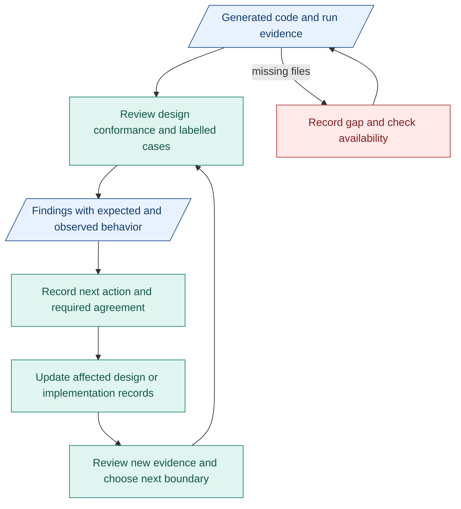

# My architecture plan toward M1

**Priority: evidence, verifier quality and implementation blockers.** Design is ready. Overall build quality remains unproven.

## SMART review targets

| When | My action | Result |
|---|---|---|
| Before next week's review | Receive four builds' code/logs. | Build/version inventory. Missing files listed. |
| Next week | Review both compiler verifiers in available full builds. | Criteria, reasons and gate findings with code/evidence links. |
| By next week's end | Prepare clear, unclear, conflicting and malformed cases per runnable full build. Review available results. | Expected/actual result, gate/evidence and assessment where applicable. Count wrong, blocked and unrun cases. |
| With each CC | Review inputs/outputs, checks and connections. | One connected case, remaining gaps listed. |
| Each progress review | Classify findings. Choose next work. | Next action and required agreement per issue. |

Unusable intent stops before Requirements. Four cases are a start, not quality proof. [Test details](../reference/compiler-verification.md#cases-and-evidence).

## Agreement needed

- Scope: people working on requirements/affected components.
- Interfaces/checks: people working on connected components/verification.
- Files/review timing: people working on the build/run.

Record decisions/evidence in existing issues/PRs and TASK records.

## Review and update flow

Blue: records. Teal: review/update work. Red: missing evidence.

## Risks and effort

- Missing code/logs: check availability early. List gaps.
- Wrong verifier: compare reasons/results with agreed expectations.
- Process overhead: fix blockers first. Keep AI CI small.

Most effort: verifiers and blockers. Next: [CC connections/RSI readiness](07-m1-capsules-and-rsi.md). Update affected design only. Delay alone changes planning, not required checks.
